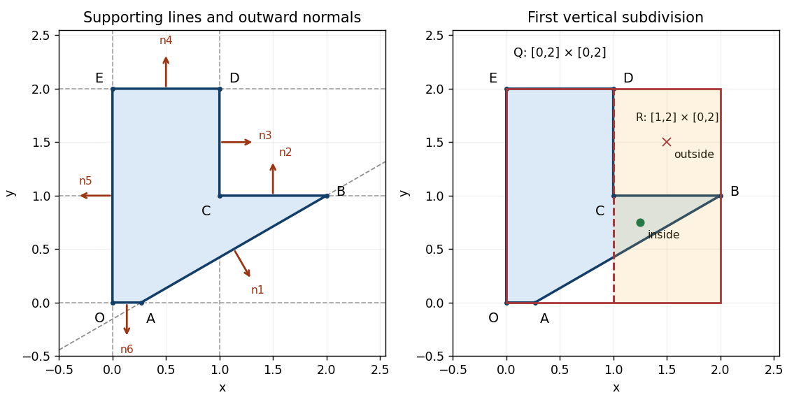
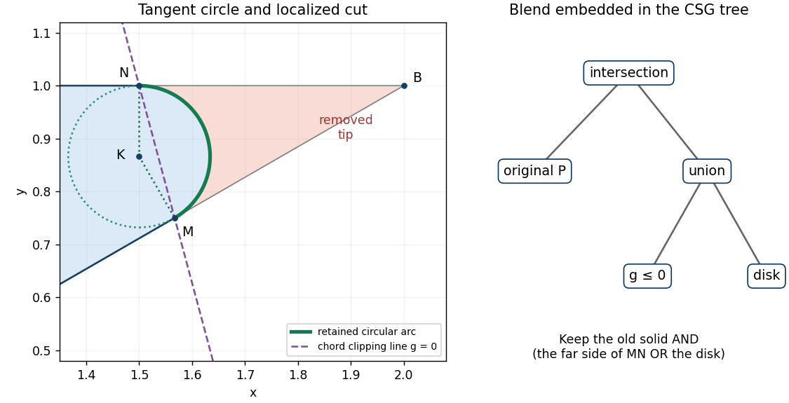
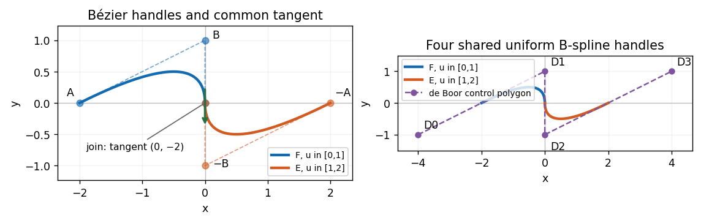
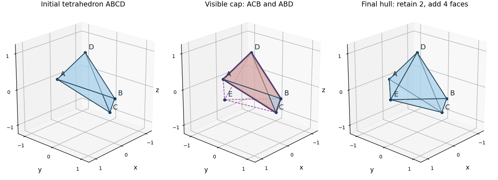

# Geometric modelling

↑ **Parent:** [2015](../2015.md)

Solutions to all three questions of the paper dated 10 June 2015. The [constructive solid geometry](../../computer-aided-geometric-design.md#constructive-solid-geometry) calculations use closed [half-spaces](../../geometry-and-topology.md#half-space) with nonpositive defining [functions](../../function.md) inside; the [B-spline](../../uniform-approximation.md#b-spline) calculations use unit-spaced simple [spline knots](../../uniform-approximation.md#spline-knot) and explicitly oriented parameters.[Cover and printed pp. 2–4, A12074W1](../../computer-science-bibliography.md#geometric-modelling-examination-paper-by-the-university-of-oxford-2015)

**Table of contents**

- [1](#1)
  - [a](#1/a)
    - [Solution](#1/a/solution)
  - [b](#1/b)
    - [Solution](#1/b/solution)
  - [c](#1/c)
    - [Solution](#1/c/solution)
  - [d](#1/d)
    - [Solution](#1/d/solution)
  - [e](#1/e)
    - [Solution](#1/e/solution)
  - [f](#1/f)
    - [Solution](#1/f/solution)
  - [g](#1/g)
    - [Solution](#1/g/solution)
- [2](#2)
  - [a](#2/a)
    - [Solution](#2/a/solution)
  - [b](#2/b)
    - [Solution](#2/b/solution)
  - [c](#2/c)
    - [Solution](#2/c/solution)
  - [d](#2/d)
    - [Solution](#2/d/solution)
  - [e](#2/e)
    - [Solution](#2/e/solution)
  - [f](#2/f)
    - [Solution](#2/f/solution)
  - [g](#2/g)
    - [Solution](#2/g/solution)
- [3](#3)
  - [a](#3/a)
    - [Solution](#3/a/solution)
  - [b](#3/b)
    - [Solution](#3/b/solution)
  - [c](#3/c)
    - [Solution](#3/c/solution)
  - [d](#3/d)
    - [Solution](#3/d/solution)
  - [e](#3/e)
    - [Solution](#3/e/solution)
  - [f](#3/f)
    - [Solution](#3/f/solution)
  - [g](#3/g)
    - [Solution](#3/g/solution)

## 1

↑ **Parent:** [Geometric modelling](geometric-modelling.md)

<h3 id="1/a">a</h3>

↑ **Parent:** [1](#1)

<h4 id="1/a/solution">Solution</h4>

↑ **Parent:** [A](#1/a)

Set $\Delta x=x_B-x_A$ and $\Delta y=y_B-y_A$. A displacement from $A$ lies along the [straight line](../../euclidean-geometry.md#straight-line) precisely when its two-dimensional [determinant](../../multilinear-algebra.md#determinant) with $(\Delta x,\Delta y)$ vanishes. Thus an [implicit equation](../../algebra.md#implicit-equation) is

$$
\boxed{\Delta y(x-x_A)-\Delta x(y-y_A)=0.}
$$

Equivalently, write $ax+by+c=0$, with $a=\Delta y$, $b=-\Delta x$ and $c=\Delta x\,y_A-\Delta y\,x_A$. The [vector](../../vector-space.md#vector) $(a,b)$ is a [normal vector](../../differential-geometry.md#normal-vector). The formula handles vertical and horizontal [straight lines](../../euclidean-geometry.md#straight-line) without division. It presupposes $A\ne B$: coincident [points](../../geometry-and-topology.md#point-geometry) do not determine a unique [straight line](../../euclidean-geometry.md#straight-line).

<h3 id="1/b">b</h3>

↑ **Parent:** [1](#1)

<h4 id="1/b/solution">Solution</h4>

↑ **Parent:** [B](#1/b)

Solving the [implicit equation](../../algebra.md#implicit-equation) for $y$ when $\Delta x\ne0$ gives

$$
y=y_A+\frac{\Delta y}{\Delta x}(x-x_A),\qquad
\boxed{m=\frac{y_B-y_A}{x_B-x_A}.}
$$

Here “gradient” means the [slope](../../euclidean-geometry.md#slope) $dy/dx$, rather than the [gradient](../../multivariable-calculus.md#gradient) $(a,b)$ of an implicit defining [function](../../function.md). If $\Delta x=0$ and $A\ne B$, the [straight line](../../euclidean-geometry.md#straight-line) is vertical and has no finite [slope](../../euclidean-geometry.md#slope). If $\Delta y=0$ and $\Delta x\ne0$, its [slope](../../euclidean-geometry.md#slope) is zero.

<h3 id="1/c">c</h3>

↑ **Parent:** [1](#1)

<h4 id="1/c/solution">Solution</h4>

↑ **Parent:** [C](#1/c)

For $ax+by+c=0$, substitute $y=0$ or $x=0$, respectively:

$$
\boxed{(x,0)=(-c/a,0)\quad(a\ne0),\qquad
(0,y)=(0,-c/b)\quad(b\ne0).}
$$

In terms of the original [coordinates](../../vector-space.md#coordinate-linear-algebra), these are

$$
\left(\frac{x_Ay_B-x_By_A}{y_B-y_A},0\right),\qquad
\left(0,\frac{x_Ay_B-x_By_A}{x_A-x_B}\right),
$$

with each expression used only when its denominator is nonzero. If $a=0$, the [straight line](../../euclidean-geometry.md#straight-line) is horizontal: it misses the horizontal axis unless $c=0$, in which case it is that entire axis. If $b=0$, it is vertical: it misses the vertical axis unless $c=0$, in which case it is that entire axis. A [straight line](../../euclidean-geometry.md#straight-line) through the origin has both finite intercepts equal to the origin whenever neither axis is coincident with it.

<h3 id="1/d">d</h3>

↑ **Parent:** [1](#1)

<h4 id="1/d/solution">Solution</h4>

↑ **Parent:** [D](#1/d)

Put $a_0=2-\sqrt3$ and define six closed [half-spaces](../../geometry-and-topology.md#half-space) $H_i=\{(x,y):f_i(x,y)\le0\}$. Their [implicit equations](../../algebra.md#implicit-equation) and outward [normal vectors](../../differential-geometry.md#normal-vector) are:

| Boundary | Defining function $f_i$ | Outward normal $\nabla f_i$ | $AB$ | $f_1=x-\sqrt3y-a_0$ | $(1,-\sqrt3)$ | $BC$ | $f_2=y-1$ | $(0,1)$ | $CD$ | $f_3=x-1$ | $(1,0)$ | $DE$ | $f_4=y-2$ | $(0,1)$ | $EO$ | $f_5=-x$ | $(-1,0)$ | $OA$ | $f_6=-y$ | $(0,-1)$ |
| --- | --- | --- | --- | --- | --- | --- | --- | --- | --- | --- | --- | --- | --- | --- | --- | --- | --- | --- | --- | --- |

The six [vertices of a polygon](../../euclidean-geometry.md#vertex-of-a-polygon) traverse the boundary counterclockwise. Each displayed [normal vector](../../differential-geometry.md#normal-vector) therefore points to the right of the corresponding directed boundary [line segment](../../convex-set.md#line-segment); it need not be a [unit vector](../../vector-space.md#unit-vector). The zero [level sets](../../topology.md#level-set) are full [straight lines](../../euclidean-geometry.md#straight-line), while the actual boundary retains only the appropriate [line segments](../../convex-set.md#line-segment).

The inward corner at $C$ prevents using the [set intersection](../../set.md#set-intersection) of all six [half-spaces](../../geometry-and-topology.md#half-space): that would incorrectly discard the upper-left part of the seat. Instead take

$$
\boxed{P=H_5\cap H_6\cap H_4\cap H_1\cap(H_2\cup H_3).}
$$

The last factor permits either $y\le1$ or $x\le1$, removing only the upper-right region. Another way to understand the same [constructive solid geometry](../../computer-aided-geometric-design.md#constructive-solid-geometry) model is as the [set union](../../set.md#set-union) of two [convex polygons](../../convex-set.md#convex-polygon), obtained by distributing the last [set intersection](../../set.md#set-intersection) over this [set union](../../set.md#set-union). Its [constructive solid geometry tree](../../computer-aided-geometric-design.md#constructive-solid-geometry-tree) has an intersection at the root and a union child for $H_2,H_3$.

**[Figure 1](#1/d/image-seat-profile-six-supporting-lines-with-outward-normals-and-the-right-child-of-the-initial-bounding-box). Seat profile, six supporting lines with outward normals, and the right child of the initial bounding box**.

<h3 id="1/e">e</h3>

↑ **Parent:** [1](#1)

<h4 id="1/e/solution">Solution</h4>

↑ **Parent:** [E](#1/e)

The tight [axis-aligned bounding box](../../computer-aided-geometric-design.md#axis-aligned-bounding-box) is $Q=[0,2]\times[0,2]$. Bisect vertically at $x=1$, giving a right child $R=[1,2]\times[0,2]$. For a scalar [implicit function](../../function.md#implicit-function) representing the same [constructive solid geometry](../../computer-aided-geometric-design.md#constructive-solid-geometry) solid, use

$$
\Phi=\max\{f_5,f_6,f_4,f_1,\min(f_2,f_3)\},\qquad P=\{\Phi\le0\}.
$$

With the convention $f_i\le0$ inside, [set intersection](../../set.md#set-intersection) corresponds to the [maximum](../../set.md#maximum-of-a-subset-of-a-total-order), and [set union](../../set.md#set-union) to the [minimum](../../set.md#minimum-of-a-subset-of-a-total-order). These operations encode membership; $\Phi$ is not a signed [distance function](../../topological-analysis.md#metric).

Since every $f_i$ is an [affine function](../../vector-space.md#affine-function), its extreme values on $R$ occur at corners. Exact real-arithmetic [interval arithmetic](../../numerical-analysis.md#interval-arithmetic) gives:

| Function | Range on $R$ | $f_1$ | $[-1-\sqrt3,\sqrt3]$ | $f_2$ | $[-1,1]$ | $f_3$ | $[0,1]$ | $f_4$ | $[-2,0]$ | $f_5$ | $[-2,-1]$ | $f_6$ | $[-2,0]$ | $\min(f_2,f_3)$, propagated | $[-1,1]$ | $\Phi$, propagated | $[-1,\sqrt3]$ |
| --- | --- | --- | --- | --- | --- | --- | --- | --- | --- | --- | --- | --- | --- | --- | --- | --- | --- |

Each leaf range is exact, but combining independent [intervals](../../real-analysis.md#interval-mathematics) forgets that the expressions share $x,y$. The final enclosure need not be the exact range of $\Phi$. For example, equality $\Phi=-1$ would require both $f_6\le-1$, hence $y\ge1$, and $\min(f_2,f_3)\le-1$, hence $y\le0$ on $R$, which is impossible. The enclosure is still sufficient for a reliable three-way decision:

$$
\boxed{\sup\Phi(R)<0:\ \text{inside};\quad
\inf\Phi(R)>0:\ \text{outside};\quad
0\in\Phi(R):\ \text{unresolved, so refine}.}
$$

Here the result is unresolved. This is a real mixed box, rather than only a pessimistic test: $(5/4,3/4)$ is strictly inside, whereas $(3/2,3/2)$ is outside. A zero endpoint alone can also mean contact with the boundary, so equality must not be treated as proof of strict interior or strict exterior. In [floating-point arithmetic](../../floating-point-arithmetic.md), certified bounds require [outward rounding](../../numerical-analysis.md#outward-rounding).

Continue splitting unresolved boxes, normally alternating axes or splitting the longest side. Propagate the [interval arithmetic](../../numerical-analysis.md#interval-arithmetic) results through the [constructive solid geometry tree](../../computer-aided-geometric-design.md#constructive-solid-geometry-tree), discard exterior boxes and stop refining strict interior boxes. In sufficiently small boundary boxes, locate crossings of the active [implicit equations](../../algebra.md#implicit-equation) with box edges and connect them into boundary [line segments](../../convex-set.md#line-segment). Retain corners and resolve ambiguous multiple crossings by further refinement; here every genuine boundary piece is straight, so its supporting [implicit equation](../../algebra.md#implicit-equation) allows exact intersection rather than a curved approximation. A maximum boundary-box diagonal $\varepsilon$ gives spatial localization at that scale, provided no boundary components are discarded; corner-sign sampling alone provides no such guarantee.

The tight box saves empty-space work, but it is awkward for extracting [facets](../../convex-set.md#facet). Entire boundary [line segments](../../convex-set.md#line-segment), notably $EO$, $OA$ and $DE$, lie on the initial box boundary, and $CD$ lies on the first splitting [straight line](../../euclidean-geometry.md#straight-line). A sign-change-only method may have no exterior sample on the other side and lose such pieces; exact zeros also persist through refinement. A slightly padded initial [axis-aligned bounding box](../../computer-aided-geometric-design.md#axis-aligned-bounding-box), together with an explicit rule for boundary-coincident pieces, makes the faceting more robust. The tight box is therefore economical for enclosure but not the best unqualified choice for a simple faceting implementation.

<h3 id="1/f">f</h3>

↑ **Parent:** [1](#1)

<h4 id="1/f/solution">Solution</h4>

↑ **Parent:** [F](#1/f)

Choose a circular [fillet](../../computer-aided-geometric-design.md#fillet) that removes the sharp convex tip at $B$. The unit directions from $B$ toward $A$ and $C$ are $(-\sqrt3/2,-1/2)$ and $(-1,0)$. Therefore the prescribed tangent [points](../../geometry-and-topology.md#point-geometry) are

$$
M=\left(2-\frac{\sqrt3}{4},\frac34\right),\qquad
N=\left(\frac32,1\right).
$$

The [circle](../../topology.md#circle) centre $K$ lies on the [normal line](../../differential-geometry.md#normal-line) to $BC$ through $N$, so $K=(3/2,k)$. Its radius to $M$ must be perpendicular to $AB$, whose [direction vector](../../euclidean-geometry.md#direction-vector) is $(\sqrt3,1)$. Thus

$$
(M-K)\cdot(\sqrt3,1)=0
\ \Longrightarrow\
\sqrt3\left(\frac12-\frac{\sqrt3}{4}\right)+\frac34-k=0
\ \Longrightarrow\ k=\frac{\sqrt3}{2}.
$$

Consequently

$$
\boxed{K=\left(\frac32,\frac{\sqrt3}{2}\right),\qquad
r=1-\frac{\sqrt3}{2}=\frac{2-\sqrt3}{2}.}
$$

Indeed $|M-K|=|N-K|=r$. The interior angle $ABC$ is $30^\circ$, and the same radius follows from $r=\tfrac12\tan15^\circ$. The selected [circular arc](../../topology.md#circular-arc) runs from $M$ to $N$ through angles $-60^\circ\le\theta\le90^\circ$ around $K$:

$$
\gamma(\theta)=K+r(\cos\theta,\sin\theta).
$$

The $150^\circ$ [circular arc](../../topology.md#circular-arc) facing $B$ is the rounding; the complementary arc is not part of the boundary.

Define the disk and a half-plane through the chord $MN$ by

$$
D_r=\left\{f_c\le0\right\},\quad
f_c=\left(x-\frac32\right)^2+\left(y-\frac{\sqrt3}{2}\right)^2-r^2,
$$

$$
H_g=\{g\le0\},\qquad
g=x-\frac32+(2-\sqrt3)(y-1).
$$

Both $M,N$ satisfy $g=0$, and $g(B)=1/2>0$. The clipping [half-space](../../geometry-and-topology.md#half-space) $H_g$ retains the part away from $B$, while the disk restores the rounded cap. The required local [constructive solid geometry tree](../../computer-aided-geometric-design.md#constructive-solid-geometry-tree) is

$$
\boxed{T_{\mathrm{blend}}=H_g\cup D_r,\qquad
P_{\mathrm{rounded}}=P\cap T_{\mathrm{blend}}.}
$$

Only the portion of $P$ on the $B$ side of $MN$ can be removed. To see the locality, $g$ is negative at every original [vertex of a polygon](../../euclidean-geometry.md#vertex-of-a-polygon) except $B$, and vanishes on the two adjacent sides exactly at $M,N$. In the resulting [triangle](../../euclidean-geometry.md#triangle) $BMN$, the disk keeps the curved cap next to $MN$ and discards the tip at $B$. A global [set intersection](../../set.md#set-intersection) with $D_r$ alone would destroy most of the seat. The outward [normal vector](../../differential-geometry.md#normal-vector) on the new boundary is $\nabla f_c=2((x,y)-K)$; at $M,N$ it has the same direction as the outward [normal vectors](../../differential-geometry.md#normal-vector) of $AB,BC$.

**[Figure 2](#1/f/image-circular-fillet-at-the-sharp-corner-tangent-radii-chord-clipping-line-and-local-union-subtree). Circular fillet at the sharp corner, tangent radii, chord clipping line, and local union subtree**.

The tangent constraints alone do not insist on a [circle](../../topology.md#circle); other [conic sections](../../euclidean-geometry.md#conic-section) can give different bulges. For example, a positive-weight [rational quadratic Bézier curve](../../computer-aided-geometric-design.md#rational-quadratic-bezier-curve) with handles $M,B,N$ has the required tangent directions:

$$
R_w(s)=\frac{(1-s)^2M+2ws(1-s)B+s^2N}{(1-s)^2+2ws(1-s)+s^2},\qquad 0\le s\le1,\quad w>0.
$$

Varying $w$ changes the bulge while fixing the tangent [points](../../geometry-and-topology.md#point-geometry); the circular choice has $w=\cos75^\circ$. Once a circular [fillet](../../computer-aided-geometric-design.md#fillet) and these two tangent [points](../../geometry-and-topology.md#point-geometry) are chosen, its centre and radius have no remaining freedom. The half-plane sign and arc selection are also essential: reversing them chooses a different retained region. This construction gives matching tangent directions, or first-order [geometric continuity](../../computer-aided-geometric-design.md#geometric-continuity), at $M,N$; the [curvature](../../differential-geometry.md#curvature) jumps from zero on each straight side to $1/r$ on the [circle](../../topology.md#circle).

<h3 id="1/g">g</h3>

↑ **Parent:** [1](#1)

<h4 id="1/g/solution">Solution</h4>

↑ **Parent:** [G](#1/g)

Insert the union subtree from part (f) as another child of the original intersection:

$$
\boxed{P_{\mathrm{rounded}}=
H_5\cap H_6\cap H_4\cap H_1\cap(H_2\cup H_3)\cap(H_g\cup D_r).}
$$

Thus the [constructive solid geometry tree](../../computer-aided-geometric-design.md#constructive-solid-geometry-tree) has one intersection root, four original [half-space](../../geometry-and-topology.md#half-space) leaves and two union children. The first union handles the inward corner at $C$; the second embeds the circular [fillet](../../computer-aided-geometric-design.md#fillet) at $B$. The [line segments](../../convex-set.md#line-segment) $AB$ and $BC$ now end at $M$ and start at $N$, with the chosen [circular arc](../../topology.md#circular-arc) between them. All other boundary [line segments](../../convex-set.md#line-segment) are retained.

## 2

↑ **Parent:** [Geometric modelling](geometric-modelling.md)

<h3 id="2/a">a</h3>

↑ **Parent:** [2](#2)

<h4 id="2/a/solution">Solution</h4>

↑ **Parent:** [A](#2/a)

For a fixed $t\in[0,1]$, [De Casteljau's algorithm](../../computer-aided-geometric-design.md#de-casteljau-s-algorithm) first takes the same fractional position along both adjacent sides of the [control polygon](../../computer-aided-geometric-design.md#control-polygon):

$$
L(t)=(1-t)A+tB=(-2+2t,t),\qquad
R(t)=(1-t)B+tC=(0,1-t).
$$

It then applies another [linear interpolation](../../function.md#linear-interpolation) with that same $t$:

$$
F(t)=(1-t)L(t)+tR(t)
=(1-t)^2A+2t(1-t)B+t^2C.
$$

This is the degree-two [Bernstein basis](../../functional-analysis.md#bernstein-basis) representation of a quadratic [Bézier curve](../../computer-aided-geometric-design.md#bezier-curve). Its [coordinate](../../vector-space.md#coordinate-linear-algebra) [polynomials](../../polynomial.md) are

$$
\boxed{F_x(t)=-2(1-t)^2=-2+4t-2t^2,\qquad
F_y(t)=2t(1-t)=2t-2t^2.}
$$

The degree is exactly two, since its second [derivative](../../calculus.md#derivative) $(-4,-4)$ is nonzero. As a check on the construction, at $t=1/2$ the two intermediate [points](../../geometry-and-topology.md#point-geometry) are $(-1,1/2)$ and $(0,1/2)$ and their [midpoint](../../convex-set.md#midpoint) is $F(1/2)=(-1/2,1/2)$.

<h3 id="2/b">b</h3>

↑ **Parent:** [2](#2)

<h4 id="2/b/solution">Solution</h4>

↑ **Parent:** [B](#2/b)

Three useful geometric properties, with their concrete consequences here, are:

- **Endpoint interpolation.** $F(0)=A=(-2,0)$ and $F(1)=C=(0,0)$. The middle [control point](../../computer-aided-geometric-design.md#control-point) $B$ is a handle, not an interpolated [point](../../geometry-and-topology.md#point-geometry): $F_y(t)\le1/2$, so the [curve](../../topology.md#curve) never reaches $B=(0,1)$.
- **Endpoint tangents.** $F'(0)=2(B-A)=(4,2)$ and $F'(1)=2(C-B)=(0,-2)$. Thus the [tangent lines](../../calculus.md#tangent-line) are parallel to the first and last sides of the [control polygon](../../computer-aided-geometric-design.md#control-polygon), respectively; both endpoint [derivatives](../../calculus.md#derivative) are nonzero.
- **Convex-hull containment.** The three [Bernstein basis](../../functional-analysis.md#bernstein-basis) weights are nonnegative and sum to one on $[0,1]$. Every $F(t)$ is therefore a [convex combination](../../convex-set.md#convex-combination) of $A,B,C$, so the entire [Bézier curve](../../computer-aided-geometric-design.md#bezier-curve) lies in their filled [triangle](../../euclidean-geometry.md#triangle).

These give the compact answer

$$
\boxed{\text{endpoint interpolation; control-edge endpoint tangents; convex-hull containment}.}
$$

The same sum-to-one calculation also explains [affine equivariance of a geometric basis](../../computer-aided-geometric-design.md#affine-equivariance-of-a-geometric-basis): applying an [affine map](../../geometry-and-topology.md#affine-map) to the handles applies that map to the [curve](../../topology.md#curve).

<h3 id="2/c">c</h3>

↑ **Parent:** [2](#2)

<h4 id="2/c/solution">Solution</h4>

↑ **Parent:** [C](#2/c)

Use a row of descending monomials $T(t)=[t^2\ t\ 1]$ and a [matrix](../../vector-space.md#matrix) with one [control point](../../computer-aided-geometric-design.md#control-point) per row. Expanding $(1-t)^2,2t(1-t),t^2$ gives their [coefficients](../../vector-space.md#coefficient) in the three columns of the basis [matrix](../../vector-space.md#matrix):

$$
M_B=\begin{pmatrix}1&-2&1\\-2&2&0\\1&0&0\end{pmatrix},\qquad
G_B=\begin{pmatrix}-2&0\\0&1\\0&0\end{pmatrix}.
$$

The [matrix multiplication](../../vector-space.md#matrix-multiplication) is

$$
\boxed{F(t)=T(t)M_BG_B
=[t^2\ t\ 1]\begin{pmatrix}-2&-2\\4&2\\-2&0\end{pmatrix}.}
$$

In particular, $T(t)M_B=[(1-t)^2\ 2t(1-t)\ t^2]$, so multiplying the geometric [matrix](../../vector-space.md#matrix) takes exactly the weighted [control point](../../computer-aided-geometric-design.md#control-point) sum in part (a). The two output entries are $F_x(t),F_y(t)$. The basis [matrix](../../vector-space.md#matrix) depends only on the degree and ordering convention; $G_B$ holds the particular geometry.

<h3 id="2/d">d</h3>

↑ **Parent:** [2](#2)

<h4 id="2/d/solution">Solution</h4>

↑ **Parent:** [D](#2/d)

Choose a quadratic uniform [B-spline](../../uniform-approximation.md#b-spline) segment on a unit [spline knot](../../uniform-approximation.md#spline-knot) interval. This choice is useful because adjacent pieces can later share [de Boor points](../../uniform-approximation.md#de-boor-point) at simple, equally spaced [spline knots](../../uniform-approximation.md#spline-knot). Its three active basis pieces on local $t\in[0,1]$ are

$$
b_0(t)=\frac{(1-t)^2}{2},\qquad
b_1(t)=\frac{1+2t-2t^2}{2},\qquad
b_2(t)=\frac{t^2}{2}.
$$

They follow from the [Cox-de Boor recurrence](../../uniform-approximation.md#cox-de-boor-recursion-formula) for degree two and consecutive integer [spline knots](../../uniform-approximation.md#spline-knot). If the three [de Boor points](../../uniform-approximation.md#de-boor-point) are $D_0,D_1,D_2$, then the equivalent [Bézier curve](../../computer-aided-geometric-design.md#bezier-curve) handles are

$$
A=\frac{D_0+D_1}{2},\qquad B=D_1,\qquad
C=\frac{D_1+D_2}{2}.
$$

One can verify this conversion simply by substituting these expressions into the [Bernstein basis](../../functional-analysis.md#bernstein-basis) formula and collecting each $D_i$. Solving gives

$$
\boxed{D_0=2A-B=(-4,-1),\qquad D_1=B=(0,1),\qquad D_2=2C-B=(0,-1).}
$$

The desired [matrix](../../vector-space.md#matrix) representation is therefore

$$
\boxed{F(t)=\frac12[t^2\ t\ 1]
\begin{pmatrix}1&-2&1\\-2&2&0\\1&1&0\end{pmatrix}
\begin{pmatrix}-4&-1\\0&1\\0&-1\end{pmatrix}.}
$$

The left row is again the monomial row, the middle [matrix](../../vector-space.md#matrix) contains the monomial [coefficients](../../vector-space.md#coefficient) of $b_0,b_1,b_2$, and the right [matrix](../../vector-space.md#matrix) lists the [de Boor points](../../uniform-approximation.md#de-boor-point). Unlike the [Bézier curve](../../computer-aided-geometric-design.md#bezier-curve) basis [matrix](../../vector-space.md#matrix), the constant row averages two handles. A clamped [B-spline](../../uniform-approximation.md#b-spline) with repeated end [spline knots](../../uniform-approximation.md#spline-knot) could instead reuse $A,B,C$ directly; the simple uniform convention above specifies which representation is being used and supplies the shared handles required for the extension.

<h3 id="2/e">e</h3>

↑ **Parent:** [2](#2)

<h4 id="2/e/solution">Solution</h4>

↑ **Parent:** [E](#2/e)

Rotating the geometry through $180^\circ$ sends every [point](../../geometry-and-topology.md#point-geometry) $p$ to $-p$. To start the extension at the origin, also reverse the parameter:

$$
E(t)=-F(1-t),\qquad
\boxed{E(t)=(2t^2,\,-2t+2t^2),\quad 0\le t\le1.}
$$

Then $E(0)=(0,0)=F(1)$ and $E(1)=(2,0)$. Merely using $-F(t)$ would trace the same rotated image toward the origin, instead of away from the join.

The reversed and rotated [de Boor points](../../uniform-approximation.md#de-boor-point) are $-D_2,-D_1,-D_0$, namely $(0,1),(0,-1),(4,1)$. The first two are already $D_1,D_2$, so there is only one new [de Boor point](../../uniform-approximation.md#de-boor-point), $\boxed{D_3=(4,1)}$. Using the same uniform basis [matrix](../../vector-space.md#matrix),

$$
\boxed{E(t)=\frac12[t^2\ t\ 1]
\begin{pmatrix}1&-2&1\\-2&2&0\\1&1&0\end{pmatrix}
\begin{pmatrix}0&1\\0&-1\\4&1\end{pmatrix}.}
$$

Equivalently, the [Bézier curve](../../computer-aided-geometric-design.md#bezier-curve) handles are $C=(0,0)$, $-B=(0,-1)$ and $-A=(2,0)$, which gives the same [polynomials](../../polynomial.md) immediately.

<h3 id="2/f">f</h3>

↑ **Parent:** [2](#2)

<h4 id="2/f/solution">Solution</h4>

↑ **Parent:** [F](#2/f)

Assign one unit parameter interval to each piece. Then

$$
\boxed{S(u)=\begin{cases}F(u),&0\le u\le1,\\E(u-1),&1\le u\le2.\end{cases}}
$$

There is no ambiguity at $u=1$, since both pieces give the origin. For a single [B-spline](../../uniform-approximation.md#b-spline) representation take degree two, the four [de Boor points](../../uniform-approximation.md#de-boor-point)

$$
(D_0,D_1,D_2,D_3)=((-4,-1),(0,1),(0,-1),(4,1))
$$

and the equally spaced [spline knot](../../uniform-approximation.md#spline-knot) vector $\tau=(-2,-1,0,1,2,3,4)$. With $N_{i,2}$ denoting the normalized degree-two [B-spline](../../uniform-approximation.md#b-spline) on this vector, the complete valid parameter interval is $[\tau_2,\tau_4]=[0,2]$ and

$$
S(u)=\sum_{i=0}^3D_iN_{i,2}(u).
$$

On $[0,1]$ the active handles are $D_0,D_1,D_2$, and on $[1,2]$ they are $D_1,D_2,D_3$. Shared handles and a simple interior [spline knot](../../uniform-approximation.md#spline-knot) are what merge the two pieces into one uniform [B-spline](../../uniform-approximation.md#b-spline). The exterior [spline knots](../../uniform-approximation.md#spline-knot) support the basis; they do not extend the interval being drawn.

In particular, the requested horizontal pieces and their vertical counterparts are

$$
\boxed{S_x(u)=\begin{cases}-2(1-u)^2,&0\le u\le1,\\2(u-1)^2,&1\le u\le2,\end{cases}\qquad
S_y(u)=\begin{cases}2u(1-u),&0\le u\le1,\\2(u-1)(u-2),&1\le u\le2.\end{cases}}
$$

**[Figure 3](#2/f/image-two-quadratic-pieces-their-bezier-handles-the-shared-uniform-b-spline-control-polygon-and-the-vertical-tangent-at-the-join). Two quadratic pieces, their Bézier handles, the shared uniform B-spline control polygon, and the vertical tangent at the join**.

<h3 id="2/g">g</h3>

↑ **Parent:** [2](#2)

<h4 id="2/g/solution">Solution</h4>

↑ **Parent:** [G](#2/g)

The join has matching positions and first [derivatives](../../calculus.md#derivative):

$$
F(1)=E(0)=(0,0),\qquad
F'(t)=(4-4t,2-4t),\qquad E'(t)=(4t,-2+4t),
$$

$$
\boxed{F'(1)=E'(0)=(0,-2)\ne(0,0).}
$$

Because both pieces have unit parameter intervals, these are also the one-sided [derivatives](../../calculus.md#derivative) of $S$ at $u=1$. Thus $S$ has first-order [parametric continuity](../../computer-aided-geometric-design.md#parametric-continuity), and hence first-order [geometric continuity](../../computer-aided-geometric-design.md#geometric-continuity), with no corner or cusp. Its nonzero tangent [vector](../../vector-space.md#vector) points vertically downward.

The second [derivatives](../../calculus.md#derivative) do not agree:

$$
F''(1)=(-4,-4),\qquad E''(0)=(4,4).
$$

So this is $C^1$ but not $C^2$ [parametric continuity](../../computer-aided-geometric-design.md#parametric-continuity). The signed planar [curvature](../../differential-geometry.md#curvature) $\kappa=(x'y''-y'x'')/(x'^2+y'^2)^{3/2}$ has one-sided values

$$
\kappa_F(1)=\frac{-8}{8}=-1,\qquad
\kappa_E(0)=\frac{8}{8}=1.
$$

The unsigned [curvatures](../../differential-geometry.md#curvature) agree, but the bending switches sides; there is no second-order [geometric continuity](../../computer-aided-geometric-design.md#geometric-continuity) through a regular orientation-preserving reparametrization. The join is a reversal of bending with a curvature jump, rather than a smooth zero-curvature inflection.

For the “gradient” compute $dy/dx=y'/x'$ away from the join:

$$
\frac{F_y'(t)}{F_x'(t)}=\frac{2-4t}{4-4t}\longrightarrow-\infty\quad(t\to1^-),\qquad
\frac{E_y'(t)}{E_x'(t)}=\frac{-2+4t}{4t}\longrightarrow-\infty\quad(t\to0^+).
$$

Hence

$$
\boxed{\text{no finite }dy/dx\text{ at the join; the tangent line is }x=0.}
$$

The zero horizontal [derivative](../../calculus.md#derivative) is not a stationary [point](../../geometry-and-topology.md#point-geometry) of the [parametric curve](../../topology.md#parametric-curve), since its vertical [derivative](../../calculus.md#derivative) is $-2$. It means that the locally regular [curve](../../topology.md#curve) has a vertical [tangent line](../../calculus.md#tangent-line) and cannot have a finite graph [derivative](../../calculus.md#derivative) as $y(x)$ there.

## 3

↑ **Parent:** [Geometric modelling](geometric-modelling.md)

<h3 id="3/a">a</h3>

↑ **Parent:** [3](#3)

<h4 id="3/a/solution">Solution</h4>

↑ **Parent:** [A](#3/a)

For solid modelling, a [polyhedron](../../euclidean-geometry.md#polyhedron) is a solid whose boundary consists of finitely many planar [polygons](../../euclidean-geometry.md#polygon), called faces, meeting along straight edges and at [vertices of a polyhedron](../../euclidean-geometry.md#vertex-of-a-polyhedron). A face is not merely a list of arbitrary spatial [points](../../geometry-and-topology.md#point-geometry): its boundary must lie in one [plane](../../geometry-and-topology.md#plane) and bound a valid planar region. The boundary is closed and consistently oriented so that inside and outside are defined.

For example, a [tetrahedron](../../euclidean-geometry.md#tetrahedron) has four triangular faces, six edges and four [vertices of a polyhedron](../../euclidean-geometry.md#vertex-of-a-polyhedron). A more general [polyhedron](../../euclidean-geometry.md#polyhedron) need not be [convex](../../real-analysis.md#convex-function) and can have handles or cavities. The concise definition is

$$
\boxed{\text{a solid enclosed by finitely many planar polygonal faces}.}
$$

<h3 id="3/b">b</h3>

↑ **Parent:** [3](#3)

<h4 id="3/b/solution">Solution</h4>

↑ **Parent:** [B](#3/b)

For an ordinary closed manifold [boundary representation](../../computer-aided-geometric-design.md#boundary-representation), three requirements are:

- **Valid embedded faces.** Each face is planar and bounded by simple closed edge loops with nonzero area; distinct face interiors do not cross, and faces meet only in their declared common edges or [vertices of a polyhedron](../../euclidean-geometry.md#vertex-of-a-polyhedron). A quadrilateral with four noncoplanar [vertices of a polyhedron](../../euclidean-geometry.md#vertex-of-a-polyhedron) is not one planar face; a bow-tie loop does not bound a simple face. Holes, when allowed, need separate correctly oriented loops.
- **Closed manifold incidence.** Exactly two faces meet at each edge, and the incident faces around each [vertex of a polyhedron](../../euclidean-geometry.md#vertex-of-a-polyhedron) form one cyclic fan. A single missing face leaves edges incident with only one face. Three faces sharing an edge, or two closed shells touching only at one [vertex of a polyhedron](../../euclidean-geometry.md#vertex-of-a-polyhedron), violate the local surface condition. The second example shows why the edge count alone is insufficient.
- **Consistent orientation.** Adjacent oriented faces traverse their common edge in opposite directions, giving compatible outward [normal vectors](../../differential-geometry.md#normal-vector). Reversing just one face of a [tetrahedron](../../euclidean-geometry.md#tetrahedron) breaks this condition. For a cavity, the material's outward [normal vector](../../differential-geometry.md#normal-vector) points into the cavity, so shell orientation must also respect which region is solid.

Together these support the answer

$$
\boxed{\text{embedded planar faces; closed manifold incidence; consistent outward orientation}.}
$$

For a connected orientable closed boundary of genus $g$, the [Euler characteristic](../../homology.md#euler-characteristic) provides an additional check, $V-E+F=2-2g$, when faces are disk-like. The familiar value $2$ applies to a sphere-like shell; it must not be imposed blindly on every [polyhedron](../../euclidean-geometry.md#polyhedron). Correct counts alone do not exclude intersections or invalid local incidence.

<h3 id="3/c">c</h3>

↑ **Parent:** [3](#3)

<h4 id="3/c/solution">Solution</h4>

↑ **Parent:** [C](#3/c)

A [boundary representation](../../computer-aided-geometric-design.md#boundary-representation) separates geometry, which supplies locations and supporting [planes](../../geometry-and-topology.md#plane), from topology, which specifies incidence and orientation. A practical [winged-edge data structure](../../computer-aided-geometric-design.md#winged-edge) uses three related record types:

- A [vertex of a polyhedron](../../euclidean-geometry.md#vertex-of-a-polyhedron) record holds its three [coordinates](../../vector-space.md#coordinate-linear-algebra) and a reference to one incident edge, sufficient to begin traversing the local fan.
- A face record holds its supporting [plane](../../geometry-and-topology.md#plane), an outward [normal vector](../../differential-geometry.md#normal-vector) or equivalent orientation, and a reference to a boundary edge. Faces with holes need one entry per boundary loop.
- An edge record holds its two endpoint [vertices of a polyhedron](../../euclidean-geometry.md#vertex-of-a-polyhedron), its left and right incident faces, and predecessor and successor edges around each of those faces: four “wing” references. “Left” and “right” refer to a chosen orientation of the edge and compatible face traversal conventions.

This explicitly stores adjacency rather than recovering it by searching all faces. A [half-edge data structure](../../computer-aided-geometric-design.md#doubly-connected-edge-list) expresses much the same information with two oppositely directed records per undirected edge: each has an origin [vertex of a polyhedron](../../euclidean-geometry.md#vertex-of-a-polyhedron), an incident face, its next boundary record and its opposite record; a previous record is often stored as well. The destination can be obtained from the opposite record's origin. This mesh record is distinct from a dangling [half-edge of a graph](../../random-graph.md#half-edge-of-a-graph).

The compact implementation answer is

$$
\boxed{\text{vertex geometry + oriented face loops + explicit edge/face/vertex incidence}.}
$$

There is deliberate redundancy: the same adjacency can be reached from both an edge and a face, a stored previous edge is recoverable by walking the loop, and a face [normal vector](../../differential-geometry.md#normal-vector) can be computed from its ordered noncollinear [vertices of a polyhedron](../../euclidean-geometry.md#vertex-of-a-polyhedron). These copies make neighbourhood queries and local edits cheap, and cached [plane](../../geometry-and-topology.md#plane) equations speed geometric tests. They impose consistency obligations: an edit must update reciprocal references, loops, orientations and affected geometric caches together. A [half-edge data structure](../../computer-aided-geometric-design.md#doubly-connected-edge-list) should share the undirected edge's geometry or keep its paired records synchronized.

<h3 id="3/d">d</h3>

↑ **Parent:** [3](#3)

<h4 id="3/d/solution">Solution</h4>

↑ **Parent:** [D](#3/d)

For a finite nonempty collection $X=\{p_1,\ldots,p_n\}\subset\mathbb R^3$, its [convex hull](../../convex-set.md#convex-hull) is the smallest [convex set](../../convex-set.md) containing all the [points](../../geometry-and-topology.md#point-geometry). Equivalently, it is the [set](../../set.md) of all [convex combinations](../../convex-set.md#convex-combination):

$$
\boxed{\operatorname{conv}X=
\left\{\sum_{i=1}^n\lambda_ip_i:\lambda_i\ge0,\ \sum_{i=1}^n\lambda_i=1\right\}.}
$$

Every [convex set](../../convex-set.md) containing the $p_i$ must contain these combinations; the displayed [set](../../set.md) is itself [convex](../../real-analysis.md#convex-function) and contains each $p_i$, proving the equivalence. For a full-dimensional finite collection this is a [convex polyhedron](../../euclidean-geometry.md#convex-polyhedron). A collinear or coplanar collection instead has a lower-dimensional [convex hull](../../convex-set.md#convex-hull), so the solid case needs a separate dimensionality assumption.

<h3 id="3/e">e</h3>

↑ **Parent:** [3](#3)

<h4 id="3/e/solution">Solution</h4>

↑ **Parent:** [E](#3/e)

Use the straightforward [incremental three-dimensional convex hull algorithm](../../convex-set.md#incremental-three-dimensional-convex-hull-algorithm). Assume distinct input [points](../../geometry-and-topology.md#point-geometry), at least four noncoplanar [points](../../geometry-and-topology.md#point-geometry), and general position with no four coplanar. Use exact orientation decisions, or robust predicates that certify the same signs. These assumptions avoid the separate bookkeeping for flat faces, points on the boundary and lower-dimensional initial data.

1. Select four [points](../../geometry-and-topology.md#point-geometry) forming a nondegenerate [tetrahedron](../../euclidean-geometry.md#tetrahedron). Store its four triangular faces with outward [normal vectors](../../differential-geometry.md#normal-vector) and consistent adjacency.
1. For the next [point](../../geometry-and-topology.md#point-geometry) $p$, evaluate every current oriented face $f=(a,b,c)$ using$$
   \sigma_f(p)=((b-a)\times(c-a))\cdot(p-a).
   $$

   The current hull lies in $\sigma_f\le0$. Thus a face is visible from $p$ exactly when $\sigma_f(p)>0$.
1. If no face is visible, discard $p$: it lies in the current [convex hull](../../convex-set.md#convex-hull). Otherwise identify the [horizon of a convex polyhedron](../../euclidean-geometry.md#horizon-of-a-convex-polyhedron) seen from $p$, namely the edges incident with exactly one visible and one retained face.
1. Delete the visible faces and cone the ordered [horizon of a convex polyhedron](../../euclidean-geometry.md#horizon-of-a-convex-polyhedron) to $p$, adding one [triangle](../../euclidean-geometry.md#triangle) per horizon edge. Orient each new face consistently outward and continue with the next [point](../../geometry-and-topology.md#point-geometry).

The [determinant](../../multilinear-algebra.md#determinant) $\sigma_f$ is six times the oriented volume of the [tetrahedron](../../euclidean-geometry.md#tetrahedron) $abcp$; only its sign matters. A zero value needs a declared degeneracy policy if the general-position assumption is relaxed.

The [data structure](../../data-structure.md) update is a separate local operation. Mark visible faces and walk their adjacency to collect the horizon cycle before deleting anything. Remove edges with two visible incident faces; retain horizon edges and their retained-face links. Insert a [vertex of a polyhedron](../../euclidean-geometry.md#vertex-of-a-polyhedron) record for $p$ and a new edge from $p$ to each horizon [vertex of a polyhedron](../../euclidean-geometry.md#vertex-of-a-polyhedron). Add one face per horizon edge, connect its other two edges to its neighbours in the cone, and replace the deleted face reference on each horizon edge. Restore the cyclic boundary references and each retained [vertex of a polyhedron](../../euclidean-geometry.md#vertex-of-a-polyhedron)'s incident-edge reference; remove any old [vertices of a polyhedron](../../euclidean-geometry.md#vertex-of-a-polyhedron) left without incident faces.

For an outward visible face with boundary edge $a\to b$ on the horizon, the new outward face can be ordered $(a,b,p)$. Its retained neighbour already traverses that edge as $b\to a$. As an independent orientation check, an interior [point](../../geometry-and-topology.md#point-geometry) of the old hull must evaluate negatively against the new face.

The correctness step is geometric: the nonvisible part of a [convex polyhedron](../../euclidean-geometry.md#convex-polyhedron) remains supporting, while sight lines from $p$ to the horizon create precisely the new supporting faces. Replacing the visible cap by its cone therefore gives

$$
\boxed{H_{i+1}=\operatorname{conv}(H_i\cup\{p\}).}
$$

Induction from the initial [tetrahedron](../../euclidean-geometry.md#tetrahedron) yields the [convex hull](../../convex-set.md#convex-hull) of all input [points](../../geometry-and-topology.md#point-geometry).

<h3 id="3/f">f</h3>

↑ **Parent:** [3](#3)

<h4 id="3/f/solution">Solution</h4>

↑ **Parent:** [F](#3/f)

With $i$ processed [points](../../geometry-and-topology.md#point-geometry), a triangulated three-dimensional [convex hull](../../convex-set.md#convex-hull) has $O(i)$ faces and edges. For a sphere-like triangular boundary, the [Euler characteristic](../../homology.md#euler-characteristic) and $3F=2E$ give $F=2V-4$ and $E=3V-6$, with $V\le i$. The complete face scan, horizon construction and adjacency update in the implementation of part (e) therefore cost $O(i)$ per insertion. Consequently,

$$
\boxed{T(n)=O\!\left(\sum_{i=4}^{n-1}i\right)=O(n^2),\qquad\text{working storage }O(n).}
$$

The quadratic worst case really occurs for this implementation. Choose all input [points](../../geometry-and-topology.md#point-geometry) in strictly [convex](../../real-analysis.md#convex-function) position, for example distinct [points](../../geometry-and-topology.md#point-geometry) $(t,t^2,t^3)$ on the three-dimensional [moment curve](../../fourier-analysis.md#moment-curve). Each processed [point](../../geometry-and-topology.md#point-geometry) remains a hull [vertex of a polyhedron](../../euclidean-geometry.md#vertex-of-a-polyhedron), so the hull has $2i-4$ triangular faces after $i$ insertions. Scanning every face at every next insertion takes $\Theta(n^2)$ sign tests. This argument does not require every insertion to delete most faces: the repeated global scans already force the bound. More elaborate [convex hull](../../convex-set.md#convex-hull) algorithms with different search machinery are not the implementation being analysed here.

<h3 id="3/g">g</h3>

↑ **Parent:** [3](#3)

<h4 id="3/g/solution">Solution</h4>

↑ **Parent:** [G](#3/g)

Insert the [points](../../geometry-and-topology.md#point-geometry) in their given order, starting from $ABCD$. Use outward face orientation and regard $f\le0$ as the interior side. The initial [tetrahedron](../../euclidean-geometry.md#tetrahedron) is nondegenerate because

$$
((B-A)\times(C-A))\cdot(D-A)=(-2,0,2)\cdot(0,1,1)=2\ne0.
$$

Thus its volume is $|2|/6=1/3$. The following table gives consistently oriented faces, conveniently scaled [plane](../../geometry-and-topology.md#plane) equations, and the omitted old [vertex of a polyhedron](../../euclidean-geometry.md#vertex-of-a-polyhedron) test:

| Face order | Interior inequality | Value at the opposite vertex | $ACB$ | $x-z\le0$ | $f(D)=-1$ | $ABD$ | $x\le0$ | $f(C)=-1$ | $ADC$ | $-2x-y+z-1\le0$ | $f(B)=-2$ | $BCD$ | $-2x+y+z-1\le0$ | $f(A)=-2$ |
| --- | --- | --- | --- | --- | --- | --- | --- | --- | --- | --- | --- | --- | --- | --- |

Every opposite [vertex of a polyhedron](../../euclidean-geometry.md#vertex-of-a-polyhedron) is strictly on the interior side, so these orientations are correct. The intersection of these four [half-spaces](../../geometry-and-topology.md#half-space) is exactly the initial [tetrahedron](../../euclidean-geometry.md#tetrahedron).

Now test $E=(1,0,0)$. In the same row order the face expressions give

$$
\boxed{(f_{ACB}(E),f_{ABD}(E),f_{ADC}(E),f_{BCD}(E))=(1,1,-3,-3).}
$$

Therefore $ACB$ and $ABD$ are visible and must be removed; $ADC$ and $BCD$ are retained. The common edge $AB$ lies inside the deleted patch and is removed. The directed horizon is

$$
A\longrightarrow C\longrightarrow B\longrightarrow D\longrightarrow A.
$$

Cone this cycle to $E$, giving outward face orders $ACE,CBE,BDE,DAE$. Their equations and tests of the two old [vertices of a polyhedron](../../euclidean-geometry.md#vertex-of-a-polyhedron) not belonging to each face are:

| New face | Interior inequality | Tests of the other vertices | $ACE$ | $x-y-2z-1\le0$ | $f(B)=-2,\ f(D)=-3$ | $CBE$ | $x+y-2z-1\le0$ | $f(A)=-2,\ f(D)=-3$ | $BDE$ | $x+y+z-1\le0$ | $f(A)=-2,\ f(C)=-3$ | $DAE$ | $x-y+z-1\le0$ | $f(B)=-2,\ f(C)=-3$ |
| --- | --- | --- | --- | --- | --- | --- | --- | --- | --- | --- | --- | --- | --- | --- |

Each new [plane](../../geometry-and-topology.md#plane) contains its three named [vertices of a polyhedron](../../euclidean-geometry.md#vertex-of-a-polyhedron) and has all remaining input [points](../../geometry-and-topology.md#point-geometry) strictly on the interior side. Together with the two retained [half-spaces](../../geometry-and-topology.md#half-space), these six supporting inequalities describe the final [convex hull](../../convex-set.md#convex-hull):

$$
\boxed{\begin{gathered}
-2x-y+z-1\le0,\quad -2x+y+z-1\le0,\\
x-y-2z-1\le0,\quad x+y-2z-1\le0,\\
x+y+z-1\le0,\quad x-y+z-1\le0.
\end{gathered}}
$$

Equivalently assemble the closed oriented boundary from $ADC,BCD,ACE,CBE,BDE,DAE$, with adjacent face loops traversing shared edges in opposite directions. It is a triangular [bipyramid](../../euclidean-geometry.md#bipyramid) with base [triangle](../../euclidean-geometry.md#triangle) $CDE$ and apices $A,B$; $CDE$ is internal, so it is not a boundary face. There are five [vertices of a polyhedron](../../euclidean-geometry.md#vertex-of-a-polyhedron), nine edges and six faces, giving the check $5-9+6=2$. The initial [tetrahedron](../../euclidean-geometry.md#tetrahedron) similarly has $4-6+4=2$.

**[Figure 4](#3/g/image-initial-tetrahedron-the-two-faces-visible-from-e-and-their-horizon-and-the-final-six-face-convex-hull). Initial tetrahedron, the two faces visible from E and their horizon, and the final six-face convex hull**.

## ↑ Ancestors (8)

1. [2015](../2015.md)
2. [Past exam of the computer science course of the University of Oxford](../../past-exam-of-the-computer-science-course-of-the-university-of-oxford.md)
3. [Computer science course of the University of Oxford](../../university-of-oxford.md#computer-science-course-of-the-university-of-oxford)
4. [Undergraduate course of the University of Oxford](../../university-of-oxford.md#undergraduate-course-of-the-university-of-oxford)
5. [Course of the University of Oxford](../../university-of-oxford.md#course-of-the-university-of-oxford)
6. [University of Oxford](../../university-of-oxford.md)
7. [List of universities](../../README.md#list-of-universities)
8. [Codex Wiki](../../README.md)
