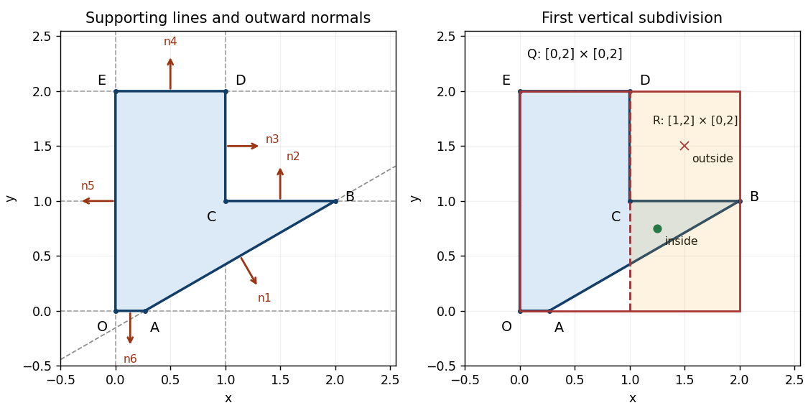

<h1 id="1/d/solution">Solution</h1>

↑ **Parent:** [D](../d.md)

Put $a_0=2-\sqrt3$ and define six closed [half-spaces](../../../../../half-space.md) $H_i=\{(x,y):f_i(x,y)\le0\}$. Their [implicit equations](../../../../../implicit-equation.md) and outward [normal vectors](../../../../../normal-vector.md) are:

| Boundary | Defining function $f_i$ | Outward normal $\nabla f_i$ | $AB$ | $f_1=x-\sqrt3y-a_0$ | $(1,-\sqrt3)$ | $BC$ | $f_2=y-1$ | $(0,1)$ | $CD$ | $f_3=x-1$ | $(1,0)$ | $DE$ | $f_4=y-2$ | $(0,1)$ | $EO$ | $f_5=-x$ | $(-1,0)$ | $OA$ | $f_6=-y$ | $(0,-1)$ |
| --- | --- | --- | --- | --- | --- | --- | --- | --- | --- | --- | --- | --- | --- | --- | --- | --- | --- | --- | --- | --- |

The six [vertices of a polygon](../../../../../vertex-of-a-polygon.md) traverse the boundary counterclockwise. Each displayed [normal vector](../../../../../normal-vector.md) therefore points to the right of the corresponding directed boundary [line segment](../../../../../line-segment.md); it need not be a [unit vector](../../../../../unit-vector.md). The zero [level sets](../../../../../level-set.md) are full [straight lines](../../../../../straight-line.md), while the actual boundary retains only the appropriate [line segments](../../../../../line-segment.md).

The inward corner at $C$ prevents using the [set intersection](../../../../../set-intersection.md) of all six [half-spaces](../../../../../half-space.md): that would incorrectly discard the upper-left part of the seat. Instead take

$$
\boxed{P=H_5\cap H_6\cap H_4\cap H_1\cap(H_2\cup H_3).}
$$

The last factor permits either $y\le1$ or $x\le1$, removing only the upper-right region. Another way to understand the same [constructive solid geometry](../../../../../constructive-solid-geometry.md) model is as the [set union](../../../../../set-union.md) of two [convex polygons](../../../../../convex-polygon.md), obtained by distributing the last [set intersection](../../../../../set-intersection.md) over this [set union](../../../../../set-union.md). Its [constructive solid geometry tree](../../../../../constructive-solid-geometry-tree.md) has an intersection at the root and a union child for $H_2,H_3$.

**[Figure 1](#1/d/image-seat-profile-six-supporting-lines-with-outward-normals-and-the-right-child-of-the-initial-bounding-box). Seat profile, six supporting lines with outward normals, and the right child of the initial bounding box**.

## ↑ Ancestors (11)

1. [D](../d.md)
2. [1](../../1.md)
3. [Geometric modelling](../../../geometric-modelling-split.md)
4. [2015](../../../split.md)
5. [Past exam of the computer science course of the University of Oxford](../../../../split.md)
6. [Computer science course of the University of Oxford](../../../../../computer-science-course-of-the-university-of-oxford.md)
7. [Undergraduate course of the University of Oxford](../../../../../undergraduate-course-of-the-university-of-oxford.md)
8. [Course of the University of Oxford](../../../../../course-of-the-university-of-oxford.md)
9. [University of Oxford](../../../../../university-of-oxford-split.md)
10. [List of universities](../../../../../list-of-universities.md)
11. [Codex Wiki](../../../../../split.md)
