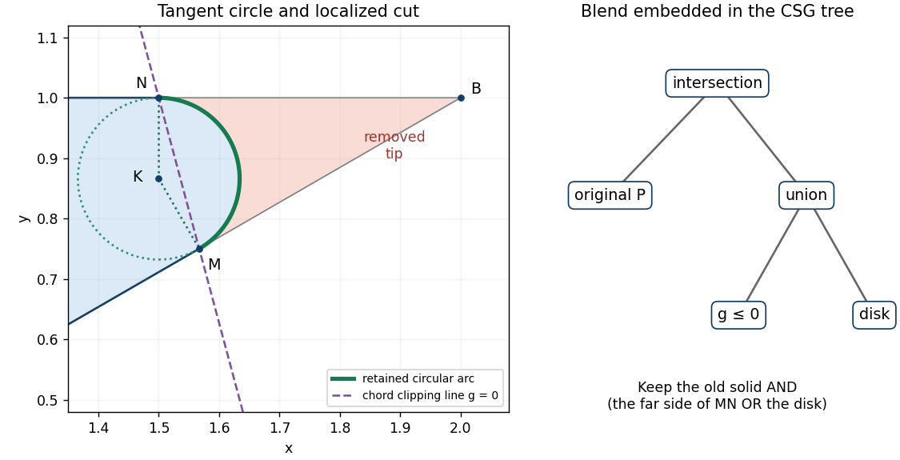

<h1 id="1/f/solution">Solution</h1>

↑ **Parent:** [F](../f.md)

Choose a circular [fillet](../../../../../fillet.md) that removes the sharp convex tip at $B$. The unit directions from $B$ toward $A$ and $C$ are $(-\sqrt3/2,-1/2)$ and $(-1,0)$. Therefore the prescribed tangent [points](../../../../../point-geometry.md) are

$$
M=\left(2-\frac{\sqrt3}{4},\frac34\right),\qquad
N=\left(\frac32,1\right).
$$

The [circle](../../../../../circle.md) centre $K$ lies on the [normal line](../../../../../normal-line.md) to $BC$ through $N$, so $K=(3/2,k)$. Its radius to $M$ must be perpendicular to $AB$, whose [direction vector](../../../../../direction-vector.md) is $(\sqrt3,1)$. Thus

$$
(M-K)\cdot(\sqrt3,1)=0
\ \Longrightarrow\
\sqrt3\left(\frac12-\frac{\sqrt3}{4}\right)+\frac34-k=0
\ \Longrightarrow\ k=\frac{\sqrt3}{2}.
$$

Consequently

$$
\boxed{K=\left(\frac32,\frac{\sqrt3}{2}\right),\qquad
r=1-\frac{\sqrt3}{2}=\frac{2-\sqrt3}{2}.}
$$

Indeed $|M-K|=|N-K|=r$. The interior angle $ABC$ is $30^\circ$, and the same radius follows from $r=\tfrac12\tan15^\circ$. The selected [circular arc](../../../../../circular-arc.md) runs from $M$ to $N$ through angles $-60^\circ\le\theta\le90^\circ$ around $K$:

$$
\gamma(\theta)=K+r(\cos\theta,\sin\theta).
$$

The $150^\circ$ [circular arc](../../../../../circular-arc.md) facing $B$ is the rounding; the complementary arc is not part of the boundary.

Define the disk and a half-plane through the chord $MN$ by

$$
D_r=\left\{f_c\le0\right\},\quad
f_c=\left(x-\frac32\right)^2+\left(y-\frac{\sqrt3}{2}\right)^2-r^2,
$$

$$
H_g=\{g\le0\},\qquad
g=x-\frac32+(2-\sqrt3)(y-1).
$$

Both $M,N$ satisfy $g=0$, and $g(B)=1/2>0$. The clipping [half-space](../../../../../half-space.md) $H_g$ retains the part away from $B$, while the disk restores the rounded cap. The required local [constructive solid geometry tree](../../../../../constructive-solid-geometry-tree.md) is

$$
\boxed{T_{\mathrm{blend}}=H_g\cup D_r,\qquad
P_{\mathrm{rounded}}=P\cap T_{\mathrm{blend}}.}
$$

Only the portion of $P$ on the $B$ side of $MN$ can be removed. To see the locality, $g$ is negative at every original [vertex of a polygon](../../../../../vertex-of-a-polygon.md) except $B$, and vanishes on the two adjacent sides exactly at $M,N$. In the resulting [triangle](../../../../../triangle.md) $BMN$, the disk keeps the curved cap next to $MN$ and discards the tip at $B$. A global [set intersection](../../../../../set-intersection.md) with $D_r$ alone would destroy most of the seat. The outward [normal vector](../../../../../normal-vector.md) on the new boundary is $\nabla f_c=2((x,y)-K)$; at $M,N$ it has the same direction as the outward [normal vectors](../../../../../normal-vector.md) of $AB,BC$.

**[Figure 2](#1/f/image-circular-fillet-at-the-sharp-corner-tangent-radii-chord-clipping-line-and-local-union-subtree). Circular fillet at the sharp corner, tangent radii, chord clipping line, and local union subtree**.

The tangent constraints alone do not insist on a [circle](../../../../../circle.md); other [conic sections](../../../../../conic-section.md) can give different bulges. For example, a positive-weight [rational quadratic Bézier curve](../../../../../rational-quadratic-bezier-curve.md) with handles $M,B,N$ has the required tangent directions:

$$
R_w(s)=\frac{(1-s)^2M+2ws(1-s)B+s^2N}{(1-s)^2+2ws(1-s)+s^2},\qquad 0\le s\le1,\quad w>0.
$$

Varying $w$ changes the bulge while fixing the tangent [points](../../../../../point-geometry.md); the circular choice has $w=\cos75^\circ$. Once a circular [fillet](../../../../../fillet.md) and these two tangent [points](../../../../../point-geometry.md) are chosen, its centre and radius have no remaining freedom. The half-plane sign and arc selection are also essential: reversing them chooses a different retained region. This construction gives matching tangent directions, or first-order [geometric continuity](../../../../../geometric-continuity.md), at $M,N$; the [curvature](../../../../../curvature.md) jumps from zero on each straight side to $1/r$ on the [circle](../../../../../circle.md).

## ↑ Ancestors (11)

1. [F](../f.md)
2. [1](../../1.md)
3. [Geometric modelling](../../../geometric-modelling-split.md)
4. [2015](../../../split.md)
5. [Past exam of the computer science course of the University of Oxford](../../../../split.md)
6. [Computer science course of the University of Oxford](../../../../../computer-science-course-of-the-university-of-oxford.md)
7. [Undergraduate course of the University of Oxford](../../../../../undergraduate-course-of-the-university-of-oxford.md)
8. [Course of the University of Oxford](../../../../../course-of-the-university-of-oxford.md)
9. [University of Oxford](../../../../../university-of-oxford-split.md)
10. [List of universities](../../../../../list-of-universities.md)
11. [Codex Wiki](../../../../../split.md)
