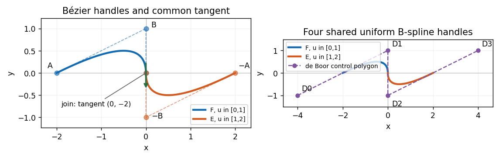

<h1 id="2/f/solution">Solution</h1>

↑ **Parent:** [F](../f.md)

Assign one unit parameter interval to each piece. Then

$$
\boxed{S(u)=\begin{cases}F(u),&0\le u\le1,\\E(u-1),&1\le u\le2.\end{cases}}
$$

There is no ambiguity at $u=1$, since both pieces give the origin. For a single [B-spline](../../../../../b-spline.md) representation take degree two, the four [de Boor points](../../../../../de-boor-point.md)

$$
(D_0,D_1,D_2,D_3)=((-4,-1),(0,1),(0,-1),(4,1))
$$

and the equally spaced [spline knot](../../../../../spline-knot.md) vector $\tau=(-2,-1,0,1,2,3,4)$. With $N_{i,2}$ denoting the normalized degree-two [B-spline](../../../../../b-spline.md) on this vector, the complete valid parameter interval is $[\tau_2,\tau_4]=[0,2]$ and

$$
S(u)=\sum_{i=0}^3D_iN_{i,2}(u).
$$

On $[0,1]$ the active handles are $D_0,D_1,D_2$, and on $[1,2]$ they are $D_1,D_2,D_3$. Shared handles and a simple interior [spline knot](../../../../../spline-knot.md) are what merge the two pieces into one uniform [B-spline](../../../../../b-spline.md). The exterior [spline knots](../../../../../spline-knot.md) support the basis; they do not extend the interval being drawn.

In particular, the requested horizontal pieces and their vertical counterparts are

$$
\boxed{S_x(u)=\begin{cases}-2(1-u)^2,&0\le u\le1,\\2(u-1)^2,&1\le u\le2,\end{cases}\qquad
S_y(u)=\begin{cases}2u(1-u),&0\le u\le1,\\2(u-1)(u-2),&1\le u\le2.\end{cases}}
$$

**[Figure 3](#2/f/image-two-quadratic-pieces-their-bezier-handles-the-shared-uniform-b-spline-control-polygon-and-the-vertical-tangent-at-the-join). Two quadratic pieces, their Bézier handles, the shared uniform B-spline control polygon, and the vertical tangent at the join**.

## ↑ Ancestors (11)

1. [F](../f.md)
2. [2](../../2.md)
3. [Geometric modelling](../../../geometric-modelling-split.md)
4. [2015](../../../split.md)
5. [Past exam of the computer science course of the University of Oxford](../../../../split.md)
6. [Computer science course of the University of Oxford](../../../../../computer-science-course-of-the-university-of-oxford.md)
7. [Undergraduate course of the University of Oxford](../../../../../undergraduate-course-of-the-university-of-oxford.md)
8. [Course of the University of Oxford](../../../../../course-of-the-university-of-oxford.md)
9. [University of Oxford](../../../../../university-of-oxford-split.md)
10. [List of universities](../../../../../list-of-universities.md)
11. [Codex Wiki](../../../../../split.md)
