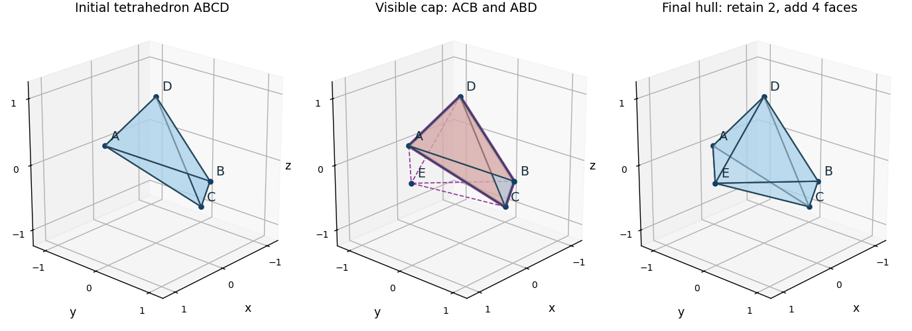

<h1 id="3/g/solution">Solution</h1>

↑ **Parent:** [G](../g.md)

Insert the [points](../../../../../point-geometry.md) in their given order, starting from $ABCD$. Use outward face orientation and regard $f\le0$ as the interior side. The initial [tetrahedron](../../../../../tetrahedron.md) is nondegenerate because

$$
((B-A)\times(C-A))\cdot(D-A)=(-2,0,2)\cdot(0,1,1)=2\ne0.
$$

Thus its volume is $|2|/6=1/3$. The following table gives consistently oriented faces, conveniently scaled [plane](../../../../../plane.md) equations, and the omitted old [vertex of a polyhedron](../../../../../vertex-of-a-polyhedron.md) test:

| Face order | Interior inequality | Value at the opposite vertex | $ACB$ | $x-z\le0$ | $f(D)=-1$ | $ABD$ | $x\le0$ | $f(C)=-1$ | $ADC$ | $-2x-y+z-1\le0$ | $f(B)=-2$ | $BCD$ | $-2x+y+z-1\le0$ | $f(A)=-2$ |
| --- | --- | --- | --- | --- | --- | --- | --- | --- | --- | --- | --- | --- | --- | --- |

Every opposite [vertex of a polyhedron](../../../../../vertex-of-a-polyhedron.md) is strictly on the interior side, so these orientations are correct. The intersection of these four [half-spaces](../../../../../half-space.md) is exactly the initial [tetrahedron](../../../../../tetrahedron.md).

Now test $E=(1,0,0)$. In the same row order the face expressions give

$$
\boxed{(f_{ACB}(E),f_{ABD}(E),f_{ADC}(E),f_{BCD}(E))=(1,1,-3,-3).}
$$

Therefore $ACB$ and $ABD$ are visible and must be removed; $ADC$ and $BCD$ are retained. The common edge $AB$ lies inside the deleted patch and is removed. The directed horizon is

$$
A\longrightarrow C\longrightarrow B\longrightarrow D\longrightarrow A.
$$

Cone this cycle to $E$, giving outward face orders $ACE,CBE,BDE,DAE$. Their equations and tests of the two old [vertices of a polyhedron](../../../../../vertex-of-a-polyhedron.md) not belonging to each face are:

| New face | Interior inequality | Tests of the other vertices | $ACE$ | $x-y-2z-1\le0$ | $f(B)=-2,\ f(D)=-3$ | $CBE$ | $x+y-2z-1\le0$ | $f(A)=-2,\ f(D)=-3$ | $BDE$ | $x+y+z-1\le0$ | $f(A)=-2,\ f(C)=-3$ | $DAE$ | $x-y+z-1\le0$ | $f(B)=-2,\ f(C)=-3$ |
| --- | --- | --- | --- | --- | --- | --- | --- | --- | --- | --- | --- | --- | --- | --- |

Each new [plane](../../../../../plane.md) contains its three named [vertices of a polyhedron](../../../../../vertex-of-a-polyhedron.md) and has all remaining input [points](../../../../../point-geometry.md) strictly on the interior side. Together with the two retained [half-spaces](../../../../../half-space.md), these six supporting inequalities describe the final [convex hull](../../../../../convex-hull.md):

$$
\boxed{\begin{gathered}
-2x-y+z-1\le0,\quad -2x+y+z-1\le0,\\
x-y-2z-1\le0,\quad x+y-2z-1\le0,\\
x+y+z-1\le0,\quad x-y+z-1\le0.
\end{gathered}}
$$

Equivalently assemble the closed oriented boundary from $ADC,BCD,ACE,CBE,BDE,DAE$, with adjacent face loops traversing shared edges in opposite directions. It is a triangular [bipyramid](../../../../../bipyramid.md) with base [triangle](../../../../../triangle.md) $CDE$ and apices $A,B$; $CDE$ is internal, so it is not a boundary face. There are five [vertices of a polyhedron](../../../../../vertex-of-a-polyhedron.md), nine edges and six faces, giving the check $5-9+6=2$. The initial [tetrahedron](../../../../../tetrahedron.md) similarly has $4-6+4=2$.

**[Figure 4](#3/g/image-initial-tetrahedron-the-two-faces-visible-from-e-and-their-horizon-and-the-final-six-face-convex-hull). Initial tetrahedron, the two faces visible from E and their horizon, and the final six-face convex hull**.

## ↑ Ancestors (11)

1. [G](../g.md)
2. [3](../../3.md)
3. [Geometric modelling](../../../geometric-modelling-split.md)
4. [2015](../../../split.md)
5. [Past exam of the computer science course of the University of Oxford](../../../../split.md)
6. [Computer science course of the University of Oxford](../../../../../computer-science-course-of-the-university-of-oxford.md)
7. [Undergraduate course of the University of Oxford](../../../../../undergraduate-course-of-the-university-of-oxford.md)
8. [Course of the University of Oxford](../../../../../course-of-the-university-of-oxford.md)
9. [University of Oxford](../../../../../university-of-oxford-split.md)
10. [List of universities](../../../../../list-of-universities.md)
11. [Codex Wiki](../../../../../split.md)
