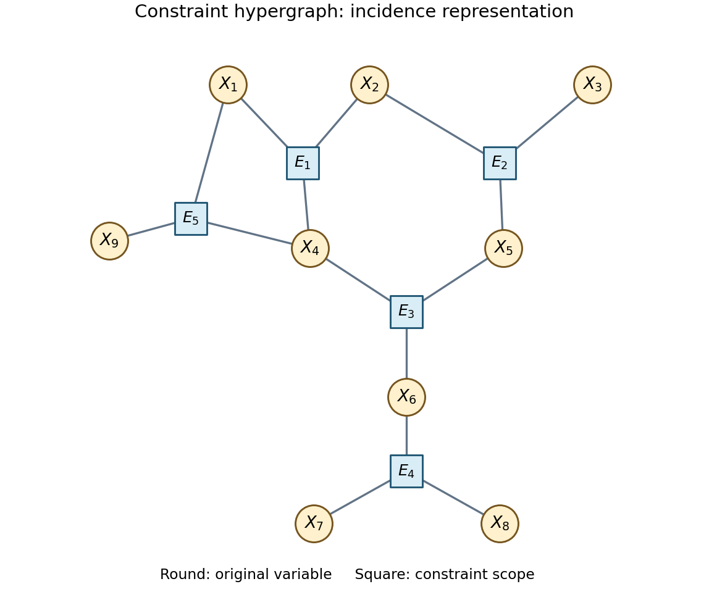
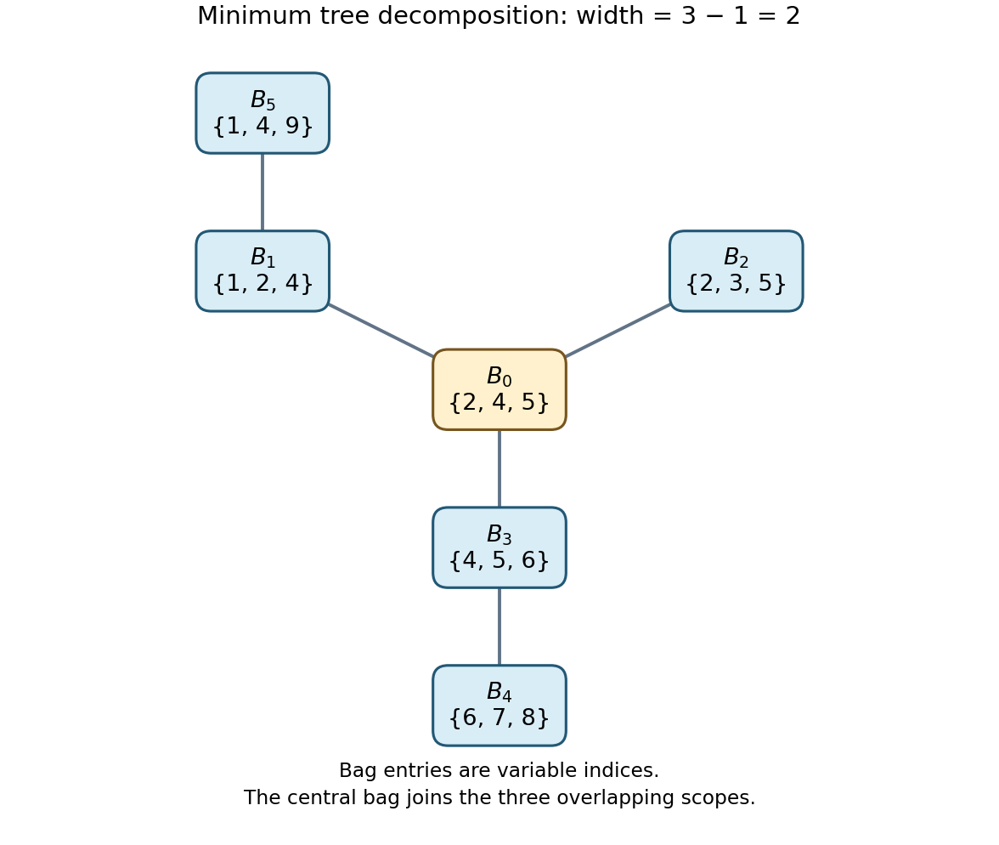

# Intelligent systems

↑ **Parent:** [2015](../2015.md)

**Table of contents**

- [1](#1)
  - [a](#1/a)
    - [Solution](#1/a/solution)
  - [b](#1/b)
    - [Solution](#1/b/solution)
  - [c](#1/c)
    - [Solution](#1/c/solution)
  - [d](#1/d)
    - [Solution](#1/d/solution)
  - [e](#1/e)
    - [Solution](#1/e/solution)
  - [f](#1/f)
    - [Solution](#1/f/solution)
- [2](#2)
  - [a](#2/a)
    - [Solution](#2/a/solution)
  - [b](#2/b)
    - [Solution](#2/b/solution)
  - [c](#2/c)
    - [Solution](#2/c/solution)
  - [d](#2/d)
    - [Solution](#2/d/solution)
  - [e](#2/e)
    - [Solution](#2/e/solution)
- [3](#3)
  - [a](#3/a)
    - [Solution](#3/a/solution)
  - [b](#3/b)
    - [i](#3/b/i)
      - [Solution](#3/b/i/solution)
    - [ii](#3/b/ii)
      - [Solution](#3/b/ii/solution)
    - [iii](#3/b/iii)
      - [Solution](#3/b/iii/solution)
  - [c](#3/c)
    - [i](#3/c/i)
      - [Solution](#3/c/i/solution)
    - [ii](#3/c/ii)
      - [Solution](#3/c/ii/solution)
    - [iii](#3/c/iii)
      - [Solution](#3/c/iii/solution)
    - [iv](#3/c/iv)
      - [Solution](#3/c/iv/solution)
    - [v](#3/c/v)
      - [Solution](#3/c/v/solution)

## 1

↑ **Parent:** [Intelligent systems](intelligent-systems.md)

<h3 id="1/a">a</h3>

↑ **Parent:** [1](#1)

<h4 id="1/a/solution">Solution</h4>

↑ **Parent:** [A](#1/a)

Let $V$ be the [set](../../set.md) of [Boolean variables](../../theoretical-computer-science.md#boolean-variable) occurring in $T$ or the initial query $Q$, and put $N=|V|$. Represent a current query by a [subset](../../set.md#subset) $R\subseteq\{\neg p:p\in V\}$: the [Boolean literals](../../theoretical-computer-science.md#boolean-literal) in this [set](../../set.md) are the outstanding obligations. The initial state is $R=Q$, and the [goal test](../../theoretical-computer-science.md#goal-test) is $R=\varnothing$.

An action chooses a [Horn clause](../../theoretical-computer-science.md#horn-clause) $C\in T$ with positive [Boolean literal](../../theoretical-computer-science.md#boolean-literal) $p$, provided $\neg p\in R$. Its [search transition model](../../theoretical-computer-science.md#search-transition-model) is precisely the given [resolution inference rule](../../mathematical-logic.md#resolution-inference-rule):

$$
R\longmapsto R'=(C\cup R)\setminus\{p,\neg p\}.
$$

Thus it removes the obligation $\neg p$ and inserts all negative [Boolean literals](../../theoretical-computer-science.md#boolean-literal) of $C$. Repeated [Boolean literals](../../theoretical-computer-science.md#boolean-literal) merge because queries are [sets](../../set.md). A [Horn clause](../../theoretical-computer-science.md#horn-clause) without a positive [Boolean literal](../../theoretical-computer-science.md#boolean-literal) supplies no action under the rule specified in this paper; it must not be treated as an additional way of finishing the query.

Give every action unit cost. A [graph path](../../graph-theory.md#path-in-a-graph) with $\ell$ actions gives a proof containing $\ell+1$ queries, so minimizing either quantity gives the same shortest proof. [Uniform-cost search](../../graph.md#uniform-cost-search) orders the [search frontier](../../theoretical-computer-science.md#search-frontier) by the number of actions already taken and applies the [goal test](../../theoretical-computer-science.md#goal-test) when removing a [search node](../../theoretical-computer-science.md#search-node) for expansion. Recording parent actions reconstructs the proof.

There are at most two choices, present or absent, for each of the $N$ negative [Boolean literals](../../theoretical-computer-science.md#boolean-literal). Therefore

$$
\boxed{c(R,C,R')=1,\qquad |\mathcal S|\le 2^N.}
$$

This bounds the [state space](../../dynamical-systems.md#state-space), including the empty query, rather than the possibly infinite [search tree](../../theoretical-computer-science.md#search-tree) of action histories.[Printed p. 2, corrected Question 1, definitions and part (a)](../../computer-science-bibliography.md#intelligent-systems-examination-paper-by-the-university-of-oxford-2015)

<h3 id="1/b">b</h3>

↑ **Parent:** [1](#1)

<h4 id="1/b/solution">Solution</h4>

↑ **Parent:** [B](#1/b)

[A-star search](../../graph.md#a-star-search) is [best-first search](../../graph.md#best-first-search) with priority

$$
\boxed{f(u)=g(u)+h(s(u)),\qquad 0\le h(s)\le h^*(s),\qquad h(\text{goal})=0.}
$$

Here $u$ is a [search node](../../theoretical-computer-science.md#search-node), $s(u)$ is its state, $g(u)$ is its accumulated [path cost](../../theoretical-computer-science.md#path-cost), and $h^*(s)$ is the minimum remaining cost to any [goal state](../../theoretical-computer-science.md#goal-state), interpreted as $\infty$ if no goal is reachable. The inequality defines an [admissible heuristic](../../theoretical-computer-science.md#admissible-heuristic). Thus $f(u)$ is a lower bound on the cost of any solution extending that particular action history.

Initialize the [search frontier](../../theoretical-computer-science.md#search-frontier) with the root. Repeatedly remove a [search node](../../theoretical-computer-science.md#search-node) of least $f$, apply the [goal test](../../theoretical-computer-science.md#goal-test), and, if it is not a goal, insert its applicable-action children with their updated $g$ and $f$. In [tree search](../../algorithm.md#tree-search), different action histories remain distinct [search nodes](../../theoretical-computer-science.md#search-node) even when they reach the same state; there is no global visited-state [set](../../set.md).

For the finite [branching factor](../../theoretical-computer-science.md#branching-factor) and unit costs here, an [admissible heuristic](../../theoretical-computer-science.md#admissible-heuristic) ensures that any first goal removed is optimal. If a cheaper solution existed, the [search frontier](../../theoretical-computer-science.md#search-frontier) would contain an unexpanded prefix of it with $f$ at most that cheaper cost, contradicting selection of the more expensive goal. Nonnegative $h$ also means only finitely many [search nodes](../../theoretical-computer-science.md#search-node) can have $f$ below any fixed finite cost, so a finite solution will eventually be reached. This does not guarantee termination when no proof exists.

<h3 id="1/c">c</h3>

↑ **Parent:** [1](#1)

<h4 id="1/c/solution">Solution</h4>

↑ **Parent:** [C](#1/c)

**Termination is not guaranteed.** Take

$$
Q=\{\neg p\},\qquad T=\bigl\{\{p,\neg q\},\{q,\neg p\}\bigr\}.
$$

Both members of $T$ are valid [Horn clauses](../../theoretical-computer-science.md#horn-clause) with distinct underlying [Boolean variables](../../theoretical-computer-science.md#boolean-variable). The only possible continuation alternates

$$
\{\neg p\}\longmapsto\{\neg q\}\longmapsto\{\neg p\}\longmapsto\cdots.
$$

The empty query is unreachable. With the [admissible heuristic](../../theoretical-computer-science.md#admissible-heuristic) $h=0$, ordinary [A-star search](../../graph.md#a-star-search) keeps generating the next [search node](../../theoretical-computer-science.md#search-node) forever, despite there being only two reachable states.

A modification requiring no additional stored state collection is to impose the known [search depth](../../theoretical-computer-science.md#search-depth) bound

$$
\boxed{L=2^N-1,\qquad\text{do not expand a non-goal node with }g=L.}
$$

The unit-cost $g$ already stored by [A-star search](../../graph.md#a-star-search) is also its [search depth](../../theoretical-computer-science.md#search-depth); the bound is a scalar computed from the input, not a closed [set](../../set.md). Apply the [goal test](../../theoretical-computer-science.md#goal-test) before refusing expansion at the bound.

To prove completeness of this modification, remove any segment between two equal states in a successful proof. The successor choices after the later occurrence are available at the earlier occurrence because the [search transition model](../../theoretical-computer-science.md#search-transition-model) depends only on the current query. Repeating this removal gives a proof with no repeated states, hence at most $2^N-1$ actions. In particular, a shortest proof never needs a repeated state, since every removed segment has positive cost. The depth restriction therefore preserves a shortest proof whenever one exists.

The restricted [search tree](../../theoretical-computer-science.md#search-tree) has finite depth and finite [branching factor](../../theoretical-computer-science.md#branching-factor), so it is finite. [A-star search](../../graph.md#a-star-search) must then either remove a goal or exhaust the [search frontier](../../theoretical-computer-science.md#search-frontier) and report failure. Its existing [search frontier](../../theoretical-computer-science.md#search-frontier) may still be large; the modification saves a separate visited-state collection, not all storage used by [tree search](../../algorithm.md#tree-search).

<h3 id="1/d">d</h3>

↑ **Parent:** [1](#1)

<h4 id="1/d/solution">Solution</h4>

↑ **Parent:** [D](#1/d)

**Yes: $h_1(R)=|R|$ is an [admissible heuristic](../../theoretical-computer-science.md#admissible-heuristic).** One application of the [resolution inference rule](../../mathematical-logic.md#resolution-inference-rule) removes just one current negative [Boolean literal](../../theoretical-computer-science.md#boolean-literal). It may add other negative [Boolean literals](../../theoretical-computer-science.md#boolean-literal), and some of those may already occur, but it cannot remove any other current obligation. Consequently

$$
|R'|\ge |R|-1.
$$

If $\ell$ actions lead from $R$ to $\varnothing$, applying this inequality at every step gives $0\ge |R|-\ell$. Thus

$$
\boxed{h_1(R)=|R|\le\ell,\qquad h_1(R)\le h^*(R).}
$$

It is also a [consistent heuristic](../../theoretical-computer-science.md#consistent-heuristic), since $h_1(R)\le1+h_1(R')$ and $h_1(\varnothing)=0$. In particular, merging duplicate obligations cannot invalidate the lower bound: removing several duplicates from the representation never counts as removing several distinct members of a [set](../../set.md).

<h3 id="1/e">e</h3>

↑ **Parent:** [1](#1)

<h4 id="1/e/solution">Solution</h4>

↑ **Parent:** [E](#1/e)

Use the [shortest path](../../shortest-path-problem.md#shortest-path) distances in the directed dependency [graph](../../graph.md) to define

$$
\boxed{
h_2(R)=
\begin{cases}
0,&R=\varnothing,\\
\max\bigl\{|R|,\ 1+\max_{\neg p\in R}d_G(p)\bigr\},&R\ne\varnothing.
\end{cases}}
$$

The additional $1$ counts the final use of a positive unit [Horn clause](../../theoretical-computer-science.md#horn-clause), which corresponds to a fact rather than an [edge](../../graph-theory.md#edge-of-a-graph) of $G$.

To justify the new lower bound, consider any complete proof from $R$ and fix $\neg p\in R$. At some step this obligation must be removed using a [Horn clause](../../theoretical-computer-science.md#horn-clause) with head $p$. If that [Horn clause](../../theoretical-computer-science.md#horn-clause) is the fact $\{p\}$, we have already found a dependency [graph path](../../graph-theory.md#path-in-a-graph) of length zero ending at a fact. Otherwise select one negative body [Boolean literal](../../theoretical-computer-science.md#boolean-literal) $\neg q$. Immediately after the step it belongs to the query, whether newly inserted or merged with an existing obligation. It must subsequently be removed. Record the [edge](../../graph-theory.md#edge-of-a-graph) $p\to q$ and repeat this argument at its later removal.

The selected removal times strictly increase. Since the proof is finite and ends with no obligations, this chain eventually uses a fact. A proof of $\ell$ actions therefore produces a dependency walk of at most $\ell-1$ [edges](../../graph-theory.md#edge-of-a-graph) from $p$ to a fact. Removing any cycles from that walk gives $d_G(p)\le\ell-1$. Hence $1+d_G(p)\le\ell$ for every initial obligation. If $d_G(p)=\infty$, no such proof exists. Combining this bound with the [admissible heuristic](../../theoretical-computer-science.md#admissible-heuristic) $|R|$ by taking their maximum preserves admissibility.

For a strict improvement, use

$$
T=\bigl\{\{p,\neg q\},\{q,\neg r\},\{r\}\bigr\},\qquad R=\{\neg p\}.
$$

Here $d_G(p)=2$, so $h_1(R)=1$ while $h_2(R)=3$. The three successive obligations are $\neg p,\neg q,\neg r$, followed by the empty query, so the improved bound is exact.

Do not sum all the values $1+d_G(p)$ without an additional argument: different obligations may share work. For example, with $T=\{\{p,\neg r\},\{q,\neg r\},\{r\}\}$, the query $\{\neg p,\neg q\}$ takes three actions, while that sum would be four.

<h3 id="1/f">f</h3>

↑ **Parent:** [1](#1)

<h4 id="1/f/solution">Solution</h4>

↑ **Parent:** [F](#1/f)

When the values of several [admissible heuristics](../../theoretical-computer-science.md#admissible-heuristic) are already available, choose their maximum:

$$
\boxed{h(R)=\max_i h_i(R).}
$$

Every $h_i(R)\le h^*(R)$, so their maximum is still an [admissible heuristic](../../theoretical-computer-science.md#admissible-heuristic). It has [heuristic dominance](../../theoretical-computer-science.md#heuristic-dominance) over their minimum and their arithmetic average, which are also [admissible heuristics](../../theoretical-computer-science.md#admissible-heuristic) but give no larger lower bound. Thus the maximum supplies the most informative generally valid choice among these alternatives.

Their sum can overestimate by counting the same remaining action repeatedly. If two [heuristic functions](../../theoretical-computer-science.md#heuristic-function) both give the exact value $1$ at a state one action from the goal, their sum gives $2$. A valid sum requires extra structure such as dividing each action's cost between the component estimates; admissibility of the components alone does not provide that structure.

Larger admissible values reduce the region $g+h<C^*$ that [A-star search](../../graph.md#a-star-search) must expand before an optimal solution of cost $C^*$ can be removed. This is a statement about [heuristic dominance](../../theoretical-computer-science.md#heuristic-dominance), not a strict claim about running time under every tie-breaking rule or evaluation cost.

## 2

↑ **Parent:** [Intelligent systems](intelligent-systems.md)

<h3 id="2/a">a</h3>

↑ **Parent:** [2](#2)

<h4 id="2/a/solution">Solution</h4>

↑ **Parent:** [A](#2/a)

Index the coins so that $c_1$ is smallest and $c_n$ largest. Choose $s_1$ as the initial stack and $s_2$ as the destination, assuming $k\ge2$. The [static predicate](../../artificial-intelligence.md#static-predicate) facts describing size are

$$
S_{\mathrm{size}}=\{\operatorname{Smaller}(c_i,c_j):1\le i<j\le n\}.
$$

No size comparison with $g$ is needed: moving onto empty ground will have a separate [action schema](../../artificial-intelligence.md#action-schema). The initial [STRIPS](../../artificial-intelligence.md#strips) state is

$$
\boxed{
I=S_{\mathrm{size}}
\cup\{\operatorname{OnTop}(c_i,c_{i+1}):1\le i<n\}
\cup\{\operatorname{OnTop}(c_n,g),\operatorname{Topmost}(c_1,s_1)\}
\cup\{\operatorname{Topmost}(g,s_j):2\le j\le k\}.}
$$

Under the [closed-world assumption](../../mathematical-logic.md#closed-world-assumption), all other ground [ground atoms](../../mathematical-logic.md#ground-atom) are false. In particular, the initial state contains just one [predicate](../../analysis-of-boolean-functions.md#predicate) fact naming the top of each stack. The [predicate](../../analysis-of-boolean-functions.md#predicate) $\operatorname{OnTop}$ names the immediate support, not every coin farther below.

An explicit positive conjunctive goal is the following [set](../../set.md) of required [ground atoms](../../mathematical-logic.md#ground-atom):

$$
\boxed{
G_{\mathrm{goal}}=
\{\operatorname{OnTop}(c_i,c_{i+1}):1\le i<n\}
\cup\{\operatorname{OnTop}(c_n,g),\operatorname{Topmost}(c_1,s_2)\}
\cup\{\operatorname{Topmost}(g,s_j):j\ne2\}.}
$$

A state succeeds when it contains $G_{\mathrm{goal}}$. The [static predicate](../../artificial-intelligence.md#static-predicate) facts in $S_{\mathrm{size}}$ persist automatically. Starting from $I$, the [planning state invariants](../../algorithm.md#planning-state-invariant) proved below make this goal exactly the desired completed stack on $s_2$ with all other stacks empty. If any new stack is acceptable, the choice of $s_2$ loses no generality because the initially empty stacks are interchangeable.

<h3 id="2/b">b</h3>

↑ **Parent:** [2](#2)

<h4 id="2/b/solution">Solution</h4>

↑ **Parent:** [B](#2/b)

Use two [STRIPS](../../artificial-intelligence.md#strips) [action schemas](../../artificial-intelligence.md#action-schema), for a destination topped by a coin and for an empty destination. In both, $x$ is a coin, $s,t$ are distinct stack constants, and $y$ is either a different coin or $g$. In the first, $z$ is a coin distinct from $x$ and, when $y$ is a coin, also distinct from $y$. These are restrictions on [action grounding](../../artificial-intelligence.md#action-grounding), so no new type or inequality [predicates](../../analysis-of-boolean-functions.md#predicate) are needed.

For $\operatorname{MoveToCoin}(x,y,z,s,t)$, use

$$
\begin{aligned}
\operatorname{Pre}={}&\{\operatorname{Topmost}(x,s),\operatorname{OnTop}(x,y),
\operatorname{Topmost}(z,t),\operatorname{Smaller}(x,z)\},\\
\operatorname{Del}={}&\{\operatorname{Topmost}(x,s),\operatorname{OnTop}(x,y),
\operatorname{Topmost}(z,t)\},\\
\operatorname{Add}={}&\{\operatorname{Topmost}(y,s),\operatorname{OnTop}(x,z),
\operatorname{Topmost}(x,t)\}.
\end{aligned}
$$

For $\operatorname{MoveToEmpty}(x,y,s,t)$, use

$$
\begin{aligned}
\operatorname{Pre}={}&\{\operatorname{Topmost}(x,s),\operatorname{OnTop}(x,y),
\operatorname{Topmost}(g,t)\},\\
\operatorname{Del}={}&\{\operatorname{Topmost}(x,s),\operatorname{Topmost}(g,t)\}
\cup\begin{cases}\{\operatorname{OnTop}(x,y)\},&y\ne g,\\\varnothing,&y=g,\end{cases}\\
\operatorname{Add}={}&\{\operatorname{Topmost}(y,s),\operatorname{Topmost}(x,t)\}
\cup\begin{cases}\{\operatorname{OnTop}(x,g)\},&y\ne g,\\\varnothing,&y=g.\end{cases}
\end{aligned}
$$

The last cases are a compact notation for two ordinary [action schemas](../../artificial-intelligence.md#action-schema), one with $y$ a coin and one with $y=g$. In the second case, $\operatorname{OnTop}(x,g)$ already holds and is left unchanged: the same ground object represents the base of every stack. Its stack identity is carried by $\operatorname{Topmost}$, so moving a singleton stack to an empty location still changes two top markers even though its support remains $g$.

Each [ground action](../../artificial-intelligence.md#ground-action) applies only if $\operatorname{Pre}\subseteq S$ and updates the [STRIPS](../../artificial-intelligence.md#strips) state by

$$
\boxed{S'=(S\setminus\operatorname{Del})\cup\operatorname{Add}.}
$$

The [preconditions](../../algorithm.md#precondition) require the moved coin to be exposed and the destination to be either exposed or empty. A coin destination additionally requires the moved coin to be smaller. The delete list removes its old support relation when that support changes, removes its old source-top marker, and removes the destination's old top marker. The add list exposes its former support and installs it as the destination top.

To prove that no incorrect [plans](../../artificial-intelligence.md#plan) arise, induct on the action history. Initially every coin has exactly one support; the stacks are disjoint decreasing chains ending at $g$; and each stack has exactly one correct top marker. An applicable action removes just the top coin from one such chain and attaches it to a different chain, or creates a singleton chain. The size [precondition](../../algorithm.md#precondition) preserves decreasing order; distinct stack parameters prevent moving onto one's own stack; and updating both top markers preserves their accuracy. The unchanged chain segments retain their support relations. These [planning state invariants](../../algorithm.md#planning-state-invariant) therefore hold after every action. Only the $k$ named stacks can be used, enforcing the stack limit.

Conversely, every legal physical move has a source top $x$, a uniquely determined former support $y$, and either an empty target or a target top $z$ larger than $x$. The corresponding [ground action](../../artificial-intelligence.md#ground-action) has exactly these [preconditions](../../algorithm.md#precondition) and effects. Thus the encoding permits all legal moves and preserves physical legality from the initial state.[Printed p. 3, Question 2(a–b), prescribed objects and predicates](../../computer-science-bibliography.md#intelligent-systems-examination-paper-by-the-university-of-oxford-2015)

<h3 id="2/c">c</h3>

↑ **Parent:** [2](#2)

<h4 id="2/c/solution">Solution</h4>

↑ **Parent:** [C](#2/c)

Move the three coins as follows, with $c_1$ smallest:

| Step | Coin | Source | Destination |
| --- | --- | --- | --- |
| 1 | $c_1$ | $s_1$ | $s_3$ |
| 2 | $c_2$ | $s_1$ | $s_4$ |
| 3 | $c_3$ | $s_1$ | $s_2$ |
| 4 | $c_2$ | $s_4$ | $s_2$ |
| 5 | $c_1$ | $s_3$ | $s_2$ |

Every moved coin is exposed, and the last two moves put a smaller coin on a larger one. Thus

$$
\boxed{5<2^3-1=7\text{ moves}.}
$$

Five is also optimal here: before the first move of $c_3$, both smaller coins must leave $s_1$. Neither can make its only move directly to the final destination and remain there, because it would obstruct the eventual arrival of $c_3$. Each smaller coin therefore needs at least two moves. Those four small-coin moves and at least one move of $c_3$ give the matching lower bound.

<h3 id="2/d">d</h3>

↑ **Parent:** [2](#2)

<h4 id="2/d/solution">Solution</h4>

↑ **Parent:** [D](#2/d)

In terms of minimum [plan](../../artificial-intelligence.md#plan) length, allowing more stacks can only help:

$$
\boxed{L^*(n,k+1)\le L^*(n,k).}
$$

Every legal [plan](../../artificial-intelligence.md#plan) using at most $k$ stacks remains legal with $k+1$ available: simply ignore the new stack. The inequality need not be strict. For $n=1$, one move suffices for every $k\ge2$.

With $k\ge n+1$, put each of the $n-1$ smaller coins on its own spare stack, move the largest coin to the destination, and then place the smaller coins on it in decreasing size order. This uses $2n-1$ moves. Every smaller coin must leave the initial stack before the largest coin's first move. It cannot move just once directly to the final stack and stay there, since that would block the largest coin's eventual arrival. Thus each smaller coin requires at least two moves, while the largest coin requires at least one. Hence

$$
L^*(n,k)=2n-1\qquad(k\ge n+1).
$$

Compared with the three-stack value $2^n-1$, the physical task can therefore become substantially easier.

The difficulty of _finding_ an optimal [plan](../../artificial-intelligence.md#plan) is a different issue. Each legal state is determined by assigning every coin to one of the $k$ labelled stacks, whose size order is then forced. There are $k^n$ such assignments, so the [state space](../../dynamical-systems.md#state-space) and possible [branching factor](../../theoretical-computer-science.md#branching-factor) grow with $k$. An uninformed [search algorithm](../../algorithm.md#search-algorithm) can therefore face more alternatives even when the optimal [plan](../../artificial-intelligence.md#plan) becomes shorter. Likewise, a simple recursive strategy for three stacks need not immediately supply the best strategy with more stacks. The defensible answer is that the required number of moves never increases, while computational search effort need not decrease.

<h3 id="2/e">e</h3>

↑ **Parent:** [2](#2)

<h4 id="2/e/solution">Solution</h4>

↑ **Parent:** [E](#2/e)

Two general constructions are **[delete-relaxation heuristics](../../theoretical-computer-science.md#delete-relaxation-heuristic)** and **[abstraction heuristics](../../theoretical-computer-science.md#abstraction-heuristic)**. Both obtain an [admissible heuristic](../../theoretical-computer-science.md#admissible-heuristic) by solving a problem in which every original [plan](../../artificial-intelligence.md#plan) remains available at no greater cost.

For a [delete-relaxation heuristic](../../theoretical-computer-science.md#delete-relaxation-heuristic), remove every [STRIPS](../../artificial-intelligence.md#strips) delete effect and compute the shortest relaxed [plan](../../artificial-intelligence.md#plan) length $h^+(S)$. A relaxed action never makes a true fact false. Inductively, executing an original [plan](../../artificial-intelligence.md#plan) in the relaxed model leaves a superset of its original facts, so positive [preconditions](../../algorithm.md#precondition) and the positive conjunctive goal remain satisfied. Therefore

$$
\boxed{h^+(S)\le h^*(S).}
$$

The exact relaxed optimum can itself be expensive to find; merely taking the length of an arbitrary relaxed [plan](../../artificial-intelligence.md#plan) does not guarantee an [admissible heuristic](../../theoretical-computer-science.md#admissible-heuristic). One can instead use a proven lower bound on the relaxed optimum.

For this coin encoding, removing delete effects loses the requirement to free an occupied stack and the requirement to destroy and later rebuild support relations. From the initial state, relaxed moves can successively move $c_1,c_2,\ldots,c_n$ from $s_1$ to $s_2$ using the empty-destination action: $\operatorname{Topmost}(g,s_2)$ is never deleted, and exposing each next source coin is still allowed. The original support-chain goal facts are never deleted either. After these $n$ actions, $\operatorname{Topmost}(g,s_1)$ and $\operatorname{Topmost}(c_1,s_2)$ also hold, so the entire goal from part (a) holds. Thus $h^+(I)\le n$, showing why this relaxation misses much of the exponential work needed with three stacks.

For an [abstraction heuristic](../../theoretical-computer-science.md#abstraction-heuristic), project states onto selected information and project each action onto its effect on that information. Forgetting a selected collection of [planning fluents](../../artificial-intelligence.md#planning-fluent), and their [preconditions](../../algorithm.md#precondition) and goals, gives one general construction for [STRIPS](../../artificial-intelligence.md#strips). Define the abstract transition relation to include every projected original transition, with cost at most the original cost. The exact abstract distance is then a lower bound because any original goal-reaching [graph path](../../graph-theory.md#path-in-a-graph) projects to an abstract goal-reaching walk:

$$
\boxed{h_{\mathrm{abs}}(S)\le h^*(S).}
$$

For the coin puzzle, a useful state abstraction remembers the stacks occupied by a chosen subset of coins and ignores the other coins, contracting the support chains past ignored coins. Moving an ignored coin leaves the abstract state unchanged; moving a retained coin is a legal move in the smaller [Tower of Hanoi](../../game-theory.md#tower-of-hanoi) instance. Precomputing exact abstract goal distances gives a [pattern database](../../theoretical-computer-science.md#pattern-database). This can retain stacking and spare-stack restrictions that the [delete-relaxation heuristic](../../theoretical-computer-science.md#delete-relaxation-heuristic) loses. Larger retained subsets give potentially stronger information but require more storage and preprocessing. Maxima of these [admissible heuristics](../../theoretical-computer-science.md#admissible-heuristic) remain safe; unqualified sums can double-count moves.

## 3

↑ **Parent:** [Intelligent systems](intelligent-systems.md)

<h3 id="3/a">a</h3>

↑ **Parent:** [3](#3)

<h4 id="3/a/solution">Solution</h4>

↑ **Parent:** [A](#3/a)

Use one [variable](../../mathematics.md#variable-mathematics) $X_{r,c}$ for each cell, with $1\le r,c\le9$. An empty cell has [constraint domain](../../theoretical-computer-science.md#constraint-domain) $\{1,\ldots,9\}$; a clue containing $d$ has singleton [constraint domain](../../theoretical-computer-science.md#constraint-domain) $\{d\}$. Thus all clues are retained automatically.

For every row $r$ impose $\operatorname{AllDifferent}(X_{r,1},\ldots,X_{r,9})$, and for every column $c$ impose $\operatorname{AllDifferent}(X_{1,c},\ldots,X_{9,c})$. For each $a,b\in\{0,1,2\}$ impose an [all-different constraint](../../theoretical-computer-science.md#all-different-constraint) on

$$
\{X_{3a+i,3b+j}:1\le i,j\le3\}.
$$

These are the nine prescribed boxes. There are 27 [all-different constraints](../../theoretical-computer-science.md#all-different-constraint) altogether. Nine pairwise distinct values chosen from a [set](../../set.md) of nine values must use every value exactly once, so these restrictions are precisely the [Sudoku](../../theoretical-computer-science.md#sudoku) requirements. Equivalently, expand each [all-different constraint](../../theoretical-computer-science.md#all-different-constraint) into pairwise [binary constraints](../../theoretical-computer-science.md#binary-constraint) $X_{r,c}\ne X_{r',c'}$ for cells sharing a row, column, or box.

$$
\boxed{81\text{ variables, clue-restricted domains, and }27\text{ all-different constraints}.}
$$

<h3 id="3/b">b</h3>

↑ **Parent:** [3](#3)

<h4 id="3/b/i">i</h4>

↑ **Parent:** [B](#3/b)

<h5 id="3/b/i/solution">Solution</h5>

↑ **Parent:** [I](#3/b/i)

Choose the distinct values of $(X_1,X_2,X_4)$ and call them $(a,b,c)$. There are $3!=6$ choices. Constraint (5), on $(X_1,X_4,X_9)$, immediately forces $X_9=b$.

Constraints (2) and (3) require $X_5\ne X_2=b$ and $X_5\ne X_4=c$, respectively. Since the [constraint domain](../../theoretical-computer-science.md#constraint-domain) has exactly three values, $X_5=a$. Constraint (2) now forces $X_3=c$, and constraint (3) forces $X_6=b$. Finally, constraint (4) permits $(X_7,X_8)=(a,c)$ or $(c,a)$.

Every choice just described satisfies all five [all-different constraints](../../theoretical-computer-science.md#all-different-constraint), and the forced-value argument shows there are no other possibilities. Hence

$$
\boxed{\#\operatorname{Sol}(P)=3!\cdot2=12.}
$$

In the order $(X_1,\ldots,X_9)$, the two forms are

$$
(a,b,c,c,a,b,a,c,b),\qquad
(a,b,c,c,a,b,c,a,b),
$$

where $(a,b,c)$ ranges over the six [permutations](../../combinatorics.md#permutation) of $(0,1,2)$.

<h4 id="3/b/ii">ii</h4>

↑ **Parent:** [B](#3/b)

<h5 id="3/b/ii/solution">Solution</h5>

↑ **Parent:** [Ii](#3/b/ii)

The [constraint hypergraph](../../theoretical-computer-science.md#constraint-hypergraph) has one [vertex](../../graph.md#vertex-graph-theory) for each of $X_1,\ldots,X_9$ and one [hypergraph edge](../../hypergraph.md#edge-of-a-hypergraph) for each constraint scope:

$$
\boxed{E_1=\{1,2,4\},\ E_2=\{2,3,5\},\ E_3=\{4,5,6\},\ E_4=\{6,7,8\},\ E_5=\{1,4,9\}.}
$$

Here $i$ abbreviates $X_i$. These five scopes follow the corrected source.[Printed p. 4, corrected Question 3(b), constraints (1)–(5)](../../computer-science-bibliography.md#intelligent-systems-examination-paper-by-the-university-of-oxford-2015) The diagram uses the incidence representation: round nodes are the original [variables](../../mathematics.md#variable-mathematics), square nodes represent [hypergraph edges](../../hypergraph.md#edge-of-a-hypergraph), and a joining line means that the [variable](../../mathematics.md#variable-mathematics) belongs to that constraint scope. The square nodes are not extra [variables](../../mathematics.md#variable-mathematics) of $P$.

**[Figure 1](#3/b/ii/image-incidence-drawing-of-the-five-constraint-scopes-in-question-3-b). Incidence drawing of the five constraint scopes in Question 3(b)**

In particular, the central pattern involving $X_2,X_4,X_5$ forms a cycle through three constraint scopes; the scopes cannot themselves simply be joined into a valid [tree decomposition](../../graph-theory.md#tree-decomposition) without an additional bag.

<h4 id="3/b/iii">iii</h4>

↑ **Parent:** [B](#3/b)

<h5 id="3/b/iii/solution">Solution</h5>

↑ **Parent:** [Iii](#3/b/iii)

Use the ordinary [treewidth](../../graph-theory.md#treewidth) of the [primal graph](../../theoretical-computer-science.md#primal-graph) of the [constraint hypergraph](../../theoretical-computer-science.md#constraint-hypergraph): two [variables](../../mathematics.md#variable-mathematics) are adjacent whenever they occur together in an [all-different constraint](../../theoretical-computer-science.md#all-different-constraint). Equivalently, a [tree decomposition](../../graph-theory.md#tree-decomposition) of this [constraint hypergraph](../../theoretical-computer-science.md#constraint-hypergraph) has a bag containing every constraint scope, together with the running-intersection requirement for each [variable](../../mathematics.md#variable-mathematics). This is distinct from taking the [treewidth](../../graph-theory.md#treewidth) of its incidence drawing.

Introduce a central bag $B_0=\{2,4,5\}$ and the five scope bags

$$
B_1=\{1,2,4\},\quad B_2=\{2,3,5\},\quad B_3=\{4,5,6\},\quad
B_4=\{6,7,8\},\quad B_5=\{1,4,9\}.
$$

Join $B_0$ to each of $B_1,B_2,B_3$, join $B_3$ to $B_4$, and join $B_1$ to $B_5$:

**[Figure 2](#3/b/iii/image-a-minimum-width-tree-decomposition-with-central-bag-containing-variables-2-4-and-5). A minimum-width tree decomposition with central bag containing variables 2, 4, and 5**.

Every constraint scope is contained in its own bag, and every [variable](../../mathematics.md#variable-mathematics) occurs. The nontrivial running-intersection checks are: $2$ occurs along $B_1-B_0-B_2$; $4$ along the connected branches $B_5-B_1-B_0-B_3$; $5$ along $B_2-B_0-B_3$; $1$ along $B_1-B_5$; and $6$ along $B_3-B_4$. Each of the other [variables](../../mathematics.md#variable-mathematics) occurs in just one bag. This is therefore a valid [tree decomposition](../../graph-theory.md#tree-decomposition) of width $3-1=2$.

Conversely, any of the original three-[variable](../../mathematics.md#variable-mathematics) constraint scopes forms a [clique](../../graph-theory.md#clique-graph-theory) of size three in the [primal graph](../../theoretical-computer-science.md#primal-graph). Such a [clique](../../graph-theory.md#clique-graph-theory) must be contained in one bag of every [tree decomposition](../../graph-theory.md#tree-decomposition), forcing width at least two. The upper and lower bounds agree:

$$
\boxed{\operatorname{tw}(P)=2.}
$$

<h3 id="3/c">c</h3>

↑ **Parent:** [3](#3)

<h4 id="3/c/i">i</h4>

↑ **Parent:** [C](#3/c)

<h5 id="3/c/i/solution">Solution</h5>

↑ **Parent:** [I](#3/c/i)

**Always true.** An [all-different constraint](../../theoretical-computer-science.md#all-different-constraint) of arity $k$ requires $k$ distinct values. If $|D|<k$, the [pigeonhole principle](../../combinatorics.md#pigeonhole-principle) makes even one such constraint impossible. Since $m>0$, at least one is present, and consequently

$$
\boxed{|D|<k\ \Longrightarrow\ \operatorname{Sol}(P)=\varnothing.}
$$

<h4 id="3/c/ii">ii</h4>

↑ **Parent:** [C](#3/c)

<h5 id="3/c/ii/solution">Solution</h5>

↑ **Parent:** [Ii](#3/c/ii)

**True in some cases and false in others:** the two numerical inequalities do not guarantee a solution.

For an unsatisfiable example satisfying both inequalities, take six [variables](../../mathematics.md#variable-mathematics), a [constraint domain](../../theoretical-computer-science.md#constraint-domain) with five values, and $k=4$, $m=3$, with [all-different constraints](../../theoretical-computer-science.md#all-different-constraint) on

$$
\{X_1,X_2,X_3,X_4\},\qquad
\{X_1,X_2,X_5,X_6\},\qquad
\{X_3,X_4,X_5,X_6\}.
$$

Any pair of the six [variables](../../mathematics.md#variable-mathematics) occurs together in at least one of these scopes: view the [variables](../../mathematics.md#variable-mathematics) as the three pairs $\{1,2\},\{3,4\},\{5,6\}$, and each scope as the union of two pairs. All six values must therefore be distinct. This is impossible with five available values, even though $5>4$ and $5>3$.

For a satisfiable example with the same $k,m,|D|$, take three disjoint groups of four [variables](../../mathematics.md#variable-mathematics) and impose one [all-different constraint](../../theoretical-computer-science.md#all-different-constraint) on each group. Assign values $1,2,3,4$ separately in every group. All three constraints hold with $D=\{1,2,3,4,5\}$.

$$
\boxed{|D|>k\text{ and }|D|>m\text{ are insufficient.}}
$$

These examples concern the intended cases in which the antecedent holds; they do not rely on vacuous truth of an implication.

<h4 id="3/c/iii">iii</h4>

↑ **Parent:** [C](#3/c)

<h5 id="3/c/iii/solution">Solution</h5>

↑ **Parent:** [Iii](#3/c/iii)

**True in some cases and false in others.** Equality of the [constraint domain](../../theoretical-computer-science.md#constraint-domain) size and [treewidth](../../graph-theory.md#treewidth) does not decide satisfiability.

For an unsatisfiable example, let $D=\{0,1\}$ and impose the three binary [all-different constraints](../../theoretical-computer-science.md#all-different-constraint) $X_1\ne X_2$, $X_2\ne X_3$, and $X_3\ne X_1$. The [primal graph](../../theoretical-computer-science.md#primal-graph) is a triangle, with [treewidth](../../graph-theory.md#treewidth) two. It needs three different values, so no solution exists despite $|D|=\operatorname{tw}(P)=2$.

For a satisfiable example, take four [variables](../../mathematics.md#variable-mathematics) with the same [constraint domain](../../theoretical-computer-science.md#constraint-domain) and constraints

$$
X_1\ne X_2,\quad X_2\ne X_3,\quad X_3\ne X_4,\quad X_4\ne X_1.
$$

Its [primal graph](../../theoretical-computer-science.md#primal-graph) is a four-cycle of [treewidth](../../graph-theory.md#treewidth) two: bags $\{1,2,3\}$ and $\{1,3,4\}$ give width two, while width one would require a [forest](../../tree-graph-theory.md#forest). The assignment $(0,1,0,1)$ satisfies all constraints.

$$
\boxed{|D|=\operatorname{tw}(P)\text{ allows both satisfiable and unsatisfiable instances}.}
$$

<h4 id="3/c/iv">iv</h4>

↑ **Parent:** [C](#3/c)

<h5 id="3/c/iv/solution">Solution</h5>

↑ **Parent:** [Iv](#3/c/iv)

**Always true.** Replace every [all-different constraint](../../theoretical-computer-science.md#all-different-constraint) by the pairwise inequalities on its scope. Then solutions are precisely the [proper graph colourings](../../graph-coloring.md) of the [primal graph](../../theoretical-computer-science.md#primal-graph) using values from $D$ as colours. Put $t=\operatorname{tw}(P)$.

A [graph](../../graph.md) of [treewidth](../../graph-theory.md#treewidth) $t$ has a [proper graph colouring](../../graph-coloring.md) with at most $t+1$ colours. Here is a constructive proof. In a width-$t$ [tree decomposition](../../graph-theory.md#tree-decomposition), remove any leaf bag contained in its neighbor. If more than one bag remains, a leaf bag has a [vertex](../../graph.md#vertex-graph-theory) absent from its neighbor. The running-intersection property means that [vertex](../../graph.md#vertex-graph-theory) occurs only in the leaf bag, so every neighbor of the [vertex](../../graph.md#vertex-graph-theory) belongs to that bag. It has at most $t$ neighbors. If only one bag remains, it has at most $t+1$ [vertices](../../graph.md#vertex-graph-theory) and the same degree bound holds.

Remove the chosen [vertex](../../graph.md#vertex-graph-theory) and repeat; deleting [vertices](../../graph.md#vertex-graph-theory) cannot increase the width of the restricted [tree decomposition](../../graph-theory.md#tree-decomposition). Now colour in reverse removal order. At most $t$ already coloured neighbors forbid colours, so one of $t+1$ colours is always available. Since the [integer](../../integer.md) inequality $|D|>t$ gives $|D|\ge t+1$, this produces a satisfying assignment:

$$
\boxed{|D|>\operatorname{tw}(P)\ \Longrightarrow\ \operatorname{Sol}(P)\ne\varnothing.}
$$

The common unrestricted [constraint domain](../../theoretical-computer-science.md#constraint-domain) and the exclusively [all-different constraints](../../theoretical-computer-science.md#all-different-constraint) are essential: arbitrary constraint relations do not reduce to [graph colouring](../../graph-coloring.md) in this way.

<h4 id="3/c/v">v</h4>

↑ **Parent:** [C](#3/c)

<h5 id="3/c/v/solution">Solution</h5>

↑ **Parent:** [V](#3/c/v)

**Always true for a nonempty finite [constraint domain](../../theoretical-computer-science.md#constraint-domain), as conventionally assumed.** Write $q=|D|$ and identify its values with $\{0,\ldots,q-1\}$. For each satisfying assignment $(x_1,\ldots,x_n)$, simultaneously replace every value by

$$
x_i\longmapsto x_i+a\pmod q,\qquad a\in\{0,\ldots,q-1\}.
$$

This [permutation](../../combinatorics.md#permutation) of the common [constraint domain](../../theoretical-computer-science.md#constraint-domain) preserves every equality and inequality, hence every [all-different constraint](../../theoretical-computer-science.md#all-different-constraint). The resulting $q$ assignments are distinct: equality of even one coordinate before and after a shift forces $a=0\pmod q$. There is at least one [variable](../../mathematics.md#variable-mathematics), since $m>0$ and $k\ge2$.

The [cyclic group](../../group.md#cyclic-group) of shifts therefore partitions the solution [set](../../set.md) into disjoint [orbits](../../dynamical-systems.md#orbit-dynamical-system) of size $q$. It follows that

$$
\boxed{q\mid\#\operatorname{Sol}(P).}
$$

The conclusion includes an unsatisfiable instance, whose solution count is zero. Full [permutation group](../../finite-group-theory.md#permutation-group) orbits need not have size $q!$, because unused values can be permuted without changing an assignment; the cyclic-shift argument avoids that mistake.

If an empty [constraint domain](../../theoretical-computer-science.md#constraint-domain) is permitted, there are zero assignments here, but the wording “divisible by $|D|$” then asks about divisibility by zero, which is ordinarily left undefined. The asserted divisibility uses the standard nonempty-domain convention, and the no-solution conclusion still holds for that degenerate input.

## ↑ Ancestors (8)

1. [2015](../2015.md)
2. [Past exam of the computer science course of the University of Oxford](../../past-exam-of-the-computer-science-course-of-the-university-of-oxford.md)
3. [Computer science course of the University of Oxford](../../university-of-oxford.md#computer-science-course-of-the-university-of-oxford)
4. [Undergraduate course of the University of Oxford](../../university-of-oxford.md#undergraduate-course-of-the-university-of-oxford)
5. [Course of the University of Oxford](../../university-of-oxford.md#course-of-the-university-of-oxford)
6. [University of Oxford](../../university-of-oxford.md)
7. [List of universities](../../README.md#list-of-universities)
8. [Codex Wiki](../../README.md)
