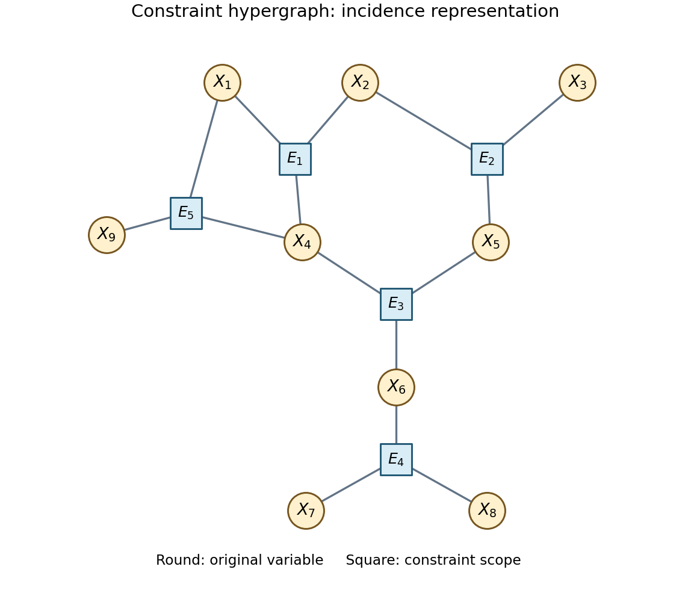

<h1 id="3/b/ii/solution">Solution</h1>

↑ **Parent:** [Ii](../ii.md)

The [constraint hypergraph](../../../../../../constraint-hypergraph.md) has one [vertex](../../../../../../vertex-graph-theory.md) for each of $X_1,\ldots,X_9$ and one [hypergraph edge](../../../../../../edge-of-a-hypergraph.md) for each constraint scope:

$$
\boxed{E_1=\{1,2,4\},\ E_2=\{2,3,5\},\ E_3=\{4,5,6\},\ E_4=\{6,7,8\},\ E_5=\{1,4,9\}.}
$$

Here $i$ abbreviates $X_i$. These five scopes follow the corrected source.[Printed p. 4, corrected Question 3(b), constraints (1)–(5)](../../../../../../intelligent-systems-examination-paper-by-the-university-of-oxford-2015.md) The diagram uses the incidence representation: round nodes are the original [variables](../../../../../../variable-mathematics.md), square nodes represent [hypergraph edges](../../../../../../edge-of-a-hypergraph.md), and a joining line means that the [variable](../../../../../../variable-mathematics.md) belongs to that constraint scope. The square nodes are not extra [variables](../../../../../../variable-mathematics.md) of $P$.

**[Figure 1](#3/b/ii/image-incidence-drawing-of-the-five-constraint-scopes-in-question-3-b). Incidence drawing of the five constraint scopes in Question 3(b)**

In particular, the central pattern involving $X_2,X_4,X_5$ forms a cycle through three constraint scopes; the scopes cannot themselves simply be joined into a valid [tree decomposition](../../../../../../tree-decomposition.md) without an additional bag.

## ↑ Ancestors (12)

1. [Ii](../ii.md)
2. [B](../../b.md)
3. [3](../../../3.md)
4. [Intelligent systems](../../../../intelligent-systems-split.md)
5. [2015](../../../../split.md)
6. [Past exam of the computer science course of the University of Oxford](../../../../../split.md)
7. [Computer science course of the University of Oxford](../../../../../../computer-science-course-of-the-university-of-oxford.md)
8. [Undergraduate course of the University of Oxford](../../../../../../undergraduate-course-of-the-university-of-oxford.md)
9. [Course of the University of Oxford](../../../../../../course-of-the-university-of-oxford.md)
10. [University of Oxford](../../../../../../university-of-oxford-split.md)
11. [List of universities](../../../../../../list-of-universities.md)
12. [Codex Wiki](../../../../../../split.md)
