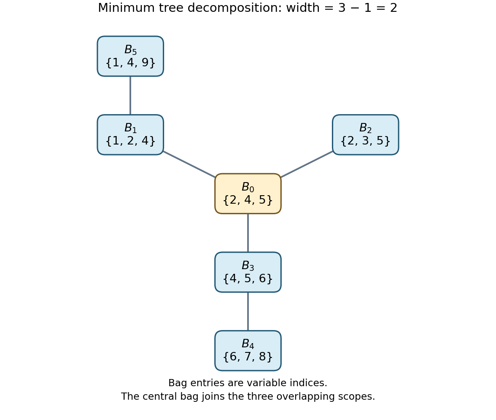

<h1 id="3/b/iii/solution">Solution</h1>

↑ **Parent:** [Iii](../iii.md)

Use the ordinary [treewidth](../../../../../../treewidth.md) of the [primal graph](../../../../../../primal-graph.md) of the [constraint hypergraph](../../../../../../constraint-hypergraph.md): two [variables](../../../../../../variable-mathematics.md) are adjacent whenever they occur together in an [all-different constraint](../../../../../../all-different-constraint.md). Equivalently, a [tree decomposition](../../../../../../tree-decomposition.md) of this [constraint hypergraph](../../../../../../constraint-hypergraph.md) has a bag containing every constraint scope, together with the running-intersection requirement for each [variable](../../../../../../variable-mathematics.md). This is distinct from taking the [treewidth](../../../../../../treewidth.md) of its incidence drawing.

Introduce a central bag $B_0=\{2,4,5\}$ and the five scope bags

$$
B_1=\{1,2,4\},\quad B_2=\{2,3,5\},\quad B_3=\{4,5,6\},\quad
B_4=\{6,7,8\},\quad B_5=\{1,4,9\}.
$$

Join $B_0$ to each of $B_1,B_2,B_3$, join $B_3$ to $B_4$, and join $B_1$ to $B_5$:

**[Figure 2](#3/b/iii/image-a-minimum-width-tree-decomposition-with-central-bag-containing-variables-2-4-and-5). A minimum-width tree decomposition with central bag containing variables 2, 4, and 5**.

Every constraint scope is contained in its own bag, and every [variable](../../../../../../variable-mathematics.md) occurs. The nontrivial running-intersection checks are: $2$ occurs along $B_1-B_0-B_2$; $4$ along the connected branches $B_5-B_1-B_0-B_3$; $5$ along $B_2-B_0-B_3$; $1$ along $B_1-B_5$; and $6$ along $B_3-B_4$. Each of the other [variables](../../../../../../variable-mathematics.md) occurs in just one bag. This is therefore a valid [tree decomposition](../../../../../../tree-decomposition.md) of width $3-1=2$.

Conversely, any of the original three-[variable](../../../../../../variable-mathematics.md) constraint scopes forms a [clique](../../../../../../clique-graph-theory.md) of size three in the [primal graph](../../../../../../primal-graph.md). Such a [clique](../../../../../../clique-graph-theory.md) must be contained in one bag of every [tree decomposition](../../../../../../tree-decomposition.md), forcing width at least two. The upper and lower bounds agree:

$$
\boxed{\operatorname{tw}(P)=2.}
$$

## ↑ Ancestors (12)

1. [Iii](../iii.md)
2. [B](../../b.md)
3. [3](../../../3.md)
4. [Intelligent systems](../../../../intelligent-systems-split.md)
5. [2015](../../../../split.md)
6. [Past exam of the computer science course of the University of Oxford](../../../../../split.md)
7. [Computer science course of the University of Oxford](../../../../../../computer-science-course-of-the-university-of-oxford.md)
8. [Undergraduate course of the University of Oxford](../../../../../../undergraduate-course-of-the-university-of-oxford.md)
9. [Course of the University of Oxford](../../../../../../course-of-the-university-of-oxford.md)
10. [University of Oxford](../../../../../../university-of-oxford-split.md)
11. [List of universities](../../../../../../list-of-universities.md)
12. [Codex Wiki](../../../../../../split.md)
