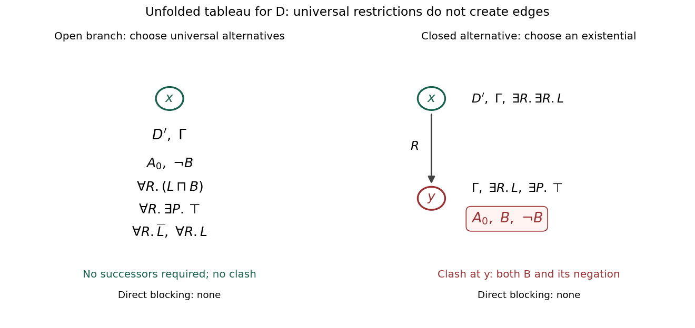

# Knowledge representation and reasoning

↑ **Parent:** [2015](../2015.md)

Solutions cover all three questions.[Questions 1–3, printed pages 2–5; Algorithm 1 on page 3](../../computer-science-bibliography.md#knowledge-representation-and-reasoning-examination-paper-of-the-university-of-oxford-2015) Throughout, the vocabulary in question 1 is interpreted as specified in the paper; in particular, the intended meaning of $\mathit{CountSupervise}$ supplies the number of supervised students. Question 2 distinguishes [EL](../../mathematical-logic.md#el) from [EL with bottom](../../mathematical-logic.md#el-with-bottom) explicitly, since the convention about $\bot$ changes two answers.

**Table of contents**

- [1](#1)
  - [a](#1/a)
    - [i](#1/a/i)
      - [Solution](#1/a/i/solution)
    - [ii](#1/a/ii)
      - [Solution](#1/a/ii/solution)
    - [iii](#1/a/iii)
      - [Solution](#1/a/iii/solution)
  - [b](#1/b)
    - [Solution](#1/b/solution)
  - [c](#1/c)
    - [i](#1/c/i)
      - [Solution](#1/c/i/solution)
    - [ii](#1/c/ii)
      - [Solution](#1/c/ii/solution)
    - [iii](#1/c/iii)
      - [Solution](#1/c/iii/solution)
    - [iv](#1/c/iv)
      - [Solution](#1/c/iv/solution)
  - [d](#1/d)
    - [i](#1/d/i)
      - [Solution](#1/d/i/solution)
    - [ii](#1/d/ii)
      - [Solution](#1/d/ii/solution)
    - [iii](#1/d/iii)
      - [Solution](#1/d/iii/solution)
  - [e](#1/e)
    - [Solution](#1/e/solution)
  - [f](#1/f)
    - [Solution](#1/f/solution)
- [2](#2)
  - [a](#2/a)
    - [i](#2/a/i)
      - [Solution](#2/a/i/solution)
    - [ii](#2/a/ii)
      - [Solution](#2/a/ii/solution)
  - [b](#2/b)
    - [Solution](#2/b/solution)
  - [c](#2/c)
    - [Solution](#2/c/solution)
  - [d](#2/d)
    - [Solution](#2/d/solution)
  - [e](#2/e)
    - [Solution](#2/e/solution)
  - [f](#2/f)
    - [Solution](#2/f/solution)
  - [g](#2/g)
    - [Solution](#2/g/solution)
- [3](#3)
  - [a](#3/a)
    - [Solution](#3/a/solution)
  - [b](#3/b)
    - [Solution](#3/b/solution)
  - [c](#3/c)
    - [i](#3/c/i)
      - [Solution](#3/c/i/solution)
    - [ii](#3/c/ii)
      - [Solution](#3/c/ii/solution)
    - [iii](#3/c/iii)
      - [Solution](#3/c/iii/solution)
  - [d](#3/d)
    - [Solution](#3/d/solution)
  - [e](#3/e)
    - [Solution](#3/e/solution)
  - [f](#3/f)
    - [i](#3/f/i)
      - [Solution](#3/f/i/solution)
    - [ii](#3/f/ii)
      - [Solution](#3/f/ii/solution)
  - [g](#3/g)
    - [Solution](#3/g/solution)

## 1

↑ **Parent:** [Knowledge representation and reasoning](knowledge-representation-and-reasoning.md)

<h3 id="1/a">a</h3>

↑ **Parent:** [1](#1)

<h4 id="1/a/i">i</h4>

↑ **Parent:** [A](#1/a)

<h5 id="1/a/i/solution">Solution</h5>

↑ **Parent:** [I](#1/a/i)

The condition about taking the course restricts which students the [first-order sentence](../../mathematical-logic.md#first-order-sentence) talks about. Within that condition we need both an inclusive [logical disjunction](../../mathematical-logic.md#logical-disjunction) and a prohibition on satisfying both alternatives:

$$
\boxed{\forall x\Bigl((\mathit{Student}(x)\land\mathit{Takes}(x,\mathit{KRR},2015))\to\bigl((\mathit{Undergrad}(x)\lor\mathit{Masters}(x))\land\neg(\mathit{Undergrad}(x)\land\mathit{Masters}(x))\bigr)\Bigr).}
$$

The [logical conjunction](../../mathematical-logic.md#logical-conjunction) on the right expresses exactly one of the two categories. It does not prohibit unrelated individuals from belonging to both categories: the restriction applies to the students in the antecedent.

<h4 id="1/a/ii">ii</h4>

↑ **Parent:** [A](#1/a)

<h5 id="1/a/ii/solution">Solution</h5>

↑ **Parent:** [Ii](#1/a/ii)

The supervisor can depend on the student, so the [existential quantification](../../mathematical-logic.md#existential-quantification) belongs inside the [universal quantification](../../mathematical-logic.md#universal-quantification):

$$
\boxed{\forall x\bigl((\mathit{Undergrad}(x)\lor\mathit{Masters}(x))\to\exists y\,\mathit{SupervisedBy}(x,y)\bigr).}
$$

The [first-order sentence](../../mathematical-logic.md#first-order-sentence) permits different students to share a supervisor. It requires neither that the supervisor be different from the student nor that the supervisor be a faculty member, since neither additional condition was given.

<h4 id="1/a/iii">iii</h4>

↑ **Parent:** [A](#1/a)

<h5 id="1/a/iii/solution">Solution</h5>

↑ **Parent:** [Iii](#1/a/iii)

Using the supplied counting function, an appropriate [first-order sentence](../../mathematical-logic.md#first-order-sentence) is

$$
\boxed{\forall x\Bigl(\bigl(\mathit{FacultyMember}(x)\land\mathit{GreaterOrEqual}(\mathit{CountSupervise}(x),2)\land\exists y\,\mathit{Teach}(x,y)\bigr)\to\mathit{Busy}(x)\Bigr).}
$$

Here the counting comparison expresses the threshold and the [existential quantification](../../mathematical-logic.md#existential-quantification) expresses teaching at least one course. The word “if” supplies this direction of [logical implication](../../mathematical-logic.md#logical-implication); it does not assert that these are the only reasons a faculty member can be busy. With the intended meanings of the nonlogical symbols, no further counting axioms are needed for this translation. If those meanings were unspecified, the displayed [first-order sentence](../../mathematical-logic.md#first-order-sentence) alone would not define arithmetic or connect the counting function to the supervision relation.

<h3 id="1/b">b</h3>

↑ **Parent:** [1](#1)

<h4 id="1/b/solution">Solution</h4>

↑ **Parent:** [B](#1/b)

Write $S,T,U,M,F,Q,J$ for the [atomic formulas](../../mathematical-logic.md#atomic-formula) $\mathit{Student}(x)$, $\mathit{Takes}(x,\mathit{KRR},2015)$, $\mathit{Undergrad}(x)$, $\mathit{Masters}(x)$, $\mathit{FacultyMember}(x)$, $\mathit{GreaterOrEqual}(\mathit{CountSupervise}(x),2)$, and $\mathit{Teach}(x,y)$, respectively. These are abbreviations for formulas, not new symbols in the vocabulary. In [clausal normal form](../../mathematical-logic.md#clausal-form), with all remaining variables implicitly universally quantified, the three translations become:

$$
\begin{array}{ll}
\text{(i)}&\neg S\lor\neg T\lor U\lor M,\\
&\neg S\lor\neg T\lor\neg U\lor\neg M;\\[2pt]
\text{(ii)}&\neg U\lor\mathit{SupervisedBy}(x,f(x)),\\
&\neg M\lor\mathit{SupervisedBy}(x,f(x));\\[2pt]
\text{(iii)}&\neg F\lor\neg Q\lor\neg J\lor\mathit{Busy}(x).
\end{array}
$$

For (ii), [Skolemization](../../mathematical-logic.md#skolemization) introduces the fresh [Skolem function](../../mathematical-logic.md#skolem-function) $f$. One supervisor suffices even when both categories hold, so the same $f$ can be used in both [first-order clauses](../../mathematical-logic.md#first-order-clause). For (iii), moving the existentially quantified course out of an antecedent produces a universally quantified variable in the resulting [first-order clause](../../mathematical-logic.md#first-order-clause):

$$
((F(x)\land Q(x)\land\exists y\,\mathit{Teach}(x,y))\to\mathit{Busy}(x))
\equiv\forall y\,((F(x)\land Q(x)\land\mathit{Teach}(x,y))\to\mathit{Busy}(x)).
$$

The [resolution with free selection](../../mathematical-logic.md#resolution-with-free-selection) calculus for [first-order Horn clauses](../../theoretical-computer-science.md#first-order-horn-clause) is sound and refutationally complete for the clause sets from $\boxed{\text{(ii) and (iii)}}$. For example, select the unique positive [first-order literal](../../mathematical-logic.md#first-order-literal) in every definite [first-order Horn clause](../../theoretical-computer-science.md#first-order-horn-clause), and select one negative [first-order literal](../../mathematical-logic.md#first-order-literal) in every nonempty clause without a positive one. On the displayed definite [first-order Horn clauses](../../theoretical-computer-science.md#first-order-horn-clause), this selects $\mathit{SupervisedBy}(x,f(x))$ or $\mathit{Busy}(x)$. A fair saturation must still consider all permitted inferences. Functions do not invalidate this completeness theorem, although they can prevent termination. [Section 2, “Resolution with Free Selection”: the selection condition and Horn resolution calculus](../../computer-science-bibliography.md#rewriting-conjunctive-queries-under-description-logic-constraints)

The first [first-order clause](../../mathematical-logic.md#first-order-clause) of (i) has two positive [first-order literals](../../mathematical-logic.md#first-order-literal), so the Horn [resolution with free selection](../../mathematical-logic.md#resolution-with-free-selection) theorem does not apply to that sentence. General [first-order resolution](../../mathematical-logic.md#first-order-resolution), with its usual completeness requirements, can handle it. Soundness of an individual resolution inference is not the issue; the issue is applicability and completeness of this particular restricted calculus.

<h3 id="1/c">c</h3>

↑ **Parent:** [1](#1)

<h4 id="1/c/i">i</h4>

↑ **Parent:** [C](#1/c)

<h5 id="1/c/i/solution">Solution</h5>

↑ **Parent:** [I](#1/c/i)

With [existential rules](../../mathematical-logic.md#tuple-generating-dependency) understood as function-free [tuple-generating dependencies](../../mathematical-logic.md#tuple-generating-dependency), $\boxed{\text{only (ii)}}$ belongs to the fragment. Split its antecedent to obtain

$$
\begin{aligned}
\mathit{Undergrad}(x)&\to\exists y\,\mathit{SupervisedBy}(x,y),\\
\mathit{Masters}(x)&\to\exists y\,\mathit{SupervisedBy}(x,y).
\end{aligned}
$$

These two [existential rules](../../mathematical-logic.md#tuple-generating-dependency) have exactly the same meaning as (ii): either category requires a supervisor, and when both hold the same supervisor may witness both requirements.

Sentence (i) requires a genuine choice between two positive alternatives and also an exclusion condition. Positive [existential rules](../../mathematical-logic.md#tuple-generating-dependency) cannot enforce that exclusion: interpreting all their relations as full relations on a one-element domain always satisfies them, whereas that interpretation violates (i). Sentence (iii), in the supplied vocabulary, uses the nonconstant function $\mathit{CountSupervise}$ and is therefore outside the function-free fragment. Introducing a new relation for the counting comparison would change the representation and require additional axioms; it is not an equivalent sentence in the stated vocabulary.

<h4 id="1/c/ii">ii</h4>

↑ **Parent:** [C](#1/c)

<h5 id="1/c/ii/solution">Solution</h5>

↑ **Parent:** [Ii](#1/c/ii)

For ordinary function-free [Datalog](../../computer-science.md#datalog), $\boxed{\text{none of the three sentences}}$ has the required form. Sentence (i) is not a definite [first-order Horn clause](../../theoretical-computer-science.md#first-order-horn-clause): the category choice gives two positive alternatives, and its second clause is a negative constraint. Even allowing constraints would not remove the positive choice. Semantically, the category-choice condition fails closure under intersection of interpretations with fixed domain and functions: one model can choose only the undergraduate category, another only the masters category, and their intersection chooses neither.

Sentence (ii) needs an existentially supplied supervisor. Function-free [Datalog](../../computer-science.md#datalog) cannot demand such a witness without naming or otherwise fixing it in the rule. Its Skolemized form is a [first-order Horn clause](../../theoretical-computer-science.md#first-order-horn-clause) with a function, rather than a [Datalog](../../computer-science.md#datalog) rule. Sentence (iii) also contains a nonconstant function. Being Horn is therefore insufficient for membership in [Datalog](../../computer-science.md#datalog).

<h4 id="1/c/iii">iii</h4>

↑ **Parent:** [C](#1/c)

<h5 id="1/c/iii/solution">Solution</h5>

↑ **Parent:** [Iii](#1/c/iii)

The standard relational [guarded fragment](../../mathematical-logic.md#guarded-fragment) contains $\boxed{\text{(i) and (ii)}}$. In (i), $\mathit{Student}(x)$ guards the only quantified variable:

$$
\forall x\bigl(\mathit{Student}(x)\to(\mathit{Takes}(x,\mathit{KRR},2015)\to((\mathit{Undergrad}(x)\lor\mathit{Masters}(x))\land\neg(\mathit{Undergrad}(x)\land\mathit{Masters}(x))))\bigr).
$$

The constants in the course-taking relation do not introduce additional free variables that need guarding.

For (ii), use the two implications from part (c)(i). Each outer [universal quantification](../../mathematical-logic.md#universal-quantification) is guarded by its unary category predicate. The inner [existential quantification](../../mathematical-logic.md#existential-quantification) can be written

$$
\exists y\,(\mathit{SupervisedBy}(x,y)\land\top),
$$

whose guard contains both $x$ and $y$. Sentence (iii) uses a nonconstant function and so is outside the standard relational [guarded fragment](../../mathematical-logic.md#guarded-fragment). This conclusion uses the original vocabulary; it does not silently replace the counting term by a fresh relation.

<h4 id="1/c/iv">iv</h4>

↑ **Parent:** [C](#1/c)

<h5 id="1/c/iv/solution">Solution</h5>

↑ **Parent:** [Iv](#1/c/iv)

In [ALC](../../mathematical-logic.md#alc), $\boxed{\text{only (ii)}}$ is representable over the given symbols. It is the [general concept inclusion](../../mathematical-logic.md#general-concept-inclusion)

$$
\boxed{\mathit{Undergrad}\sqcup\mathit{Masters}\sqsubseteq\exists\mathit{SupervisedBy}.\top.}
$$

Equivalently, use one [general concept inclusion](../../mathematical-logic.md#general-concept-inclusion) for each category. Unary predicates become [description logic concepts](../../mathematical-logic.md#description-logic-concept) and the supervision predicate becomes a [description logic role](../../mathematical-logic.md#description-logic-role).

Sentence (i) depends on a ternary predicate evaluated at two named constants. Basic [ALC](../../mathematical-logic.md#alc) has unary [description logic concepts](../../mathematical-logic.md#description-logic-concept) and binary [description logic roles](../../mathematical-logic.md#description-logic-role), with no constructor for that course-and-year slice of a ternary predicate. Sentence (iii) uses a counting function and a comparison relation that basic [ALC](../../mathematical-logic.md#alc) cannot express. Replacing these conditions by freshly named [description logic concepts](../../mathematical-logic.md#description-logic-concept) would give an informal encoding, but would not define their meanings or establish equivalence in the supplied vocabulary.

<h3 id="1/d">d</h3>

↑ **Parent:** [1](#1)

<h4 id="1/d/i">i</h4>

↑ **Parent:** [D](#1/d)

<h5 id="1/d/i/solution">Solution</h5>

↑ **Parent:** [I](#1/d/i)

For resolution, a [first-order sentence](../../mathematical-logic.md#first-order-sentence) is in [clausal normal form](../../mathematical-logic.md#clausal-form) when it is a universally quantified [logical conjunction](../../mathematical-logic.md#logical-conjunction) of [first-order clauses](../../mathematical-logic.md#first-order-clause):

$$
\boxed{\forall\bar x\,\bigwedge_{i=1}^{m}\bigvee_{j=1}^{k_i}L_{ij},}
$$

where every $L_{ij}$ is a [first-order literal](../../mathematical-logic.md#first-order-literal), meaning an [atomic formula](../../mathematical-logic.md#atomic-formula) or the [logical negation](../../theoretical-computer-science.md#negation) of an [atomic formula](../../mathematical-logic.md#atomic-formula). The quantifiers are often left implicit and the [first-order clauses](../../mathematical-logic.md#first-order-clause) treated as a set. The empty [first-order clause](../../mathematical-logic.md#first-order-clause) represents falsity; an empty set of [first-order clauses](../../mathematical-logic.md#first-order-clause) represents truth.

A convention that allows an arbitrary quantifier prefix followed by a conjunctive matrix is weaker: that is a [prenex normal form](../../mathematical-logic.md#prenex-normal-form) with a conjunctive matrix. The elimination of existential quantifiers by [Skolemization](../../mathematical-logic.md#skolemization) is the extra step relevant to resolution and to part (ii).

<h4 id="1/d/ii">ii</h4>

↑ **Parent:** [D](#1/d)

<h5 id="1/d/ii/solution">Solution</h5>

↑ **Parent:** [Ii](#1/d/ii)

The usual transformation to [clausal normal form](../../mathematical-logic.md#clausal-form) preserves $\boxed{\text{equisatisfiability, but not necessarily logical equivalence}}$. Removing implications and distributing [logical conjunction](../../mathematical-logic.md#logical-conjunction) and [logical disjunction](../../mathematical-logic.md#logical-disjunction) preserve [logical equivalence](../../mathematical-logic.md#logical-equivalence). [Skolemization](../../mathematical-logic.md#skolemization) introduces new symbols and chooses witnesses as functions of preceding universally quantified variables.

For example,

$$
\varphi=\forall x\exists y\,R(x,y)
\quad\longmapsto\quad
\psi=\forall x\,R(x,f(x)).
$$

On the domain $\{0,1\}$, let $R$ be equality. Then $\varphi$ is true. Expand this same [first-order structure](../../mathematical-logic.md#first-order-structure) by interpreting $f$ as the constant function with value $0$. The resulting [first-order structure](../../mathematical-logic.md#first-order-structure) falsifies $\psi$ at $x=1$. Interpreting $f$ as the identity instead satisfies $\psi$.

Thus every model of $\psi$ has a reduct satisfying $\varphi$, and a model of $\varphi$ can be expanded with suitable witnesses to satisfy $\psi$. That model-expansion property gives [equisatisfiability](../../mathematical-logic.md#equisatisfiability), not [logical equivalence](../../mathematical-logic.md#logical-equivalence) for every interpretation of the added function. If “CNF” means a conjunctive matrix with existential quantifiers retained, [Skolemization](../../mathematical-logic.md#skolemization) has not yet happened and an equivalent form is possible; this is why the convention must be specified.

<h4 id="1/d/iii">iii</h4>

↑ **Parent:** [D](#1/d)

<h5 id="1/d/iii/solution">Solution</h5>

↑ **Parent:** [Iii](#1/d/iii)

An exponential increase is unavoidable for an equivalent [conjunctive normal form](../../theoretical-computer-science.md#conjunctive-normal-form) over the original variables. Consider the linear-size [Boolean formula](../../theoretical-computer-science.md#boolean-formula)

$$
F_n=\bigvee_{i=1}^{n}(p_i\land q_i).
$$

Distributing gives the $2^n$ [Boolean clauses](../../theoretical-computer-science.md#clause-of-a-boolean-formula)

$$
F_n\equiv\bigwedge_{(r_1,\ldots,r_n)\in\{p_1,q_1\}\times\cdots\times\{p_n,q_n\}}(r_1\lor\cdots\lor r_n).
$$

To prove that the growth is necessary, fix one choice $r_i\in\{p_i,q_i\}$. Let $\alpha_r$ make every $r_i$ false and its partner true. Each pair then contains a false variable, so $F_n$ is false. Any equivalent [conjunctive normal form](../../theoretical-computer-science.md#conjunctive-normal-form) must contain a [Boolean clause](../../theoretical-computer-science.md#clause-of-a-boolean-formula) $C$ falsified by $\alpha_r$ and entailed by $F_n$.

Every individual term $p_i\land q_i$ entails $C$, because that term implies $F_n$. After tautological [Boolean clauses](../../theoretical-computer-science.md#clause-of-a-boolean-formula) are discarded, this forces $C$ to contain a positive $p_i$ or positive $q_i$ for every $i$: otherwise set both variables in that pair true and independently falsify all [Boolean literals](../../theoretical-computer-science.md#boolean-literal) of $C$, contradicting the entailment. Since $C$ is false at $\alpha_r$, it must contain the false member $r_i$, never its true partner. Consequently the same $C$ cannot be false at any different $\alpha_s$. The $2^n$ different assignments therefore require at least $2^n$ different [Boolean clauses](../../theoretical-computer-science.md#clause-of-a-boolean-formula).

Writing the answer already takes $\boxed{\Omega(2^n)\text{ time in the worst case}}$. This obstruction applies to [first-order logic](../../mathematical-logic.md#first-order-logic) as well, since the example can be expressed using ground unary [atomic formulas](../../mathematical-logic.md#atomic-formula). It concerns exact equivalence without auxiliary symbols. A [Tseytin transformation](../../theoretical-computer-science.md#tseytin-transformation) can produce a polynomial-size equisatisfiable [conjunctive normal form](../../theoretical-computer-science.md#conjunctive-normal-form) with auxiliary variables, so the statement must not be extended to that different task.

<h3 id="1/e">e</h3>

↑ **Parent:** [1](#1)

<h4 id="1/e/solution">Solution</h4>

↑ **Parent:** [E](#1/e)

The algorithm is $\boxed{\text{incorrect: it can return true for a non-entailed ground atom}}$. Its recursive calls return only Booleans. They do not return and propagate the [first-order substitutions](../../mathematical-logic.md#first-order-substitution) obtained while satisfying earlier rule premises.

Take distinct constants $a,b,c$, facts

$$
\mathcal F=\{P(a),Q(b)\},
$$

and the single [Datalog](../../computer-science.md#datalog) rule

$$
P(x)\land Q(x)\to H(c).
$$

Ask for $H(c)$. The head matches the goal without binding $x$. In line 15, the recursive call for $P(x)$ succeeds by [first-order unification](../../algorithm.md#first-order-unification) with $P(a)$, but returns only `true`. The next recursive call still receives $Q(x)$ with $x$ unbound, and succeeds by [first-order unification](../../algorithm.md#first-order-unification) with $Q(b)$. Neither subgoal is the visited head $H(c)$, so the visited test does not stop these calls. Both recursive results are `true`, and the algorithm returns `true` for $H(c)$.

However, the [least Herbrand model](../../mathematical-logic.md#least-herbrand-model) is just $\{P(a),Q(b)\}$. No single constant makes both $P(x)$ and $Q(x)$ true, so the rule cannot derive $H(c)$. The two individually successful premises need one consistent [first-order substitution](../../mathematical-logic.md#first-order-substitution). A correct [backward chaining](../../computer-science.md#backward-chaining) procedure must thread answer [first-order substitutions](../../mathematical-logic.md#first-order-substitution) through the remaining premises and backtrack when they cannot be extended; [forward chaining](../../computer-science.md#forward-chaining) on ground [Datalog](../../computer-science.md#datalog) instances is another way to avoid this error.

<h3 id="1/f">f</h3>

↑ **Parent:** [1](#1)

<h4 id="1/f/solution">Solution</h4>

↑ **Parent:** [F](#1/f)

A fragment has the [finite model property](../../model-theory.md#finite-model-property) if $\boxed{\text{every satisfiable sentence in the fragment has a finite model}}$. This does not mean that every model is finite, nor that there is one uniform bound on model size for the entire fragment.

[ALC](../../mathematical-logic.md#alc) has the [finite model property](../../model-theory.md#finite-model-property), including satisfiability with respect to finite [TBoxes](../../mathematical-logic.md#tbox). A [tableau algorithm for ALC](../../mathematical-logic.md#tableau-algorithm-for-alc) uses finitely many possible labels and [direct blocking in description logic](../../mathematical-logic.md#direct-blocking-in-description-logic) to obtain a finite representation of a model. The resulting finite-model claim is a property of the logic; termination alone, for an arbitrary procedure, would not establish it.

Full [first-order logic](../../mathematical-logic.md#first-order-logic) does not have the [finite model property](../../model-theory.md#finite-model-property). For example, the [first-order sentence](../../mathematical-logic.md#first-order-sentence)

$$
\bigl(\forall x\,\neg R(x,x)\bigr)\land
\bigl(\forall x\forall y\forall z\,((R(x,y)\land R(y,z))\to R(x,z))\bigr)\land
\bigl(\forall x\exists y\,R(x,y)\bigr)
$$

requires an irreflexive transitive relation with a successor for every element. It is satisfied by the usual strict order on the [natural numbers](../../arithmetic.md#natural-number). In a nonempty finite domain, repeatedly taking successors eventually repeats an element; transitivity would then force $R(x,x)$, contradicting irreflexivity. Hence this satisfiable [first-order sentence](../../mathematical-logic.md#first-order-sentence) has no finite model.

## 2

↑ **Parent:** [Knowledge representation and reasoning](knowledge-representation-and-reasoning.md)

<h3 id="2/a">a</h3>

↑ **Parent:** [2](#2)

<h4 id="2/a/i">i</h4>

↑ **Parent:** [A](#2/a)

<h5 id="2/a/i/solution">Solution</h5>

↑ **Parent:** [I](#2/a/i)

An initial split into an acyclic definition and the remaining [general concept inclusions](../../mathematical-logic.md#general-concept-inclusion) is

$$
\boxed{\mathcal T_u=\{C\equiv\exists P.\top\},\qquad \mathcal T_g=\{(1),(2),(3),(4)\}.}
$$

The definition of $C$ is suitable for [TBox unfolding](../../mathematical-logic.md#tbox-unfolding): its right-hand side does not depend on $C$, and $C$ has only this defining left-hand side. The other displayed [general concept inclusions](../../mathematical-logic.md#general-concept-inclusion) do not initially have an atomic defined left-hand side. In particular, $A\sqcap B\sqsubseteq\bot$ can be rewritten for [TBox absorption](../../mathematical-logic.md#tbox-absorption), but is not already an atomic definition.

<h4 id="2/a/ii">ii</h4>

↑ **Parent:** [A](#2/a)

<h5 id="2/a/ii/solution">Solution</h5>

↑ **Parent:** [Ii](#2/a/ii)

Absorb (4) using the equivalence

$$
A\sqcap B\sqsubseteq\bot\quad\Longleftrightarrow\quad A\sqsubseteq\neg B.
$$

Thus we can take

$$
\boxed{\mathcal T_u=\{C\equiv\exists P.\top,\ A\sqsubseteq\neg B\},\qquad \mathcal T_g=\{(1),(2),(3)\}.}
$$

Here $A\sqsubseteq\neg B$ is a primitive inclusion, handled by adding $\neg B$ whenever $A$ labels a node. For literal substitution-based [TBox unfolding](../../mathematical-logic.md#tbox-unfolding), introduce a fresh [description logic concept](../../mathematical-logic.md#description-logic-concept) $A_0$ and replace the primitive inclusion by

$$
A\equiv A_0\sqcap\neg B.
$$

This preserves the original models after forgetting $A_0$: any model of the primitive inclusion extends by taking $A_0=A$, and any model of the new definition satisfies the primitive inclusion. The fresh name is important. Replacing $A$ by $\neg B$ alone would incorrectly assert that every non-$B$ element is an $A$ element.

<h3 id="2/b">b</h3>

↑ **Parent:** [2](#2)

<h4 id="2/b/solution">Solution</h4>

↑ **Parent:** [B](#2/b)

Use the substitution version of [TBox unfolding](../../mathematical-logic.md#tbox-unfolding) from part (a), and abbreviate

$$
L=A_0\sqcap\neg B,\qquad \overline L=\neg A_0\sqcup B.
$$

The notation $\overline L$ is the [negation normal form](../../mathematical-logic.md#negation-normal-form) of $\neg L$. The unfolded input [description logic concept](../../mathematical-logic.md#description-logic-concept) is

$$
\boxed{D'=L\sqcap\forall R.(L\sqcap B).}
$$

For the remaining [TBox](../../mathematical-logic.md#tbox), turn each [general concept inclusion](../../mathematical-logic.md#general-concept-inclusion) $X\sqsubseteq Y$ into $\neg X\sqcup Y$, and unfold all defined names. The global [description logic concept](../../mathematical-logic.md#description-logic-concept) to add at every generated node is

$$
\boxed{\begin{aligned}
\Gamma=C_{\mathcal T_g}'={}&\forall R.\exists P.\top\\
&\sqcap(\forall R.\overline L\sqcup\exists R.\exists R.L)\\
&\sqcap\bigl(\forall R.(\forall R.\overline L\sqcap\forall R.\neg B)\sqcup\forall R.L\bigr).
\end{aligned}}
$$

In the last line, negating $\exists R.(\exists R.A\sqcup\exists R.B)$ gives $\forall R.(\forall R.\neg A\sqcap\forall R.\neg B)$. Both levels of universal restriction are needed.

Start the [tableau algorithm for ALC](../../mathematical-logic.md#tableau-algorithm-for-alc) with a root $x$ labelled $D'$ and $\Gamma$. Expand the [logical conjunctions](../../mathematical-logic.md#logical-conjunction). For the disjunction from (2), choose $\forall R.\overline L$. For the disjunction from (3), choose $\forall R.L$. Apart from the compound formulas already processed, the root label is

$$
\mathcal L(x)=\{A_0,\neg B,\forall R.(L\sqcap B),\forall R.\exists P.\top,\forall R.\overline L,\forall R.L\}.
$$

There is no existential restriction at $x$, so no successor needs to be generated. In particular, $\forall R.\exists P.\top$ creates a $P$-successor only at an existing $R$-successor; it creates no $R$-successor itself. The branch is complete and has no [tableau clash](../../mathematical-logic.md#tableau-clash). There is $\boxed{\text{no directly blocked node}}$: the open completion graph has only its root. The universal restrictions can have incompatible fillers without creating a [tableau clash](../../mathematical-logic.md#tableau-clash) when there are no successors.

For comparison, choosing the other alternative $\exists R.\exists R.L$ from (2) creates an $R$-successor $y$. The root restriction $\forall R.(L\sqcap B)$ puts $A_0,\neg B,B$ in $\mathcal L(y)$, giving a [tableau clash](../../mathematical-logic.md#tableau-clash) immediately. That branch closes before [direct blocking in description logic](../../mathematical-logic.md#direct-blocking-in-description-logic) is needed. The figure records the processed formulas through the label $\Gamma$ and displays the decisive labels explicitly.

**[Figure 1](#2/b/image-an-open-one-node-completion-and-the-closed-alternative-neither-branch-contains-a-directly-blocked-node). An open one-node completion and the closed alternative; neither branch contains a directly blocked node**.

A concrete model confirms the open branch:

$$
\boxed{\Delta^{\mathcal I}=\{d\},\quad A^{\mathcal I}=\{d\},\quad B^{\mathcal I}=C^{\mathcal I}=\varnothing,\quad R^{\mathcal I}=P^{\mathcal I}=\varnothing.}
$$

All three remaining [general concept inclusions](../../mathematical-logic.md#general-concept-inclusion) hold because their relevant $R$-successor requirements are vacuous. The definition of $C$ and the disjointness condition hold as well. Thus $\boxed{D\text{ is satisfiable with respect to }\mathcal T}$.

<h3 id="2/c">c</h3>

↑ **Parent:** [2](#2)

<h4 id="2/c/solution">Solution</h4>

↑ **Parent:** [C](#2/c)

Using the absorbed [TBox](../../mathematical-logic.md#tbox) with its primitive inclusion, translate [description logic concepts](../../mathematical-logic.md#description-logic-concept) as unary predicates and [description logic roles](../../mathematical-logic.md#description-logic-role) as binary predicates. [Concept satisfiability](../../mathematical-logic.md#concept-satisfiability) means that some element belongs to $A\sqcap C$, while every element satisfies the [TBox](../../mathematical-logic.md#tbox) axioms. The required [first-order sentence](../../mathematical-logic.md#first-order-sentence) is

$$
\boxed{\begin{aligned}
&\exists x\,(A(x)\land C(x))\\
{}\land{}&\forall u\,(A(u)\to\neg B(u))\\
{}\land{}&\forall u\,\bigl(C(u)\leftrightarrow\exists v\,P(u,v)\bigr).
\end{aligned}}
$$

Only $\mathcal T_u$ is included here, as requested. There is no requirement to satisfy (1), (2) or (3). For instance, one element with $A=C=\{d\}$, $B=\varnothing$ and $P=\{(d,d)\}$ satisfies this [first-order sentence](../../mathematical-logic.md#first-order-sentence).

Alternatively, unfolding the absorbed [TBox](../../mathematical-logic.md#tbox) first gives the existential [first-order sentence](../../mathematical-logic.md#first-order-sentence) $\exists x\exists y\,(A_0(x)\land\neg B(x)\land P(x,y))$. The interpretation of the eliminated names is then recovered by $A=A_0\setminus B$ and $C=\{x:\exists y\,P(x,y)\}$.

<h3 id="2/d">d</h3>

↑ **Parent:** [2](#2)

<h4 id="2/d/solution">Solution</h4>

↑ **Parent:** [D](#2/d)

For [EL with bottom](../../mathematical-logic.md#el-with-bottom), the eligible axioms are $\boxed{(2),(4),(5)}$. Axioms (1) and (3) contain universal restrictions, and (3) also contains a disjunction, so they are outside its syntax. For plain [EL](../../mathematical-logic.md#el), whose constructors are $\top$, atomic names, conjunction and existential restriction, the eligible axioms are $\boxed{(2),(5)}$; (4) is excluded because it uses $\bot$. These conventions should not be conflated.

Here is a normalized [TBox](../../mathematical-logic.md#tbox) for the bottom-inclusive version. Introduce one fresh [description logic concept](../../mathematical-logic.md#description-logic-concept) $X$ for $\exists R.A$, and use

$$
\boxed{\begin{aligned}
\exists R.A&\sqsubseteq X,\qquad X\sqsubseteq\exists R.A,\\
X&\sqsubseteq\exists R.X,\\
A\sqcap B&\sqsubseteq\bot,\\
C&\sqsubseteq\exists P.\top,\qquad \exists P.\top\sqsubseteq C.
\end{aligned}}
$$

These are the usual normalized forms: an existential restriction on the left with an atomic right-hand side, an atomic left-hand side with an existential restriction on the right, or a conjunction of atomic names implying $\bot$. Here $\top$ is permitted as a filler.

The first two [general concept inclusions](../../mathematical-logic.md#general-concept-inclusion) force $X\equiv\exists R.A$. The third then says $\exists R.A\sqsubseteq\exists R.\exists R.A$, exactly (2). Conversely, any model of (2) extends by $X=(\exists R.A)^{\mathcal I}$ to satisfy all three normalized [general concept inclusions](../../mathematical-logic.md#general-concept-inclusion). The last two are the two directions of (5). For plain [EL](../../mathematical-logic.md#el), delete just $A\sqcap B\sqsubseteq\bot$ from this normalized [TBox](../../mathematical-logic.md#tbox).

<h3 id="2/e">e</h3>

↑ **Parent:** [2](#2)

<h4 id="2/e/solution">Solution</h4>

↑ **Parent:** [E](#2/e)

The standard semantics of [ALC](../../mathematical-logic.md#alc) and [EL](../../mathematical-logic.md#el) do not impose the [unique name assumption](../../mathematical-logic.md#unique-name-assumption). Therefore the two individual names may denote the same element. A minimum-size model of either normalized [TBox](../../mathematical-logic.md#tbox) from part (d), together with the [ABox](../../mathematical-logic.md#abox), is

$$
\boxed{\begin{gathered}
\Delta^{\mathcal I}=\{d\},\qquad a^{\mathcal I}=b^{\mathcal I}=d,\\
A^{\mathcal I}=C^{\mathcal I}=X^{\mathcal I}=\{d\},\qquad B^{\mathcal I}=\varnothing,\\
R^{\mathcal I}=P^{\mathcal I}=\{(d,d)\}.
\end{gathered}}
$$

The $R$ self-loop supplies the [ABox](../../mathematical-logic.md#abox) fact and makes both $\exists R.A$ and $\exists R.X$ true at $d$. The $P$ self-loop supplies exactly the existential restriction defining $C$. Disjointness holds because $B$ is empty. Hence every normalized [general concept inclusion](../../mathematical-logic.md#general-concept-inclusion) is satisfied. A domain must be nonempty, so $\boxed{|\Delta^{\mathcal I}|=1}$ is minimal.

If a separate [unique name assumption](../../mathematical-logic.md#unique-name-assumption) were imposed, the minimum would instead be two. One can take $a\ne b$, $A=\{a\}$, $C=\{b\}$, $R=\{(a,b)\}$, $P=\{(b,b)\}$ and $B=X=\varnothing$. There is then no $R$-edge ending at an $A$ element, so the normalized requirements involving $X$ hold vacuously. That additional convention is not part of standard [description logic](../../mathematical-logic.md#description-logic) semantics.

<h3 id="2/f">f</h3>

↑ **Parent:** [2](#2)

<h4 id="2/f/solution">Solution</h4>

↑ **Parent:** [F](#2/f)

For plain [EL](../../mathematical-logic.md#el), $\boxed{\text{every concept is satisfiable with respect to every EL TBox}}$. On a one-element domain, interpret every atomic [description logic concept](../../mathematical-logic.md#description-logic-concept) as the whole domain and every [description logic role](../../mathematical-logic.md#description-logic-role) as the full binary relation. A structural induction makes every [EL](../../mathematical-logic.md#el) [description logic concept](../../mathematical-logic.md#description-logic-concept) denote that element. Every [general concept inclusion](../../mathematical-logic.md#general-concept-inclusion) is consequently true, including cyclic ones. The decision procedure can therefore always answer `yes` on well-formed inputs.

For [EL with bottom](../../mathematical-logic.md#el-with-bottom), [concept satisfiability](../../mathematical-logic.md#concept-satisfiability) with respect to general [TBoxes](../../mathematical-logic.md#tbox) is $\boxed{\text{P-complete}}$ under the usual logarithmic-space reductions. Polynomial-time completion propagates atomic inclusions, conjunction consequences and existential requirements; deriving $\bot$ for the queried [description logic concept](../../mathematical-logic.md#description-logic-concept) detects unsatisfiability. There are polynomially many such labels and normalized relationships to propagate.

For the lower bound, encode a monotone [Boolean circuit](../../theoretical-computer-science.md#boolean-circuit) with a starting [description logic concept](../../mathematical-logic.md#description-logic-concept) $S$. Give each input gate labelled one an inclusion $S\sqsubseteq G_i$. Encode an AND gate by $G_i\sqcap G_j\sqsubseteq G_k$, and an OR gate by $G_i\sqsubseteq G_k$ and $G_j\sqsubseteq G_k$. Finally add $G_{\mathrm{out}}\sqsubseteq\bot$. Then $S$ is unsatisfiable exactly when the circuit output is one. The complement version is also [P-complete](../../theoretical-computer-science.md#p-completeness), since [P](../../theoretical-computer-science.md#p-complexity) is closed under complement. Thus allowing $\bot$ changes a trivial satisfiability problem into a nontrivial polynomial-time one. The bottom-inclusive convention is also reflected in the [Sections 2 and 5: allowed class expressions and the complexity table for OWL 2 EL](../../computer-science-bibliography.md#owl-2-web-ontology-language-profiles-second-edition).

<h3 id="2/g">g</h3>

↑ **Parent:** [2](#2)

<h4 id="2/g/solution">Solution</h4>

↑ **Parent:** [G](#2/g)

The complete numbered axioms in the rule fragment [RL description logic](../../mathematical-logic.md#rl-description-logic) are $\boxed{(1),(3),(4)}$. Their translations to [Datalog](../../computer-science.md#datalog) with constraints are

$$
\boxed{\begin{aligned}
R(x,y)&\to C(y),\\
R(x,y)\land R(y,z)\land A(z)\land R(x,w)&\to A(w),\\
R(x,y)\land R(y,z)\land B(z)\land R(x,w)&\to A(w),\\
A(x)\land B(x)&\to\bot.
\end{aligned}}
$$

The first rule is (1). For (3), its existential antecedent needs a two-edge $R$ path ending at an $A$ or $B$ element. Split that disjunction into two [Datalog](../../computer-science.md#datalog) rules, and use a separate variable $w$ for an arbitrary immediate $R$-successor of $x$. The conclusion applies to every such successor, not merely the path witness $y$.

The last rule is a constraint: a ground instance with both premises true makes the [knowledge base](../../computer-science.md#knowledge-base) inconsistent. If an implementation permits only positive [Datalog](../../computer-science.md#datalog) heads, replace $\bot$ by a fresh nullary predicate $\mathit{Bad}$ and separately check that it is never derived. Merely deriving $\mathit{Bad}$ without that check would not express disjointness.

Axiom (2) requires an existential witness in its head and is outside [RL description logic](../../mathematical-logic.md#rl-description-logic). Axiom (5), considered as the whole equivalence, is outside for the same reason in the direction $C\sqsubseteq\exists P.\top$. If definitions are split before selecting eligible [general concept inclusions](../../mathematical-logic.md#general-concept-inclusion), its reverse direction is eligible and adds $\boxed{P(x,y)\to C(x)}$. Keep the difference between selecting the complete equivalence and retaining its rule-expressible half explicit. The permitted positions of existential and universal restrictions are specified in the [Section 4.2.3: subclass and superclass expressions; Section 4.2.5: class axioms](../../computer-science-bibliography.md#owl-2-web-ontology-language-profiles-second-edition).

## 3

↑ **Parent:** [Knowledge representation and reasoning](knowledge-representation-and-reasoning.md)

<h3 id="3/a">a</h3>

↑ **Parent:** [3](#3)

<h4 id="3/a/solution">Solution</h4>

↑ **Parent:** [A](#3/a)

Fix a signature, adding a fresh constant if it otherwise has no ground terms. Its [Herbrand universe](../../mathematical-logic.md#herbrand-universe) $U$ is the set of all ground terms, and its [Herbrand base](../../mathematical-logic.md#herbrand-base) $B$ is the set of all [ground atoms](../../mathematical-logic.md#ground-atom) over $U$. A [Herbrand interpretation](../../mathematical-logic.md#herbrand-structure) is identified with a subset $I\subseteq B$: precisely its members are true. Function symbols and constants have their term interpretations.

A [least Herbrand model](../../mathematical-logic.md#least-herbrand-model) of a [knowledge base](../../computer-science.md#knowledge-base) $\mathcal K$ is a [Herbrand model](../../mathematical-logic.md#herbrand-model) $M$ satisfying

$$
\boxed{M\models\mathcal K\quad\text{and}\quad M\subseteq J\text{ for every Herbrand model }J\models\mathcal K.}
$$

If it exists, it is unique. This is stronger than being minimal: a minimal model merely has no strictly smaller model contained in it.

For a positive definite [Datalog](../../computer-science.md#datalog) program with facts, let $T$ add every fact and the head of every ground rule whose body is already true. Starting from the empty set and repeatedly adding consequences yields

$$
\boxed{M=\bigcup_{n\ge0}T^n(\varnothing)=\bigcap\{J:J\text{ is a Herbrand model of }\mathcal K\},}
$$

where $T$ is taken inflationary, so it also retains its input. Every added [ground atom](../../mathematical-logic.md#ground-atom) belongs to every model, and the union is closed under every finite rule body. These two facts establish that it is the [least Herbrand model](../../mathematical-logic.md#least-herbrand-model). The intersection assertion is guaranteed here by the definite Horn form, not for arbitrary [knowledge bases](../../computer-science.md#knowledge-base).

<h3 id="3/b">b</h3>

↑ **Parent:** [3](#3)

<h4 id="3/b/solution">Solution</h4>

↑ **Parent:** [B](#3/b)

$\boxed{\text{No.}}$ A [disjunctive Datalog](../../computer-science.md#disjunctive-datalog) [knowledge base](../../computer-science.md#knowledge-base) can have several incomparable minimal [Herbrand models](../../mathematical-logic.md#herbrand-model) without a [least Herbrand model](../../mathematical-logic.md#least-herbrand-model). Take the single disjunctive fact

$$
\top\to P(a)\lor Q(a).
$$

Both $M_1=\{P(a)\}$ and $M_2=\{Q(a)\}$ are [Herbrand models](../../mathematical-logic.md#herbrand-model). Any [least Herbrand model](../../mathematical-logic.md#least-herbrand-model) would have to be contained in both, hence contained in $M_1\cap M_2=\varnothing$. But the empty [Herbrand interpretation](../../mathematical-logic.md#herbrand-structure) falsifies the disjunctive fact. This is a contradiction. Taking the intersection of all models therefore fails because that intersection need not itself be a model.

<h3 id="3/c">c</h3>

↑ **Parent:** [3](#3)

<h4 id="3/c/i">i</h4>

↑ **Parent:** [C](#3/c)

<h5 id="3/c/i/solution">Solution</h5>

↑ **Parent:** [I](#3/c/i)

Use `not` for [negation as failure](../../computer-science.md#negation-as-failure), rather than classical [logical negation](../../theoretical-computer-science.md#negation). The disjunctive condition is expressed by two separate [Datalog with negation](../../computer-science.md#datalog-with-negation) rules:

$$
\boxed{\begin{aligned}
\mathit{Year}(x)\land\mathit{DivisibleBy}(x,400)&\to\mathit{Leap}(x),\\
\mathit{Year}(x)\land\mathit{DivisibleBy}(x,4)\land\operatorname{not}\mathit{DivisibleBy}(x,100)&\to\mathit{Leap}(x).
\end{aligned}}
$$

The positive $\mathit{Year}(x)$ premise restricts the rule to years and makes the variable explicitly safe. The divisibility relation is input data; the integer-looking constants do not make arbitrary arithmetic facts true automatically.

<h4 id="3/c/ii">ii</h4>

↑ **Parent:** [C](#3/c)

<h5 id="3/c/ii/solution">Solution</h5>

↑ **Parent:** [Ii](#3/c/ii)

The remaining classification rule is

$$
\boxed{\mathit{Year}(x)\land\operatorname{not}\mathit{Leap}(x)\to\mathit{Common}(x).}
$$

The positive premise restricts the rule to years. Its [negation as failure](../../computer-science.md#negation-as-failure) premise is evaluated by [stable model semantics](../../computer-science.md#stable-model-semantics); it does not assert a separately stored negative fact. This gives a [stratified Datalog](../../computer-science.md#stratified-datalog) program: divisibility and year facts are inputs, leap status is computed next, and common status last.

<h4 id="3/c/iii">iii</h4>

↑ **Parent:** [C](#3/c)

<h5 id="3/c/iii/solution">Solution</h5>

↑ **Parent:** [Iii](#3/c/iii)

Add the [ground atom](../../mathematical-logic.md#ground-atom)

$$
\boxed{\mathit{Year}(N).}
$$

Together with the three rules above, this is the [Datalog with negation](../../computer-science.md#datalog-with-negation) [knowledge base](../../computer-science.md#knowledge-base) $\mathcal K$. There are no supplied divisibility facts and no other year facts. In particular, nothing in this [knowledge base](../../computer-science.md#knowledge-base) asserts $\mathit{DivisibleBy}(N,4)$ or $\mathit{DivisibleBy}(N,100)$.

<h3 id="3/d">d</h3>

↑ **Parent:** [3](#3)

<h4 id="3/d/solution">Solution</h4>

↑ **Parent:** [D](#3/d)

A [Herbrand interpretation](../../mathematical-logic.md#herbrand-structure) $I$ is a [stable model](../../computer-science.md#stable-model) when it is the [least Herbrand model](../../mathematical-logic.md#least-herbrand-model) of its [stable model reduct](../../computer-science.md#stable-model-reduct) $\mathcal K^I$. To form the reduct, ground the rules, delete each rule with a premise $\operatorname{not}A$ for which $A\in I$, and remove the remaining occurrences of `not` and their atoms.

For $\mathcal I_1$, the rules concerning $N$ in the reduct are

$$
\begin{aligned}
\mathit{Year}(N)\land\mathit{DivisibleBy}(N,400)&\to\mathit{Leap}(N),\\
\mathit{Year}(N)\land\mathit{DivisibleBy}(N,4)&\to\mathit{Leap}(N),\\
\mathit{Year}(N)&\to\mathit{Common}(N),
\end{aligned}
$$

together with $\mathit{Year}(N)$. No rule has a divisibility atom in its head, so [forward chaining](../../computer-science.md#forward-chaining) produces no divisibility facts and no leap fact. Ground rules for the other constants cannot fire because their year premises are absent. Thus

$$
\operatorname{LM}(\mathcal K^{\mathcal I_1})=\{\mathit{Year}(N),\mathit{Common}(N)\}=\mathcal I_1.
$$

Therefore $\boxed{\mathcal I_1\text{ is stable}}$.

For $\mathcal I_2$, the rule using $\operatorname{not}\mathit{DivisibleBy}(N,100)$ is deleted. The common-year rule is retained without its negative premise, since $\mathit{Leap}(N)$ is absent. Crucially, the reduct does not convert atoms already in $\mathcal I_2$ into facts. Its [least Herbrand model](../../mathematical-logic.md#least-herbrand-model) is again $\{\mathit{Year}(N),\mathit{Common}(N)\}$. The two divisibility atoms in $\mathcal I_2$ have no support. Hence

$$
\boxed{\mathcal I_2\text{ is not stable}.}
$$

Inspecting these two interpretations alone is not sufficient for [skeptical entailment](../../computer-science.md#skeptical-entailment). That requires every [stable model](../../computer-science.md#stable-model) to contain $\mathit{Common}(N)$. Here we can finish the argument: every reduct has no rule deriving divisibility atoms, so every [stable model](../../computer-science.md#stable-model) has empty divisibility relation. Its leap relation must then be empty as well. The common-year rule consequently derives $\mathit{Common}(N)$, and the only year fact is $\mathit{Year}(N)$. Thus $\mathcal I_1$ is the unique [stable model](../../computer-science.md#stable-model), and

$$
\boxed{\mathcal K\mathrel{\vert\!\approx}\mathit{Common}(N).}
$$

This final uniqueness argument, rather than the examination of just two candidate interpretations, establishes the required universal claim.

<h3 id="3/e">e</h3>

↑ **Parent:** [3](#3)

<h4 id="3/e/solution">Solution</h4>

↑ **Parent:** [E](#3/e)

A safe one-rule [Datalog with negation](../../computer-science.md#datalog-with-negation) example with no [stable model](../../computer-science.md#stable-model) is

$$
\boxed{\operatorname{not}P(a)\to P(a).}
$$

There are no variables, so no safety condition is violated. If $P(a)$ is absent from a proposed [stable model](../../computer-science.md#stable-model), its reduct contains the fact $P(a)$, whose [least Herbrand model](../../mathematical-logic.md#least-herbrand-model) contains $P(a)$. If $P(a)$ is present, the rule is deleted, and the reduct has empty [least Herbrand model](../../mathematical-logic.md#least-herbrand-model). Either choice disagrees with its reduct's [least Herbrand model](../../mathematical-logic.md#least-herbrand-model). Additional unsupported atoms cannot repair the disagreement. Hence there is no [stable model](../../computer-science.md#stable-model).

<h3 id="3/f">f</h3>

↑ **Parent:** [3](#3)

<h4 id="3/f/i">i</h4>

↑ **Parent:** [F](#3/f)

<h5 id="3/f/i/solution">Solution</h5>

↑ **Parent:** [I](#3/f/i)

For polynomial-time many-one reductions, an unconditional example is the [empty language](../../theoretical-computer-science.md#empty-language):

$$
\boxed{L=\varnothing\text{ is in NP and is not NP-complete}.}
$$

A procedure that rejects every input decides it in constant time, so it belongs to [P](../../theoretical-computer-science.md#p-complexity) and hence [NP](../../theoretical-computer-science.md#np-complexity). It is not [NP-hard](../../theoretical-computer-science.md#np-hardness): the nonempty [formal language](../../theoretical-computer-science.md#formal-language) $\{0\}$ belongs to [NP](../../theoretical-computer-science.md#np-complexity), but no many-one reduction $f$ can satisfy

$$
0\in\{0\}\quad\Longleftrightarrow\quad f(0)\in\varnothing.
$$

The right-hand side is always false. Thus the hardness condition fails without assuming $\mathsf P\ne\mathsf{NP}$. Giving an ordinary nontrivial problem in [P](../../theoretical-computer-science.md#p-complexity) would not establish the requested separation unconditionally, because that would require excluding the possibility $\mathsf P=\mathsf{NP}$.

<h4 id="3/f/ii">ii</h4>

↑ **Parent:** [F](#3/f)

<h5 id="3/f/ii/solution">Solution</h5>

↑ **Parent:** [Ii](#3/f/ii)

The [halting problem](../../foundations-of-mathematics.md#halting-problem) is an unconditional example:

$$
\boxed{\mathrm{HALT}\text{ is NP-hard but not NP-complete}.}
$$

Reduce [SAT](../../theoretical-computer-science.md#boolean-satisfiability-problem) to it as follows. Given a [Boolean formula](../../theoretical-computer-science.md#boolean-formula) $\varphi$, construct a [Turing machine](../../theoretical-computer-science.md#turing-machine) $M_\varphi$ that ignores its input, enumerates all [Boolean valuations](../../mathematical-logic.md#boolean-valuation) of $\varphi$, and halts if it finds a satisfying one. If none satisfies $\varphi$, it enters an infinite loop after the enumeration. Then

$$
\varphi\in\mathrm{SAT}\quad\Longleftrightarrow\quad\langle M_\varphi,\varepsilon\rangle\in\mathrm{HALT}.
$$

The construction of the machine description takes [polynomial time](../../theoretical-computer-science.md#polynomial-time); the potentially exponential running time of the constructed machine is irrelevant to the time needed to compute the [polynomial-time reduction](../../theoretical-computer-science.md#polynomial-time-reduction). Since [SAT](../../theoretical-computer-science.md#boolean-satisfiability-problem) is [NP-complete](../../theoretical-computer-science.md#np-completeness), this proves [NP-hardness](../../theoretical-computer-science.md#np-hardness) of the [halting problem](../../foundations-of-mathematics.md#halting-problem).

Every problem in [NP](../../theoretical-computer-science.md#np-complexity) is decidable, by enumerating the finitely many polynomial-length certificates and running the verifier. The [halting problem](../../foundations-of-mathematics.md#halting-problem) is [undecidable](../../computability-theory.md#undecidable-decision-problem), so it is outside [NP](../../theoretical-computer-science.md#np-complexity) and therefore cannot be [NP-complete](../../theoretical-computer-science.md#np-completeness).

<h3 id="3/g">g</h3>

↑ **Parent:** [3](#3)

<h4 id="3/g/solution">Solution</h4>

↑ **Parent:** [G](#3/g)

The satisfiability problem is $\boxed{\text{decidable}}$. Partition the positive facts according to their predicate symbols. Let $\mathcal A_{\mathcal T}$ contain those using [description logic concepts](../../mathematical-logic.md#description-logic-concept) or [description logic roles](../../mathematical-logic.md#description-logic-role) from $\mathcal T$. Run an ordinary [ALC](../../mathematical-logic.md#alc) [knowledge base](../../computer-science.md#knowledge-base) consistency procedure on $(\mathcal T,\mathcal A_{\mathcal T})$. Return `no` if it is inconsistent, and `yes` otherwise.

The `no` answer is sound because any model of the whole [knowledge base](../../computer-science.md#knowledge-base) would restrict to a model of $(\mathcal T,\mathcal A_{\mathcal T})$. For the converse, take a model $\mathcal I$ of that [ALC](../../mathematical-logic.md#alc) part. Keep its domain, individual interpretations and [TBox](../../mathematical-logic.md#tbox) predicates. Interpret every predicate used by the positive [Datalog](../../computer-science.md#datalog) rules as the full relation of its arity on this same domain. This is possible because those predicates are disjoint from the [TBox](../../mathematical-logic.md#tbox) predicates. Every [Datalog](../../computer-science.md#datalog) rule head is then true under every variable assignment, so every positive rule and every remaining positive fact is satisfied. Predicates occurring only in facts can likewise be interpreted as full relations. Any individual name not already interpreted can denote an arbitrary domain element.

Consequently,

$$
\boxed{(\mathcal T,\mathcal R,\mathcal A)\text{ is satisfiable}\quad\Longleftrightarrow\quad(\mathcal T,\mathcal A_{\mathcal T})\text{ is satisfiable}.}
$$

The argument depends on both restrictions in the question: disjoint predicate vocabularies and positive rule heads. A rule concluding $\bot$ would not be made true by filling all relations. Sharing constants alone causes no problem, since the expansion uses the same domain and the same interpretations of those constants.

## ↑ Ancestors (8)

1. [2015](../2015.md)
2. [Past exam of the computer science course of the University of Oxford](../../past-exam-of-the-computer-science-course-of-the-university-of-oxford.md)
3. [Computer science course of the University of Oxford](../../university-of-oxford.md#computer-science-course-of-the-university-of-oxford)
4. [Undergraduate course of the University of Oxford](../../university-of-oxford.md#undergraduate-course-of-the-university-of-oxford)
5. [Course of the University of Oxford](../../university-of-oxford.md#course-of-the-university-of-oxford)
6. [University of Oxford](../../university-of-oxford.md)
7. [List of universities](../../README.md#list-of-universities)
8. [Codex Wiki](../../README.md)
