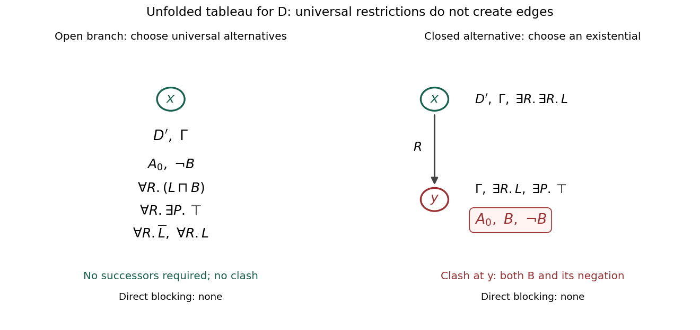

<h1 id="2/b/solution">Solution</h1>

↑ **Parent:** [B](../b.md)

Use the substitution version of [TBox unfolding](../../../../../tbox-unfolding.md) from part (a), and abbreviate

$$
L=A_0\sqcap\neg B,\qquad \overline L=\neg A_0\sqcup B.
$$

The notation $\overline L$ is the [negation normal form](../../../../../negation-normal-form.md) of $\neg L$. The unfolded input [description logic concept](../../../../../description-logic-concept.md) is

$$
\boxed{D'=L\sqcap\forall R.(L\sqcap B).}
$$

For the remaining [TBox](../../../../../tbox.md), turn each [general concept inclusion](../../../../../general-concept-inclusion.md) $X\sqsubseteq Y$ into $\neg X\sqcup Y$, and unfold all defined names. The global [description logic concept](../../../../../description-logic-concept.md) to add at every generated node is

$$
\boxed{\begin{aligned}
\Gamma=C_{\mathcal T_g}'={}&\forall R.\exists P.\top\\
&\sqcap(\forall R.\overline L\sqcup\exists R.\exists R.L)\\
&\sqcap\bigl(\forall R.(\forall R.\overline L\sqcap\forall R.\neg B)\sqcup\forall R.L\bigr).
\end{aligned}}
$$

In the last line, negating $\exists R.(\exists R.A\sqcup\exists R.B)$ gives $\forall R.(\forall R.\neg A\sqcap\forall R.\neg B)$. Both levels of universal restriction are needed.

Start the [tableau algorithm for ALC](../../../../../tableau-algorithm-for-alc.md) with a root $x$ labelled $D'$ and $\Gamma$. Expand the [logical conjunctions](../../../../../logical-conjunction.md). For the disjunction from (2), choose $\forall R.\overline L$. For the disjunction from (3), choose $\forall R.L$. Apart from the compound formulas already processed, the root label is

$$
\mathcal L(x)=\{A_0,\neg B,\forall R.(L\sqcap B),\forall R.\exists P.\top,\forall R.\overline L,\forall R.L\}.
$$

There is no existential restriction at $x$, so no successor needs to be generated. In particular, $\forall R.\exists P.\top$ creates a $P$-successor only at an existing $R$-successor; it creates no $R$-successor itself. The branch is complete and has no [tableau clash](../../../../../tableau-clash.md). There is $\boxed{\text{no directly blocked node}}$: the open completion graph has only its root. The universal restrictions can have incompatible fillers without creating a [tableau clash](../../../../../tableau-clash.md) when there are no successors.

For comparison, choosing the other alternative $\exists R.\exists R.L$ from (2) creates an $R$-successor $y$. The root restriction $\forall R.(L\sqcap B)$ puts $A_0,\neg B,B$ in $\mathcal L(y)$, giving a [tableau clash](../../../../../tableau-clash.md) immediately. That branch closes before [direct blocking in description logic](../../../../../direct-blocking-in-description-logic.md) is needed. The figure records the processed formulas through the label $\Gamma$ and displays the decisive labels explicitly.

**[Figure 1](#2/b/image-an-open-one-node-completion-and-the-closed-alternative-neither-branch-contains-a-directly-blocked-node). An open one-node completion and the closed alternative; neither branch contains a directly blocked node**.

A concrete model confirms the open branch:

$$
\boxed{\Delta^{\mathcal I}=\{d\},\quad A^{\mathcal I}=\{d\},\quad B^{\mathcal I}=C^{\mathcal I}=\varnothing,\quad R^{\mathcal I}=P^{\mathcal I}=\varnothing.}
$$

All three remaining [general concept inclusions](../../../../../general-concept-inclusion.md) hold because their relevant $R$-successor requirements are vacuous. The definition of $C$ and the disjointness condition hold as well. Thus $\boxed{D\text{ is satisfiable with respect to }\mathcal T}$.

## ↑ Ancestors (11)

1. [B](../b.md)
2. [2](../../2.md)
3. [Knowledge representation and reasoning](../../../knowledge-representation-and-reasoning-split.md)
4. [2015](../../../split.md)
5. [Past exam of the computer science course of the University of Oxford](../../../../split.md)
6. [Computer science course of the University of Oxford](../../../../../computer-science-course-of-the-university-of-oxford.md)
7. [Undergraduate course of the University of Oxford](../../../../../undergraduate-course-of-the-university-of-oxford.md)
8. [Course of the University of Oxford](../../../../../course-of-the-university-of-oxford.md)
9. [University of Oxford](../../../../../university-of-oxford-split.md)
10. [List of universities](../../../../../list-of-universities.md)
11. [Codex Wiki](../../../../../split.md)
