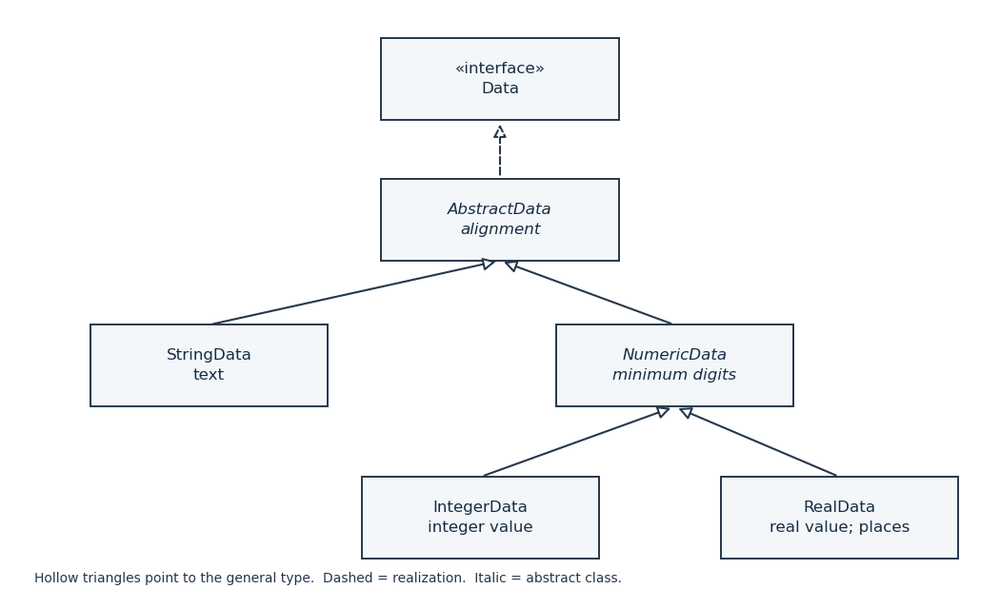

# Object oriented programming

↑ **Parent:** [2015](../2015.md)

The solutions use the original seven-page paper, including its corrected Question 3.[Cover, pp. 2–7, and the correction label on p. 6](../../computer-science-bibliography.md#object-oriented-programming-examination-paper-of-the-university-of-oxford-2015)

**Table of contents**

- [1](#1)
  - [a](#1/a)
    - [Solution](#1/a/solution)
  - [b](#1/b)
    - [Solution](#1/b/solution)
  - [c](#1/c)
    - [Solution](#1/c/solution)
  - [d](#1/d)
    - [i](#1/d/i)
      - [Solution](#1/d/i/solution)
    - [ii](#1/d/ii)
      - [Solution](#1/d/ii/solution)
  - [e](#1/e)
    - [Solution](#1/e/solution)
- [2](#2)
  - [a](#2/a)
    - [Solution](#2/a/solution)
  - [b](#2/b)
    - [Solution](#2/b/solution)
  - [c](#2/c)
    - [Solution](#2/c/solution)
  - [d](#2/d)
    - [Solution](#2/d/solution)
  - [e](#2/e)
    - [Solution](#2/e/solution)
  - [f](#2/f)
    - [Solution](#2/f/solution)
- [3](#3)
  - [a](#3/a)
    - [Solution](#3/a/solution)
  - [b](#3/b)
    - [Solution](#3/b/solution)
  - [c](#3/c)
    - [Solution](#3/c/solution)
  - [d](#3/d)
    - [Solution](#3/d/solution)
  - [e](#3/e)
    - [Solution](#3/e/solution)

## 1

↑ **Parent:** [Object oriented programming](object-oriented-programming.md)

<h3 id="1/a">a</h3>

↑ **Parent:** [1](#1)

<h4 id="1/a/solution">Solution</h4>

↑ **Parent:** [A](#1/a)

An [immutable object](../../programming-language.md#immutable-object) has no changeable observable state after its [object constructor](../../programming-language.md#object-constructor) finishes. Two clients may hold references to the same [immutable object](../../programming-language.md#immutable-object), but neither can change what the other observes. Thus sharing an [immutable object](../../programming-language.md#immutable-object) avoids the interference normally associated with [reference aliasing](../../computer-memory.md#reference-aliasing): for example, sharing a [Java](../../programming-language.md#java-programming-language) `String` is safe because a text-changing operation returns another [software object](../../programming-language.md#software-object) rather than modifying that [String data type](../../programming-language.md#string-data-type) value.

A `final` reference alone does not establish an [immutable object](../../programming-language.md#immutable-object): it prevents reassignment of that reference, but its referent could still be mutable. An [immutable object](../../programming-language.md#immutable-object) must also protect any reachable mutable state, for instance through [defensive copying](../../computer-science.md#defensive-copying). With that qualification, the essential answer is

$$
\boxed{\text{unchanging observable state permits sharing without update interference}.}
$$

<h3 id="1/b">b</h3>

↑ **Parent:** [1](#1)

<h4 id="1/b/solution">Solution</h4>

↑ **Parent:** [B](#1/b)

First determine the width of each column by finding the longest rendered [String data type](../../programming-language.md#string-data-type) value in it. Independently determine the number of rows as the largest column size. An empty column has width zero. Then traverse rows first and columns second: render a present entry with spaces on the appropriate side, or render an absent entry as an entire column of spaces. Put one separating space between adjacent columns and a newline after each row. In particular, an exhausted column must not shift later entries into its position.

Here is executable [Java](../../programming-language.md#java-programming-language) for the [algorithm](../../algorithm.md). `Column`, defined in part (e), is an ordinary [list](../../data-structure.md#list-abstract-data-type) of `Data`. The [object interface](../../programming-language.md#object-interface) in part (c) supplies the three queries used below. Each query sees stable content during this call; concurrent changes to formatting are outside this contract.

```
static String replicate(char c, int n) {
    StringBuilder s = new StringBuilder();
    for (int i = 0; i < n; ++i) s.append(c);
    return s.toString();
}

static String printData(List<Column> columns) {
    int[] width = new int[columns.size()];
    int rows = 0;
    for (int c = 0; c < columns.size(); ++c) {
        Column column = columns.get(c);
        rows = Math.max(rows, column.size());
        for (Data d : column)
            width[c] = Math.max(width[c], d.length());
    }
    StringBuilder out = new StringBuilder();
    for (int r = 0; r < rows; ++r) {
        for (int c = 0; c < columns.size(); ++c) {
            if (c != 0) out.append(' ');
            Column column = columns.get(c);
            if (r >= column.size()) {
                out.append(replicate(' ', width[c]));
            } else {
                Data d = column.get(r);
                String text = d.toString();
                String pad = replicate(' ', width[c] - text.length());
                out.append(d.leftJustified() ? text + pad : pad + text);
            }
        }
        out.append('\n');
    }
    return out.toString();
}
```

The [algorithm](../../algorithm.md) uses the stipulated fixed-width characters and assumes entries contain no embedded newlines. If the column widths are $w_0,\ldots,w_{k-1}$ and $k>0$, every emitted row has the same width,

$$
\boxed{\sum_{c=0}^{k-1}w_c+(k-1)\quad\text{characters before its newline}.}
$$

An empty collection, or a collection consisting entirely of empty columns, gives the empty [String data type](../../programming-language.md#string-data-type) value. Spaces at the end of a short last row are harmless and preserve the rectangular layout.

<h3 id="1/c">c</h3>

↑ **Parent:** [1](#1)

<h4 id="1/c/solution">Solution</h4>

↑ **Parent:** [C](#1/c)

Use an [abstract class](../../programming-language.md#abstract-class) to share the unchangeable alignment flag and the rule that the reported length equals the rendered text's length. This small [class inheritance](../../programming-language.md#class-inheritance) hierarchy will also serve the numeric [software classes](../../programming-language.md#class-programming) in part (d). The [Java interface](../../programming-language.md#java-interface) explicitly declares `toString()` so that the display contract is visible even though all [Java](../../programming-language.md#java-programming-language) [software objects](../../programming-language.md#software-object) already inherit that [object method](../../programming-language.md#object-method).

```
interface Data {
    boolean leftJustified();
    int length();
    String toString();
}

abstract class AbstractData implements Data {
    private final boolean leftj;

    protected AbstractData(boolean leftj) { this.leftj = leftj; }

    public final boolean leftJustified() { return leftj; }
    public final int length() { return toString().length(); }
    public abstract String toString();
}

final class StringData extends AbstractData {
    private final String text;

    public StringData(String s, boolean leftj) {
        super(leftj);
        if (s == null) throw new IllegalArgumentException("null text");
        text = s;
    }

    public String toString() { return text; }
}
```

There are no setters, and the stored [String data type](../../programming-language.md#string-data-type) value is an [immutable object](../../programming-language.md#immutable-object), so `StringData` is itself an [immutable object](../../programming-language.md#immutable-object). Its [object constructor](../../programming-language.md#object-constructor) rejects a [null reference](../../computer-memory.md#null-reference) instead of deferring failure until display. Consequently,

$$
\boxed{\texttt{length()}=\texttt{toString().length()},\qquad\text{alignment is fixed at construction}.}
$$

<h3 id="1/d">d</h3>

↑ **Parent:** [1](#1)

<h4 id="1/d/i">i</h4>

↑ **Parent:** [D](#1/d)

<h5 id="1/d/i/solution">Solution</h5>

↑ **Parent:** [I](#1/d/i)

The [UML class diagram](../../computer-science.md#class-diagram) separates text shared by every displayable item from numeric formatting shared only by numeric items. A dashed hollow-triangle arrow denotes realization of a [Java interface](../../programming-language.md#java-interface); solid hollow-triangle arrows denote [class inheritance](../../programming-language.md#class-inheritance). Both kinds of arrow point towards the more general type.

<a id="1/d/i/image-data-interface-realization-and-inheritance-for-string-integer-and-real-display-items"></a>


**[Figure 1](#1/d/i/image-data-interface-realization-and-inheritance-for-string-integer-and-real-display-items). Data interface realization and inheritance for string, integer and real display items**.

`AbstractData` owns alignment and computes length from the current rendered text. `NumericData` adds the minimum digit width. `IntegerData` and `RealData` each own their numeric value, while `RealData` alone owns the minimum number of decimal places. The numeric formatting [object methods](../../programming-language.md#object-method) do not belong on `Data`: ordinary text has no meaningful `setPlaces` operation. The design choice is

$$
\boxed{\text{shared alignment in AbstractData; shared numeric width in NumericData}.}
$$

<h4 id="1/d/ii">ii</h4>

↑ **Parent:** [D](#1/d)

<h5 id="1/d/ii/solution">Solution</h5>

↑ **Parent:** [Ii](#1/d/ii)

Retain `Data`, `AbstractData` and `StringData` from part (c). The following are the additional [software classes](../../programming-language.md#class-programming). `Formatting` denotes the supplied formatting facility with its two static `format` overloads; its implementation is expressly not required. These calls preserve the distinction between a minimum width and a maximum width: no stored value is truncated.

```
abstract class NumericData extends AbstractData {
    private int minDigits = 0;

    protected NumericData(boolean leftj) { super(leftj); }

    public final void setDigits(int n) { minDigits = Math.max(0, n); }
    protected final int digits() { return minDigits; }
}

final class IntegerData extends NumericData {
    private final int value;

    public IntegerData(int n, boolean leftj) {
        super(leftj);
        value = n;
    }

    public String toString() {
        return Formatting.format(value, digits());
    }
}

final class RealData extends NumericData {
    private final double value;
    private int minPlaces = 0;

    public RealData(double d, boolean leftj) {
        super(leftj);
        value = d;
    }

    public void setPlaces(int p) { minPlaces = Math.max(0, p); }

    public String toString() {
        return Formatting.format(value, digits(), minPlaces);
    }
}
```

Zero is the default minimum, and a nonpositive setting removes that minimum. Formatting a negative value, or a value already longer than the minimum, is delegated to the stated formatter contract. The inherited `length()` calls the current `toString()`, so a change to either formatting setting immediately changes the measured column width. For example, after `setDigits(3)`, an `IntegerData` containing 42 renders `042` and has length 3; after `setPlaces(2)`, a `RealData` containing 2.7 renders `2.70` and has length at least 4.

Unlike `StringData`, these numeric [software objects](../../programming-language.md#software-object) are mutable because their displayed state can change. Their numeric values and alignment remain fixed. The useful invariant is

$$
\boxed{\text{the current formatting settings determine both text and its reported length}.}
$$

<h3 id="1/e">e</h3>

↑ **Parent:** [1](#1)

<h4 id="1/e/solution">Solution</h4>

↑ **Parent:** [E](#1/e)

Use the weekday number as an [array index](../../data-structure.md#array-index). Before adding dates, add one empty entry to each weekday before `start`; otherwise the first date in those columns would appear a week too early. For day $d$, the slot number is $\texttt{start}+d-1$, whose remainder modulo 7 selects the column. The source's example makes clear that `start` counts empty weekday cells, rather than individual printed space characters.[p. 3, Question 1(e) and Figure 1, month(1,30)](../../computer-science-bibliography.md#object-oriented-programming-examination-paper-of-the-university-of-oxford-2015)

With `import java.util.*;`, the remaining [Java](../../programming-language.md#java-programming-language) code is:

```
final class Column extends ArrayList<Data> {
    private static final long serialVersionUID = 1L;
}

static String month(int start, int numDays) {
    if (start < 0 || start >= 7 || numDays < 1 || numDays > 31)
        throw new IllegalArgumentException("invalid month parameters");
    String[] days = {"Su", "Mo", "Tu", "We", "Th", "Fr", "Sa"};
    int ncols = days.length;
    List<Column> output = new ArrayList<Column>(ncols);
    for (int c = 0; c < ncols; ++c) {
        Column column = new Column();
        column.add(new StringData(days[c], true));
        output.add(column);
    }
    for (int c = 0; c < start; ++c)
        output.get(c).add(new StringData("", true));
    for (int d = 1; d <= numDays; ++d) {
        int c = (start + d - 1) % ncols;
        output.get(c).add(new IntegerData(d, false));
    }
    return printData(output);
}
```

The two-character headers force every column to width two, and right justification aligns one-digit dates with the units digits of two-digit dates. Date $d$ appears in data row $\lfloor(\texttt{start}+d-1)/7\rfloor$, below the header. For `month(1,30)` the visible result is

```
Su Mo Tu We Th Fr Sa
    1  2  3  4  5  6
 7  8  9 10 11 12 13
14 15 16 17 18 19 20
21 22 23 24 25 26 27
28 29 30
```

The last physical line may also carry spaces for its empty trailing cells. Every physical line ends with a newline. In particular,

$$
\boxed{\text{weekday}(d)=(\texttt{start}+d-1)\bmod7.}
$$

## 2

↑ **Parent:** [Object oriented programming](object-oriented-programming.md)

<h3 id="2/a">a</h3>

↑ **Parent:** [2](#2)

<h4 id="2/a/solution">Solution</h4>

↑ **Parent:** [A](#2/a)

Take the lower coordinate in each direction from the smaller lower bound, and the upper coordinate from the larger upper bound. This gives an [axis-aligned bounding box](../../computer-aided-geometric-design.md#axis-aligned-bounding-box), rather than the generally nonrectangular [set union](../../set.md#set-union) of the two regions. Use [defensive copying](../../computer-science.md#defensive-copying) because the paper's `Point` has mutable fields.

```
final class Rect {
    private final Point lowerLeft, upperRight;

    public Rect(Point ll, Point ur) {
        if (ll == null || ur == null)
            throw new IllegalArgumentException("null corner");
        double xl = ll.getX(), yl = ll.getY();
        double xh = ur.getX(), yh = ur.getY();
        if (!Double.isFinite(xl) || !Double.isFinite(yl)
                || !Double.isFinite(xh) || !Double.isFinite(yh)
                || xl > xh || yl > yh)
            throw new IllegalArgumentException("invalid rectangle");
        lowerLeft = new Point(xl, yl);
        upperRight = new Point(xh, yh);
    }

    public Rect Union(Rect r) {
        return new Rect(
            new Point(Math.min(lowerLeft.getX(), r.lowerLeft.getX()),
                      Math.min(lowerLeft.getY(), r.lowerLeft.getY())),
            new Point(Math.max(upperRight.getX(), r.upperRight.getX()),
                      Math.max(upperRight.getY(), r.upperRight.getY())));
    }

    public Point lowerLeft() { return lowerLeft.clone(); }
    public Point upperRight() { return upperRight.clone(); }
}
```

Any containing [rectangle](../../euclidean-geometry.md#rectangle) must reach at least as far as each input [rectangle](../../euclidean-geometry.md#rectangle) in all four coordinate directions. The constructed [rectangle](../../euclidean-geometry.md#rectangle) reaches exactly those four limits, which proves both containment and minimality:

$$
\boxed{[\min(x_l,x'_l),\max(x_h,x'_h)]\times[\min(y_l,y'_l),\max(y_h,y'_h)].}
$$

The corner accessors return copies, so changing a constructor argument or returned `Point` cannot alter an existing `Rect`.

<h3 id="2/b">b</h3>

↑ **Parent:** [2](#2)

<h4 id="2/b/solution">Solution</h4>

↑ **Parent:** [B](#2/b)

The [iterator pattern](../../programming-language.md#iterator-pattern) separates traversal state from the aggregate being traversed. A client asks whether another entry exists, then requests that entry, without knowing whether storage is an [array](../../data-structure.md#array-data-structure), a [linked list](../../data-structure.md#linked-list) or another [data structure](../../data-structure.md). Distinct [iterators](../../data-structure.md#iterator) have independent positions in a traversal.

In [Java](../../programming-language.md#java-programming-language), declare `DataList implements Iterable<Point>` and provide `public Iterator<Point> iterator()`. The returned [iterator](../../data-structure.md#iterator) implements `hasNext()` and `next()`; exhausted `next()` throws `NoSuchElementException`. This also permits an enhanced `for (Point p : data)` loop.[Iterable.iterator(), enhanced for support, and Iterator.next() exhaustion contract](../../computer-science-bibliography.md#java-8-iteration-api-documentation)

Returning `points.iterator()` directly would permit removal through that [iterator](../../data-structure.md#iterator) and expose mutable stored `Point` instances. Part (e) instead returns an unmodifiable [iterator snapshot](../../data-structure.md#iterator-snapshot) containing fresh `Point` copies. That choice gives stable traversals and prevents [representation exposure](../../computer-science.md#representation-exposure), with the tradeoff that a traversal does not see subsequent insertions. Thus

$$
\boxed{\texttt{Iterable<Point>}\ \text{creates independent}\ \texttt{Iterator<Point>}\ \text{traversals}.}
$$

<h3 id="2/c">c</h3>

↑ **Parent:** [2](#2)

<h4 id="2/c/solution">Solution</h4>

↑ **Parent:** [C](#2/c)

In [model-view-controller](../../computer-science.md#model-view-controller), the model owns application data and its rules: here it is the ordered `DataList` with its uniqueness condition on horizontal coordinates. A view renders those data, for example as a line plot or a bar plot. View-specific decisions such as whether to show axes need not change the model. A controller interprets actions such as entering a new sample or selecting a plot style, and requests the appropriate model or view operation.

This [separation of concerns](../../computer-science.md#separation-of-concerns) permits several views of the same data and allows model operations to be tested without drawing a window. When the model changes, affected views need a notification or another refresh mechanism. The [Observer pattern](../../programming-language.md#observer-pattern) in part (d) supplies one such mechanism, without making the model depend on every concrete view [software class](../../programming-language.md#class-programming). The division is

$$
\boxed{\text{model: state and rules; view: presentation; controller: input interpretation}.}
$$

<h3 id="2/d">d</h3>

↑ **Parent:** [2](#2)

<h4 id="2/d/solution">Solution</h4>

↑ **Parent:** [D](#2/d)

In the [Observer pattern](../../programming-language.md#observer-pattern), an observable subject keeps registered observers behind a shared [object interface](../../programming-language.md#object-interface). After a relevant update, the subject calls that [object interface](../../programming-language.md#object-interface) on each observer. Observers can register and unregister independently, and the subject needs no knowledge of their concrete [software classes](../../programming-language.md#class-programming).

For this [model-view-controller](../../computer-science.md#model-view-controller) application, `DataList` is the subject, while graph views are observers. After a successful insertion, a notification tells each registered view to redraw from the updated model. An invalid insertion leaves the model unchanged and needs no change notification. Calling observers only after restoring the [representation invariant](../../computer-science.md#representation-invariant) prevents views from seeing a half-completed insertion. Hence

$$
\boxed{\text{one coherent model change can refresh several independently registered views}.}
$$

<h3 id="2/e">e</h3>

↑ **Parent:** [2](#2)

<h4 id="2/e/solution">Solution</h4>

↑ **Parent:** [E](#2/e)

Keep storage private. Find the first entry whose horizontal coordinate is not smaller than the new one. Equality there means that the coordinate is already present; otherwise insertion at that position preserves strict ordering. Reject nonfinite coordinates, since a `NaN` would make the required comparisons meaningless. This is an explicit finite-coordinate contract for a display application.[isFinite(double)](../../computer-science-bibliography.md#java-8-double-api-documentation)

The [Observer pattern](../../programming-language.md#observer-pattern) uses a small callback [Java interface](../../programming-language.md#java-interface). With `import java.util.*;`, the full implementation is:

```
interface GraphObserver {
    void changed(DataList source);
}

final class DataList implements Iterable<Point> {
    private final List<Point> points;
    private final List<GraphObserver> observers;

    public DataList() {
        points = new ArrayList<Point>();
        observers = new ArrayList<GraphObserver>();
    }

    public void addObserver(GraphObserver observer) {
        if (observer == null)
            throw new IllegalArgumentException("null observer");
        for (GraphObserver old : observers)
            if (old == observer) return;
        observers.add(observer);
    }

    public void removeObserver(GraphObserver observer) {
        for (int i = 0; i < observers.size(); ++i) {
            if (observers.get(i) == observer) {
                observers.remove(i);
                return;
            }
        }
    }

    public void addPoint(double x, double y) throws Exception {
        if (!Double.isFinite(x) || !Double.isFinite(y))
            throw new Exception("nonfinite coordinate");
        int i = 0;
        while (i < points.size() && points.get(i).getX() < x) ++i;
        if (i < points.size() && points.get(i).getX() == x)
            throw new Exception("duplicate x coordinate");
        points.add(i, new Point(x, y));
        List<GraphObserver> current =
            new ArrayList<GraphObserver>(observers);
        for (GraphObserver observer : current) observer.changed(this);
    }

    public Iterator<Point> iterator() {
        List<Point> snapshot = new ArrayList<Point>(points.size());
        for (Point p : points) snapshot.add(p.clone());
        return Collections.unmodifiableList(snapshot).iterator();
    }
}
```

This is a sequential implementation. Callback [object methods](../../programming-language.md#object-method) are required to return normally and not reenter `addPoint`; they may change their registrations. Copying the registration [list](../../data-structure.md#list-abstract-data-type) means such changes affect future notifications, while each observer present at the start of this notification gets exactly one call. Repeated registration of the same observer is ignored by [object identity](../../computer-memory.md#object-identity). Both signed zeros compare equal and therefore count as the same horizontal coordinate.

For correctness, all old entries before position `i` have smaller horizontal coordinates. If an entry at `i` exists after the duplicate check, it has a strictly larger coordinate. Inserting between these two groups preserves the [representation invariant](../../computer-science.md#representation-invariant); rejecting a duplicate has no state effect. No client receives a stored mutable `Point`. Thus

$$
\boxed{\text{sorted, duplicate-free insertion first; observer notification second}.}
$$

<h3 id="2/f">f</h3>

↑ **Parent:** [2](#2)

<h4 id="2/f/solution">Solution</h4>

↑ **Parent:** [F](#2/f)

For each sample, include both its marker and its bar. A bar's lower vertical limit is $\min(0,y_i)$, including negative bars below the horizontal axis. Its horizontal half-width is $w_i/2$, rather than $w_i$. Its marker extends by $C$ in both directions. Therefore that sample's [axis-aligned bounding box](../../computer-aided-geometric-design.md#axis-aligned-bounding-box) is

$$
\left[x_i-\max(C,w_i/2),x_i+\max(C,w_i/2)\right]
\times
\left[\min(0,y_i-C),\max(0,y_i+C)\right].
$$

Taking successive bounding unions includes every sample. Finally unite with $[-M,M]\times[-M,M]$ to include the stipulated axes. The printed upper-corner formula has one extra closing parenthesis; both the lower-corner formula and the picture confirm the coordinatewise interpretation used here.[p. 5, Question 2(f), axes formula and Figure 2](../../computer-science-bibliography.md#object-oriented-programming-examination-paper-of-the-university-of-oxford-2015)

The following commented [Java](../../programming-language.md#java-programming-language) [object method](../../programming-language.md#object-method) may be placed in a graph-view utility [software class](../../programming-language.md#class-programming). It uses `Rect` from part (a) and one [iterator snapshot](../../data-structure.md#iterator-snapshot) from part (e).

```
static Rect barBounds(DataList data, double C, double M) {
    if (!Double.isFinite(C) || !Double.isFinite(M) || C <= 0 || M <= 0)
        throw new IllegalArgumentException("positive finite margins required");
    List<Point> p = new ArrayList<Point>();
    for (Point point : data) p.add(point);
    int n = p.size();
    if (n < 2) throw new IllegalArgumentException("at least two points required");

    // This central square supplies the required minimum axis extents.
    Rect bounds = new Rect(new Point(-M, -M), new Point(M, M));
    for (int i = 0; i < n; ++i) {
        double x = p.get(i).getX(), y = p.get(i).getY();
        double width;
        if (i == 0) {
            width = p.get(1).getX() - x;
        } else if (i == n - 1) {
            width = x - p.get(i - 1).getX();
        } else {
            width = Math.min(x - p.get(i - 1).getX(),
                             p.get(i + 1).getX() - x);
        }
        // Include whichever is wider: marker or half of the bar.
        double half = Math.max(C, width / 2.0);
        // The bar reaches the baseline; the marker reaches y +/- C.
        Rect item = new Rect(new Point(x - half, Math.min(0.0, y - C)),
                             new Point(x + half, Math.max(0.0, y + C)));
        bounds = bounds.Union(item);
    }
    return bounds;
}
```

This uses the usual assumption that coordinate differences and expanded bounds are representable as finite `double` values. `Rect` rejects overflowed bounds; numerical range extension is not part of the requested geometry. As with all [floating-point arithmetic](../../floating-point-arithmetic.md), the calculation approximates the corresponding exact [real number](../../arithmetic.md#real-number) formulas.

Every side produced by the coordinatewise extrema is required by some bar, marker enclosure or axis extent. The result is therefore the smallest guaranteed [rectangle](../../euclidean-geometry.md#rectangle) for the specified marker enclosures and axes. If $X_l,Y_l,X_h,Y_h$ denote the graph-only bounds, the final answer is

$$
\boxed{[\min(-M,X_l),\max(M,X_h)]\times[\min(-M,Y_l),\max(M,Y_h)].}
$$

## 3

↑ **Parent:** [Object oriented programming](object-oriented-programming.md)

<h3 id="3/a">a</h3>

↑ **Parent:** [3](#3)

<h4 id="3/a/solution">Solution</h4>

↑ **Parent:** [A](#3/a)

For primitive values, [Java](../../programming-language.md#java-programming-language) `==` compares values, subject to the primitive type's rules. For references, `==` compares [object identity](../../computer-memory.md#object-identity): it asks whether the references designate the same [software object](../../programming-language.md#software-object), or are both null. The `equals(Object)` [object method](../../programming-language.md#object-method) permits a [software class](../../programming-language.md#class-programming) to define [value equality](../../programming-language.md#value-equality). Its inherited `Object` implementation still uses [object identity](../../computer-memory.md#object-identity), so meaningful content comparison requires an appropriate override.[equals(Object), default identity semantics and the equality contract](../../computer-science-bibliography.md#java-8-object-api-documentation)

For example:

```
String a = new String("wall");
String b = new String("wall");
boolean sameObject = (a == b);  // false
boolean sameText = a.equals(b); // true
```

The two allocations have different [object identities](../../computer-memory.md#object-identity) but equal text. Using separately allocated [String data type](../../programming-language.md#string-data-type) values avoids relying on literal interning. A `null` receiver cannot receive an `equals` call; `java.util.Objects.equals(a,b)` is a null-safe comparison. An `equals` implementation should define an [equivalence relation](../../set-theory.md#equivalence-relation) and equal [software objects](../../programming-language.md#software-object) must have equal `hashCode()` results.[equals(Object) and hashCode() contracts](../../computer-science-bibliography.md#java-8-object-api-documentation) The distinction is

$$
\boxed{\text{reference }\texttt{==}:\text{ identity};\qquad\texttt{equals}:\text{ the class's declared equality}.}
$$

<h3 id="3/b">b</h3>

↑ **Parent:** [3](#3)

<h4 id="3/b/solution">Solution</h4>

↑ **Parent:** [B](#3/b)

Let brick $i$ have positive [integer](../../integer.md) width $w_i$. Regard its horizontal occupied region as $[x_i,x_i+w_i)$ and its vertical occupied region as $[y_i,y_i+1)$. These [half-open interval](../../real-analysis.md#half-open-interval) conventions allow adjoining bricks to touch without overlapping. Since the vertical coordinates are [integers](../../integer.md), two bricks can overlap only when they are on the same row. A suitable [predicate](../../analysis-of-boolean-functions.md#predicate) is

$$
\boxed{\operatorname{valid}(W)\iff
\forall i\ne j,\quad
 y_i\ne y_j\ \lor\ x_i+w_i\le x_j\ \lor\ x_j+w_j\le x_i.}
$$

Positive widths and nonnegative [integer](../../integer.md) heights are the underlying domain conditions for a wall built on the baseplate. Distinct members of the [set](../../set.md) are compared even if their `Brick` references happen to be identical: one brick specification can describe several placements. Testing [object identity](../../computer-memory.md#object-identity) alone would miss two overlapping placements of the same specification.

For example, width-two bricks beginning at 0 and 2 on the same row satisfy the [predicate](../../analysis-of-boolean-functions.md#predicate); beginnings at 0 and 1 do not. The non-strict separation inequalities are essential because touching edges are permitted.

<h3 id="3/c">c</h3>

↑ **Parent:** [3](#3)

<h4 id="3/c/solution">Solution</h4>

↑ **Parent:** [C](#3/c)

For an [integer](../../integer.md) cell coordinate, occupancy is an existential [predicate](../../analysis-of-boolean-functions.md#predicate):

$$
\boxed{\operatorname{contains}(W,x,y)\iff
\exists i:\quad y=y_i\ \land\ x_i\le x<x_i+w_i.}
$$

The first occupied unit cell of brick $i$ is at $x_i$, and its last is at $x_i+w_i-1$. Thus the required support [predicate](../../analysis-of-boolean-functions.md#predicate), with the baseplate explicitly included, is

$$
\boxed{\operatorname{supportive}(W)\iff
\forall i:\quad y_i=0\ \lor\
\left(y_i>0\ \land\
\operatorname{contains}(W,x_i,y_i-1)\ \land\
\operatorname{contains}(W,x_i+w_i-1,y_i-1)\right).}
$$

For width one, the two support cells coincide. For a wider brick, its middle may bridge an empty gap; the question only requires support beneath its two ends. Checking $x_i+w_i$ would incorrectly examine a cell beyond the brick's right end. The potentially infinite baseplate supplies every required support at height zero.[p. 6, Question 3(c), and p. 7, Figure 3](../../computer-science-bibliography.md#object-oriented-programming-examination-paper-of-the-university-of-oxford-2015)

<h3 id="3/d">d</h3>

↑ **Parent:** [3](#3)

<h4 id="3/d/solution">Solution</h4>

↑ **Parent:** [D](#3/d)

Represent a wall by a [list](../../data-structure.md#list-abstract-data-type) of rows indexed by height. Within each row keep brick placements sorted by their left coordinate, with disjoint occupied [half-open intervals](../../real-analysis.md#half-open-interval). The public `Brick` in the paper is a mutable input specification; internal placements snapshot its width and colour, so later client edits cannot invalidate an existing wall. Empty intermediate rows cannot occur in a supportive wall with occupied rows above them.

The following [Java](../../programming-language.md#java-programming-language) uses `import java.util.*;` and `import java.awt.Color;`. Keep the source's `Brick` input [software class](../../programming-language.md#class-programming). All other representation types are private nested [software classes](../../programming-language.md#class-programming) of `Wall`, which prevents clients from inserting directly into a row. The `row(int y)` query returns a detached row for the equality operation in part (e).

```
final class Wall {
    private static final class Placed {
        final long x, end;
        final Color colour;

        Placed(long x, int width, Color colour) {
            this.x = x;
            this.end = x + width;
            this.colour = colour;
        }
    }

    private static final class Row {
        private final List<Placed> bricks = new ArrayList<Placed>();

        boolean contains(long x) {
            for (Placed b : bricks) {
                if (x < b.x) return false;
                if (x < b.end) return true;
            }
            return false;
        }

        boolean canInsert(Placed b) {
            for (Placed old : bricks)
                if (b.x < old.end && old.x < b.end) return false;
            return true;
        }

        void insert(Placed b) {
            int i = 0;
            while (i < bricks.size() && bricks.get(i).x < b.x) ++i;
            bricks.add(i, b);
        }

        Row copy() {
            Row r = new Row();
            r.bricks.addAll(bricks);
            return r;
        }

        // Insert the equality members from part (e) here.
    }

    private final List<Row> rows = new ArrayList<Row>();

    public void addBrick(Brick b, int x, int y) throws Exception {
        if (b == null || b.col == null || b.width <= 0 || y < 0)
            throw new Exception("invalid brick or height");
        // Snapshot mutable input. Long arithmetic protects x + width.
        int width = b.width;
        Color colour = new Color(b.col.getRGB(), true);
        Placed placed = new Placed((long) x, width, colour);
        if (y > rows.size()) throw new Exception("unsupported height");

        Row target = y == rows.size() ? new Row() : rows.get(y);
        if (!target.canInsert(placed)) throw new Exception("overlap");
        if (y > 0) {
            Row below = rows.get(y - 1);
            if (!below.contains(placed.x) || !below.contains(placed.end - 1))
                throw new Exception("unsupported end");
        }
        // All checks precede the first modification of this wall.
        target.insert(placed);
        if (y == rows.size()) rows.add(target);
    }

    public boolean contains(int x, int y) {
        return y >= 0 && y < rows.size() && rows.get(y).contains((long) x);
    }

    public Object row(int y) {
        if (y < 0) throw new IllegalArgumentException("negative row");
        return y < rows.size() ? rows.get(y).copy() : new Row();
    }
}
```

Here `Placed` instances and their captured `Color` values are [immutable objects](../../programming-language.md#immutable-object), so copying a row's outer [list](../../data-structure.md#list-abstract-data-type) suffices to create a detached snapshot. Returning its static type as `Object` exposes just the equality operation needed below, without exposing a mutable row [API](../../computer-science.md#application-programming-interface). A fuller application could instead return an immutable row-view [object interface](../../programming-language.md#object-interface).

The empty [list](../../data-structure.md#list-abstract-data-type) represents a valid supportive wall. A rejected insertion performs no wall update. On success, the overlap test establishes validity in the target row; all other rows are unchanged. The support checks establish support for the new brick; adding material cannot remove support from old bricks. Appending a row only at the current height count keeps the row representation contiguous. [Integer overflow](../../programming-language.md#integer-overflow) in a right endpoint is prevented by converting the horizontal coordinate to `long` before adding the positive `int` width. For instance, a brick at `Integer.MAX_VALUE` can still have a mathematically meaningful right endpoint.

The resulting [representation invariant](../../computer-science.md#representation-invariant) is

$$
\boxed{\text{ordered disjoint placements within rows, with every elevated brick supported at both ends}.}
$$

This is a sequential [API](../../computer-science.md#application-programming-interface); concurrent mutation of an input `Brick` during the call is outside its contract. Coordinate magnitude does not determine the storage used: storage is proportional to the number of placements and occupied rows.

<h3 id="3/e">e</h3>

↑ **Parent:** [3](#3)

<h4 id="3/e/solution">Solution</h4>

↑ **Parent:** [E](#3/e)

Brick boundaries are not observable in the requested row equality. Two adjacent red width-one bricks must compare equal to one red width-two brick at the same left coordinate. Comparing the underlying placement [lists](../../data-structure.md#list-abstract-data-type) would therefore give the wrong result.

Instead build each row's unique [sequence](../../sequence-and-series.md#sequence) of maximal occupied colour runs: merge adjacent placements exactly when they touch and have equal colours. Gaps remain gaps, and touching different colours remain separate runs. This is a geometric version of [run-length encoding](../../data-compression.md#run-length-encoding), with explicit start and end coordinates. Insert these members inside `Row` from part (d):

```
private static final class Run {
    final long x, end;
    final Color colour;

    Run(long x, long end, Color colour) {
        this.x = x;
        this.end = end;
        this.colour = colour;
    }
}

private List<Run> runs() {
    List<Run> result = new ArrayList<Run>();
    for (Placed b : bricks) {
        int last = result.size() - 1;
        if (last >= 0) {
            Run r = result.get(last);
            if (r.end == b.x && r.colour.equals(b.colour)) {
                result.set(last, new Run(r.x, b.end, r.colour));
                continue;
            }
        }
        result.add(new Run(b.x, b.end, b.colour));
    }
    return result;
}

@Override public boolean equals(Object other) {
    if (this == other) return true;
    if (!(other instanceof Row)) return false;
    List<Run> a = runs(), b = ((Row) other).runs();
    if (a.size() != b.size()) return false;
    for (int i = 0; i < a.size(); ++i) {
        Run r = a.get(i), s = b.get(i);
        if (r.x != s.x || r.end != s.end || !r.colour.equals(s.colour))
            return false;
    }
    return true;
}

@Override public int hashCode() {
    int h = 1;
    for (Run r : runs()) {
        h = 31 * h + Long.hashCode(r.x);
        h = 31 * h + Long.hashCode(r.end);
        h = 31 * h + r.colour.hashCode();
    }
    return h;
}
```

`Color.equals` compares colour values rather than [object identity](../../computer-memory.md#object-identity). Two row snapshots compare their local horizontal content independently of which wall height supplied them. Empty rows compare equal, even if obtained from different walls. The [hash code](../../computer-science.md#hash-code) uses the same canonical runs as `equals`, so alternative brick subdivisions with equal displayed content also have equal [hash codes](../../computer-science.md#hash-code).[hashCode(), equal objects must produce equal hash codes](../../computer-science-bibliography.md#java-8-object-api-documentation)

To prove correctness, observe that a maximal run starts whenever occupancy begins or the colour changes, and ends exactly where that occupancy or colour ceases. Those boundaries are determined by the occupied colour at every coordinate. Thus equal occupied colours give the same runs, and equal runs give equal occupied colours. If rows contain $m$ and $n$ bricks, generating and comparing their runs has $O(m+n)$ [time complexity](../../theoretical-computer-science.md#time-complexity) and $O(m+n)$ additional storage, independent of their widths or the magnitude of their coordinates. This meets the requirement to improve on checking every possible cell:

$$
\boxed{\text{row equality}\iff\text{equal ordered maximal occupied colour runs}.}
$$

## ↑ Ancestors (8)

1. [2015](../2015.md)
2. [Past exam of the computer science course of the University of Oxford](../../past-exam-of-the-computer-science-course-of-the-university-of-oxford.md)
3. [Computer science course of the University of Oxford](../../university-of-oxford.md#computer-science-course-of-the-university-of-oxford)
4. [Undergraduate course of the University of Oxford](../../university-of-oxford.md#undergraduate-course-of-the-university-of-oxford)
5. [Course of the University of Oxford](../../university-of-oxford.md#course-of-the-university-of-oxford)
6. [University of Oxford](../../university-of-oxford.md)
7. [List of universities](../../README.md#list-of-universities)
8. [Codex Wiki](../../README.md)
