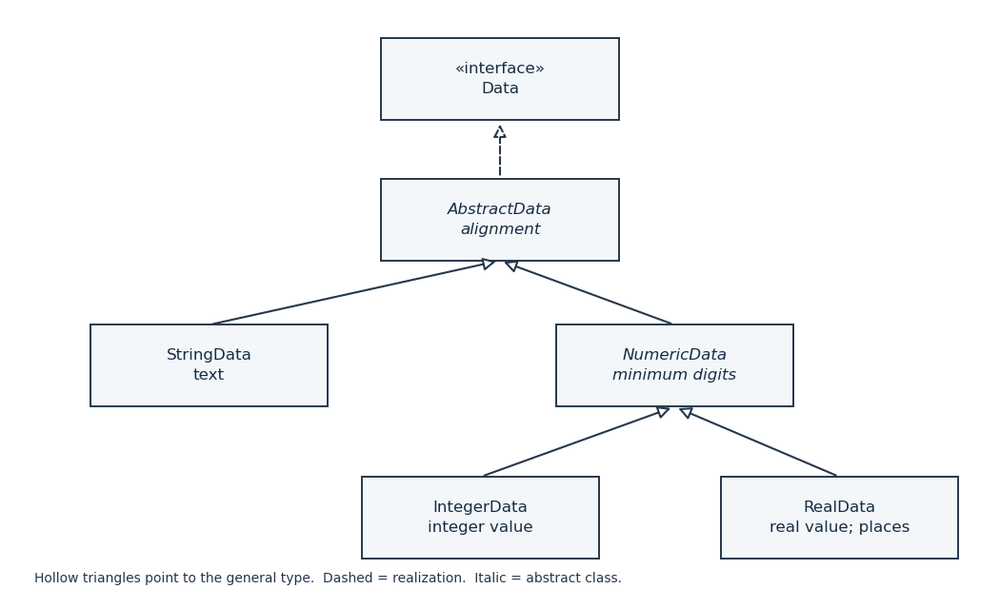

<h1 id="1/d/i/solution">Solution</h1>

↑ **Parent:** [I](../i.md)

The [UML class diagram](../../../../../../class-diagram.md) separates text shared by every displayable item from numeric formatting shared only by numeric items. A dashed hollow-triangle arrow denotes realization of a [Java interface](../../../../../../java-interface.md); solid hollow-triangle arrows denote [class inheritance](../../../../../../class-inheritance.md). Both kinds of arrow point towards the more general type.

**[Figure 1](#1/d/i/image-data-interface-realization-and-inheritance-for-string-integer-and-real-display-items). Data interface realization and inheritance for string, integer and real display items**.

`AbstractData` owns alignment and computes length from the current rendered text. `NumericData` adds the minimum digit width. `IntegerData` and `RealData` each own their numeric value, while `RealData` alone owns the minimum number of decimal places. The numeric formatting [object methods](../../../../../../object-method.md) do not belong on `Data`: ordinary text has no meaningful `setPlaces` operation. The design choice is

$$
\boxed{\text{shared alignment in AbstractData; shared numeric width in NumericData}.}
$$

## ↑ Ancestors (12)

1. [I](../i.md)
2. [D](../../d.md)
3. [1](../../../1.md)
4. [Object oriented programming](../../../../object-oriented-programming-split.md)
5. [2015](../../../../split.md)
6. [Past exam of the computer science course of the University of Oxford](../../../../../split.md)
7. [Computer science course of the University of Oxford](../../../../../../computer-science-course-of-the-university-of-oxford.md)
8. [Undergraduate course of the University of Oxford](../../../../../../undergraduate-course-of-the-university-of-oxford.md)
9. [Course of the University of Oxford](../../../../../../course-of-the-university-of-oxford.md)
10. [University of Oxford](../../../../../../university-of-oxford-split.md)
11. [List of universities](../../../../../../list-of-universities.md)
12. [Codex Wiki](../../../../../../split.md)
