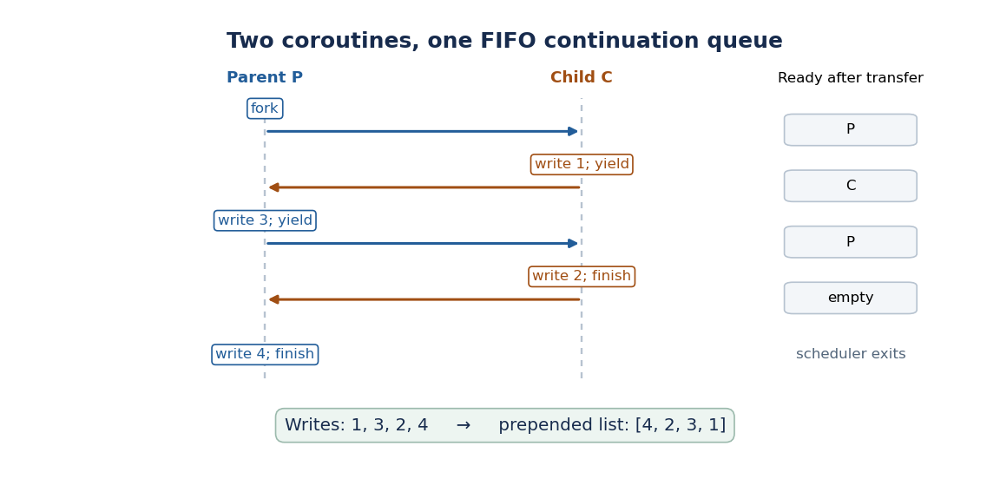

# Principles of programming languages

↑ **Parent:** [2015](../2015.md)

Solutions to all three questions of the paper dated 11 June 2015.[Cover and pp. 2–8, A12079W1](../../computer-science-bibliography.md#principles-of-programming-languages-examination-paper-by-the-university-of-oxford-2015) In the equations below, $r_m$ and $\mathbin{\triangleright_m}$ denote the base [computational monad](../../programming-language.md#computational-monad)'s result and sequencing operations. All equalities of computations are extensional: apply both sides to the same remaining arguments. [Haskell](../../programming-language.md#haskell) fragments use `result` and `bind` for the paper's $\operatorname{result}$ and $\mathbin{\triangleright}$. The `FunMem` programs use the language's own syntax.

**Table of contents**

- [1](#1)
  - [a](#1/a)
    - [Solution](#1/a/solution)
  - [b](#1/b)
    - [Solution](#1/b/solution)
  - [c](#1/c)
    - [Solution](#1/c/solution)
  - [d](#1/d)
    - [Solution](#1/d/solution)
  - [e](#1/e)
    - [Solution](#1/e/solution)
  - [f](#1/f)
    - [Solution](#1/f/solution)
  - [g](#1/g)
    - [Solution](#1/g/solution)
- [2](#2)
  - [a](#2/a)
    - [Solution](#2/a/solution)
  - [b](#2/b)
    - [Solution](#2/b/solution)
  - [c](#2/c)
    - [Solution](#2/c/solution)
  - [d](#2/d)
    - [Solution](#2/d/solution)
  - [e](#2/e)
    - [Solution](#2/e/solution)
- [3](#3)
  - [a](#3/a)
    - [Solution](#3/a/solution)
  - [b](#3/b)
    - [Solution](#3/b/solution)
  - [c](#3/c)
    - [Solution](#3/c/solution)
  - [d](#3/d)
    - [Solution](#3/d/solution)

## 1

↑ **Parent:** [Principles of programming languages](principles-of-programming-languages.md)

<h3 id="1/a">a</h3>

↑ **Parent:** [1](#1)

<h4 id="1/a/solution">Solution</h4>

↑ **Parent:** [A](#1/a)

Thread the explicit [program state](../../programming-language.md#program-state) through the computation, using the base [computational monad](../../programming-language.md#computational-monad) to sequence its effects:

$$
\boxed{\begin{aligned}
\operatorname{result}(x)\,s&=r_m(x,s),\\
(p\triangleright f)\,s&=(p\,s)\triangleright_m\bigl(\lambda(x,s').\,f(x)\,s'\bigr).
\end{aligned}}
$$

In [Haskell](../../programming-language.md#haskell) notation, with `resultM` and `bindM` standing for the base operations:

```
result :: Monad m => a -> MemT m a
result x s = resultM (x,s)

bind :: Monad m => MemT m a -> (a -> MemT m b) -> MemT m b
bind p f s = bindM (p s) (\(x,s') -> f x s')
```

This is the [state monad transformer](../../programming-language.md#state-monad-transformer). The first computation's final [program state](../../programming-language.md#program-state), rather than its initial [program state](../../programming-language.md#program-state), becomes the second computation's input. The base [computational monad](../../programming-language.md#computational-monad) decides whether that pair is available at all.

<h3 id="1/b">b</h3>

↑ **Parent:** [1](#1)

<h4 id="1/b/solution">Solution</h4>

↑ **Parent:** [B](#1/b)

Use the three [monad laws](../../programming-language.md#monad-laws) of the base [computational monad](../../programming-language.md#computational-monad). For left identity, at an arbitrary [program state](../../programming-language.md#program-state) $s$,

$$
\begin{aligned}
(\operatorname{result}(x)\triangleright f)\,s
&=r_m(x,s)\triangleright_m\bigl(\lambda(y,t).\,f(y)\,t\bigr)\\
&=f(x)\,s.
\end{aligned}
$$

The last step is the base left identity law. For right identity,

$$
\begin{aligned}
(p\triangleright\operatorname{result})\,s
&=(p\,s)\triangleright_m\bigl(\lambda(x,t).\,\operatorname{result}(x)\,t\bigr)\\
&=(p\,s)\triangleright_m\bigl(\lambda(x,t).\,r_m(x,t)\bigr)\\
&=(p\,s)\triangleright_m r_m=p\,s.
\end{aligned}
$$

The penultimate equality identifies the pair-destructuring [function](../../function.md) with $r_m$; the last uses the base right identity law.

For [associativity](../../algebraic-operation.md#associative-property), expand the two successive uses of sequencing and apply base [associativity](../../algebraic-operation.md#associative-property):

$$
\begin{aligned}
((p\triangleright f)\triangleright g)\,s
&=\bigl((p\,s)\triangleright_m(\lambda(x,t).\,f(x)\,t)\bigr)
\triangleright_m(\lambda(y,u).\,g(y)\,u)\\
&=(p\,s)\triangleright_m\bigl(\lambda(x,t).\,
(f(x)\,t)\triangleright_m(\lambda(y,u).\,g(y)\,u)\bigr)\\
&=(p\,s)\triangleright_m\bigl(\lambda(x,t).\,(f(x)\triangleright g)\,t\bigr)\\
&=\bigl(p\triangleright(\lambda x.\,f(x)\triangleright g)\bigr)\,s.
\end{aligned}
$$

No [program state](../../programming-language.md#program-state) is duplicated or reset during these rearrangements: both sides pass $s$ to $p$, its output $t$ to $f$, and the output $u$ of $f$ to $g$. By [function extensionality](../../function.md#function-extensionality),

$$
\boxed{\operatorname{result}(x)\triangleright f=f(x),\quad
p\triangleright\operatorname{result}=p,\quad
(p\triangleright f)\triangleright g=p\triangleright(\lambda x.\,f(x)\triangleright g).}
$$

<h3 id="1/c">c</h3>

↑ **Parent:** [1](#1)

<h4 id="1/c/solution">Solution</h4>

↑ **Parent:** [C](#1/c)

Reading preserves the [computer memory](../../computer-memory.md); writing returns the [unit type](../../programming-language.md#unit-type) value; allocating returns both the fresh [memory location](../../computer-memory.md#memory-location) and the allocator's updated [computer memory](../../computer-memory.md):

```
get :: Monad m => Location -> MemT m Value
get a s = resultM (contents s a,s)

put :: Monad m => Location -> Value -> MemT m ()
put a v s = resultM ((),update s a v)

new :: Monad m => MemT m Location
new s = resultM (fresh s)
```

These use the memory interface in [Printed p. 3, Figure 1](../../computer-science-bibliography.md#principles-of-programming-languages-examination-paper-by-the-university-of-oxford-2015). In particular, `fresh` already returns its outputs in the order required by the [state monad transformer](../../programming-language.md#state-monad-transformer):

$$
\boxed{\begin{aligned}
\operatorname{get}(a)\,s&=r_m(\operatorname{contents}(s,a),s),\\
\operatorname{put}(a,v)\,s&=r_m((),\operatorname{update}(s,a,v)),\\
\operatorname{new}\,s&=r_m(\operatorname{fresh}(s)).
\end{aligned}}
$$

<h3 id="1/d">d</h3>

↑ **Parent:** [1](#1)

<h4 id="1/d/solution">Solution</h4>

↑ **Parent:** [D](#1/d)

There is one undifferentiated exception, so use the two alternatives of the [Haskell](../../programming-language.md#haskell) [algebraic data type](../../programming-language.md#algebraic-data-type) `Maybe`: `Just x` succeeds and `Nothing` fails. A suitable [exception monad transformer](../../programming-language.md#exception-monad-transformer) is:

```
type ExT m a = m (Maybe a)

result :: Monad m => a -> ExT m a
result x = resultM (Just x)

bind :: Monad m => ExT m a -> (a -> ExT m b) -> ExT m b
bind p f = bindM p (\r -> case r of
  Nothing -> resultM Nothing
  Just x  -> f x)

orelse :: Monad m => ExT m a -> ExT m a -> ExT m a
orelse p q = bindM p (\r -> case r of
  Nothing -> q
  Just x  -> resultM (Just x))

failure :: Monad m => ExT m a
failure = resultM Nothing
```

The distinction between `bindM` and `bind` matters. The handler must inspect the failed alternative using the base [computational monad](../../programming-language.md#computational-monad); the transformed `bind` would propagate failure without running that inspection. The alternative computation `q` runs only after `p` returns `Nothing`; any effects already performed by the base [computational monad](../../programming-language.md#computational-monad) remain subject to that base's semantics.

Left identity follows by selecting `Just x`. Right identity follows because either alternative is passed back to `resultM`. For [associativity](../../algebraic-operation.md#associative-property), base [associativity](../../algebraic-operation.md#associative-property) exposes the first alternative: `Nothing` propagates through both remaining steps; `Just x` runs `f x`, with its `Nothing` and `Just` alternatives treated identically on both sides. Thus this representation also satisfies the [monad laws](../../programming-language.md#monad-laws).

$$
\boxed{\operatorname{ExT}\ m\ A=m(\operatorname{Maybe}\ A),\qquad
\operatorname{failure}\mathbin{\operatorname{orelse}}q=q,\qquad
\operatorname{result}(x)\mathbin{\operatorname{orelse}}q=\operatorname{result}(x).}
$$

<h3 id="1/e">e</h3>

↑ **Parent:** [1](#1)

<h4 id="1/e/solution">Solution</h4>

↑ **Parent:** [E](#1/e)

The [identity monad](../../programming-language.md#identity-monad) embeds a value unchanged and sequences by ordinary application:

```
type IdM a = a
result :: a -> IdM a
result x = x
bind :: IdM a -> (a -> IdM b) -> IdM b
bind x f = f x
```

All three [monad laws](../../programming-language.md#monad-laws) reduce to substitution in [function](../../function.md) application. There is no additional [program state](../../programming-language.md#program-state), failure alternative or [continuation](../../programming-language.md#continuation-computer-science) layer:

$$
\boxed{\operatorname{result}(x)=x,\qquad x\triangleright f=f(x).}
$$

<h3 id="1/f">f</h3>

↑ **Parent:** [1](#1)

<h4 id="1/f/solution">Solution</h4>

↑ **Parent:** [F](#1/f)

Expand the two [type synonyms](../../programming-language.md#type-synonym) to see what survives an exception:

$$
\begin{aligned}
\operatorname{ExT}(\operatorname{MemT}\ m)\ A
&=\operatorname{Mem}\to m(\operatorname{Maybe}\ A,\operatorname{Mem}),\\
\operatorname{MemT}(\operatorname{ExT}\ m)\ A
&=\operatorname{Mem}\to m(\operatorname{Maybe}(A,\operatorname{Mem})).
\end{aligned}
$$

In the first order, a failed computation can still produce `(Nothing,s')`. The exception handler therefore runs with $s'$, including writes made before failure. In the second order, failure produces `Nothing`, with no returned [computer memory](../../computer-memory.md). A handler defined by applying the underlying `orelse` pointwise runs its alternative from the original input [computer memory](../../computer-memory.md) $s$. This gives rollback of this explicit [program state](../../programming-language.md#program-state) for the failed branch.

For example, start with a [memory location](../../computer-memory.md#memory-location) holding $0$, write $1$, fail, and handle the failure by reading that [memory location](../../computer-memory.md#memory-location). The first order returns $1$; the second returns $0$. This rollback concerns the explicit [computer memory](../../computer-memory.md) only: arbitrary effects in the base [computational monad](../../programming-language.md#computational-monad) are not thereby reversed.

$$
\boxed{\begin{aligned}
\operatorname{ExT}(\operatorname{MemT}\ m)&:\text{ writes survive failure};\\
\operatorname{MemT}(\operatorname{ExT}\ m)&:\text{ failed memory updates roll back}.
\end{aligned}}
$$

A conventional [programming language](../../programming-language.md) normally retains writes made before an exception is caught. Its mutable [computer memory](../../computer-memory.md) and [exception handling](../../programming-language.md#exception-handling) therefore correspond more closely to $\operatorname{ExT}(\operatorname{MemT}\ m)$.

<h3 id="1/g">g</h3>

↑ **Parent:** [1](#1)

<h4 id="1/g/solution">Solution</h4>

↑ **Parent:** [G](#1/g)

Fix an answer type and let the [continuation](../../programming-language.md#continuation-computer-science) return its answer inside the base [computational monad](../../programming-language.md#computational-monad):

```
type ContT m a = (a -> m Answer) -> m Answer

result :: Monad m => a -> ContT m a
result x k = k x

bind :: Monad m => ContT m a -> (a -> ContT m b) -> ContT m b
bind p f k = p (\x -> f x k)
```

The [continuation monad transformer](../../programming-language.md#continuation-monad-transformer) changes the [continuation](../../programming-language.md#continuation-computer-science) supplied to `p`: it first runs `f` on the produced value, then uses the original final [continuation](../../programming-language.md#continuation-computer-science) `k`. Base sequencing is unnecessary in these two definitions because `p` already accepts a [continuation](../../programming-language.md#continuation-computer-science) returning `m Answer`. The customary lift, if desired, is `lift q k = bindM q k`.

$$
\boxed{\begin{aligned}
\operatorname{ContT}\ m\ A&=(A\to m\operatorname{Answer})\to m\operatorname{Answer},\\
\operatorname{result}(x)\,k&=k(x),\\
(p\triangleright f)\,k&=p(\lambda x.\,f(x)\,k).
\end{aligned}}
$$

## 2

↑ **Parent:** [Principles of programming languages](principles-of-programming-languages.md)

<h3 id="2/a">a</h3>

↑ **Parent:** [2](#2)

<h4 id="2/a/solution">Solution</h4>

↑ **Parent:** [A](#2/a)

The [continuation](../../programming-language.md#continuation-computer-science) receives both the computed value and the current [computer memory](../../computer-memory.md). Therefore return invokes it with unchanged [computer memory](../../computer-memory.md), while sequencing installs a [continuation](../../programming-language.md#continuation-computer-science) that passes the produced value and updated [computer memory](../../computer-memory.md) to the next computation:

```
result :: a -> M a
result x k s = k x s

bind :: M a -> (a -> M b) -> M b
bind p f k s = p (\x s' -> f x k s') s
```

For left identity, expand the two definitions:

$$
(\operatorname{result}(x)\triangleright f)\,k\,s
=(\lambda y\,t.\,f(y)\,k\,t)\,x\,s=f(x)\,k\,s.
$$

For right identity,

$$
(p\triangleright\operatorname{result})\,k\,s
=p(\lambda x\,t.\,\operatorname{result}(x)\,k\,t)\,s
=p(\lambda x\,t.\,k\,x\,t)\,s=p\,k\,s.
$$

For [associativity](../../algebraic-operation.md#associative-property), both groupings reduce to the same expression:

$$
\begin{aligned}
((p\triangleright f)\triangleright g)\,k\,s
&=p\bigl(\lambda x\,t.\,f(x)(\lambda y\,u.\,g(y)\,k\,u)\,t\bigr)\,s,\\
\bigl(p\triangleright(\lambda x.\,f(x)\triangleright g)\bigr)\,k\,s
&=p\bigl(\lambda x\,t.\,f(x)(\lambda y\,u.\,g(y)\,k\,u)\,t\bigr)\,s.
\end{aligned}
$$

By [function extensionality](../../function.md#function-extensionality), these establish all three [monad laws](../../programming-language.md#monad-laws):

$$
\boxed{\operatorname{result}(x)\triangleright f=f(x),\qquad
p\triangleright\operatorname{result}=p,\qquad
(p\triangleright f)\triangleright g=p\triangleright(\lambda x.\,f(x)\triangleright g).}
$$

<h3 id="2/b">b</h3>

↑ **Parent:** [2](#2)

<h4 id="2/b/solution">Solution</h4>

↑ **Parent:** [B](#2/b)

Apply the memory interface before invoking the supplied [continuation](../../programming-language.md#continuation-computer-science):

```
get :: Location -> M Value
get a k s = k (contents s a) s

put :: Location -> Value -> M ()
put a v k s = k () (update s a v)

new :: M Location
new k s = let (a,s') = fresh s in k a s'
```

A read preserves [computer memory](../../computer-memory.md); a write changes it but returns the [unit type](../../programming-language.md#unit-type) value; an allocation uses the updated [computer memory](../../computer-memory.md) returned by `fresh`. The [continuation](../../programming-language.md#continuation-computer-science) always receives the latest [computer memory](../../computer-memory.md):

$$
\boxed{\begin{aligned}
\operatorname{get}(a)\,k\,s&=k(\operatorname{contents}(s,a))\,s,\\
\operatorname{put}(a,v)\,k\,s&=k(())(\operatorname{update}(s,a,v)),\\
\operatorname{new}\,k\,s&=k(a)\,s'\quad\text{where }(a,s')=\operatorname{fresh}(s).
\end{aligned}}
$$

<h3 id="2/c">c</h3>

↑ **Parent:** [2](#2)

<h4 id="2/c/solution">Solution</h4>

↑ **Parent:** [C](#2/c)

Capturing a [continuation](../../programming-language.md#continuation-computer-science) retains the destination, while the [computer memory](../../computer-memory.md) is supplied when that destination is eventually invoked. The required [Haskell](../../programming-language.md#haskell) definitions are:

```
callcc :: (Cont a -> M a) -> M a
callcc f k s = f k k s

withc :: Cont a -> M a -> M a
withc saved p _current s = p saved s

callccPrim :: [Value] -> M Value
callccPrim [Function f] =
  callcc (\k -> f [Continuation k])

withcPrim :: [Value] -> M Value
withcPrim [Continuation k,v] = withc k (result v)
```

In `callcc`, the handler `f k` initially runs with the same current [continuation](../../programming-language.md#continuation-computer-science) `k`. If it returns normally, its result goes there. If it invokes `withc` with a saved [continuation](../../programming-language.md#continuation-computer-science), the current destination is discarded. In particular,

$$
\boxed{\operatorname{callcc}(f)\,k\,s=f(k)\,k\,s,\qquad
\operatorname{withc}(k',p)\,k\,s=p\,k'\,s.}
$$

The primitive interface receives values, because the surrounding [call-by-value](../../programming-language.md#call-by-value) [interpreter](../../programming-language.md#interpreter-computing) has already evaluated its arguments. Thus the expression supplied as the second argument of `withc` is evaluated once, before `withcPrim` transfers its value. Wrapping that value with `result` implements precisely the remaining transfer; the primitive must not try to evaluate it a second time. Neither operation restores a saved snapshot of [computer memory](../../computer-memory.md).

<h3 id="2/d">d</h3>

↑ **Parent:** [2](#2)

<h4 id="2/d/solution">Solution</h4>

↑ **Parent:** [D](#2/d)

Keep a [FIFO queue](../../data-structure.md#fifo-queue) of runnable [continuations](../../programming-language.md#continuation-computer-science) in shared [computer memory](../../computer-memory.md). Removing a [continuation](../../programming-language.md#continuation-computer-science) from its head transfers control with `nil`; suspending a runnable computation appends its [continuation](../../programming-language.md#continuation-computer-science) at the rear. A single scheduler group also needs a terminal [continuation](../../programming-language.md#continuation-computer-science) so that finishing the last computation cannot return through an obsolete invocation of `fork`.

The following is `FunMem`, including the shared initialization and helper definitions. `run(main)` starts a scheduler group; nested `fork` calls use that same group.

```
val ready = new(); ready := nil;
val stop = new();

rec append(xs,ys) =
  if xs = nil then ys else head(xs) : append(tail(xs),ys);

val enqueue(k) =
  ready := append(!ready,k:nil); nil;

val dispatch() =
  if !ready = nil then withc(!stop,nil)
  else let val k = head(!ready) in
    ready := tail(!ready); withc(k,nil);

val run(main) =
  callcc(lambda (done)
    stop := done; ready := nil;
    main(); dispatch());

val fork(f) =
  callcc(lambda (parent)
    enqueue(parent); f(); dispatch());

val yield() =
  callcc(lambda (current)
    enqueue(current); dispatch())
```

At `fork`, the parent is queued before `f()` starts. The child runs immediately. Its ordinary return value is ignored by sequencing into `dispatch()`. At `yield`, the current computation joins the rear, then the oldest runnable computation is removed from the front. If there was no other runnable computation, these operations select the just-captured [continuation](../../programming-language.md#continuation-computer-science), so the caller resumes immediately with `nil`.

The invariant is that each suspended runnable computation has exactly one entry in `ready`, ordered by the time it most recently became suspended and runnable. A running computation is absent from that [FIFO queue](../../data-structure.md#fifo-queue). Neither appending nor removing an entry suspends, so these operations are indivisible relative to this [cooperative multitasking](../../programming-language.md#cooperative-multitasking) scheduler. Completing a child removes the child from consideration permanently; it is never enqueued by its completion wrapper.

For the paper's example, call the initial computation $P$ and the forked computation $C$. The [FIFO queue](../../data-structure.md#fifo-queue) and writes evolve as follows:

| Event | Running next | Ready queue | New list head | Fork starts child | $C$ | $P$ | — | Child writes and yields | $P$ | $C$ | $1$ | Parent writes and yields | $C$ | $P$ | $3$ | Child writes and finishes | $P$ | empty | $2$ | Parent writes and finishes | scheduler exits | empty | $4$ |
| --- | --- | --- | --- | --- | --- | --- | --- | --- | --- | --- | --- | --- | --- | --- | --- | --- | --- | --- | --- | --- | --- | --- | --- |

<a id="2/d/image-fifo-continuation-scheduling-of-the-paper-s-two-coroutines"></a>


**[Figure 1](#2/d/image-fifo-continuation-scheduling-of-the-paper-s-two-coroutines). FIFO continuation scheduling of the paper's two coroutines**.

Thus the observable list, read after the scheduler group finishes, is

$$
\boxed{[4,2,3,1],\qquad\operatorname{fork}(f)\text{ and }\operatorname{yield}()\text{ resume their callers with nil}.}
$$

The scheduler exit is used only when no runnable [continuations](../../programming-language.md#continuation-computer-science) remain. A main computation can place its desired final observable value in shared [computer memory](../../computer-memory.md) and read it after `run` returns. This wrapper also permits already-forked computations to finish if the initial computation finishes before them. Each `run` creates one active scheduler group; calls of `run` are not nested.

<h3 id="2/e">e</h3>

↑ **Parent:** [2](#2)

<h4 id="2/e/solution">Solution</h4>

↑ **Parent:** [E](#2/e)

Represent a [binary semaphore](../../operating-system.md#binary-semaphore) by a two-element [list](../../data-structure.md#list-abstract-data-type) containing the addresses of its busy flag and its waiting [FIFO queue](../../data-structure.md#fifo-queue). A blocked [continuation](../../programming-language.md#continuation-computer-science) belongs to the waiting [FIFO queue](../../data-structure.md#fifo-queue), not the scheduler's runnable [FIFO queue](../../data-structure.md#fifo-queue). These definitions extend the `FunMem` scheduler from the preceding part:

```
val semaphore() =
  let val busy = new() in
  let val waiting = new() in
    busy := false; waiting := nil; busy : waiting : nil;

val acquire(s) =
  let val busy = head(s) in
  let val waiting = head(tail(s)) in
    if !busy then
      callcc(lambda (blocked)
        waiting := append(!waiting,blocked:nil); dispatch())
    else (busy := true; nil);

val release(s) =
  let val busy = head(s) in
  let val waiting = head(tail(s)) in
    if !waiting = nil then (busy := false; nil)
    else let val next = head(!waiting) in
      waiting := tail(!waiting); enqueue(next); nil
```

A newly created [semaphore](../../operating-system.md#semaphore-programming) is free. Acquiring it while free marks it busy and immediately returns `nil`. Acquiring it while busy captures the remainder of the caller, appends that [continuation](../../programming-language.md#continuation-computer-science) to the waiting [FIFO queue](../../data-structure.md#fifo-queue), and dispatches a runnable computation. No runnable copy of the blocked caller is retained.

When a waiting caller exists, `release` keeps the busy flag true: the released permit is reserved for that caller. It removes exactly one waiting [continuation](../../programming-language.md#continuation-computer-science) and appends it to the scheduler's runnable [FIFO queue](../../data-structure.md#fifo-queue). It does not invoke `dispatch`, so the releasing computation keeps running. A newcomer cannot steal the reserved permit during the interval before the released caller resumes. That caller's captured [continuation](../../programming-language.md#continuation-computer-science) resumes after `acquire` with `nil`, already possessing the permit.

$$
\boxed{\begin{array}{ll}
\text{free acquire:}&\text{mark busy and continue};\\
\text{busy acquire:}&\text{block outside the runnable queue};\\
\text{release with waiter:}&\text{keep busy and enqueue one waiter};\\
\text{release without waiter:}&\text{mark free}.
\end{array}}
$$

These are [FIFO semaphores](../../operating-system.md#fifo-semaphore); the question only requires selecting one waiter, so choosing the oldest is a valid stronger discipline. The updates contain no suspension except at the explicit blocking point, making them atomic relative to this [cooperative multitasking](../../programming-language.md#cooperative-multitasking) scheduler. As allowed in the paper, invalid releases and executions in which every remaining computation is blocked need no error handling; the latter are [deadlocks](../../operating-system.md#deadlock), not a way to make progress.

## 3

↑ **Parent:** [Principles of programming languages](principles-of-programming-languages.md)

<h3 id="3/a">a</h3>

↑ **Parent:** [3](#3)

<h4 id="3/a/solution">Solution</h4>

↑ **Parent:** [A](#3/a)

Use [programming closures](../../programming-language.md#closure-computer-programming) that receive evaluated arguments and return a computation in the chosen [computational monad](../../programming-language.md#computational-monad). A sufficient core of the semantic value domain is:

```
data Value = IntVal Integer
           | BoolVal Bool
           | Function ([Value] -> M Value)
```

Additional constructors may represent the other built-in values. Assume a [semantic environment](../../programming-language.md#semantic-environment) abstract data type with operations `lookupEnv :: Env -> Ident -> Value` and `extend :: Env -> [(Ident,Value)] -> Env`. The latter simultaneously adds the listed bindings, shadowing old bindings. Parameter names in one binding list are distinct, and calls have the expected arity.

Define [programming closure](../../programming-language.md#closure-computer-programming) construction separately; it does not run the body:

```
close :: Expr -> Env -> Value
close (Lambda xs body) rho =
  Function (\args -> eval body (extend rho (zip xs args)))

apply :: Value -> [Value] -> M Value
apply (Function f) args = f args
```

The four expression forms have the following semantic equations. Function position is evaluated first, followed by argument expressions from left to right:

```
eval :: Expr -> Env -> M Value

eval (Variable x) rho = result (lookupEnv rho x)

eval (Apply e es) rho =
  bind (eval e rho) (\f ->
    bind (evalArgs es rho) (\args -> apply f args))

eval e@(Lambda xs body) rho = result (close e rho)

eval (Let d body) rho =
  bind (defn d rho) (\rho' -> eval body rho')

evalArgs :: [Expr] -> Env -> M [Value]
evalArgs [] rho = result []
evalArgs (e:es) rho =
  bind (eval e rho) (\v ->
    bind (evalArgs es rho) (\vs -> result (v:vs)))
```

The two definition forms are:

```
defn :: Defn -> Env -> M Env

defn (Val x e) rho =
  bind (eval e rho) (\v -> result (extend rho [(x,v)]))

defn (Rec x e@(Lambda xs body)) rho = result rho'
  where
    rho' = extend rho [(x,v)]
    v = close e rho'
```

The ordinary definition evaluates its right-hand side in the old [semantic environment](../../programming-language.md#semantic-environment); its own name is not yet bound there. The recursive definition creates a [recursive closure](../../programming-language.md#recursive-closure) in the extended [semantic environment](../../programming-language.md#semantic-environment) containing itself. Because the right-hand side is a [lambda abstraction](../../computability-theory.md#lambda-abstraction), constructing that [programming closure](../../programming-language.md#closure-computer-programming) does not evaluate its body. [Haskell](../../programming-language.md#haskell)'s [lazy evaluation](../../programming-language.md#lazy-evaluation) can tie this recursive data structure without requiring any extra fixed-point operation from the arbitrary [computational monad](../../programming-language.md#computational-monad).

[Lexical scope](../../programming-language.md#lexical-scope) is explicit: calling a [programming closure](../../programming-language.md#closure-computer-programming) extends the defining [semantic environment](../../programming-language.md#semantic-environment), and its parameters shadow bindings in that [semantic environment](../../programming-language.md#semantic-environment). The six requested constructs are therefore covered by

$$
\boxed{\operatorname{Variable},\ \operatorname{Apply},\ \operatorname{Lambda},\ \operatorname{Let},\ \operatorname{Val},\ \operatorname{Rec}.}
$$

<h3 id="3/b">b</h3>

↑ **Parent:** [3](#3)

<h4 id="3/b/solution">Solution</h4>

↑ **Parent:** [B](#3/b)

The equivalence holds for every lawful [computational monad](../../programming-language.md#computational-monad) with the semantic equations above. In particular, effects in $e_1$ are neither discarded nor evaluated twice. Fix an initial [semantic environment](../../programming-language.md#semantic-environment) $\rho$, and write

$$
E=\operatorname{eval}(e_1)\,\rho,\qquad
\rho_v=\operatorname{extend}(\rho,[(x,v)]),\qquad
F(v)=\operatorname{eval}(e_2)\,\rho_v.
$$

Expanding `Let` and `Val` gives

$$
\begin{aligned}
\operatorname{eval}(\mathsf{let\ val}\ x=e_1\ \mathsf{in}\ e_2)\,\rho
&=\bigl(E\triangleright(\lambda v.\,\operatorname{result}(\rho_v))\bigr)
\triangleright(\lambda\rho'.\,\operatorname{eval}(e_2)\,\rho')\\
&=E\triangleright\bigl(\lambda v.\,
\operatorname{result}(\rho_v)\triangleright(\lambda\rho'.\,\operatorname{eval}(e_2)\,\rho')\bigr)\\
&=E\triangleright F.
\end{aligned}
$$

The two steps use [associativity](../../algebraic-operation.md#associative-property) and left identity from the [monad laws](../../programming-language.md#monad-laws).

For the application, evaluating the [lambda abstraction](../../computability-theory.md#lambda-abstraction) yields `result c`, where the [programming closure](../../programming-language.md#closure-computer-programming) $c$ satisfies $\operatorname{apply}(c,[v])=F(v)$. The singleton argument evaluator reduces to

$$
\begin{aligned}
\operatorname{evalArgs}([e_1])\,\rho
&=E\triangleright\bigl(\lambda v.\,
\operatorname{result}([])\triangleright(\lambda vs.\,\operatorname{result}(v:vs))\bigr)\\
&=E\triangleright(\lambda v.\,\operatorname{result}([v])).
\end{aligned}
$$

Use left identity to remove the initial `result c`, then [associativity](../../algebraic-operation.md#associative-property) and left identity again:

$$
\begin{aligned}
\operatorname{eval}((\mathsf{lambda}(x)\ e_2)\ e_1)\,\rho
&=\bigl(E\triangleright(\lambda v.\,\operatorname{result}([v]))\bigr)
\triangleright(\lambda vs.\,\operatorname{apply}(c,vs))\\
&=E\triangleright\bigl(\lambda v.\,
\operatorname{result}([v])\triangleright(\lambda vs.\,\operatorname{apply}(c,vs))\bigr)\\
&=E\triangleright F.
\end{aligned}
$$

Consequently,

$$
\boxed{\operatorname{eval}(\mathsf{let\ val}\ x=e_1\ \mathsf{in}\ e_2)\,\rho
=\operatorname{eval}((\mathsf{lambda}(x)\ e_2)\ e_1)\,\rho
\quad\text{for every lawful }M.}
$$

The argument relies on the [lambda abstraction](../../computability-theory.md#lambda-abstraction) itself being effect-free, as specified in part (a), and on using the same [semantic environment](../../programming-language.md#semantic-environment) for $e_1$ on each side. No commutativity of effects is assumed. In particular, the proof applies to [state monads](../../programming-language.md#state-monad), exceptions and [continuation monads](../../programming-language.md#continuation-monad), not merely to the [identity monad](../../programming-language.md#identity-monad).

<h3 id="3/c">c</h3>

↑ **Parent:** [3](#3)

<h4 id="3/c/solution">Solution</h4>

↑ **Parent:** [C](#3/c)

Add the [abstract syntax tree](../../programming-language.md#abstract-syntax-tree) alternative `Fix Ident Expr`. Its [syntactic sugar](../../programming-language.md#syntactic-sugar) expansion and the semantic equations from part (a) give

$$
\begin{aligned}
\operatorname{eval}(\operatorname{Fix}\ x\ e)\,\rho
&=\operatorname{eval}(\operatorname{Let}\ (\operatorname{Rec}\ x\ e)\ (\operatorname{Variable}\ x))\,\rho\\
&=\operatorname{defn}(\operatorname{Rec}\ x\ e)\,\rho
\triangleright(\lambda\rho'.\,\operatorname{result}(\operatorname{lookupEnv}(\rho',x)))\\
&=\operatorname{result}(\rho^*)
\triangleright(\lambda\rho'.\,\operatorname{result}(\operatorname{lookupEnv}(\rho',x)))\\
&=\operatorname{result}(v),
\end{aligned}
$$

where $\rho^*=\operatorname{extend}(\rho,[(x,v)])$ and $v=\operatorname{close}(e,\rho^*)$. The final step uses left identity from the [monad laws](../../programming-language.md#monad-laws) and the lookup rule for the newly bound identifier.

Thus a direct evaluator equation is:

```
eval (Fix x e@(Lambda xs body)) rho = result v
  where
    rho' = extend rho [(x,v)]
    v = close e rho'
```

Equivalently, spelling out [programming closure](../../programming-language.md#closure-computer-programming) construction,

$$
\boxed{\operatorname{eval}(\operatorname{Fix}\ x\ (\operatorname{Lambda}\ xs\ b))\,\rho
=\operatorname{result}(v),\quad
v=\operatorname{Function}\bigl(\lambda args.\,
\operatorname{eval}(b)(\operatorname{extend}(\rho^*,\operatorname{zip}(xs,args)))\bigr).}
$$

The result is a [recursive closure](../../programming-language.md#recursive-closure), not the result of calling its body. Its self-binding is visible inside that body but does not extend the caller's surrounding [semantic environment](../../programming-language.md#semantic-environment).

<h3 id="3/d">d</h3>

↑ **Parent:** [3](#3)

<h4 id="3/d/solution">Solution</h4>

↑ **Parent:** [D](#3/d)

Add `Fixes [Ident] [Expr]` to the [abstract syntax tree](../../programming-language.md#abstract-syntax-tree). For the stipulated nonempty, equally long lists of distinct names and [lambda abstractions](../../computability-theory.md#lambda-abstraction), define all [programming closures](../../programming-language.md#closure-computer-programming) against one common extended [semantic environment](../../programming-language.md#semantic-environment):

```
eval (Fixes xs es) rho = result (head vs)
  where
    rho' = extend rho (zip xs vs)
    vs = map (\e -> close e rho') es
```

Expanding the auxiliary [function](../../function.md), if $e_i=\operatorname{Lambda}\ ys_i\ b_i$,

$$
\boxed{\begin{aligned}
\rho^*&=\operatorname{extend}(\rho,[(x_1,v_1),\ldots,(x_n,v_n)]),\\
v_i&=\operatorname{Function}\bigl(\lambda args.\,
\operatorname{eval}(b_i)(\operatorname{extend}(\rho^*,\operatorname{zip}(ys_i,args)))\bigr),\\
\operatorname{eval}(\operatorname{Fixes}\ [x_1,\ldots,x_n]\ [e_1,\ldots,e_n])\,\rho
&=\operatorname{result}(v_1).
\end{aligned}}
$$

Every body can therefore call every member of the family, including itself. Constructing the family performs no body computations in the arbitrary [computational monad](../../programming-language.md#computational-monad). As in part (c), host [lazy evaluation](../../programming-language.md#lazy-evaluation) ties the recursive [semantic environment](../../programming-language.md#semantic-environment); a monadic fixed-point operator is unnecessary.

For example, with two bodies implementing evenness and oddness, respectively, each [programming closure](../../programming-language.md#closure-computer-programming) sees both names in $\rho^*$. Returning the first [programming closure](../../programming-language.md#closure-computer-programming) still retains access to the second. Building each [programming closure](../../programming-language.md#closure-computer-programming) in an independently extended old [semantic environment](../../programming-language.md#semantic-environment) would lose this [mutual recursion](../../algorithm.md#mutual-recursion). For $n=1$, the definition agrees with `Fix`.

## ↑ Ancestors (8)

1. [2015](../2015.md)
2. [Past exam of the computer science course of the University of Oxford](../../past-exam-of-the-computer-science-course-of-the-university-of-oxford.md)
3. [Computer science course of the University of Oxford](../../university-of-oxford.md#computer-science-course-of-the-university-of-oxford)
4. [Undergraduate course of the University of Oxford](../../university-of-oxford.md#undergraduate-course-of-the-university-of-oxford)
5. [Course of the University of Oxford](../../university-of-oxford.md#course-of-the-university-of-oxford)
6. [University of Oxford](../../university-of-oxford.md)
7. [List of universities](../../README.md#list-of-universities)
8. [Codex Wiki](../../README.md)
