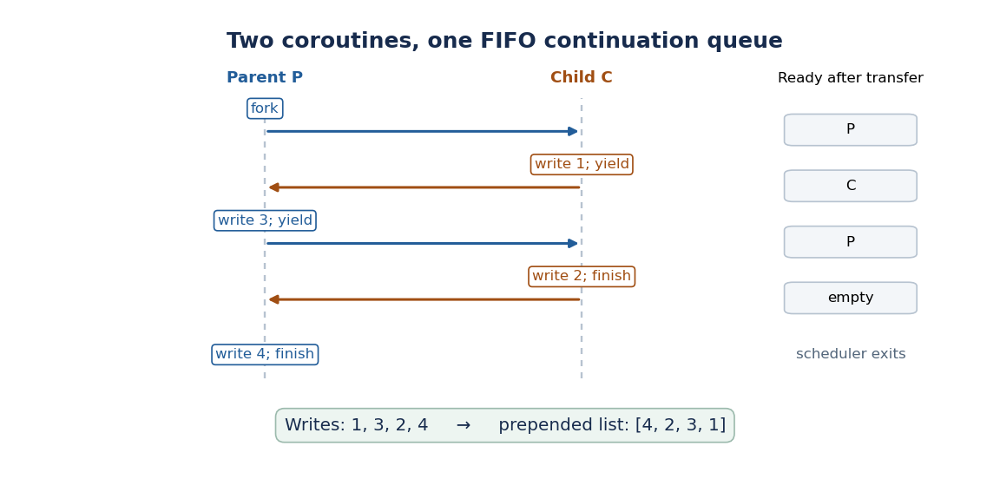

<h1 id="2/d/solution">Solution</h1>

↑ **Parent:** [D](../d.md)

Keep a [FIFO queue](../../../../../fifo-queue.md) of runnable [continuations](../../../../../continuation-computer-science.md) in shared [computer memory](../../../../../computer-memory-split.md). Removing a [continuation](../../../../../continuation-computer-science.md) from its head transfers control with `nil`; suspending a runnable computation appends its [continuation](../../../../../continuation-computer-science.md) at the rear. A single scheduler group also needs a terminal [continuation](../../../../../continuation-computer-science.md) so that finishing the last computation cannot return through an obsolete invocation of `fork`.

The following is `FunMem`, including the shared initialization and helper definitions. `run(main)` starts a scheduler group; nested `fork` calls use that same group.

```
val ready = new(); ready := nil;
val stop = new();

rec append(xs,ys) =
  if xs = nil then ys else head(xs) : append(tail(xs),ys);

val enqueue(k) =
  ready := append(!ready,k:nil); nil;

val dispatch() =
  if !ready = nil then withc(!stop,nil)
  else let val k = head(!ready) in
    ready := tail(!ready); withc(k,nil);

val run(main) =
  callcc(lambda (done)
    stop := done; ready := nil;
    main(); dispatch());

val fork(f) =
  callcc(lambda (parent)
    enqueue(parent); f(); dispatch());

val yield() =
  callcc(lambda (current)
    enqueue(current); dispatch())
```

At `fork`, the parent is queued before `f()` starts. The child runs immediately. Its ordinary return value is ignored by sequencing into `dispatch()`. At `yield`, the current computation joins the rear, then the oldest runnable computation is removed from the front. If there was no other runnable computation, these operations select the just-captured [continuation](../../../../../continuation-computer-science.md), so the caller resumes immediately with `nil`.

The invariant is that each suspended runnable computation has exactly one entry in `ready`, ordered by the time it most recently became suspended and runnable. A running computation is absent from that [FIFO queue](../../../../../fifo-queue.md). Neither appending nor removing an entry suspends, so these operations are indivisible relative to this [cooperative multitasking](../../../../../cooperative-multitasking.md) scheduler. Completing a child removes the child from consideration permanently; it is never enqueued by its completion wrapper.

For the paper's example, call the initial computation $P$ and the forked computation $C$. The [FIFO queue](../../../../../fifo-queue.md) and writes evolve as follows:

| Event | Running next | Ready queue | New list head | Fork starts child | $C$ | $P$ | — | Child writes and yields | $P$ | $C$ | $1$ | Parent writes and yields | $C$ | $P$ | $3$ | Child writes and finishes | $P$ | empty | $2$ | Parent writes and finishes | scheduler exits | empty | $4$ |
| --- | --- | --- | --- | --- | --- | --- | --- | --- | --- | --- | --- | --- | --- | --- | --- | --- | --- | --- | --- | --- | --- | --- | --- |

<a id="2/d/image-fifo-continuation-scheduling-of-the-paper-s-two-coroutines"></a>


**[Figure 1](#2/d/image-fifo-continuation-scheduling-of-the-paper-s-two-coroutines). FIFO continuation scheduling of the paper's two coroutines**.

Thus the observable list, read after the scheduler group finishes, is

$$
\boxed{[4,2,3,1],\qquad\operatorname{fork}(f)\text{ and }\operatorname{yield}()\text{ resume their callers with nil}.}
$$

The scheduler exit is used only when no runnable [continuations](../../../../../continuation-computer-science.md) remain. A main computation can place its desired final observable value in shared [computer memory](../../../../../computer-memory-split.md) and read it after `run` returns. This wrapper also permits already-forked computations to finish if the initial computation finishes before them. Each `run` creates one active scheduler group; calls of `run` are not nested.

## ↑ Ancestors (11)

1. [D](../d.md)
2. [2](../../2.md)
3. [Principles of programming languages](../../../principles-of-programming-languages-split.md)
4. [2015](../../../split.md)
5. [Past exam of the computer science course of the University of Oxford](../../../../split.md)
6. [Computer science course of the University of Oxford](../../../../../computer-science-course-of-the-university-of-oxford.md)
7. [Undergraduate course of the University of Oxford](../../../../../undergraduate-course-of-the-university-of-oxford.md)
8. [Course of the University of Oxford](../../../../../course-of-the-university-of-oxford.md)
9. [University of Oxford](../../../../../university-of-oxford-split.md)
10. [List of universities](../../../../../list-of-universities.md)
11. [Codex Wiki](../../../../../split.md)
