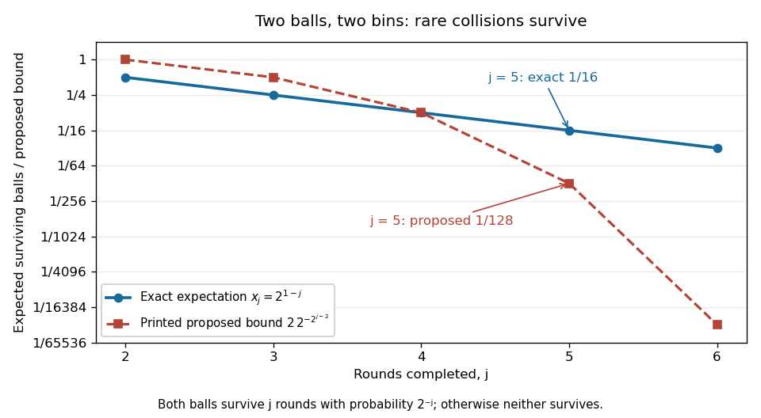

<h1 id="2/c/solution">Solution</h1>

↑ **Parent:** [C](../c.md)

**The printed bound also fails for the actual [expectations](../../../../../expected-value-split.md).** In the two-bin [counterexample](../../../../../counterexample.md) from part (b), at $j=5$ the true value and proposed bound are

$$
\boxed{x_5=\frac1{16}>2\,2^{-2^{5-2}}=\frac1{128}.}
$$

The supplied premise $x_2\leq n/2$ does hold in this example: $x_2=1/2\leq1$. Thus the problem is the invalid recurrence in part (b), rather than failure of the supplied starting estimate.[Printed p. 2, Question 2(c), including the supplied bound on x\_2](../../../../../probability-and-computing-examination-paper-by-the-university-of-oxford-2015.md)

The intended [mathematical induction](../../../../../mathematical-induction.md) is valid **conditionally on the recurrence**. For a deterministic nonnegative sequence $y_j$ satisfying $y_2\leq n/2$ and $y_{j+1}\leq y_j^2/n$, the base case is $y_2\leq n2^{-1}$. If $y_j\leq n2^{-2^{j-2}}$, then

$$
y_{j+1}\leq\frac{(n2^{-2^{j-2}})^2}{n}
=n2^{-2^{j-1}}.
$$

This proves the proposed form for $y_j$ but cannot identify $y_j$ with $\mathbb E B_j$.

**[Figure 1](#2/c/image-exact-two-bin-survivor-expectation-and-the-invalid-printed-bound). Exact two-bin survivor expectation and the invalid printed bound**.

## ↑ Ancestors (11)

1. [C](../c.md)
2. [2](../../2.md)
3. [Probability and computing](../../../probability-and-computing-split.md)
4. [2015](../../../split.md)
5. [Past exam of the computer science course of the University of Oxford](../../../../split.md)
6. [Computer science course of the University of Oxford](../../../../../computer-science-course-of-the-university-of-oxford.md)
7. [Undergraduate course of the University of Oxford](../../../../../undergraduate-course-of-the-university-of-oxford.md)
8. [Course of the University of Oxford](../../../../../course-of-the-university-of-oxford.md)
9. [University of Oxford](../../../../../university-of-oxford-split.md)
10. [List of universities](../../../../../list-of-universities.md)
11. [Codex Wiki](../../../../../split.md)
