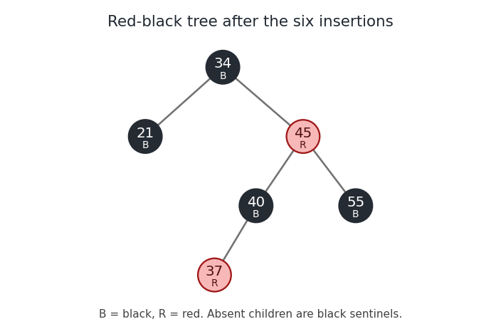

# Algorithms

↑ **Parent:** [2018](../2018.md)

Solutions to all three questions of the [University of Oxford](../../university-of-oxford.md) [computer science](../../computer-science.md) finals paper, Trinity Term 2018, held on 16 June 2018. Every printed option is treated.

Source: [Public examination-paper archive](https://www.whatdotheyknow.com/request/ba_computer_science_past_papers/response/2577745/attach/2/202402%20183%20CS%20Papers.zip?cookie_passthrough=1), member `2017/T/a16156w1.pdf`, paper A16156W1, three scanned pages. The printed 2018 cover controls the sitting despite the archive member’s directory name.

**Table of contents**

- [1](#1)
  - [a](#1/a)
    - [Solution](#1/a/solution)
  - [b](#1/b)
    - [Solution](#1/b/solution)
  - [c](#1/c)
    - [Solution](#1/c/solution)
  - [d](#1/d)
    - [Solution](#1/d/solution)
  - [e](#1/e)
    - [Solution](#1/e/solution)
  - [f](#1/f)
    - [Solution](#1/f/solution)
- [2](#2)
  - [a](#2/a)
    - [Solution](#2/a/solution)
  - [b](#2/b)
    - [Solution](#2/b/solution)
  - [c](#2/c)
    - [Solution](#2/c/solution)
  - [d](#2/d)
    - [Solution](#2/d/solution)
  - [e](#2/e)
    - [Solution](#2/e/solution)
  - [f](#2/f)
    - [Solution](#2/f/solution)
- [3](#3)
  - [a](#3/a)
    - [Solution](#3/a/solution)
  - [b](#3/b)
    - [Solution](#3/b/solution)
  - [c](#3/c)
    - [Solution](#3/c/solution)
  - [d](#3/d)
    - [Solution](#3/d/solution)
  - [e](#3/e)
    - [Solution](#3/e/solution)

## 1

↑ **Parent:** [Algorithms](algorithms.md)

<h3 id="1/a">a</h3>

↑ **Parent:** [1](#1)

<h4 id="1/a/solution">Solution</h4>

↑ **Parent:** [A](#1/a)

A [binary search tree](../../data-structure.md#binary-search-tree) is a [binary tree](../../data-structure.md#binary-tree) storing distinct keys from a [total order](../../set.md#total-order), with every key in a node's left [subtree](../../data-structure.md#subtree) smaller than that node's key and every key in its right [subtree](../../data-structure.md#subtree) larger. The condition concerns entire [subtrees](../../data-structure.md#subtree), not just immediate neighbours.

For membership, start at the [root of a tree](../../tree-graph-theory.md#root-of-a-tree) and compare the target with the current key. **Return true on equality; continue into the left [subtree](../../data-structure.md#subtree) for a smaller target and the right [subtree](../../data-structure.md#subtree) for a larger target; return false on an empty [subtree](../../data-structure.md#subtree).** The [binary search tree](../../data-structure.md#binary-search-tree) ordering ensures that a discarded [subtree](../../data-structure.md#subtree) cannot contain the target. Each step descends one level, so the [algorithm](../../algorithm.md) terminates and uses $O(h+1)$ [time complexity](../../theoretical-computer-science.md#time-complexity) for [height of a binary tree](../../data-structure.md#height-of-a-binary-tree) $h$, under constant-time key comparison.

<h3 id="1/b">b</h3>

↑ **Parent:** [1](#1)

<h4 id="1/b/solution">Solution</h4>

↑ **Parent:** [B](#1/b)

First perform [splaying](../../data-structure.md#splaying) on the key to be deleted, making its node the [root of a tree](../../tree-graph-theory.md#root-of-a-tree). Delete that root, leaving left and right [subtrees](../../data-structure.md#subtree) $L,R$. If either is empty, return the other. Otherwise find the maximum key $m$ of $L$ by following right-child references, and perform [splaying](../../data-structure.md#splaying) on $m$ within $L$. This makes $m$ the root of $L$ with an empty right [subtree](../../data-structure.md#subtree). Attach $R$ there. **The result is the original [splay tree](../../data-structure.md#splay-tree) with exactly the selected key removed.** An unsuccessful lookup leaves the represented [set](../../set.md) unchanged.

For [algorithm correctness](../../algorithm.md#algorithm-correctness), all keys of $L$ are smaller than the deleted key, and all keys of $R$ are larger. [Splaying](../../data-structure.md#splaying) preserves the [binary search tree](../../data-structure.md#binary-search-tree) property by the permitted assumption. Since $m$ is the maximum of $L$, it has no larger key within $L$; since every key of $R$ exceeds $m$, attaching $R$ as its right [subtree](../../data-structure.md#subtree) preserves every ordering condition. All remaining keys occur once. This is the join-based deletion of a [splay tree](../../data-structure.md#splay-tree).[Author-hosted publication record and abstract: splay-tree search, insertion and deletion operations](../../computer-science-bibliography.md#self-adjusting-binary-search-trees-by-daniel-sleator-and-robert-tarjan)

<h3 id="1/c">c</h3>

↑ **Parent:** [1](#1)

<h4 id="1/c/solution">Solution</h4>

↑ **Parent:** [C](#1/c)

**No.** In a [red-black tree](../../data-structure.md#red-black-tree) with no red nodes, equal [black height](../../data-structure.md#black-height) forces every [graph path](../../graph-theory.md#path-in-a-graph) from the root to an absent-child position to have the same length. A real node cannot have exactly one real child: the two paths through that node would then have different numbers of black nodes. Recursively, every real level must be full. The tree is therefore a [perfect binary tree](../../data-structure.md#perfect-binary-tree).

With $h$ real levels its size is $1+2+\cdots+2^{h-1}=2^h-1$. A size of $23$ would require $2^h=24$, which is impossible for an [integer](../../integer.md) $h$. The black null sentinels are not counted among the $23$ stored entries. This is the [all-black red-black tree size criterion](../../data-structure.md#all-black-red-black-tree-size-criterion).

<h3 id="1/d">d</h3>

↑ **Parent:** [1](#1)

<h4 id="1/d/solution">Solution</h4>

↑ **Parent:** [D](#1/d)

Use the conventional bottom-up [red-black tree insertion](../../data-structure.md#red-black-tree-insertion): insert a red node by the [binary search tree](../../data-structure.md#binary-search-tree) rule, repair a red parent with recolouring or [tree rotations](../../data-structure.md#tree-rotation), and make the root black. Write $B$ and $R$ for black and red. The first three insertions give root $34_B$, with $21_R$ on the left and $55_R$ on the right.

Inserting $40$ as the left child of $55$ gives a red parent and a red uncle. Recolour $21,55$ black and retain a black root $34$. Inserting $45$ then gives the inner configuration $55_B$–$40_R$–$45_R$. A left [tree rotation](../../data-structure.md#tree-rotation) at $40$, followed by a right [tree rotation](../../data-structure.md#tree-rotation) at $55$, produces a [subtree](../../data-structure.md#subtree) rooted at $45_B$ with $40_R$ and $55_R$ beneath it. Finally insert $37_R$ to the left of $40_R$. Its uncle $55_R$ is red, so recolour $40,55$ black and $45$ red. No further repair is required because $45$ has black parent $34$.

**The final root is $34_B$; its left child is $21_B$ and its right child is $45_R$. Under $45_R$ are $40_B$ on the left and $55_B$ on the right; $40_B$ has left child $37_R$.** All omitted children are black null sentinels. Each root-to-null [graph path](../../graph-theory.md#path-in-a-graph) has two real black nodes, and no red node has a red child.

**[Figure 1](#1/d/image-the-red-black-tree-after-the-six-insertions-with-colours-also-marked-b-and-r). The red-black tree after the six insertions, with colours also marked B and R**.

<h3 id="1/e">e</h3>

↑ **Parent:** [1](#1)

<h4 id="1/e/solution">Solution</h4>

↑ **Parent:** [E](#1/e)

Write $y=x+1$. After [splaying](../../data-structure.md#splaying) on $x$, that key is at the root, and $y$ is the smallest key in its right [subtree](../../data-structure.md#subtree). This uses the [integer](../../integer.md) assumption: no stored key lies strictly between $x$ and $y$. Thus $y$ has an empty left [subtree](../../data-structure.md#subtree) while it remains within the right [subtree](../../data-structure.md#subtree) of $x$.

Now perform ordinary bottom-up [splaying](../../data-structure.md#splaying) on $y$. Until the final step involving $x$, all [tree rotations](../../data-structure.md#tree-rotation) occur below $x$ and leave it at the root. There are only two possible final cases.

- If $y$ is the right child of $x$, a single [zig step](../../data-structure.md#zig-step) rotates $y$ above $x$, placing $x$ immediately to its left.
- Otherwise $y$ is a grandchild of $x$. Its parent $p$ lies in the right [subtree](../../data-structure.md#subtree) of $x$ and must satisfy $p>y$. Hence the last two directions are right then left. A [zig-zag step](../../data-structure.md#zig-zag-step) rotates $y$ above $p$ and then above $x$, again placing $x$ immediately to its left. A right-right final configuration is impossible because $y$ is the minimum of this [subtree](../../data-structure.md#subtree).

Therefore **$x$ becomes the left child of $x+1$**. The argument applies more generally to [consecutive keys in a binary search tree](../../data-structure.md#consecutive-keys-in-a-binary-search-tree), even when their numerical difference is not one.

<h3 id="1/f">f</h3>

↑ **Parent:** [1](#1)

<h4 id="1/f/solution">Solution</h4>

↑ **Parent:** [F](#1/f)

Use the usual bottom-up [splaying](../../data-structure.md#splaying) operations. We prove the stronger result that **at most three successful calls suffice**. No insertions or deletions are needed.

If the chosen key $x$ is the minimum stored key, first perform [splaying](../../data-structure.md#splaying) on $x$ and then on its immediate successor. The argument for [consecutive keys in a binary search tree](../../data-structure.md#consecutive-keys-in-a-binary-search-tree) makes $x$ the left child of the successor with an empty right [subtree](../../data-structure.md#subtree); minimality makes its left [subtree](../../data-structure.md#subtree) empty too. Hence $x$ is a [leaf of a rooted tree](../../tree-graph-theory.md#leaf-of-a-rooted-tree). The maximum-key case is the mirror image.

Suppose $x$ is an interior key. Since at least four keys are stored, there are either two keys larger than $x$ or two smaller than $x$. In the former case choose four consecutive stored keys

$$
a<x<b<c,
$$

where $a$ is the predecessor of $x$, and $b,c$ are the next two successors. Perform **$\operatorname{Splay}(c),\operatorname{Splay}(a),\operatorname{Splay}(b)$**.

Here is a complete check of the local shapes. After the first call, $c$ is the root. After the second, $a$ is the root; every key below $a$ is in its left [subtree](../../data-structure.md#subtree) $A$, and every key above $c$ stays in the right [subtree](../../data-structure.md#subtree) $D$ of $c$. These outside [subtrees](../../data-structure.md#subtree) cannot interfere with the next search. Between $a$ and $c$ there are only $x,b$. The last step of [splaying](../../data-structure.md#splaying) on $a$ is either a [zig step](../../data-structure.md#zig-step), leaving $c$ as its right child; a [zig-zag step](../../data-structure.md#zig-zag-step), with the same result; or a [zig-zig step](../../data-structure.md#zig-zig-step), leaving some $p\in\{x,b\}$ as its right child with $c$ immediately to the right of $p$. Consequently the possible right [subtrees](../../data-structure.md#subtree) of $a$ are exactly among these four forms, using $k(L,R)$ for a node with its left and right [subtrees](../../data-structure.md#subtree):

$$
\begin{array}{c|c}
\text{right subtree of }a\text{ after the second call}&\text{shape after splaying }b\\\hline
c\bigl(b(x,\varnothing),D\bigr)&b\bigl(a(A,x),c(\varnothing,D)\bigr)\\
c\bigl(x(\varnothing,b),D\bigr)&b\bigl(a(A,x),c(\varnothing,D)\bigr)\\
b\bigl(x,c(\varnothing,D)\bigr)&b\bigl(a(A,x),c(\varnothing,D)\bigr)\\
x\bigl(\varnothing,c(b,D)\bigr)&b\bigl(a(A,x),c(\varnothing,D)\bigr)
\end{array}
$$

Here an unexpanded $x$ or $b$ denotes a node with no children. Each row follows by the indicated one or two [tree rotations](../../data-structure.md#tree-rotation) in each bottom-up step. All rows end with $x$ as the right child of $a$, with both its [subtrees](../../data-structure.md#subtree) empty. If instead two keys below $x$ are available, reflect the construction, exchanging left and right and reversing the order of keys. This proves [splaying a chosen node into a leaf](../../data-structure.md#splaying-a-chosen-node-into-a-leaf) for every node of every [splay tree](../../data-structure.md#splay-tree) of size at least four.

## 2

↑ **Parent:** [Algorithms](algorithms.md)

<h3 id="2/a">a</h3>

↑ **Parent:** [2](#2)

<h4 id="2/a/solution">Solution</h4>

↑ **Parent:** [A](#2/a)

For a finite [undirected graph](../../graph-theory.md#undirected-graph) $G=(V,E)$, a [vertex cover](../../graph-theory.md#vertex-cover) is a [subset](../../set.md#subset) $C\subseteq V$ meeting every [edge](../../graph-theory.md#edge-of-a-graph): for every $\{u,v\}\in E$, at least one of $u,v$ belongs to $C$. **The optimization problem asks for a [vertex cover](../../graph-theory.md#vertex-cover) of minimum [cardinality](../../cardinal-number.md#cardinality).** Its usual decision version also supplies an [integer](../../integer.md) $k$ and asks whether one exists with $|C|\leq k$.

<h3 id="2/b">b</h3>

↑ **Parent:** [2](#2)

<h4 id="2/b/solution">Solution</h4>

↑ **Parent:** [B](#2/b)

Construct a [set cover problem](../../theoretical-computer-science.md#set-cover-problem) instance whose universe is the [set](../../set.md) of [edges](../../graph-theory.md#edge-of-a-graph) $E$. For each [vertex](../../graph.md#vertex-graph-theory) $v\in V$, supply the [set](../../set.md) $S_v$ of all [edges](../../graph-theory.md#edge-of-a-graph) incident to $v$. A collection $\{S_v:v\in C\}$ covers the universe if and only if every [edge](../../graph-theory.md#edge-of-a-graph) has an endpoint in $C$, which is precisely the [vertex cover](../../graph-theory.md#vertex-cover) condition.

The correspondence preserves [cardinality](../../cardinal-number.md#cardinality): **a [vertex cover](../../graph-theory.md#vertex-cover) of size $k$ is a feasible solution of the [set cover problem](../../theoretical-computer-science.md#set-cover-problem) using $k$ of these sets, and conversely**. If two labelled [vertices](../../graph.md#vertex-graph-theory) produce identical [sets](../../set.md), one can keep their labels or discard duplicate choices without changing the optimum. The construction has size $O(|V|+|E|)$ when incidences are listed, so it is a [polynomial-time reduction](../../theoretical-computer-science.md#polynomial-time-reduction).

<h3 id="2/c">c</h3>

↑ **Parent:** [2](#2)

<h4 id="2/c/solution">Solution</h4>

↑ **Parent:** [C](#2/c)

Root the [tree](../../tree-graph-theory.md) arbitrarily. For each [vertex](../../graph.md#vertex-graph-theory) $v$, let $D_1(v)$ be the minimum [vertex cover](../../graph-theory.md#vertex-cover) size in its descendant [subtree](../../data-structure.md#subtree), conditional on selecting $v$, and $D_0(v)$ the corresponding minimum conditional on omitting $v$. Process the [vertices](../../graph.md#vertex-graph-theory) in [postorder traversal](../../tree-graph-theory.md#postorder-traversal). For every child $u$ of $v$,

$$
\boxed{D_1(v)=1+\sum_{u\text{ child of }v}\min\{D_0(u),D_1(u)\},\qquad D_0(v)=\sum_{u\text{ child of }v}D_1(u).}
$$

At a [leaf of a rooted tree](../../tree-graph-theory.md#leaf-of-a-rooted-tree), the empty [sums](../../arithmetic.md#sum) give $D_1=1,D_0=0$. Return **$\min\{D_0(r),D_1(r)\}$** at the root $r$.

For [algorithm correctness](../../algorithm.md#algorithm-correctness), if $v$ is selected, each child [subtree](../../data-structure.md#subtree) may independently use its cheaper state, since the connecting [edge](../../graph-theory.md#edge-of-a-graph) is already covered by $v$. If $v$ is omitted, each child must be selected to cover its connecting [edge](../../graph-theory.md#edge-of-a-graph). Distinct child [subtrees](../../data-structure.md#subtree) have no [edges](../../graph-theory.md#edge-of-a-graph) between them because the input is a [tree](../../tree-graph-theory.md). These observations prove the recurrences by [structural induction](../../foundations-of-mathematics.md#structural-induction). Each [edge](../../graph-theory.md#edge-of-a-graph) contributes constant work once, giving **$O(|V|)$ [time complexity](../../theoretical-computer-science.md#time-complexity) and $O(|V|)$ space** with [adjacency lists](../../data-structure.md#adjacency-list). The single-vertex [tree](../../tree-graph-theory.md) correctly has optimum zero. This is [minimum vertex cover of a tree](../../graph-theory.md#minimum-vertex-cover-of-a-tree) by [dynamic programming](../../mathematical-optimization.md#dynamic-programming).

<h3 id="2/d">d</h3>

↑ **Parent:** [2](#2)

<h4 id="2/d/solution">Solution</h4>

↑ **Parent:** [D](#2/d)

In [depth-first search](../../algorithm.md#depth-first-search) of an [undirected graph](../../graph-theory.md#undirected-graph), every [edge](../../graph-theory.md#edge-of-a-graph) joins a [vertex](../../graph.md#vertex-graph-theory) to one of its ancestors or descendants in the discovery [tree](../../tree-graph-theory.md). To see this directly, suppose $u$ is discovered before its neighbour $v$. If $v$ is still undiscovered, the search from $u$ cannot finish before discovering $v$: it eventually scans $uv$. Thus $v$ is discovered while the call for $u$ remains active and belongs to its descendant [subtree](../../data-structure.md#subtree).[Chapter 6, §6.1: active recursion intervals, tree/back edges and ancestor relations](../../computer-science-bibliography.md#depth-first-search-by-jeff-erickson)

For any [edge](../../graph-theory.md#edge-of-a-graph) $uv$, its ancestor endpoint therefore has a proper descendant and hence at least one child. It is an [internal vertex of a rooted tree](../../tree-graph-theory.md#internal-vertex-of-a-rooted-tree). **Every [edge](../../graph-theory.md#edge-of-a-graph) has an internal endpoint**, so the internal [vertices](../../graph.md#vertex-graph-theory) form a [vertex cover](../../graph-theory.md#vertex-cover). The relevant [leaves of a rooted tree](../../tree-graph-theory.md#leaf-of-a-rooted-tree) here have no children in the rooted discovery [tree](../../tree-graph-theory.md); a root of [vertex degree](../../graph-theory.md#degree-graph-theory) one can still be internal.

<h3 id="2/e">e</h3>

↑ **Parent:** [2](#2)

<h4 id="2/e/solution">Solution</h4>

↑ **Parent:** [E](#2/e)

We construct an [injection](../../algebra.md#injective-function) from the [unmatched vertices in a matching](../../matching-graph-theory.md#unmatched-vertex-in-a-matching) to the [leaves of a rooted tree](../../tree-graph-theory.md#leaf-of-a-rooted-tree). Start a downward [graph path](../../graph-theory.md#path-in-a-graph) at each unmatched [vertex](../../graph.md#vertex-graph-theory) $u$. If the current [vertex](../../graph.md#vertex-graph-theory) is a [leaf of a rooted tree](../../tree-graph-theory.md#leaf-of-a-rooted-tree), stop. Otherwise choose any child $v$. The current [vertex](../../graph.md#vertex-graph-theory) is either the unmatched starting point or a [vertex](../../graph.md#vertex-graph-theory) already matched to its own parent.

In either case, $v$ cannot be unmatched: the [proper matching in a rooted tree](../../matching-graph-theory.md#proper-matching-in-a-rooted-tree) condition would require its parent to be matched to one of $v$'s [siblings in a rooted tree](../../tree-graph-theory.md#sibling-in-a-rooted-tree), whereas that parent is either unmatched or already matched upward. Nor can $v$ be matched to its parent. Its matching partner must therefore be one of its own children, say $w$. Extend the [graph path](../../graph-theory.md#path-in-a-graph) by the two [edges](../../graph-theory.md#edge-of-a-graph) to $v$ and then to $w$, and continue from $w$.

Every extension descends two levels, so finiteness guarantees termination at a [leaf of a rooted tree](../../tree-graph-theory.md#leaf-of-a-rooted-tree). Every visited [vertex](../../graph.md#vertex-graph-theory) except the starting point is matched. The constructed [graph paths](../../graph-theory.md#path-in-a-graph) for different unmatched starting points are disjoint: if two downward [graph paths](../../graph-theory.md#path-in-a-graph) in a [tree](../../tree-graph-theory.md) meet, one starting point must lie on the other path, which would put a second unmatched [vertex](../../graph.md#vertex-graph-theory) after the first. That is impossible. Hence their terminal [leaves of a rooted tree](../../tree-graph-theory.md#leaf-of-a-rooted-tree) are distinct, proving

$$
\boxed{|U(M)|\leq|L(T)|.}
$$

Only the properness condition for unmatched non-root [vertices](../../graph.md#vertex-graph-theory) was used. If the root is unmatched and the convention exempts it because it has no parent, the same construction starts there and still works. Thus the root convention does not affect the claimed inequality. This proves the [unmatched-vertex bound for a proper tree matching](../../matching-graph-theory.md#unmatched-vertex-bound-for-a-proper-tree-matching) without requiring $M$ to have maximum size.

<h3 id="2/f">f</h3>

↑ **Parent:** [2](#2)

<h4 id="2/f/solution">Solution</h4>

↑ **Parent:** [F](#2/f)

For a [connected graph](../../graph.md#connected-graph) with at least one [edge](../../graph-theory.md#edge-of-a-graph), run [depth-first search](../../algorithm.md#depth-first-search) and output the [set](../../set.md) $I$ of [internal vertices of a rooted tree](../../tree-graph-theory.md#internal-vertex-of-a-rooted-tree) in its discovery [tree](../../tree-graph-theory.md) $T$. Part (d) proves that $I$ is a [vertex cover](../../graph-theory.md#vertex-cover). It is also connected: every ancestor of an internal [vertex](../../graph.md#vertex-graph-theory) is internal, so the [graph path](../../graph-theory.md#path-in-a-graph) in $T$ from that [vertex](../../graph.md#vertex-graph-theory) to the root stays inside $I$. The root is internal when $|V|\geq2$.

For the approximation guarantee, choose a maximum-size [proper matching in a rooted tree](../../matching-graph-theory.md#proper-matching-in-a-rooted-tree) $M$ of $T$, whose existence is supplied. It is used only in the analysis; the [algorithm](../../algorithm.md) need not construct it. Since every matched [edge](../../graph-theory.md#edge-of-a-graph) uses two distinct [vertices](../../graph.md#vertex-graph-theory),

$$
|V|=2|M|+|U(M)|.
$$

By part (e), $|L(T)|\geq|U(M)|$. Therefore

$$
\boxed{|I|=|V|-|L(T)|\leq|V|-|U(M)|=2|M|\leq2\,\mathrm{OPT}.}
$$

The final inequality holds because every [vertex cover](../../graph-theory.md#vertex-cover) of $G$, connected or otherwise, must use at least one distinct endpoint for each of the disjoint [edges](../../graph-theory.md#edge-of-a-graph) in $M\subseteq E(G)$. Thus this is a **2-[approximation algorithm](../../mathematical-optimization.md#approximation-algorithm) in $O(|V|+|E|)$ [time complexity](../../theoretical-computer-science.md#time-complexity)**.

For completeness, a disconnected input needs a feasibility check: if two different [connected components of a graph](../../graph.md#component-graph-theory) contain [edges](../../graph-theory.md#edge-of-a-graph), no connected [vertex cover](../../graph-theory.md#vertex-cover) can meet both. If exactly one component contains [edges](../../graph-theory.md#edge-of-a-graph), run the construction on that component and ignore isolated [vertices](../../graph.md#vertex-graph-theory). If there are no [edges](../../graph-theory.md#edge-of-a-graph), the empty [vertex cover](../../graph-theory.md#vertex-cover) is optimal when an empty solution is permitted; if a nonempty connected solution is required, any single [vertex](../../graph.md#vertex-graph-theory) is optimal for a nonempty input. These conventions cover the boundary cases omitted from the main approximation argument.

## 3

↑ **Parent:** [Algorithms](algorithms.md)

<h3 id="3/a">a</h3>

↑ **Parent:** [3](#3)

<h4 id="3/a/solution">Solution</h4>

↑ **Parent:** [A](#3/a)

Use the [standard maximum form of a linear program](../../linear-programming.md#standard-maximum-form-of-a-linear-program)

$$
\boxed{\max\{c^Tz:Az\leq b,\ z\geq0\}.}
$$

An arbitrary [linear program](../../linear-programming.md) can be converted by the following operations.

- Replace minimization of $c^Tx$ by maximization of $-c^Tx$, and negate the resulting optimal value when translating back. A constant term in the objective is recorded separately.
- Replace every unrestricted variable $x_j$ by $z_j^+-z_j^-$ with both new variables nonnegative. A nonpositive variable can instead be negated. A lower bound $x_j\geq\ell$ can be eliminated by writing $x_j=\ell+z_j$, $z_j\geq0$; other bounds remain [linear inequalities](../../arithmetic.md#linear-inequality).
- Multiply a $\geq$ row by $-1$. Replace an equality $a^Tx=b$ by the pair $a^Tx\leq b$ and $-a^Tx\leq-b$.

These substitutions preserve the attainable objective values, up to the stated sign and constant corrections, and map [feasible points](../../mathematical-optimization.md#feasible-point) in both directions. An alternative standard-form convention uses $Az=b,z\geq0$: add a nonnegative [slack variable](../../linear-programming.md#slack-variable) to each upper-bound row, or subtract a nonnegative [surplus variable](../../linear-programming.md#surplus-variable) from a lower-bound row. The inequality convention above is used in the remaining solutions.

<h3 id="3/b">b</h3>

↑ **Parent:** [3](#3)

<h4 id="3/b/solution">Solution</h4>

↑ **Parent:** [B](#3/b)

Let $Z$ be the [set](../../set.md) of [isolated vertices](../../random-graph.md#isolated-vertex) of the finite [simple graph](../../graph.md#simple-graph) $G=(V,E)$. Introduce a nonnegative [integer](../../integer.md) $x_v$ for every [vertex](../../graph.md#vertex-graph-theory). Use the [integer program](../../mathematical-optimization.md#integer-programming)

$$
\boxed{\begin{aligned}
\text{maximize}\quad&\sum_{v\in V}x_v\\
\text{subject to}\quad&x_u+x_v\leq1&&\text{for every }\{u,v\}\in E,\\
&x_v\leq1&&\text{for every }v\in Z,\\
&x_v\geq0,\quad x_v\in\mathbb Z&&\text{for every }v\in V.
\end{aligned}}
$$

Every nonisolated [vertex](../../graph.md#vertex-graph-theory) belongs to an [edge](../../graph-theory.md#edge-of-a-graph), whose inequality and the other endpoint's nonnegativity already imply $x_v\leq1$. The explicit bounds on $Z$ therefore make all variables binary. For an [integer](../../integer.md) [feasible point](../../mathematical-optimization.md#feasible-point), $S=\{v:x_v=1\}$ is an [independent set](../../graph-theory.md#independent-set-graph-theory), and its [cardinality](../../cardinal-number.md#cardinality) is the objective. Conversely the [indicator vector](../../measure-theory.md#indicator-vector) of any [independent set](../../graph-theory.md#independent-set-graph-theory) is feasible. Thus **the optimal value is the maximum [independent set](../../graph-theory.md#independent-set-graph-theory) size**. Including the isolated-[vertex](../../graph.md#vertex-graph-theory) bounds is essential for an arbitrary [graph](../../graph.md); without them the formulation would be unbounded whenever an [isolated vertex](../../random-graph.md#isolated-vertex) is present.

<h3 id="3/c">c</h3>

↑ **Parent:** [3](#3)

<h4 id="3/c/solution">Solution</h4>

↑ **Parent:** [C](#3/c)

Remove the [integer](../../integer.md) requirements from the previous formulation to obtain its [linear programming relaxation](../../linear-programming.md#linear-programming-relaxation). Give each [edge](../../graph-theory.md#edge-of-a-graph) constraint a nonnegative [dual variable](../../linear-programming.md#dual-variable) $y_e$, and each bound for $v\in Z$ a nonnegative [dual variable](../../linear-programming.md#dual-variable) $z_v$. Since all right-hand sides are one, the [dual linear program](../../linear-programming.md#dual-linear-program) is

$$
\boxed{\begin{aligned}
\text{minimize}\quad&\sum_{e\in E}y_e+\sum_{v\in Z}z_v\\
\text{subject to}\quad&\sum_{e\ni v}y_e\geq1&&v\in V\setminus Z,\\
&z_v\geq1&&v\in Z,\\
&y_e\geq0,\quad z_v\geq0.
\end{aligned}}
$$

An [integer](../../integer.md) [feasible point](../../mathematical-optimization.md#feasible-point) selects a multiset of [edges](../../graph-theory.md#edge-of-a-graph) touching every nonisolated [vertex](../../graph.md#vertex-graph-theory), together with at least one singleton for each [isolated vertex](../../random-graph.md#isolated-vertex). Repeated [edges](../../graph-theory.md#edge-of-a-graph) or singleton choices can be discarded without losing coverage, so an optimum has a genuine [edge cover](../../graph-theory.md#edge-cover) of the nonisolated part and one singleton per isolated [vertex](../../graph.md#vertex-graph-theory). **If $G$ has no [isolated vertices](../../random-graph.md#isolated-vertex), this is exactly an [edge cover](../../graph-theory.md#edge-cover)**, with the objective counting selected [edges](../../graph-theory.md#edge-of-a-graph) including any unnecessary multiplicities. The isolated-singleton extension is necessary because a [graph](../../graph.md) with an [isolated vertex](../../random-graph.md#isolated-vertex) admits no ordinary [edge cover](../../graph-theory.md#edge-cover).

This interpretation concerns [integer](../../integer.md) feasible dual solutions. The [linear programming relaxation](../../linear-programming.md#linear-programming-relaxation) can have fractional optima, so its value need not equal the integer [independent set](../../graph-theory.md#independent-set-graph-theory) optimum. For example, the triangle has relaxed independent-set value $3/2$, whereas its maximum [independent set](../../graph-theory.md#independent-set-graph-theory) has size $1$ and its minimum [edge cover](../../graph-theory.md#edge-cover) has size $2$.

<h3 id="3/d">d</h3>

↑ **Parent:** [3](#3)

<h4 id="3/d/solution">Solution</h4>

↑ **Parent:** [D](#3/d)

Regard the two kinds of agents as the two sides of a [complete bipartite graph](../../bipartite-graph.md#complete-bipartite-graph), with [edge weight](../../graph.md#edge-weight) $c_{ij}$. Pairing everyone is a [perfect matching](../../matching-graph-theory.md#perfect-matching), and its maximum total weight is $P$. Consider the capacitated [linear program](../../linear-programming.md)

$$
\begin{aligned}
P_{\rm LP}=\max\quad&\sum_{i,j}c_{ij}x_{ij}\\
\text{subject to}\quad&\sum_jx_{ij}\leq1\quad(1\leq i\leq n),\\
&\sum_ix_{ij}\leq1\quad(1\leq j\leq n),\qquad x_{ij}\geq0.
\end{aligned}
$$

It is feasible and bounded. Every optimum has all row and column sums equal to one: otherwise the equal total deficits of the two sides give a row $i$ and column $j$ both below one. Increasing $x_{ij}$ by the smaller of their positive deficits remains feasible and increases the objective because $c_{ij}>0$, a contradiction.

Thus an optimum is a [doubly stochastic matrix](../../vector-space.md#doubly-stochastic-matrix). By the [Birkhoff-von Neumann theorem](../../vector-space.md#birkhoff-von-neumann-theorem) it is a [convex combination](../../convex-set.md#convex-combination) of [permutation matrices](../../vector-space.md#permutation-matrix), so at least one corresponding [perfect matching](../../matching-graph-theory.md#perfect-matching) has weight at least its objective. Conversely every such [perfect matching](../../matching-graph-theory.md#perfect-matching) gives a feasible [matrix](../../vector-space.md#matrix). Hence $P_{\rm LP}=P$. One way to justify the decomposition is to apply [Hall's marriage theorem](../../matching-graph-theory.md#hall-s-marriage-theorem) to the positive-entry support, subtract the smallest entry on a supported [perfect matching](../../matching-graph-theory.md#perfect-matching), and repeat after rescaling the nonzero remainder; each subtraction removes a positive entry, so the process terminates.

The [dual linear program](../../linear-programming.md#dual-linear-program) assigns nonnegative [dual variables](../../linear-programming.md#dual-variable) $p_i,q_j$ to the row and column capacity constraints:

$$
\boxed{\min\sum_i p_i+\sum_jq_j\quad\text{subject to}\quad p_i+q_j\geq c_{ij},\qquad p_i,q_j\geq0.}
$$

These are exactly the permitted payments and all the pairwise acceptance conditions, so its optimal value is $Q$. It is feasible, for example by taking $p_i=\max_jc_{ij}$ and $q_j=0$. [Strong duality](../../linear-programming.md#strong-duality) now gives **$P=P_{\rm LP}=Q$**. In particular, the nonnegative payment restriction has been retained throughout; using capacity inequalities rather than equality constraints avoids introducing unrestricted prices.

For a direct [weak duality](../../linear-programming.md#weak-duality) check, sum $p_i+q_{\pi(i)}\geq c_{i,\pi(i)}$ over any pairing $\pi$. Its revenue never exceeds the company's total offered payment. The [linear programming duality](../../linear-programming.md#linear-programming-duality) and integrality argument prove that this lower bound on payments is attained.

<h3 id="3/e">e</h3>

↑ **Parent:** [3](#3)

<h4 id="3/e/solution">Solution</h4>

↑ **Parent:** [E](#3/e)

Combine all inequalities, including nonnegativity, into $Cx\leq d$; explicitly, the rows $-e_j^Tx\leq0$ encode $x_j\geq0$. Let $x_*$ be a [vertex of a linear polyhedron](../../linear-programming.md#vertex-of-a-linear-polyhedron), equivalently an [extreme point](../../convex-set.md#extreme-point) of the feasible [linear polyhedron](../../linear-programming.md#linear-polyhedron), and let $I$ index the [active constraints](../../linear-programming.md#active-constraint) there.

Suppose the active row normals have [rank](../../quadratic-form.md#rank-one-quadratic-form) smaller than $n$. By the [rank-nullity theorem](../../kernel-of-a-linear-map.md#rank-nullity-theorem) there is a nonzero [vector](../../vector-space.md#vector) $h$ with $C_ih=0$ for every $i\in I$. Every inactive row has positive [slack variable](../../linear-programming.md#slack-variable) value $s_i=d_i-C_ix_*>0$. Since there are only finitely many rows, choose $\varepsilon>0$ so small that

$$
\varepsilon|C_ih|<s_i\qquad\text{for every inactive row with }C_ih\ne0.
$$

Then both $x_*+\varepsilon h$ and $x_*-\varepsilon h$ are [feasible points](../../mathematical-optimization.md#feasible-point): the [active constraints](../../linear-programming.md#active-constraint) remain equalities and no inactive inequality is violated. They are distinct, and $x_*$ is their [midpoint](../../convex-set.md#midpoint), contradicting the [extreme point](../../convex-set.md#extreme-point) property.

Therefore the active row normals have [rank](../../quadratic-form.md#rank-one-quadratic-form) $n$, and **at least $n$ [linearly independent](../../vector-space.md#linear-independence) constraints are satisfied with equality**. In particular at least $n$ constraints are tight, as claimed. Nonnegativity bounds must be counted: for example, at the origin these can supply all $n$ active rows. Degeneracy can make more than $n$ constraints tight, so the result does not assert exactly $n$.

## ↑ Ancestors (8)

1. [2018](../2018.md)
2. [Past exam of the computer science course of the University of Oxford](../../past-exam-of-the-computer-science-course-of-the-university-of-oxford.md)
3. [Computer science course of the University of Oxford](../../university-of-oxford.md#computer-science-course-of-the-university-of-oxford)
4. [Undergraduate course of the University of Oxford](../../university-of-oxford.md#undergraduate-course-of-the-university-of-oxford)
5. [Course of the University of Oxford](../../university-of-oxford.md#course-of-the-university-of-oxford)
6. [University of Oxford](../../university-of-oxford.md)
7. [List of universities](../../README.md#list-of-universities)
8. [Codex Wiki](../../README.md)
