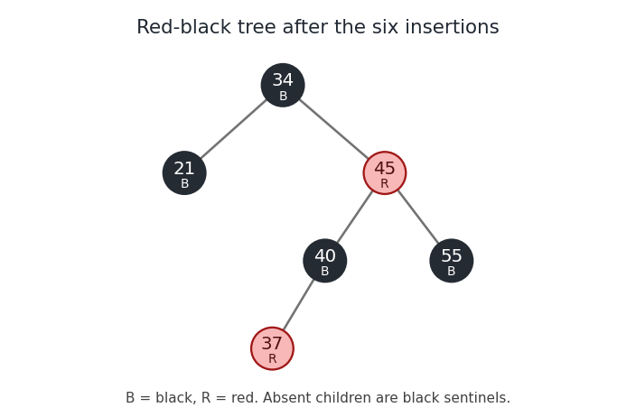

<h1 id="1/d/solution">Solution</h1>

↑ **Parent:** [D](../d.md)

Use the conventional bottom-up [red-black tree insertion](../../../../../red-black-tree-insertion.md): insert a red node by the [binary search tree](../../../../../binary-search-tree.md) rule, repair a red parent with recolouring or [tree rotations](../../../../../tree-rotation.md), and make the root black. Write $B$ and $R$ for black and red. The first three insertions give root $34_B$, with $21_R$ on the left and $55_R$ on the right.

Inserting $40$ as the left child of $55$ gives a red parent and a red uncle. Recolour $21,55$ black and retain a black root $34$. Inserting $45$ then gives the inner configuration $55_B$–$40_R$–$45_R$. A left [tree rotation](../../../../../tree-rotation.md) at $40$, followed by a right [tree rotation](../../../../../tree-rotation.md) at $55$, produces a [subtree](../../../../../subtree.md) rooted at $45_B$ with $40_R$ and $55_R$ beneath it. Finally insert $37_R$ to the left of $40_R$. Its uncle $55_R$ is red, so recolour $40,55$ black and $45$ red. No further repair is required because $45$ has black parent $34$.

**The final root is $34_B$; its left child is $21_B$ and its right child is $45_R$. Under $45_R$ are $40_B$ on the left and $55_B$ on the right; $40_B$ has left child $37_R$.** All omitted children are black null sentinels. Each root-to-null [graph path](../../../../../path-in-a-graph.md) has two real black nodes, and no red node has a red child.

**[Figure 1](#1/d/image-the-red-black-tree-after-the-six-insertions-with-colours-also-marked-b-and-r). The red-black tree after the six insertions, with colours also marked B and R**.

## ↑ Ancestors (11)

1. [D](../d.md)
2. [1](../../1.md)
3. [Algorithms](../../../algorithms-split.md)
4. [2018](../../../split.md)
5. [Past exam of the computer science course of the University of Oxford](../../../../split.md)
6. [Computer science course of the University of Oxford](../../../../../computer-science-course-of-the-university-of-oxford.md)
7. [Undergraduate course of the University of Oxford](../../../../../undergraduate-course-of-the-university-of-oxford.md)
8. [Course of the University of Oxford](../../../../../course-of-the-university-of-oxford.md)
9. [University of Oxford](../../../../../university-of-oxford-split.md)
10. [List of universities](../../../../../list-of-universities.md)
11. [Codex Wiki](../../../../../split.md)
