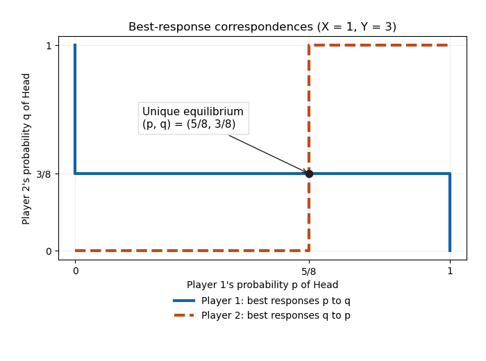

# Computational game theory

↑ **Parent:** [2018](../2018.md)

Source paper: [released examination archive](https://www.whatdotheyknow.com/request/ba_computer_science_past_papers/response/2577745/attach/2/202402%20183%20CS%20Papers.zip?cookie_passthrough=1), member `2017/T/a15684w1.pdf`. The printed cover dates this examination to 29 May 2018. All three questions and all eighteen lettered parts are answered below. The stag-hunt arguments distinguish the intended positive rewards from the zero-reward boundary omitted in the printed assumptions.

**Table of contents**

- [1](#1)
  - [a](#1/a)
    - [Solution](#1/a/solution)
  - [b](#1/b)
    - [Solution](#1/b/solution)
  - [c](#1/c)
    - [Solution](#1/c/solution)
  - [d](#1/d)
    - [Solution](#1/d/solution)
  - [e](#1/e)
    - [Solution](#1/e/solution)
  - [f](#1/f)
    - [Solution](#1/f/solution)
- [2](#2)
  - [a](#2/a)
    - [Solution](#2/a/solution)
  - [b](#2/b)
    - [Solution](#2/b/solution)
  - [c](#2/c)
    - [Solution](#2/c/solution)
  - [d](#2/d)
    - [Solution](#2/d/solution)
  - [e](#2/e)
    - [Solution](#2/e/solution)
  - [f](#2/f)
    - [Solution](#2/f/solution)
- [3](#3)
  - [a](#3/a)
    - [Solution](#3/a/solution)
  - [b](#3/b)
    - [Solution](#3/b/solution)
  - [c](#3/c)
    - [Solution](#3/c/solution)
  - [d](#3/d)
    - [Solution](#3/d/solution)
  - [e](#3/e)
    - [Solution](#3/e/solution)
  - [f](#3/f)
    - [Solution](#3/f/solution)

## 1

↑ **Parent:** [Computational game theory](computational-game-theory.md)

<h3 id="1/a">a</h3>

↑ **Parent:** [1](#1)

<h4 id="1/a/solution">Solution</h4>

↑ **Parent:** [A](#1/a)

For a finite [normal-form game](../../game-theory.md#normal-form-game), a [mixed strategy](../../game-theory.md#mixed-strategy) $\sigma_i$ is a [probability distribution](../../probability-distribution.md) over player $i$'s [pure strategies](../../game-theory.md#pure-strategy). Independent randomization by the players defines an [expected payoff](../../game-theory.md#expected-payoff) $u_i(\sigma)$. A [strategy profile](../../game-theory.md#strategy-profile) $\sigma$ is a [Nash equilibrium](../../game-theory.md#nash-equilibrium) if

$$
u_i(\sigma_i,\sigma_{-i})\geq u_i(\tau_i,\sigma_{-i})
$$

for every player $i$ and every alternative [mixed strategy](../../game-theory.md#mixed-strategy) $\tau_i$. By linearity in a player's own distribution, it is enough to check all pure deviations. Equivalently, every [pure strategy](../../game-theory.md#pure-strategy) in the [support of a mixed strategy](../../game-theory.md#support-of-a-mixed-strategy) must be a [best response](../../game-theory.md#best-response) to the other players' choices.

<h3 id="1/b">b</h3>

↑ **Parent:** [1](#1)

<h4 id="1/b/solution">Solution</h4>

↑ **Parent:** [B](#1/b)

With rows and columns ordered Head, Tail, the [payoff matrix](../../game-theory.md#payoff-matrix) of ordered pairs is

$$
\begin{array}{c|cc}
& H&T\\\hline
H&(-2,2)&(X,-X)\\
T&(Y,-Y)&(-2,2)
\end{array}.
$$

This is a [zero-sum game](../../game-theory.md#zero-sum-game). There is **no pure [Nash equilibrium](../../game-theory.md#nash-equilibrium)**: when the coins match, player 1 gains by switching to a mismatch; when they do not match, player 2 gains by making them match. Since $X,Y>0$, these improvements are strict.

Let $p$ and $q$ be the respective probabilities that players 1 and 2 choose Head. Player 1's payoffs from Head and Tail are $X-(X+2)q$ and $(Y+2)q-2$. Player 2 is indifferent when the corresponding player-1 payoffs against its two pure actions, $Y-(Y+2)p$ and $(X+2)p-2$, agree. The resulting unique [fully mixed Nash equilibrium](../../game-theory.md#fully-mixed-nash-equilibrium) is

$$
\boxed{p=\frac{Y+2}{X+Y+4},\qquad q=\frac{X+2}{X+Y+4}.}
$$

Both numbers lie strictly between zero and one. If either player instead used a pure action, the other's unique [best response](../../game-theory.md#best-response) would force the pure-action cycle above, so there are no additional partly mixed equilibria. Substitution gives player 1's [expected payoff](../../game-theory.md#expected-payoff) $(XY-4)/(X+Y+4)$ and its negative for player 2.

For $X=1,Y=3$, the [best response correspondences](../../game-theory.md#best-response) are

$$
BR_1(q)=\begin{cases}\{1\},&q<3/8,\\{[0,1]},&q=3/8,\\\{0\},&q>3/8,\end{cases}\qquad
BR_2(p)=\begin{cases}\{0\},&p<5/8,\\{[0,1]},&p=5/8,\\\{1\},&p>5/8.\end{cases}
$$

Their intersection is **$(p,q)=(5/8,3/8)$**, with [expected payoffs](../../game-theory.md#expected-payoff) $(-1/8,1/8)$.

**[Figure 1](#1/b/image-the-two-best-response-correspondences-intersect-at-the-unique-mixed-equilibrium). The two best response correspondences intersect at the unique mixed equilibrium**. The horizontal axis is player 1's Head probability $p$, and the vertical axis is player 2's Head probability $q$. Whole intervals at indifference are included.

<h3 id="1/c">c</h3>

↑ **Parent:** [1](#1)

<h4 id="1/c/solution">Solution</h4>

↑ **Parent:** [C](#1/c)

**Yes: choose $Y=4/X$.** The equilibrium [expected payoffs](../../game-theory.md#expected-payoff) are opposite because this is a [zero-sum game](../../game-theory.md#zero-sum-game). They are equal exactly when both are zero. Part (b)'s value vanishes exactly when $XY=4$, and $4/X>0$ for every allowed $X>0$. This establishes both existence and the unique suitable positive choice of $Y$.

<h3 id="1/d">d</h3>

↑ **Parent:** [1](#1)

<h4 id="1/d/solution">Solution</h4>

↑ **Parent:** [D](#1/d)

Under the intended positive rewards $0<h<d$, a hunter at the all-hare [strategy profile](../../game-theory.md#strategy-profile) receives $h$. A unilateral switch to deer leaves only one participant. Since the integer threshold satisfies $k>n/2$ with $n\geq3$, we have $k\geq2$, so that deer hunt fails and pays zero. Thus no player can gain by switching, and **the all-hare profile is a [Nash equilibrium](../../game-theory.md#nash-equilibrium)**. At $h=0$ it remains an equilibrium through indifference; negative $h$ would invalidate the claim.

<h3 id="1/e">e</h3>

↑ **Parent:** [1](#1)

<h4 id="1/e/solution">Solution</h4>

↑ **Parent:** [E](#1/e)

Assume $0<h<d$ and the feasible threshold $2\leq k\leq n$. An unsuccessful deer hunter would gain by switching to hare, so an equilibrium with deer participants must have $s\geq k$. A deer hunter then earns $d/s$ and must not gain by changing to hare; this requires $d/s\geq h$. A hare hunter who joins would earn $d/(s+1)$, so staying with hare requires $h\geq d/(s+1)$. Hence the necessary and sufficient conditions for the stated range $0<s<n$ are

$$
\boxed{k\leq s<n,\qquad \frac d{s+1}\leq h\leq\frac ds.}
$$

These conditions check every possible unilateral change in this two-action [game](../../game-theory.md#game), so they also prove sufficiency. Equality is allowed because a [Nash equilibrium](../../game-theory.md#nash-equilibrium) rules out strict improvements, not indifferent deviations. The endpoint $s=n$ has no hare hunter to check; it is an equilibrium exactly when $d/n\geq h$.

<h3 id="1/f">f</h3>

↑ **Parent:** [1](#1)

<h4 id="1/f/solution">Solution</h4>

↑ **Parent:** [F](#1/f)

Continue with $0<h<d$ and set $r=d/h$. Part (e) requires an interior count to satisfy $s\leq r\leq s+1$ with $s\geq k$; the all-deer endpoint $s=n$ is allowed when $r\geq n$. If $r$ is nonintegral and $k\leq r<n$, only $s=\lfloor r\rfloor$ works. If $r=m$ is an integer with $k+1\leq m\leq n$, both $s=m-1$ and $s=m$ work. At $r=k$ only $s=k$ remains, while $r>n$ permits only $s=n$. When $r<k$, there is no positive equilibrium count.

Thus there are **at most two positive counts**, and **exactly one** precisely when

$$
\boxed{\frac dh\geq k\quad\text{and}\quad\frac dh\notin\{k+1,k+2,\ldots,n\}.}
$$

This includes $k=n$, when the excluded set is empty. It counts numbers of deer hunters, not the many choices of which hunters participate. The argument is the [threshold stag-hunt equilibrium count](../../game-theory.md#threshold-stag-hunt-equilibrium-count).

The original paper states only $h<d$ explicitly. Its assertion needs the usual strict positivity of the hare reward. If zero is included, take $n=6,k=4,d=1,h=0$. Counts $s=1$ and $s=2$ both give unsuccessful hunters zero, and one additional deer hunter still cannot reach the threshold; all unilateral alternatives also pay zero. The count $s=6$ is an equilibrium as well. These are **three positive equilibrium counts**, contradicting an unrestricted reading. More generally, for $h=0<d$, the positive counts are $1,\ldots,k-2$ and $n$.

## 2

↑ **Parent:** [Computational game theory](computational-game-theory.md)

<h3 id="2/a">a</h3>

↑ **Parent:** [2](#2)

<h4 id="2/a/solution">Solution</h4>

↑ **Parent:** [A](#2/a)

A [game tree](../../game-theory.md#game-tree) is a rooted [tree](../../tree-graph-theory.md) representing successive histories. A nonterminal [vertex](../../graph.md#vertex-graph-theory) specifies the player who moves, its outgoing [edges](../../graph-theory.md#edge-of-a-graph) are the available actions, and each leaf specifies a terminal [payoff](../../game-theory.md#payoff) for every player. A [pure strategy](../../game-theory.md#pure-strategy) specifies an action at every decision point belonging to that player, including decision points not reached by the eventual play.

For a [perfect-information game](../../game-theory.md#perfect-information-game), each player observes the exact preceding history. An [extensive-form game](../../game-theory.md#extensive-form-game) with imperfect information additionally groups indistinguishable decision points into [information sets](../../game-theory.md#information-set), with compatible available actions. Chance moves, if present, carry specified [probabilities](../../probability-theory.md#probability); the displayed game has none. A [subgame perfect equilibrium](../../game-theory.md#subgame-perfect-equilibrium) must prescribe a [Nash equilibrium](../../game-theory.md#nash-equilibrium) in every proper subgame as well as in the whole [game](../../game-theory.md#game).

<h3 id="2/b">b</h3>

↑ **Parent:** [2](#2)

<h4 id="2/b/solution">Solution</h4>

↑ **Parent:** [B](#2/b)

Apply [backward induction in games](../../game-theory.md#backward-induction-in-games), or [Zermelo's algorithm](../../game-theory.md#backward-induction-in-games), from the terminal decision points. At node 4, player 1 chooses $R_4$ because $6>3$, giving continuation payoffs $(6,9)$. At node 5, player 1 chooses $L_5$ because $4>2$, giving $(4,6)$. At node 3, player 2 compares its continuation payoffs nine and six, so chooses $L_3$. At node 2, player 2 chooses $R_2$, receiving four rather than two.

At the root, player 1 consequently receives six from either action: $L_1$ leads to $(6,4)$ and $R_1$ to $(6,9)$. Thus **there are two pure [subgame perfect equilibria](../../game-theory.md#subgame-perfect-equilibrium)**, with strategies

$$
\boxed{(L_1,R_4,L_5;\ R_2,L_3),\qquad(R_1,R_4,L_5;\ R_2,L_3).}
$$

The semicolon separates the players, and each list specifies the player's action at every one of its decision points. All four non-root choices are strict. If mixed strategies are included, **every mixture between $L_1$ and $R_1$ at the root is also an equilibrium**, with those other actions fixed. There are no further mixtures at the strict decision points.

<h3 id="2/c">c</h3>

↑ **Parent:** [2](#2)

<h4 id="2/c/solution">Solution</h4>

↑ **Parent:** [C](#2/c)

For each history of the first two votes, voter 3 selects its favourite achievable winner. Writing rows for voter 1's vote and columns for voter 2's vote, the resulting continuation winners are

$$
\begin{array}{c|ccc}
&A&B&C\\\hline
A&A&B&C\\
B&B&B&B\\
C&C&B&C
\end{array}.
$$

For example, after votes $B,C$, voter 3 can make either $B$ or $C$ win, and prefers $B$; a vote for $A$ would instead produce the tie-break winner $A$.

Voter 2 prefers $C$ to $B$ to $A$. Optimizing each row therefore gives continuation winners $C,B,C$ after voter 1's respective choices $A,B,C$. Voter 1 prefers $B$ to $C$ and therefore votes $B$, giving **winner $B$ in every [subgame perfect equilibrium](../../game-theory.md#subgame-perfect-equilibrium)**.

Some histories admit several equally good votes, but they produce the same winning candidate. Since each voter strictly ranks the three possible winners, [unique outcome under strict outcome preferences](../../game-theory.md#unique-outcome-under-strict-outcome-preferences) makes this winner independent of those action ties. This is [backward induction](../../foundations-of-mathematics.md#backward-induction) over outcomes, not a claim that the entire equilibrium strategy profile is unique.

<h3 id="2/d">d</h3>

↑ **Parent:** [2](#2)

<h4 id="2/d/solution">Solution</h4>

↑ **Parent:** [D](#2/d)

**Yes: let the order be voter 2, then voter 3, then voter 1.** When voter 1 moves last, it makes $A$ win whenever that is possible; otherwise it prefers $B$ to $C$. For the first two votes in this new order, its optimal continuation winners are

$$
\begin{array}{c|ccc}
&A&B&C\\\hline
A&A&A&A\\
B&A&B&A\\
C&A&A&C
\end{array}.
$$

Rows now record voter 2's initial choice and columns voter 3's choice. In a three-way split, the specified tie-break produces $A$, which explains, for example, the off-diagonal $B,C$ entry.

Voter 3 optimizes its ranking $B\succ C\succ A$ in each row, giving the continuation winners $A,B,C$. Voter 2 then chooses $C$, its favourite of the three. The winner is therefore **$C$ in every [subgame perfect equilibrium](../../game-theory.md#subgame-perfect-equilibrium)**, again by [unique outcome under strict outcome preferences](../../game-theory.md#unique-outcome-under-strict-outcome-preferences). In particular, if voter 2 starts with $C$, voter 3 must also vote $C$: either other vote lets the last voter force $A$.

<h3 id="2/e">e</h3>

↑ **Parent:** [2](#2)

<h4 id="2/e/solution">Solution</h4>

↑ **Parent:** [E](#2/e)

In the final round, player 1 strictly accepts every $q_2>0$. In any [subgame perfect equilibrium](../../game-theory.md#subgame-perfect-equilibrium) it must also accept $q_2=0$ with probability one. Otherwise, if that acceptance probability were $a<1$, offering zero would give player 2 only $a\alpha$. A sufficiently small positive offer would be accepted and yield more. No positive offer maximizes player 2's payoff either, because a smaller positive offer improves it. The same supremum argument rules out a mixed offer distribution attaining the missing maximum. Thus the final-round equilibrium uniquely has **$q_2=0$, accepted**, with payoffs $(0,\alpha)$.

In round one, player 2 therefore rejects $q_1<\alpha$ and accepts $q_1>\alpha$. At $q_1=\alpha$ it is indifferent, but equilibrium again forces acceptance with probability one: if acceptance were less likely, player 1 could improve on any proposed optimum with an offer just above $\alpha$. Since $\alpha<1$, player 1 strictly prefers the resulting positive payoff to rejection.

Consequently **the unique equilibrium outcome is immediate agreement at $q_1=\alpha$, giving payoffs $(1-\alpha,\alpha)$**. The full strategies are: player 1 offers $\alpha$ initially and accepts every nonnegative final offer; player 2 accepts initial offers at least $\alpha$, rejects smaller ones, and offers zero in every reached final-round subgame. These prescriptions cover off-path histories too. Acceptance at indifference follows from the [continuous-offer bargaining acceptance lemma](../../game-theory.md#continuous-offer-bargaining-acceptance-lemma), rather than an arbitrary tie-breaking convention.

<h3 id="2/f">f</h3>

↑ **Parent:** [2](#2)

<h4 id="2/f/solution">Solution</h4>

↑ **Parent:** [F](#2/f)

Let $P_k$ be the initial proposer's share, measured as a fraction of the pie currently available, with $k$ rounds remaining. The last-round argument in part (e) gives $P_1=1$. Rejecting an offer leaves the responder as next proposer with a pie smaller by factor $\alpha$, so its continuation value is $\alpha P_{k-1}$. The current proposer offers exactly that amount, which is accepted by the [continuous-offer bargaining acceptance lemma](../../game-theory.md#continuous-offer-bargaining-acceptance-lemma). Hence

$$
P_k=1-\alpha P_{k-1},\qquad\boxed{P_k=1-\alpha+\alpha^2-\cdots+(-\alpha)^{k-1}=\frac{1-(-\alpha)^k}{1+\alpha}.}
$$

The formula follows by summing a finite [geometric series](../../sequence-and-series.md#geometric-series), or by induction in the recurrence. Agreement is immediate in every subgame, so this share is player 1's actual initial payoff.

For odd $k$, $P_k=(1+\alpha^k)/(1+\alpha)$ lies above $1/(1+\alpha)$ and decreases with $k$. For even $k$, $P_k=(1-\alpha^k)/(1+\alpha)$ lies below that value and increases with $k$. Thus prefer odd to even, fewer rounds among odd choices, and more rounds among even choices. For the given $k_1<k_2$, this simplifies to **choose $k_1$ if $k_1$ is odd, and choose $k_2$ if $k_1$ is even**. All comparisons are strict because $0<\alpha<1$. This is the [finite-horizon bargaining parity effect](../../game-theory.md#finite-horizon-bargaining-parity-effect).

## 3

↑ **Parent:** [Computational game theory](computational-game-theory.md)

<h3 id="3/a">a</h3>

↑ **Parent:** [3](#3)

<h4 id="3/a/solution">Solution</h4>

↑ **Parent:** [A](#3/a)

For an $n$-player [transferable utility game](../../game-theory.md#transferable-utility-game) with $v(\varnothing)=0$, the [Shapley value](../../game-theory.md#shapley-value) is

$$
\boxed{\phi_i(v)=\sum_{S\subseteq N\setminus\{i\}}\frac{|S|!\,(n-|S|-1)!}{n!}\left(v(S\cup\{i\})-v(S)\right).}
$$

It averages player $i$'s [marginal contribution](../../game-theory.md#marginal-contribution) over uniformly random orders of all players. Exactly $|S|!(n-|S|-1)!$ of the $n!$ [permutations](../../combinatorics.md#permutation) put precisely $S$ before $i$. For a [cooperative cost game](../../game-theory.md#cooperative-cost-game), apply the same linear formula to the cost function; the result represents payments instead of distributed benefits.

<h3 id="3/b">b</h3>

↑ **Parent:** [3](#3)

<h4 id="3/b/solution">Solution</h4>

↑ **Parent:** [B](#3/b)

Take three players and define the [simple cooperative game](../../game-theory.md#simple-cooperative-game)

$$
v(S)=\begin{cases}1,&1\in S\text{ and }S\cap\{2,3\}\ne\varnothing,\\0,&\text{otherwise}.\end{cases}
$$

It is a [superadditive coalitional game](../../game-theory.md#superadditive-coalitional-game): two disjoint [coalitions](../../game-theory.md#coalition-game-theory) cannot both have value one because each would need player 1. If one has value one, their union does too; if neither does, the desired inequality is immediate.

The vector $(1,0,0)$ belongs to the [core of a cooperative game](../../game-theory.md#core-game-theory). More strongly, it is the unique core vector: singleton constraints give nonnegative coordinates, efficiency gives sum one, and the value-one coalitions $\{1,2\}$ and $\{1,3\}$ force $x_3=x_2=0$.

In a random player ordering, player 1 is pivotal unless it comes first, giving [Shapley value](../../game-theory.md#shapley-value) $2/3$. Player 2 is pivotal only in order $1,2,3$, and player 3 only in order $1,3,2$. Thus

$$
\boxed{\phi=(2/3,1/6,1/6),\qquad\operatorname{Core}(v)=\{(1,0,0)\}.}
$$

The coalition $\{1,2\}$ receives only $5/6<1$, so the [Shapley value](../../game-theory.md#shapley-value) is outside the [core](../../game-theory.md#core-game-theory). This proves that [superadditivity and nonempty core do not imply Shapley stability](../../game-theory.md#superadditivity-and-nonempty-core-do-not-imply-shapley-stability).

<h3 id="3/c">c</h3>

↑ **Parent:** [3](#3)

<h4 id="3/c/solution">Solution</h4>

↑ **Parent:** [C](#3/c)

Put $c(\varnothing)=0$. For nonempty [coalitions](../../game-theory.md#coalition-game-theory), the runway required by a union is the longer of the two required runways, so

$$
c(S\cup T)=\max(c(S),c(T))\leq c(S)+c(T).
$$

The inequality uses nonnegative costs and also holds when either coalition is empty. Thus **the cost function is subadditive**, in particular for the stated disjoint [coalitions](../../game-theory.md#coalition-game-theory). A [subadditive cost game](../../game-theory.md#subadditive-cost-game) becomes a [superadditive coalitional game](../../game-theory.md#superadditive-coalitional-game) after changing signs to $v=-c$.

<h3 id="3/d">d</h3>

↑ **Parent:** [3](#3)

<h4 id="3/d/solution">Solution</h4>

↑ **Parent:** [D](#3/d)

Choose one plane requiring the longest runway and assign it the entire cost $c(N)$; assign every other plane zero. These nonnegative payments sum to $c(N)$. Any [coalition](../../game-theory.md#coalition-game-theory) containing that chosen plane also requires the whole longest runway, so its payment is exactly its standalone cost. Any coalition without it pays zero, which is at most its nonnegative standalone cost.

Hence **this payment vector is in the cost core**, proving the desired sharing always exists. This is an existence certificate, not a fairness assertion. If there are no planes, the empty allocation has total zero. The [Shapley value of an airport game](../../game-theory.md#shapley-value-of-an-airport-game) gives a more symmetric sharing rule and also lies in the [core](../../game-theory.md#core-game-theory) of this [cooperative cost game](../../game-theory.md#cooperative-cost-game).

<h3 id="3/e">e</h3>

↑ **Parent:** [3](#3)

<h4 id="3/e/solution">Solution</h4>

↑ **Parent:** [E](#3/e)

Decompose the required runway into successive layers. The first layer has cost $s$ and is needed by all four planes. The next costs $2s$ and is needed by the three medium-or-long planes. The final layer costs $4s$ and is needed only by the longest plane.

For each layer, the first requiring plane in a uniformly random ordering contributes its entire cost. Each of its requiring planes has equal probability of being first. By [linearity of the Shapley value](../../game-theory.md#linearity-of-the-shapley-value), divide each layer cost equally among those requiring it. The payments are therefore

$$
\boxed{\phi_{\mathrm{short}}=\frac s4,\qquad\phi_{\mathrm{medium},1}=\phi_{\mathrm{medium},2}=\frac s4+\frac{2s}3=\frac{11s}{12},\qquad\phi_{\mathrm{long}}=\frac s4+\frac{2s}3+4s=\frac{59s}{12}.}
$$

They sum to $7s=c(N)$. The equality of the two medium payments follows from their identical runway requirements; the random-order argument proves the amounts, not just their equality.

<h3 id="3/f">f</h3>

↑ **Parent:** [3](#3)

<h4 id="3/f/solution">Solution</h4>

↑ **Parent:** [F](#3/f)

Remove any plane types with zero count, retaining the increasing order of the remaining lengths; if none remain, return the empty allocation. For the retained types put $s_0=0$ and $N_i=\sum_{\ell=i}^k n_\ell$. Then every plane of type $j$ has [Shapley value](../../game-theory.md#shapley-value)

$$
\boxed{\phi_j=\lambda\sum_{i=1}^j\frac{s_i-s_{i-1}}{N_i}.}
$$

Compute suffix counts $N_i$ in a backward pass. In a forward pass, accumulate $A\gets A+\lambda(s_i-s_{i-1})/N_i$ and output $A$ as the common payment for type $i$.

For correctness, layer $i$ costs $\lambda(s_i-s_{i-1})$ and is required by exactly $N_i$ planes. A particular requiring plane is earliest among these in a random ordering with probability $1/N_i$. Its expected [marginal contribution](../../game-theory.md#marginal-contribution) to the layer is therefore that layer's cost divided by $N_i$. Summing the layers it requires proves the formula. This is the [Shapley value of an airport game](../../game-theory.md#shapley-value-of-an-airport-game).

The two passes use $O(k)$ arithmetic operations. If every individual payment must be explicitly listed, add the unavoidable $O(|N|)$ output work. For counts given in binary, the compact per-type output is polynomial in the input size; expanding an exponentially large number of identical entries need not be. With integer lengths and rational $\lambda$, all fractions can be computed exactly with polynomial bit complexity: a common denominator divides a product of at most $k$ suffix counts, whose bit length is $O(k\log|N|)$, in addition to the input denominator of $\lambda$. For arbitrary real $\lambda$, the same rational factors give symbolic multiples of it.

## ↑ Ancestors (8)

1. [2018](../2018.md)
2. [Past exam of the computer science course of the University of Oxford](../../past-exam-of-the-computer-science-course-of-the-university-of-oxford.md)
3. [Computer science course of the University of Oxford](../../university-of-oxford.md#computer-science-course-of-the-university-of-oxford)
4. [Undergraduate course of the University of Oxford](../../university-of-oxford.md#undergraduate-course-of-the-university-of-oxford)
5. [Course of the University of Oxford](../../university-of-oxford.md#course-of-the-university-of-oxford)
6. [University of Oxford](../../university-of-oxford.md)
7. [List of universities](../../README.md#list-of-universities)
8. [Codex Wiki](../../README.md)
