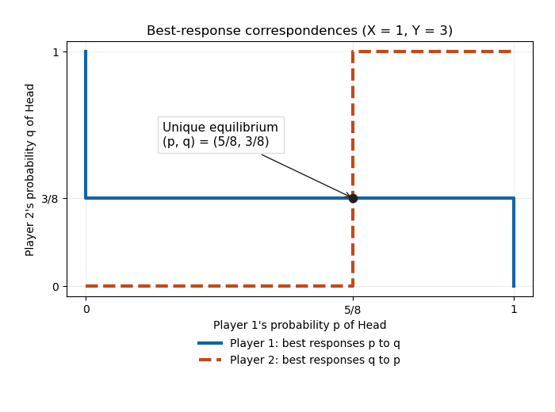

<h1 id="1/b/solution">Solution</h1>

↑ **Parent:** [B](../b.md)

With rows and columns ordered Head, Tail, the [payoff matrix](../../../../../payoff-matrix.md) of ordered pairs is

$$
\begin{array}{c|cc}
& H&T\\\hline
H&(-2,2)&(X,-X)\\
T&(Y,-Y)&(-2,2)
\end{array}.
$$

This is a [zero-sum game](../../../../../zero-sum-game.md). There is **no pure [Nash equilibrium](../../../../../nash-equilibrium.md)**: when the coins match, player 1 gains by switching to a mismatch; when they do not match, player 2 gains by making them match. Since $X,Y>0$, these improvements are strict.

Let $p$ and $q$ be the respective probabilities that players 1 and 2 choose Head. Player 1's payoffs from Head and Tail are $X-(X+2)q$ and $(Y+2)q-2$. Player 2 is indifferent when the corresponding player-1 payoffs against its two pure actions, $Y-(Y+2)p$ and $(X+2)p-2$, agree. The resulting unique [fully mixed Nash equilibrium](../../../../../fully-mixed-nash-equilibrium.md) is

$$
\boxed{p=\frac{Y+2}{X+Y+4},\qquad q=\frac{X+2}{X+Y+4}.}
$$

Both numbers lie strictly between zero and one. If either player instead used a pure action, the other's unique [best response](../../../../../best-response.md) would force the pure-action cycle above, so there are no additional partly mixed equilibria. Substitution gives player 1's [expected payoff](../../../../../expected-payoff.md) $(XY-4)/(X+Y+4)$ and its negative for player 2.

For $X=1,Y=3$, the [best response correspondences](../../../../../best-response.md) are

$$
BR_1(q)=\begin{cases}\{1\},&q<3/8,\\{[0,1]},&q=3/8,\\\{0\},&q>3/8,\end{cases}\qquad
BR_2(p)=\begin{cases}\{0\},&p<5/8,\\{[0,1]},&p=5/8,\\\{1\},&p>5/8.\end{cases}
$$

Their intersection is **$(p,q)=(5/8,3/8)$**, with [expected payoffs](../../../../../expected-payoff.md) $(-1/8,1/8)$.

**[Figure 1](#1/b/image-the-two-best-response-correspondences-intersect-at-the-unique-mixed-equilibrium). The two best response correspondences intersect at the unique mixed equilibrium**. The horizontal axis is player 1's Head probability $p$, and the vertical axis is player 2's Head probability $q$. Whole intervals at indifference are included.

## ↑ Ancestors (11)

1. [B](../b.md)
2. [1](../../1.md)
3. [Computational game theory](../../../computational-game-theory-split.md)
4. [2018](../../../split.md)
5. [Past exam of the computer science course of the University of Oxford](../../../../split.md)
6. [Computer science course of the University of Oxford](../../../../../computer-science-course-of-the-university-of-oxford.md)
7. [Undergraduate course of the University of Oxford](../../../../../undergraduate-course-of-the-university-of-oxford.md)
8. [Course of the University of Oxford](../../../../../course-of-the-university-of-oxford.md)
9. [University of Oxford](../../../../../university-of-oxford-split.md)
10. [List of universities](../../../../../list-of-universities.md)
11. [Codex Wiki](../../../../../split.md)
