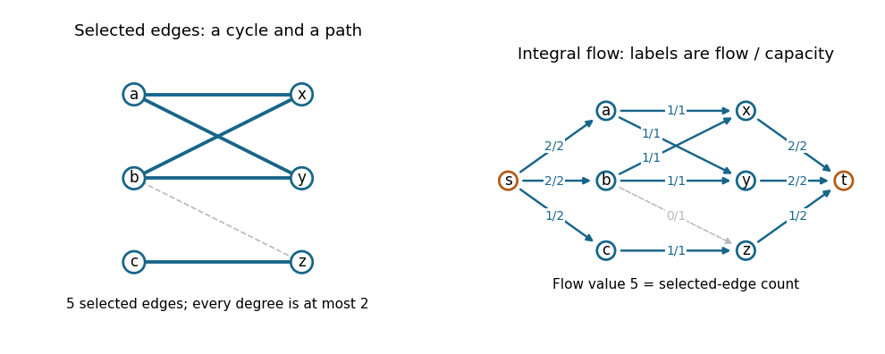

# Algorithms

↑ **Parent:** [2019](../2019.md)

Source paper: [released Oxford examination archive](https://www.whatdotheyknow.com/request/ba_computer_science_past_papers/response/2577745/attach/2/202402%20183%20CS%20Papers.zip?cookie_passthrough=1), member `2018/T/a16156w1.pdf`. The actual cover identifies the Second Public Examination, Trinity Term 2019, Friday 28 June, 09:30–11:30; the archive directory predates that cover year. All three questions are covered below, including every printed Roman part.

**Table of contents**

- [1](#1)
  - [a](#1/a)
    - [Solution](#1/a/solution)
  - [b](#1/b)
    - [Solution](#1/b/solution)
  - [c](#1/c)
    - [Solution](#1/c/solution)
  - [d](#1/d)
    - [Solution](#1/d/solution)
  - [e](#1/e)
    - [Solution](#1/e/solution)
- [2](#2)
  - [a](#2/a)
    - [i](#2/a/i)
      - [Solution](#2/a/i/solution)
    - [ii](#2/a/ii)
      - [Solution](#2/a/ii/solution)
    - [iii](#2/a/iii)
      - [Solution](#2/a/iii/solution)
    - [iv](#2/a/iv)
      - [Solution](#2/a/iv/solution)
  - [b](#2/b)
    - [i](#2/b/i)
      - [Solution](#2/b/i/solution)
    - [ii](#2/b/ii)
      - [Solution](#2/b/ii/solution)
    - [iii](#2/b/iii)
      - [Solution](#2/b/iii/solution)
  - [c](#2/c)
    - [Solution](#2/c/solution)
  - [d](#2/d)
    - [Solution](#2/d/solution)
- [3](#3)
  - [a](#3/a)
    - [Solution](#3/a/solution)
  - [b](#3/b)
    - [Solution](#3/b/solution)
  - [c](#3/c)
    - [i](#3/c/i)
      - [Solution](#3/c/i/solution)
    - [ii](#3/c/ii)
      - [Solution](#3/c/ii/solution)
    - [iii](#3/c/iii)
      - [Solution](#3/c/iii/solution)
  - [d](#3/d)
    - [i](#3/d/i)
      - [Solution](#3/d/i/solution)
    - [ii](#3/d/ii)
      - [Solution](#3/d/ii/solution)

## 1

↑ **Parent:** [Algorithms](algorithms.md)

<h3 id="1/a">a</h3>

↑ **Parent:** [1](#1)

<h4 id="1/a/solution">Solution</h4>

↑ **Parent:** [A](#1/a)

Use nonnegative amounts on the original [directed edges](../../graph-theory.md#directed-edge) of the [flow network](../../flow-network.md). A [feasible flow](../../graph-theory.md#feasible-flow) is a [function](../../function.md) $f:E\to\mathbb R_{\geq0}$ satisfying the [capacity constraints](../../flow-network.md#capacity-constraint) $f(u,v)\leq c(u,v)$ and [flow conservation](../../flow-network.md#flow-conservation) at every internal [vertex](../../graph.md#vertex-graph-theory):

$$
\sum_{u:(u,v)\in E}f(u,v)=\sum_{w:(v,w)\in E}f(v,w)\qquad(v\notin\{s,t\}).
$$

Its [flow value](../../flow-network.md#strength-of-a-flow) is net outflow at the source,

$$
\boxed{|f|=\sum_{v:(s,v)\in E}f(s,v)-\sum_{u:(u,s)\in E}f(u,s).}
$$

Summing [flow conservation](../../flow-network.md#flow-conservation) shows that this is also net inflow at the sink. Subtracting incoming [flow](../../flow-network.md#flow) matters when the source has incoming [edges](../../graph-theory.md#edge-of-a-graph).

An $s$–$t$ [cut of a flow network](../../flow-network.md#cut-of-a-flow-network) is a [partition of a set](../../set.md#partition-of-a-set) $(S,V\setminus S)$ with $s\in S$ and $t\notin S$. Its [cut capacity](../../flow-network.md#cut-capacity) is **the total outward [flow network edge capacity](../../flow-network.md#flow-network-edge-capacity)**,

$$
c(S,V\setminus S)=\sum_{(u,v)\in E:\,u\in S,\,v\notin S}c(u,v).
$$

Incoming [edges](../../graph-theory.md#edge-of-a-graph) do not contribute to this [sum](../../arithmetic.md#sum). Equivalently, one may use the antisymmetric net-[flow](../../flow-network.md#flow) convention, but the nonnegative arc convention above will also be used in the subsequent reductions.

<h3 id="1/b">b</h3>

↑ **Parent:** [1](#1)

<h4 id="1/b/solution">Solution</h4>

↑ **Parent:** [B](#1/b)

Sum net outflow over all [vertices](../../graph.md#vertex-graph-theory) in the source side $S$. An internal [directed edge](../../graph-theory.md#directed-edge) occurs once positively and once negatively, so it cancels. All internal [vertices](../../graph.md#vertex-graph-theory) have zero net outflow by [flow conservation](../../flow-network.md#flow-conservation), and the sink is outside $S$. Therefore

$$
|f|=\sum_{\substack{(u,v)\in E\\u\in S,\,v\notin S}}f(u,v)-\sum_{\substack{(u,v)\in E\\u\notin S,\,v\in S}}f(u,v).
$$

The second [sum](../../arithmetic.md#sum) is nonnegative, while every term in the first satisfies its [capacity constraint](../../flow-network.md#capacity-constraint). Consequently,

$$
\boxed{|f|\leq\sum_{\substack{(u,v)\in E\\u\in S,\,v\notin S}}c(u,v)=c(S,V\setminus S).}
$$

This is direct accounting from [flow conservation](../../flow-network.md#flow-conservation); it does not invoke the [max-flow min-cut theorem](../../flow-network.md#max-flow-min-cut-theorem).

<h3 id="1/c">c</h3>

↑ **Parent:** [1](#1)

<h4 id="1/c/solution">Solution</h4>

↑ **Parent:** [C](#1/c)

A [path-cycle matching](../../graph-theory.md#path-cycle-matching) is exactly an [edge](../../graph-theory.md#edge-of-a-graph) [subset](../../set.md#subset) whose resulting [subgraph](../../graph-theory.md#subgraph) has maximum [degree](../../polynomial.md#degree-of-a-polynomial) at most two: every nontrivial [connected component of a graph](../../graph.md#component-graph-theory) of this form is a [graph path](../../graph-theory.md#path-in-a-graph) or a [cycle in a graph](../../graph-theory.md#cycle-in-a-graph). Thus the task is a [bipartite b-matching](../../matching-graph-theory.md#bipartite-b-matching) problem with bound two at every [vertex](../../graph.md#vertex-graph-theory).

Find a [bipartition](../../bipartite-graph.md#bipartition-of-a-graph) $L,R$, orient every original [edge](../../graph-theory.md#edge-of-a-graph) from $L$ to $R$, and add a source $s$ and sink $t$. Give each arc $s\to u$, for $u\in L$, [flow network edge capacity](../../flow-network.md#flow-network-edge-capacity) two; each original arc $u\to v$ [flow network edge capacity](../../flow-network.md#flow-network-edge-capacity) one; and each arc $v\to t$, for $v\in R$, [flow network edge capacity](../../flow-network.md#flow-network-edge-capacity) two. Compute an integral [maximum flow](../../flow-network.md#maximum-flow-problem) and select the original [edges](../../graph-theory.md#edge-of-a-graph) whose [flow](../../flow-network.md#flow) is one. The [integral max-flow theorem](../../flow-network.md#integral-max-flow-theorem) guarantees such an integral optimum.

By [flow conservation](../../flow-network.md#flow-conservation), at most two selected [edges](../../graph-theory.md#edge-of-a-graph) touch each [vertex](../../graph.md#vertex-graph-theory), so they decompose into the required [vertex-disjoint paths](../../graph-theory.md#vertex-disjoint-paths) and [cycles in a graph](../../graph-theory.md#cycle-in-a-graph). Conversely, any permissible [path-cycle matching](../../graph-theory.md#path-cycle-matching) gives a [feasible flow](../../graph-theory.md#feasible-flow): send one unit through its middle arc for each selected [edge](../../graph-theory.md#edge-of-a-graph), with the outside arc amounts equal to the endpoint [degrees](../../polynomial.md#degree-of-a-polynomial). In both directions, **the [flow value](../../flow-network.md#strength-of-a-flow) equals the number of selected [edges](../../graph-theory.md#edge-of-a-graph)**. Maximizing either quantity therefore maximizes the other.

**[Figure 1](#1/c/image-an-original-path-cycle-matching-example-and-its-integral-maximum-flow-representation). An original path-cycle matching example and its integral maximum flow representation**.

The blue [edges](../../graph-theory.md#edge-of-a-graph) in this example form a four-[cycle in a graph](../../graph-theory.md#cycle-in-a-graph) and a one-[edge](../../graph-theory.md#edge-of-a-graph) [graph path](../../graph-theory.md#path-in-a-graph); the dashed [edge](../../graph-theory.md#edge-of-a-graph) is unused. Their five units of [flow](../../flow-network.md#flow) are optimal: the two left [vertices](../../graph.md#vertex-graph-theory) $a,b$ can each contribute at most two selected [edges](../../graph-theory.md#edge-of-a-graph), and $c$ has only one incident [edge](../../graph-theory.md#edge-of-a-graph).

The constructed [flow network](../../flow-network.md) has $|V|+2$ [vertices](../../graph.md#vertex-graph-theory) and $|E|+|V|$ arcs. A [polynomial-time algorithm](../../theoretical-computer-science.md#polynomial-time-algorithm) for [maximum flow](../../flow-network.md#maximum-flow-problem), such as the [Edmonds–Karp algorithm](../../flow-network.md#edmonds-karp-algorithm), followed by a traversal of the selected [subgraph](../../graph-theory.md#subgraph), gives an efficient solution.

<h3 id="1/d">d</h3>

↑ **Parent:** [1](#1)

<h4 id="1/d/solution">Solution</h4>

↑ **Parent:** [D](#1/d)

Separate the forced [integer](../../integer.md) portion from the choice of rounding direction. Put $p_{ij}=\lfloor a_{ij}\rfloor$ and $q_{ij}=a_{ij}-p_{ij}$. Define residual demands

$$
r_i=\sum_jq_{ij}=\sum_ja_{ij}-\sum_jp_{ij},\qquad c_j=\sum_iq_{ij}=\sum_ia_{ij}-\sum_ip_{ij}.
$$

These are [nonnegative integers](../../arithmetic.md#natural-number), since the original row and column [sums](../../arithmetic.md#sum) are [integers](../../integer.md). Also $\sum_ir_i=\sum_jc_j=:T$. Each [fractional part](../../calculus.md#fractional-part) satisfies $0\leq q_{ij}<1$.

Construct a [flow network](../../flow-network.md) with a [vertex](../../graph.md#vertex-graph-theory) for each row and column, source-to-row arcs of [flow network edge capacity](../../flow-network.md#flow-network-edge-capacity) $r_i$, row-to-column arcs of [flow network edge capacity](../../flow-network.md#flow-network-edge-capacity) one exactly where $q_{ij}>0$, and column-to-sink arcs of [flow network edge capacity](../../flow-network.md#flow-network-edge-capacity) $c_j$. The amounts $q_{ij}$ themselves define a fractional [feasible flow](../../graph-theory.md#feasible-flow) of [flow value](../../flow-network.md#strength-of-a-flow) $T$. No [flow](../../flow-network.md#flow) can exceed $T$, the total source [flow network edge capacity](../../flow-network.md#flow-network-edge-capacity). Because all constructed [flow network edge capacities](../../flow-network.md#flow-network-edge-capacity) are [integers](../../integer.md), an integral [maximum flow](../../flow-network.md#maximum-flow-problem) also has [flow value](../../flow-network.md#strength-of-a-flow) $T$ and saturates every source and sink arc.

Let $h_{ij}$ be its middle-arc [flow](../../flow-network.md#flow), taking $h_{ij}=0$ when that arc is absent. Then $h_{ij}\in\{0,1\}$, and the required answer is

$$
\boxed{b_{ij}=\lfloor a_{ij}\rfloor+h_{ij}.}
$$

At an already integral entry no middle arc exists, so that entry stays fixed. At a nonintegral entry the two possibilities are precisely its [floor](../../calculus.md#floor-function) and [ceiling](../../calculus.md#ceiling-function). [Flow conservation](../../flow-network.md#flow-conservation) gives $\sum_jh_{ij}=r_i$ and $\sum_ih_{ij}=c_j$, preserving every original row and column [sum](../../arithmetic.md#sum).

This is [matrix rounding with fixed margins](../../linear-programming.md#matrix-rounding-with-fixed-margins). There are $m+n+2$ [vertices](../../graph.md#vertex-graph-theory) and at most $mn+m+n$ arcs. Exact [rational arithmetic](../../number-theory.md#rational-arithmetic) computes the [floors](../../calculus.md#floor-function) and residual demands in [polynomial time](../../theoretical-computer-science.md#polynomial-time) in the encoded input length; the resulting [flow network edge capacities](../../flow-network.md#flow-network-edge-capacity) are small [integers](../../integer.md), so there is no need to scale by a potentially large common denominator.

<h3 id="1/e">e</h3>

↑ **Parent:** [1](#1)

<h4 id="1/e/solution">Solution</h4>

↑ **Parent:** [E](#1/e)

First give $w$ the vote of every voter whose allowed [set](../../set.md) contains $w$. Let their number be $K$. This loses no possible strict victory: starting with any winning assignment, changing such a ballot to $w$ increases $w$'s score and weakly decreases an opponent's score. Thus a winning assignment exists exactly when one exists with these $K$ ballots fixed.

Every remaining voter must now be assigned to an allowed opponent, and **each opponent may receive at most $K-1$ votes**. If any allowed [set](../../set.md) is empty, there is no valid election assignment. With at least two candidates, $K=0$ immediately makes a unique victory impossible. With only the candidate $w$, every nonempty ballot [set](../../set.md) forces that candidate, so the answer is yes under the question's strict-comparison definition.

For the remaining case $K\geq1$, make a [flow network](../../flow-network.md) with a [vertex](../../graph.md#vertex-graph-theory) for each remaining voter and each opponent. Add source-to-voter arcs of [flow network edge capacity](../../flow-network.md#flow-network-edge-capacity) one, voter-to-opponent arcs of [flow network edge capacity](../../flow-network.md#flow-network-edge-capacity) one for the allowed choices, and opponent-to-sink arcs of [flow network edge capacity](../../flow-network.md#flow-network-edge-capacity) $K-1$. Compute an integral [maximum flow](../../flow-network.md#maximum-flow-problem). Then

$$
\boxed{w\text{ can be the unique winner}\iff |f_{\max}|=n-K.}
$$

A [flow](../../flow-network.md#flow) saturating all voter arcs assigns each remaining voter to exactly one allowed opponent, by integrality and [flow conservation](../../flow-network.md#flow-conservation). The sink-arc [capacity constraints](../../flow-network.md#capacity-constraint) give every opponent strictly fewer than $K$ votes. Conversely, any winning assignment with the fixed $K$ votes defines just such a saturating [feasible flow](../../graph-theory.md#feasible-flow). The [flow network](../../flow-network.md) has at most $n+m+2$ [vertices](../../graph.md#vertex-graph-theory) and $O(n+m+\sum_i|C_i|)$ arcs, hence the decision takes [polynomial time](../../theoretical-computer-science.md#polynomial-time).

## 2

↑ **Parent:** [Algorithms](algorithms.md)

<h3 id="2/a">a</h3>

↑ **Parent:** [2](#2)

<h4 id="2/a/i">i</h4>

↑ **Parent:** [A](#2/a)

<h5 id="2/a/i/solution">Solution</h5>

↑ **Parent:** [I](#2/a/i)

Take $u,v\in P$ and $0\leq\lambda\leq1$. Their [convex combination](../../convex-set.md#convex-combination) satisfies

$$
A\bigl(\lambda u+(1-\lambda)v\bigr)=\lambda Au+(1-\lambda)Av\leq\lambda b+(1-\lambda)b=b.
$$

Thus every such [convex combination](../../convex-set.md#convex-combination) remains in $P$, so **$P$ is a [convex set](../../convex-set.md)**. The assertion also holds when $P$ is empty.

<h4 id="2/a/ii">ii</h4>

↑ **Parent:** [A](#2/a)

<h5 id="2/a/ii/solution">Solution</h5>

↑ **Parent:** [Ii](#2/a/ii)

An [extreme point](../../convex-set.md#extreme-point) $p\in P$ cannot be written as a nontrivial [convex combination](../../convex-set.md#convex-combination) of two distinct [points](../../geometry-and-topology.md#point-geometry) of $P$: if $p=\lambda u+(1-\lambda)v$ with $u,v\in P$ and $0<\lambda<1$, then $u=v=p$.

A [vertex of a linear polyhedron](../../linear-programming.md#vertex-of-a-linear-polyhedron) is a [feasible point](../../mathematical-optimization.md#feasible-point) at which the [active constraints](../../linear-programming.md#active-constraint) include $n$ [linearly independent](../../vector-space.md#linear-independence) row normals. Equivalently, some $n$ independent bounding [hyperplanes](../../vector-space.md#hyperplane) intersect uniquely at that [point](../../geometry-and-topology.md#point-geometry). This definition does not require $P$ to be bounded or full-dimensional. For a [linear polyhedron](../../linear-programming.md#linear-polyhedron), it is also equivalent to the [point](../../geometry-and-topology.md#point-geometry) uniquely maximizing a suitable [linear function](../../vector-space.md#linear-function): sum the selected active inequalities to construct one such [linear function](../../vector-space.md#linear-function).

<h4 id="2/a/iii">iii</h4>

↑ **Parent:** [A](#2/a)

<h5 id="2/a/iii/solution">Solution</h5>

↑ **Parent:** [Iii](#2/a/iii)

Let $p$ be a [vertex of a linear polyhedron](../../linear-programming.md#vertex-of-a-linear-polyhedron) and choose $n$ independent [active constraints](../../linear-programming.md#active-constraint), written $Bp=d$, with $B$ invertible. Suppose $p=\lambda u+(1-\lambda)v$, where $u,v\in P$ and $0<\lambda<1$. Each selected inequality has $B_iu\leq d_i$ and $B_iv\leq d_i$, while

$$
d_i=B_ip=\lambda B_iu+(1-\lambda)B_iv.
$$

Since both weights are positive, equality in this weighted upper bound forces $B_iu=B_iv=d_i$ for every selected row. Hence $Bu=Bv=d$, and invertibility gives $u=v=p$. Therefore **every [vertex of a linear polyhedron](../../linear-programming.md#vertex-of-a-linear-polyhedron) is an [extreme point](../../convex-set.md#extreme-point)**.

<h4 id="2/a/iv">iv</h4>

↑ **Parent:** [A](#2/a)

<h5 id="2/a/iv/solution">Solution</h5>

↑ **Parent:** [Iv](#2/a/iv)

**No.** For the [linear polyhedron](../../linear-programming.md#linear-polyhedron) $P=[0,1]^2$, take $c=(1,0)^T$ and $x^*=(1,1/2)^T$. The maximum of $c^Tx$ is one, attained at $x^*$. Yet

$$
x^*=\tfrac12(1,0)^T+\tfrac12(1,1)^T,
$$

so $x^*$ is not an [extreme point](../../convex-set.md#extreme-point), hence not a [vertex of a linear polyhedron](../../linear-programming.md#vertex-of-a-linear-polyhedron). An [optimal face](../../linear-programming.md#optimal-face-of-a-linear-program) can contain many [points](../../geometry-and-topology.md#point-geometry); an arbitrary maximizer need not be one of its [vertices of a linear polyhedron](../../linear-programming.md#vertex-of-a-linear-polyhedron).

<h3 id="2/b">b</h3>

↑ **Parent:** [2](#2)

<h4 id="2/b/i">i</h4>

↑ **Parent:** [B](#2/b)

<h5 id="2/b/i/solution">Solution</h5>

↑ **Parent:** [I](#2/b/i)

Only $z,w$ have printed nonnegativity restrictions; $x,y$ are unrestricted. In four-dimensional space, a [vertex of a linear polyhedron](../../linear-programming.md#vertex-of-a-linear-polyhedron) needs four independent [active constraints](../../linear-programming.md#active-constraint). There are exactly four available constraints, so all must be active. Solving them gives

$$
z=w=0,\qquad y=3,\qquad 2x-y=1,
$$

and therefore the only possible [vertex of a linear polyhedron](../../linear-programming.md#vertex-of-a-linear-polyhedron) is **$(x,y,z,w)=(2,3,0,0)$**. It is feasible, and its four active normals are independent, so it is indeed a [vertex of a linear polyhedron](../../linear-programming.md#vertex-of-a-linear-polyhedron).

One can also see uniqueness geometrically from the [slack variables](../../linear-programming.md#slack-variable) $s_1=1-2x+y-5w$ and $s_2=3-y-z-w$. The [feasible region](../../mathematical-optimization.md#feasible-region) is in affine bijection with the [nonnegative orthant](../../convex-set.md#nonnegative-orthant) in $(s_1,s_2,z,w)$:

$$
y=3-s_2-z-w,\qquad x=2-\tfrac12s_1-\tfrac12s_2-\tfrac12z-3w.
$$

That [orthant](../../convex-set.md#orthant) has only the origin as an [extreme point](../../convex-set.md#extreme-point), giving the same unique [vertex of a linear polyhedron](../../linear-programming.md#vertex-of-a-linear-polyhedron).

<h4 id="2/b/ii">ii</h4>

↑ **Parent:** [B](#2/b)

<h5 id="2/b/ii/solution">Solution</h5>

↑ **Parent:** [Ii](#2/b/ii)

Use the [standard maximum form of a linear program](../../linear-programming.md#standard-maximum-form-of-a-linear-program) convention $\max c^Tu$ subject to $Mu\leq b$ and $u\geq0$. Split the unrestricted variables as $x=x^+-x^-$ and $y=y^+-y^-$, with all four new variables nonnegative. The resulting [linear program](../../linear-programming.md) is

$$
\begin{aligned}
\max\quad&2x^+-2x^-+3y^+-3y^-+4z+7w\\
\text{subject to}\quad&2x^+-2x^--y^++y^-+5w\leq1,\\
&y^+-y^-+z+w\leq3,\\
&x^+,x^-,y^+,y^-,z,w\geq0.
\end{aligned}
$$

If equality-constraint standard form is preferred, add a nonnegative [slack variable](../../linear-programming.md#slack-variable) to each inequality.

Give the two inequalities nonnegative [dual variables](../../linear-programming.md#dual-variable) $\alpha,\beta$. The [dual linear program](../../linear-programming.md#dual-linear-program) is

$$
\begin{aligned}
\min\quad&\alpha+3\beta\\
\text{subject to}\quad&2\alpha\geq2,\qquad -2\alpha\geq-2,\\
&-\alpha+\beta\geq3,\qquad \alpha-\beta\geq-3,\\
&\beta\geq4,\qquad5\alpha+\beta\geq7,\\
&\alpha,\beta\geq0.
\end{aligned}
$$

The paired inequalities encode equalities for the two original unrestricted variables. Equivalently, the [dual linear program](../../linear-programming.md#dual-linear-program) has $2\alpha=2$, $-\alpha+\beta=3$, $\beta\geq4$, $5\alpha+\beta\geq7$ and $\alpha,\beta\geq0$. Thus **its only [feasible point](../../mathematical-optimization.md#feasible-point) is $(\alpha,\beta)=(1,4)$, of [objective function](../../mathematical-optimization.md#objective-function) value $13$**.

<h4 id="2/b/iii">iii</h4>

↑ **Parent:** [B](#2/b)

<h5 id="2/b/iii/solution">Solution</h5>

↑ **Parent:** [Iii](#2/b/iii)

The [point](../../geometry-and-topology.md#point-geometry) $(1,4)$ satisfies [dual feasibility](../../linear-programming.md#dual-feasibility) and supplies an upper bound of $13$ by [weak duality](../../linear-programming.md#weak-duality). Directly, take one copy of the first constraint and four copies of the second:

$$
2x+3y+4z+9w\leq13.
$$

Since $w\geq0$, the original [objective function](../../mathematical-optimization.md#objective-function) is at most $13-2w\leq13$. The [feasible point](../../mathematical-optimization.md#feasible-point) $(2,3,0,0)$ attains $13$. Hence

$$
\boxed{\operatorname{OPT}=13,\qquad (x,y,z,w)=(2,3,0,0)\text{ is optimal}.}
$$

There are also nonvertex optima. In terms of the [slack variables](../../linear-programming.md#slack-variable), the exact [objective function](../../mathematical-optimization.md#objective-function) identity is

$$
2x+3y+4z+7w=13-s_1-4s_2-2w.
$$

Equality requires $s_1=s_2=w=0$, leaving the entire [optimal face](../../linear-programming.md#optimal-face-of-a-linear-program)

$$
(x,y,z,w)=(2-t/2,\,3-t,\,t,\,0),\qquad t\geq0.
$$

Negative $x$ or $y$ on this ray are allowed. This illustrates why the single [vertex of a linear polyhedron](../../linear-programming.md#vertex-of-a-linear-polyhedron) does not imply a unique optimum.

<h3 id="2/c">c</h3>

↑ **Parent:** [2](#2)

<h4 id="2/c/solution">Solution</h4>

↑ **Parent:** [C](#2/c)

First suppose the stated nonnegative [vectors](../../vector-space.md#vector) $y,z$ exist. If $x\in P\cap Q$, multiply $Ax\leq b$ by $y^T$ and $Cx\leq d$ by $z^T$. Since $x\geq0$ and $y^TA+z^TC\geq0$, this gives the contradiction

$$
0\leq(y^TA+z^TC)x\leq y^Tb+z^Td<0.
$$

Thus the certificate implies $P\cap Q=\varnothing$.

For the converse, put

$$
M=\begin{pmatrix}A\\C\end{pmatrix},\qquad h=\begin{pmatrix}b\\d\end{pmatrix}.
$$

A common [feasible point](../../mathematical-optimization.md#feasible-point) exists exactly when $Mx\leq h$, $x\geq0$. Introducing a nonnegative [vector](../../vector-space.md#vector) of [slack variables](../../linear-programming.md#slack-variable) $s$ makes this equivalent to

$$
\begin{pmatrix}M&I\end{pmatrix}\begin{pmatrix}x\\s\end{pmatrix}=h,\qquad x,s\geq0.
$$

If this system is infeasible, the nonnegative-equations version of [Farkas' lemma](../../convex-optimization.md#farkas-lemma) supplies an unrestricted [vector](../../vector-space.md#vector) $u$ such that

$$
M^Tu\geq0,\qquad I^Tu=u\geq0,\qquad h^Tu<0.
$$

Split $u=(y,z)^T$ according to the original two blocks of inequalities. The three conditions become **$y,z\geq0$, $y^TA+z^TC\geq0$ and $y^Tb+z^Td<0$**, exactly the desired certificate. Both directions are proved. The role of $x\geq0$ is essential: it is why the combined normal need only be nonnegative rather than zero.[§5.8.3, printed pp. 261–262, linear-inequality alternatives and Farkas' lemma](../../mathematics-bibliography.md#convex-optimization-by-stephen-boyd-and-lieven-vandenberghe)

<h3 id="2/d">d</h3>

↑ **Parent:** [2](#2)

<h4 id="2/d/solution">Solution</h4>

↑ **Parent:** [D](#2/d)

Let $B=A^T$ and choose any column [probability vector](../../probability-distribution.md#probability-vector) $q$, for example the first coordinate [unit vector](../../vector-space.md#unit-vector). Because $A$ has nonnegative entries and each row sums to one, $B$ maps the [probability simplex](../../algebraic-topology.md#probability-simplex)

$$
\Delta=\{v\in\mathbb R^n:v\geq0,\ \mathbf1^Tv=1\}
$$

into itself: $Bv\geq0$ and $\mathbf1^TBv=(A\mathbf1)^Tv=\mathbf1^Tv=1$.

The iterates $B^jq$ need not converge, so take their arithmetic averages,

$$
x_N=\frac1N\sum_{j=0}^{N-1}B^jq\in\Delta.
$$

A telescoping [sum](../../arithmetic.md#sum) gives

$$
Bx_N-x_N=\frac{B^Nq-q}{N}.
$$

Both [vectors](../../vector-space.md#vector) on the right before subtraction have [L1 norm](../../normed-vector-space.md#l1-norm) one, so $\|Bx_N-x_N\|_1\leq2/N\to0$.

The [probability simplex](../../algebraic-topology.md#probability-simplex) is closed and bounded in finite-dimensional [Euclidean space](../../normed-vector-space.md#euclidean-norm), hence compact by the [Heine-Borel theorem](../../topology.md#heine-borel-theorem). It follows that a [subsequence](../../sequence-and-series.md#subsequence) $x_{N_j}$ converges to some $x\in\Delta$. Passing to the [limit](../../calculus.md#limit-of-a-function) in the displayed identity, using [continuity](../../calculus.md#continuous-function) of the [linear map](../../vector-space.md#linear-map) $B$, gives **$A^Tx=Bx=x$, with $x\geq0$ and $\sum_i x_i=1$**.

This proves [stationary distribution existence for a finite Markov chain](../../markov-chain.md#stationary-distribution-existence-for-a-finite-markov-chain) without any [Markov chain irreducibility](../../markov-chain.md#irreducible-markov-chain) or [aperiodicity](../../markov-chain.md#aperiodic-markov-chain) assumption. Those stronger hypotheses concern uniqueness and convergence, not the existence required here.

## 3

↑ **Parent:** [Algorithms](algorithms.md)

<h3 id="3/a">a</h3>

↑ **Parent:** [3](#3)

<h4 id="3/a/solution">Solution</h4>

↑ **Parent:** [A](#3/a)

A parameterized [decision problem](../../theoretical-computer-science.md#decision-problem) is [fixed-parameter tractable](../../theoretical-computer-science.md#fixed-parameter-tractability) if there is an [algorithm](../../algorithm.md) deciding inputs of encoded length $N$ and parameter $k$ in [running time](../../algorithm.md#running-time) at most **$f(k)N^c$**, where $f$ is a computable [function](../../function.md) and $c$ is a constant independent of $k$. Arbitrarily expensive dependence on the parameter is permitted; putting $k$ in the exponent of $N$ does not by itself establish [fixed-parameter tractability](../../theoretical-computer-science.md#fixed-parameter-tractability).

For a minimization problem with nonnegative costs, a factor-two [approximation algorithm](../../mathematical-optimization.md#approximation-algorithm) runs in [polynomial time](../../theoretical-computer-science.md#polynomial-time), always returns a [feasible solution](../../mathematical-optimization.md#feasible-point), and satisfies **$\operatorname{cost}(\operatorname{ALG})\leq2\operatorname{OPT}$** on every feasible input. A [feasible solution](../../mathematical-optimization.md#feasible-point) also satisfies $\operatorname{OPT}\leq\operatorname{cost}(\operatorname{ALG})$. If the optimum is zero, the guarantee requires an answer of zero cost.

<h3 id="3/b">b</h3>

↑ **Parent:** [3](#3)

<h4 id="3/b/solution">Solution</h4>

↑ **Parent:** [B](#3/b)

The [vertex cover decision problem](../../graph-theory.md#vertex-cover-decision-problem) takes a finite [simple graph](../../graph.md#simple-graph) $G$ and a [nonnegative integer](../../arithmetic.md#natural-number) $k$, and asks whether there is a [vertex cover](../../graph-theory.md#vertex-cover) of [cardinality](../../cardinal-number.md#cardinality) at most $k$. The optimization problem asks for a [minimum vertex cover](../../graph-theory.md#minimum-vertex-cover), with cost equal to its [cardinality](../../cardinal-number.md#cardinality).

For the decision problem, if there are no [edges](../../graph-theory.md#edge-of-a-graph), accept; if there is an [edge](../../graph-theory.md#edge-of-a-graph) but $k=0$, reject. Otherwise choose an [edge](../../graph-theory.md#edge-of-a-graph) $uv$ and branch: either include $u$ and recurse on $G-u$ with budget $k-1$, or include $v$ and recurse on $G-v$ with budget $k-1$. Accept if either branch accepts. Every [vertex cover](../../graph-theory.md#vertex-cover) contains at least one endpoint of $uv$, so every possible solution is retained by at least one branch. Conversely, adding the selected endpoint to a [vertex cover](../../graph-theory.md#vertex-cover) returned by the smaller instance covers all original [edges](../../graph-theory.md#edge-of-a-graph). This proves correctness by [induction](../../foundations-of-mathematics.md#mathematical-induction) on the remaining budget.

The [search tree](../../theoretical-computer-science.md#search-tree) has depth at most $k$ and at most $2^k$ leaves. Processing each node in $O(|V|+|E|)$ time gives **$O(2^k(|V|+|E|))$ [running time](../../algorithm.md#running-time)**, establishing [fixed-parameter tractability](../../theoretical-computer-science.md#fixed-parameter-tractability).

For optimization, greedily build a [maximal matching](../../matching-graph-theory.md#maximal-matching) $M$: repeatedly select an [edge](../../graph-theory.md#edge-of-a-graph) and discard every [edge](../../graph-theory.md#edge-of-a-graph) touching either endpoint. Return the [set](../../set.md) $C$ of all endpoints of $M$. Any [edge](../../graph-theory.md#edge-of-a-graph) with neither endpoint in $C$ could be added to $M$, contradicting maximality; thus $C$ is a [vertex cover](../../graph-theory.md#vertex-cover). Since the [edges](../../graph-theory.md#edge-of-a-graph) of a [matching in a graph](../../matching-graph-theory.md) have pairwise [disjoint](../../set.md#disjoint-sets) endpoint [sets](../../set.md), every [vertex cover](../../graph-theory.md#vertex-cover) must contain at least one different [vertex](../../graph.md#vertex-graph-theory) for each of them. Therefore

$$
\boxed{|C|=2|M|\leq2\tau(G)=2\operatorname{OPT}.}
$$

The greedy construction takes [polynomial time](../../theoretical-computer-science.md#polynomial-time), and can be implemented in $O(|V|+|E|)$ with [adjacency lists](../../data-structure.md#adjacency-list). It needs only a [maximal matching](../../matching-graph-theory.md#maximal-matching), not a [maximum matching](../../matching-graph-theory.md#maximum-cardinality-matching).

<h3 id="3/c">c</h3>

↑ **Parent:** [3](#3)

<h4 id="3/c/i">i</h4>

↑ **Parent:** [C](#3/c)

<h5 id="3/c/i/solution">Solution</h5>

↑ **Parent:** [I](#3/c/i)

If the basis has $r\leq k$ members, it has $2^r$ [subsets](../../set.md#subset), each specifying a possible [union](../../set.md#set-union). Different [subsets](../../set.md#subset) can produce the same [union](../../set.md#set-union), so the number of distinct generated [sets](../../set.md) is at most $2^r$. Consequently,

$$
\boxed{|\mathcal F|\leq2^k.}
$$

Here $\mathcal F$ is a [set family](../../extremal-set-theory.md#set-family) of distinct [sets](../../set.md). If a representation lists duplicate input [sets](../../set.md), discard those duplicates before applying this bound. The empty [union](../../set.md#set-union) is included.

<h4 id="3/c/ii">ii</h4>

↑ **Parent:** [C](#3/c)

<h5 id="3/c/ii/solution">Solution</h5>

↑ **Parent:** [Ii](#3/c/ii)

Write $U'=U\setminus\{y\}$ and $\mathcal F'=\{B\setminus\{y\}:B\in\mathcal F\}$. If $\mathcal A$ is a basis for the original instance, replace each member $A$ by $A\setminus\{y\}$. Deletion commutes with [unions](../../set.md#set-union), so the resulting family generates every member of $\mathcal F'$ and has at most $|\mathcal A|$ members.

Conversely, take a basis $\mathcal A'$ for the reduced instance. Lift each of its members by

$$
L(A')=\begin{cases}A'\cup\{y\},&x\in A',\\A',&x\notin A'.\end{cases}
$$

If $B\setminus\{y\}$ is represented as a [union](../../set.md#set-union) of reduced basis [sets](../../set.md), the same [union](../../set.md#set-union) of their lifts agrees with $B$ on $U'$. It contains $y$ exactly when one of the selected reduced basis [sets](../../set.md) contains $x$, namely exactly when $x\in B$. By the assumed [incidence equivalence in a set family](../../extremal-set-theory.md#incidence-equivalence-in-a-set-family), this occurs exactly when $y\in B$. Thus the lifted [union](../../set.md#set-union) is precisely $B$, and the lifted basis has no more members.

Therefore **deleting $y$ preserves the yes/no answer with the same parameter $k$**. The reverse construction does not require a reduced basis [set](../../set.md) to be an input [set](../../set.md).

<h4 id="3/c/iii">iii</h4>

↑ **Parent:** [C](#3/c)

<h5 id="3/c/iii/solution">Solution</h5>

↑ **Parent:** [Iii](#3/c/iii)

First discard duplicate input [sets](../../set.md), and let $m=|\mathcal F|$. If $m>2^k$, reject by part (i); this rejection can be encoded as the fixed no-instance $U=\{u\}$, $\mathcal F=\{\{u\}\}$, $k=0$ of the [set basis problem](../../extremal-set-theory.md#set-basis-problem). Otherwise, represent each ground element $x$ by its incidence column

$$
\sigma(x)=\bigl(\mathbf1_{x\in B}\bigr)_{B\in\mathcal F}\in\{0,1\}^m.
$$

Keep one element from each class of equal columns. By repeatedly applying part (ii), this preserves the answer. The reduced number of elements $q$ satisfies

$$
\boxed{m\leq2^k,\qquad q\leq2^m\leq2^{2^k}.}
$$

Relabel these representatives and store their reduced incidence [matrix](../../vector-space.md#matrix). Its $mq$ membership bits, the dimensions and $k$ have encoded length bounded solely by a computable [function](../../function.md) of $k$; the leading incidence bound is $2^{k+2^k}$. Thus this is a [kernelization](../../theoretical-computer-science.md#kernelization), even though it is not a polynomial kernel. Forming columns and grouping identical ones takes [polynomial time](../../theoretical-computer-science.md#polynomial-time) in the original explicit input length. To test $m>2^k$, compare bit lengths or truncate exponentiation at $m+1$; never construct an enormous $2^k$ merely to perform this preprocessing comparison.

For completeness, the bounded instance can be solved explicitly. Enumerate all ordered lists of $k$ [subsets](../../set.md#subset) of the $q$-element ground [set](../../set.md), allowing empty members to pad shorter bases. There are at most $2^{kq}$ such lists. For a candidate basis and each reduced input [set](../../set.md) $B$, form the [union](../../set.md#set-union) of every candidate basis [set](../../set.md) contained in $B$. If this [union](../../set.md#set-union) equals $B$, a representation exists; if it does not, no [union](../../set.md#set-union) of that candidate's members can represent $B$, because any member not contained in $B$ would add a forbidden element. Testing every $B$ therefore verifies a candidate in time polynomial in $m,q,k$.

The preprocessing is polynomial in the original input length, and the remaining search depends only on $k$. Hence **the [set basis problem](../../extremal-set-theory.md#set-basis-problem) is [fixed-parameter tractable](../../theoretical-computer-science.md#fixed-parameter-tractability) with respect to $k$**. Empty input families and $k=0$ are covered by the same empty-[union](../../set.md#set-union) convention.

<h3 id="3/d">d</h3>

↑ **Parent:** [3](#3)

<h4 id="3/d/i">i</h4>

↑ **Parent:** [D](#3/d)

<h5 id="3/d/i/solution">Solution</h5>

↑ **Parent:** [I](#3/d/i)

Assume the standard nonempty instance convention $1\leq k\leq n$, and set $d(v,v)=0$. Start with no centers. Pick any city still farther than $2r^*$ from every selected center, add it as a center, and mark every city within distance $2r^*$ of it as covered. Stop when all cities are covered.

Distinct chosen centers have pairwise distance greater than $2r^*$. Fix an optimal [set](../../set.md) of $k$ centers and assign each city to one optimal center within distance $r^*$. Two cities assigned to the same center have distance at most $2r^*$ by the [triangle inequality](../../topological-analysis.md#triangle-inequality). Thus no two chosen centers can be assigned to that same optimal center. The [pigeonhole principle](../../combinatorics.md#pigeonhole-principle) shows that **the greedy procedure selects at most $k$ centers and has radius at most $2r^*$**. If fewer than $k$ are selected, add arbitrary distinct cities; this cannot worsen the radius.

With the supplied radius, a straightforward implementation updates coverage in $O(n)$ time per selected center, hence takes $O(nk)$ distance tests. The argument also handles $r^*=0$. It is the packing bound underlying the [metric k-center problem](../../mathematical-optimization.md#metric-k-center-problem).

<h4 id="3/d/ii">ii</h4>

↑ **Parent:** [D](#3/d)

<h5 id="3/d/ii/solution">Solution</h5>

↑ **Parent:** [Ii](#3/d/ii)

The optimum radius is a distance from some city to a selected city, so it belongs to

$$
D=\{0\}\cup\{d(u,v):u,v\in V,\ u\ne v\}.
$$

Sort the distinct values of $D$, try them in increasing order, and run part (i)'s greedy procedure with each trial value $r$. Declare a trial successful when all cities are covered using at most $k$ centers; stop a failed trial as soon as a $(k+1)$st center would be selected. The trial $r=r^*$ must succeed by part (i), so the first successful value $\widehat r$ satisfies $\widehat r\leq r^*$. Its output has

$$
\boxed{R\leq2\widehat r\leq2r^*.}
$$

There are $O(n^2)$ candidate distances and $O(n^2)$ work per trial, giving a [polynomial-time algorithm](../../theoretical-computer-science.md#polynomial-time-algorithm) with [running time](../../algorithm.md#running-time) $O(n^4)$, plus sorting. Success at $r$ need not mean that radius $r$ itself is feasible; only the radius-$2r$ guarantee is used.

A faster alternative is the [farthest-first traversal](../../mathematical-optimization.md#farthest-first-traversal). Choose any first center, then repeatedly choose a city farthest from its nearest current center until $k$ have been chosen. Let $R$ be the resulting radius. If $R>0$, adjoin a city attaining that distance. At every earlier selection, the maximum distance to the then-current center [set](../../set.md) was at least $R$, so all pairs among these $k+1$ cities are at distance at least $R$. Two belong to the same optimal radius-$r^*$ [closed ball](../../topological-analysis.md#closed-ball), giving $R\leq2r^*$ by the [triangle inequality](../../topological-analysis.md#triangle-inequality). If $R=0$, the guarantee is immediate. Maintaining nearest-center distances gives **$O(nk)$ distance evaluations** without knowing $r^*$.

## ↑ Ancestors (8)

1. [2019](../2019.md)
2. [Past exam of the computer science course of the University of Oxford](../../past-exam-of-the-computer-science-course-of-the-university-of-oxford.md)
3. [Computer science course of the University of Oxford](../../university-of-oxford.md#computer-science-course-of-the-university-of-oxford)
4. [Undergraduate course of the University of Oxford](../../university-of-oxford.md#undergraduate-course-of-the-university-of-oxford)
5. [Course of the University of Oxford](../../university-of-oxford.md#course-of-the-university-of-oxford)
6. [University of Oxford](../../university-of-oxford.md)
7. [List of universities](../../README.md#list-of-universities)
8. [Codex Wiki](../../README.md)
