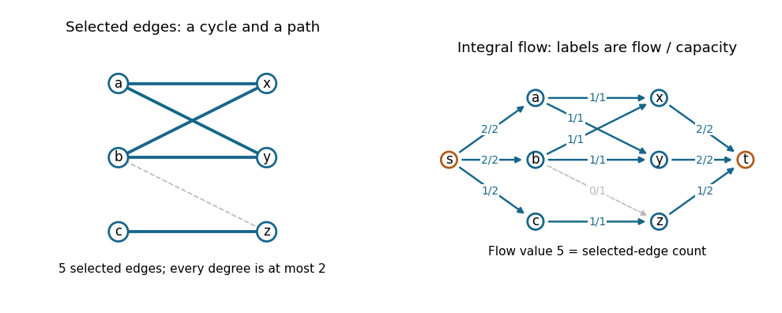

<h1 id="1/c/solution">Solution</h1>

↑ **Parent:** [C](../c.md)

A [path-cycle matching](../../../../../path-cycle-matching.md) is exactly an [edge](../../../../../edge-of-a-graph.md) [subset](../../../../../subset.md) whose resulting [subgraph](../../../../../subgraph.md) has maximum [degree](../../../../../degree-of-a-polynomial.md) at most two: every nontrivial [connected component of a graph](../../../../../component-graph-theory.md) of this form is a [graph path](../../../../../path-in-a-graph.md) or a [cycle in a graph](../../../../../cycle-in-a-graph.md). Thus the task is a [bipartite b-matching](../../../../../bipartite-b-matching.md) problem with bound two at every [vertex](../../../../../vertex-graph-theory.md).

Find a [bipartition](../../../../../bipartition-of-a-graph.md) $L,R$, orient every original [edge](../../../../../edge-of-a-graph.md) from $L$ to $R$, and add a source $s$ and sink $t$. Give each arc $s\to u$, for $u\in L$, [flow network edge capacity](../../../../../flow-network-edge-capacity.md) two; each original arc $u\to v$ [flow network edge capacity](../../../../../flow-network-edge-capacity.md) one; and each arc $v\to t$, for $v\in R$, [flow network edge capacity](../../../../../flow-network-edge-capacity.md) two. Compute an integral [maximum flow](../../../../../maximum-flow-problem.md) and select the original [edges](../../../../../edge-of-a-graph.md) whose [flow](../../../../../flow.md) is one. The [integral max-flow theorem](../../../../../integral-max-flow-theorem.md) guarantees such an integral optimum.

By [flow conservation](../../../../../flow-conservation.md), at most two selected [edges](../../../../../edge-of-a-graph.md) touch each [vertex](../../../../../vertex-graph-theory.md), so they decompose into the required [vertex-disjoint paths](../../../../../vertex-disjoint-paths.md) and [cycles in a graph](../../../../../cycle-in-a-graph.md). Conversely, any permissible [path-cycle matching](../../../../../path-cycle-matching.md) gives a [feasible flow](../../../../../feasible-flow.md): send one unit through its middle arc for each selected [edge](../../../../../edge-of-a-graph.md), with the outside arc amounts equal to the endpoint [degrees](../../../../../degree-of-a-polynomial.md). In both directions, **the [flow value](../../../../../strength-of-a-flow.md) equals the number of selected [edges](../../../../../edge-of-a-graph.md)**. Maximizing either quantity therefore maximizes the other.

**[Figure 1](#1/c/image-an-original-path-cycle-matching-example-and-its-integral-maximum-flow-representation). An original path-cycle matching example and its integral maximum flow representation**.

The blue [edges](../../../../../edge-of-a-graph.md) in this example form a four-[cycle in a graph](../../../../../cycle-in-a-graph.md) and a one-[edge](../../../../../edge-of-a-graph.md) [graph path](../../../../../path-in-a-graph.md); the dashed [edge](../../../../../edge-of-a-graph.md) is unused. Their five units of [flow](../../../../../flow.md) are optimal: the two left [vertices](../../../../../vertex-graph-theory.md) $a,b$ can each contribute at most two selected [edges](../../../../../edge-of-a-graph.md), and $c$ has only one incident [edge](../../../../../edge-of-a-graph.md).

The constructed [flow network](../../../../../flow-network-split.md) has $|V|+2$ [vertices](../../../../../vertex-graph-theory.md) and $|E|+|V|$ arcs. A [polynomial-time algorithm](../../../../../polynomial-time-algorithm.md) for [maximum flow](../../../../../maximum-flow-problem.md), such as the [Edmonds–Karp algorithm](../../../../../edmonds-karp-algorithm.md), followed by a traversal of the selected [subgraph](../../../../../subgraph.md), gives an efficient solution.

## ↑ Ancestors (11)

1. [C](../c.md)
2. [1](../../1.md)
3. [Algorithms](../../../algorithms-split.md)
4. [2019](../../../split.md)
5. [Past exam of the computer science course of the University of Oxford](../../../../split.md)
6. [Computer science course of the University of Oxford](../../../../../computer-science-course-of-the-university-of-oxford.md)
7. [Undergraduate course of the University of Oxford](../../../../../undergraduate-course-of-the-university-of-oxford.md)
8. [Course of the University of Oxford](../../../../../course-of-the-university-of-oxford.md)
9. [University of Oxford](../../../../../university-of-oxford-split.md)
10. [List of universities](../../../../../list-of-universities.md)
11. [Codex Wiki](../../../../../split.md)
