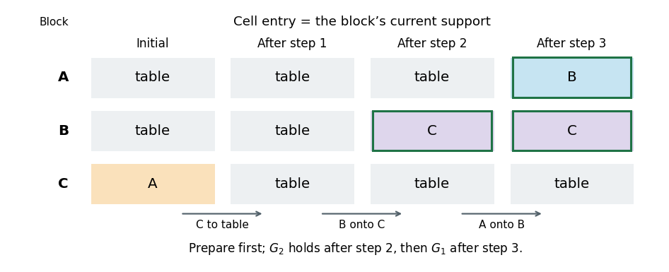

# Artificial intelligence

↑ **Parent:** [2019](../2019.md)

Source paper: [released Oxford examination archive](https://www.whatdotheyknow.com/request/ba_computer_science_past_papers/response/2577745/attach/2/202402%20183%20CS%20Papers.zip?cookie_passthrough=1), member `2018/T/a16607w1.pdf`. Its native cover identifies the Second Public Examination, Trinity Term 2019, Monday 3 June, 14:30–16:30. The archive directory predates the actual cover year. All three questions and every unnumbered requirement within their printed parts are addressed. The blocks-world figure is intact.

**Table of contents**

- [1](#1)
  - [a](#1/a)
    - [Solution](#1/a/solution)
  - [b](#1/b)
    - [Solution](#1/b/solution)
  - [c](#1/c)
    - [Solution](#1/c/solution)
  - [d](#1/d)
    - [Solution](#1/d/solution)
  - [e](#1/e)
    - [Solution](#1/e/solution)
  - [f](#1/f)
    - [Solution](#1/f/solution)
  - [g](#1/g)
    - [Solution](#1/g/solution)
  - [h](#1/h)
    - [Solution](#1/h/solution)
- [2](#2)
  - [a](#2/a)
    - [Solution](#2/a/solution)
  - [b](#2/b)
    - [Solution](#2/b/solution)
  - [c](#2/c)
    - [Solution](#2/c/solution)
  - [d](#2/d)
    - [Solution](#2/d/solution)
  - [e](#2/e)
    - [Solution](#2/e/solution)
- [3](#3)
  - [a](#3/a)
    - [Solution](#3/a/solution)
  - [b](#3/b)
    - [Solution](#3/b/solution)
  - [c](#3/c)
    - [Solution](#3/c/solution)
  - [d](#3/d)
    - [Solution](#3/d/solution)
  - [e](#3/e)
    - [Solution](#3/e/solution)
  - [f](#3/f)
    - [Solution](#3/f/solution)

## 1

↑ **Parent:** [Artificial intelligence](artificial-intelligence.md)

<h3 id="1/a">a</h3>

↑ **Parent:** [1](#1)

<h4 id="1/a/solution">Solution</h4>

↑ **Parent:** [A](#1/a)

**The first assertion is false.** Give the root a first child that is a [goal state](../../theoretical-computer-science.md#goal-state) of cost ten and another child leading to many cheaper non-goal [search nodes](../../theoretical-computer-science.md#search-node). [Depth-first search](../../algorithm.md#depth-first-search) can take the first child and stop immediately. [A-star search](../../graph.md#a-star-search) with the [admissible heuristic](../../theoretical-computer-science.md#admissible-heuristic) $h=0$ behaves as [uniform-cost search](../../graph.md#uniform-cost-search) and expands the cheaper non-goal [search nodes](../../theoretical-computer-science.md#search-node) before selecting that goal. Thus an [admissible heuristic](../../theoretical-computer-science.md#admissible-heuristic) does not make [A-star search](../../graph.md#a-star-search) expand fewer nodes than every possible [depth-first search](../../algorithm.md#depth-first-search) ordering. The latter need not return an optimal solution.

**The second assertion is true under the usual finite-[branching factor](../../theoretical-computer-science.md#branching-factor) assumption.** [Breadth-first search](../../tree-graph-theory.md#breadth-first-search) orders by [search depth](../../theoretical-computer-science.md#search-depth), not [path cost](../../theoretical-computer-science.md#path-cost). Every finite depth contains finitely many [search nodes](../../theoretical-computer-science.md#search-node), so a goal at finite depth is eventually reached even if some steps cost zero. Zero-cost steps can affect cost optimality, but do not obstruct this completeness argument. An infinite [branching factor](../../theoretical-computer-science.md#branching-factor) would invalidate the argument irrespective of [step costs](../../theoretical-computer-science.md#step-cost).

**The third assertion is true as a worst-case black-box requirement, with a finite optimum assumed.** If outgoing actions are known only by expanding a state, an unexamined reachable branch can conceal a sufficiently negative-cost action followed by a route to a goal. Its total cost can beat the current solution by an arbitrarily large amount. Without additional lower bounds or structural information, finding one cheap solution cannot justify stopping; exhaustive examination can be necessary. This does not assert that every already-described irrelevant state must be visited on every input. Moreover, a reachable negative-cost [cycle in a graph](../../graph-theory.md#cycle-in-a-graph) that can still reach a goal can make costs unbounded below, in which case no finite-cost optimal solution exists at all.

<h3 id="1/b">b</h3>

↑ **Parent:** [1](#1)

<h4 id="1/b/solution">Solution</h4>

↑ **Parent:** [B](#1/b)

[Iterative deepening depth-first search](../../algorithm.md#iterative-deepening-depth-first-search) increases a bound on the number of actions, usually through $0,1,2,\ldots$. [Iterative lengthening search](../../algorithm.md#iterative-lengthening-search) instead bounds accumulated [path cost](../../theoretical-computer-science.md#path-cost); after an unsuccessful pass, its next bound is the least [path cost](../../theoretical-computer-science.md#path-cost) among the rejected [search nodes](../../theoretical-computer-science.md#search-node). Thus it can distinguish shallow expensive paths from deeper cheap ones.

Both repeatedly perform [depth-first search](../../algorithm.md#depth-first-search) and retain its small active-path storage, trading repeated work for avoiding a large [search frontier](../../theoretical-computer-science.md#search-frontier). With unit [step costs](../../theoretical-computer-science.md#step-cost) their bounds coincide. With unequal positive [step costs](../../theoretical-computer-science.md#step-cost), [iterative deepening depth-first search](../../algorithm.md#iterative-deepening-depth-first-search) finds a solution with the fewest actions, while [iterative lengthening search](../../algorithm.md#iterative-lengthening-search), under the termination conditions discussed next, finds one of least total cost. Real-valued [path costs](../../theoretical-computer-science.md#path-cost) can make [iterative lengthening search](../../algorithm.md#iterative-lengthening-search) perform many more passes than the depth-bounded method.

<h3 id="1/c">c</h3>

↑ **Parent:** [1](#1)

<h4 id="1/c/solution">Solution</h4>

↑ **Parent:** [C](#1/c)

Start the threshold at zero and let $C^*$ be the least solution cost. Suppose an unsuccessful pass has threshold $L<C^*$. Along an optimal action [sequence](../../sequence-and-series.md#sequence), take the first prefix whose [path cost](../../theoretical-computer-science.md#path-cost) exceeds $L$. Its preceding prefix is explored, so that rejected prefix contributes to the next-threshold calculation. Positive [step costs](../../theoretical-computer-science.md#step-cost) imply that its cost is at most $C^*$. Therefore the next threshold is also at most $C^*$.

By [induction](../../foundations-of-mathematics.md#mathematical-induction), no threshold used before the first solution exceeds $C^*$. A returned [goal state](../../theoretical-computer-science.md#goal-state) therefore has cost at most $C^*$; by the definition of $C^*$ it cannot cost less. **The first returned solution is optimal.**

The termination qualification matters. In a finitely branching problem with [step costs](../../theoretical-computer-science.md#step-cost) at least $\epsilon>0$, a threshold $L$ admits only depths up to $\lfloor L/\epsilon\rfloor$, so each pass is finite and only finitely many [path costs](../../theoretical-computer-science.md#path-cost) precede $C^*$. These conditions establish completeness as well. Strict positivity alone on an arbitrary infinite tree is insufficient: an infinite branch with costs $1/2,1/4,1/8,\ldots$ can remain below a finite threshold and trap [depth-first search](../../algorithm.md#depth-first-search). The optimality argument above is valid whenever the required passes terminate; a finite graph with finitely many strictly positive action costs supplies a uniform positive lower bound.

<h3 id="1/d">d</h3>

↑ **Parent:** [1](#1)

<h4 id="1/d/solution">Solution</h4>

↑ **Parent:** [D](#1/d)

With initial threshold zero and unit [step costs](../../theoretical-computer-science.md#step-cost), the thresholds are $0,1,\ldots,d$, so **there are $d+1$ passes**. Starting the first pass at one instead omits the zero-threshold pass when the root is not a goal.

At depth $i$, at most $b^i$ [search nodes](../../theoretical-computer-science.md#search-node) are admitted in each pass with threshold at least $i$. Across all passes, the full-to-cutoff visit bound is

$$
V(b,d)=\sum_{i=0}^{d}(d+1-i)b^i.
$$

This is attained when the only depth-$d$ goal is visited last. If a [goal test](../../theoretical-computer-science.md#goal-test) occurs before expansion, the goal is visited but not expanded, giving the corresponding worst-case expansion count

$$
\boxed{E(b,d)=\sum_{i=0}^{d}(d+1-i)b^i-1.}
$$

For $b\ne1$, the visit bound is $V(b,d)=[b^{d+2}-(d+2)b+d+1]/(b-1)^2$, hence the worst-case number expanded is **$\Theta(b^d)$ for fixed $b>1$**. For $b=1$, it is $\Theta(d^2)$. An earlier goal reduces the final pass, so its exact count cannot be inferred from $b,d$ alone. Children generated and immediately rejected above a threshold are not counted as expanded; counting those generated nodes adds the corresponding branching overhead.

<h3 id="1/e">e</h3>

↑ **Parent:** [1](#1)

<h4 id="1/e/solution">Solution</h4>

↑ **Parent:** [E](#1/e)

A lower bound on individual [step costs](../../theoretical-computer-science.md#step-cost) does **not** bound the difference between consecutive [path cost](../../theoretical-computer-science.md#path-cost) thresholds. Two different paths can have costs differing by an arbitrarily small amount, even though every edge costs at least $\epsilon$.

Let $C^*$ be the optimal solution cost. Every unsuccessful threshold is the [path cost](../../theoretical-computer-science.md#path-cost) of some [search node](../../theoretical-computer-science.md#search-node) below $C^*$. Such a node has depth strictly less than $C^*/\epsilon$. For a uniform [branching factor](../../theoretical-computer-science.md#branching-factor) $b>1$, the number of passes is therefore bounded by

$$
1+\sum_{j=0}^{\lceil C^*/\epsilon\rceil-1}b^j=O\!\left(b^{\lceil C^*/\epsilon\rceil}\right).
$$

If a solution of depth $d$ exists, each of its edges costs at most one, so $C^*\leq d$ and an associated bound is **$O(b^{\lceil d/\epsilon\rceil})$ passes**. If $d$ denotes the optimal solution's depth, the same inequality applies. With no solution-cost or solution-depth bound, $b$ and $\epsilon$ alone give no finite uniform iteration bound.

The exponential behavior is possible. Put a depth-$d$ goal on a branch with unit costs and let a large competing subtree use costs just above $\epsilon$. Choose tiny distinct perturbations so that its many [search nodes](../../theoretical-computer-science.md#search-node) below cost $d$ have distinct [path costs](../../theoretical-computer-science.md#path-cost). The threshold can advance through those costs one at a time. Thus **a bound such as $\lceil d/\epsilon\rceil$ on the number of passes is unjustified**: it bounds admitted depth, not the number of distinct costs. For $b=1$ there is only one path, so the corresponding count is linear in the admitted depth rather than exponential.

<h3 id="1/f">f</h3>

↑ **Parent:** [1](#1)

<h4 id="1/f/solution">Solution</h4>

↑ **Parent:** [F](#1/f)

For the [three-colourability problem](../../graph-coloring.md#three-colourability-problem), represent a candidate by a complete colour assignment $c:V\to\{r,g,b\}$, initially chosen at random. Give it the conflict [objective function](../../mathematical-optimization.md#objective-function)

$$
H(c)=\sum_{\{u,v\}\in E}\mathbf1_{c(u)=c(v)}.
$$

A neighbor changes the colour of one [vertex](../../graph.md#vertex-graph-theory) to either other colour. For [hill climbing](../../mathematical-optimization.md#hill-climbing), maximize $-H$, or equivalently repeatedly choose a recolouring that reduces $H$. One can inspect all $2|V|$ neighbors, or focus on conflicted [vertices](../../graph.md#vertex-graph-theory) and evaluate their alternative colours using only incident [edges](../../graph-theory.md#edge-of-a-graph). Stop successfully as soon as **$H=0$**, which is exactly a [proper graph colouring](../../graph-coloring.md) with three colours.

If no improving move exists at positive $H$, the method is stuck in a [local minimum](../../analysis.md#local-minimum). Random restarts, limited sideways moves or other exploratory [local search](../../mathematical-optimization.md#local-search) choices can reduce this failure mode, but do not turn a finite unsuccessful run into a proof of impossibility. On a graph with no [proper graph colouring](../../graph-coloring.md) using three colours, every complete colouring has $H>0$, so this procedure cannot return a valid colouring. Conversely, a positive-conflict stopping point also occurs on some graphs admitting a [proper graph colouring](../../graph-coloring.md) with three colours. **Failure of [hill climbing](../../mathematical-optimization.md#hill-climbing) alone does not certify non-colourability.** For a concrete trap, use a [bipartite graph](../../bipartite-graph.md) with three [vertices](../../graph.md#vertex-graph-theory) on each side and every cross-[edge](../../graph-theory.md#edge-of-a-graph), and give each side one vertex of each colour. There are three conflicts. Recolouring any single vertex leaves it with exactly one same-colour neighbor, so no single change improves $H$, even though colouring each whole side differently solves the instance.

<h3 id="1/g">g</h3>

↑ **Parent:** [1](#1)

<h4 id="1/g/solution">Solution</h4>

↑ **Parent:** [G](#1/g)

For an action [sequence](../../sequence-and-series.md#sequence) $\pi$, let $T_\pi(B)$ be the [set](../../set.md) of all physical states obtainable by applying it to the initial [belief state](../../theoretical-computer-science.md#belief-state) $B$. Under a deterministic model this is an image; for nondeterministic outcomes it is the [union](../../set.md#set-union) of all permitted images. For $B'\subseteq B$,

$$
T_\pi(B')\subseteq T_\pi(B).
$$

If each action is applicable to every current possibility from $B$, it is also applicable to every possibility from $B'$. If the final [belief state](../../theoretical-computer-science.md#belief-state) for $B$ is contained in the physical goal [set](../../set.md) $G$, then $T_\pi(B')\subseteq G$. Thus **the same [plan](../../artificial-intelligence.md#plan) solves every [subset](../../set.md#subset) of $B$**.

Nothing comparable follows for an arbitrary [superset](../../set.md#superset). For example, let an action take $s_1$ to a goal and leave $s_2$ at a non-goal. It solves $\{s_1\}$ but not $\{s_1,s_2\}$. A larger [belief state](../../theoretical-computer-science.md#belief-state) is solved by this particular [sequence](../../sequence-and-series.md#sequence) exactly when all added states also permit it and end in $G$. It may succeed on some [supersets](../../set.md#superset) and fail on others; it cannot be guaranteed merely from success on $B$.

<h3 id="1/h">h</h3>

↑ **Parent:** [1](#1)

<h4 id="1/h/solution">Solution</h4>

↑ **Parent:** [H](#1/h)

Use [incremental belief-state search](../../theoretical-computer-science.md#incremental-belief-state-search) to find only the initial possibilities needed to constrain a successful [plan](../../artificial-intelligence.md#plan). Choose one possible initial state, or a small [subset](../../set.md#subset) $B_0$ of the full initial [belief state](../../theoretical-computer-science.md#belief-state) $B$. Find an action [sequence](../../sequence-and-series.md#sequence) solving this restricted problem, then simulate it from every state in $B$.

If validation succeeds, return the candidate. Otherwise choose a state that makes some action inapplicable or ends outside the goal, add it to $B_0$, and search again for a [plan](../../artificial-intelligence.md#plan) that works for every selected state. Replanning can revise the earlier [sequence](../../sequence-and-series.md#sequence); merely appending a repair to one arbitrary candidate can miss solutions. For a finite initial [belief state](../../theoretical-computer-science.md#belief-state), there are at most $|B|$ additions before every initial possibility has been included. If a complete restricted solver proves that even the selected [subset](../../set.md#subset) is unsolvable, part (g) shows that the full problem is unsolvable.

The benefits are smaller intermediate [belief states](../../theoretical-computer-science.md#belief-state), fewer states propagated through candidate actions, and avoidance of unnecessary portions of the full [power set](../../set.md#power-set) search space. One physical-state counterexample can eliminate many invalid candidates. The worst case can still require all initial states; the method exploits instances where a few representative possibilities already force a [plan](../../artificial-intelligence.md#plan) that passes universal validation.

## 2

↑ **Parent:** [Artificial intelligence](artificial-intelligence.md)

<h3 id="2/a">a</h3>

↑ **Parent:** [2](#2)

<h4 id="2/a/solution">Solution</h4>

↑ **Parent:** [A](#2/a)

Let $Q=\{1,\ldots,n\}^2$ be the board squares and let $\operatorname{Attack}(p,q)$ mean that the absolute coordinate differences are $(1,2)$ or $(2,1)$.

**One [variable](../../mathematics.md#variable-mathematics) per knight.** Use $X_1,\ldots,X_k$, with each [constraint domain](../../theoretical-computer-science.md#constraint-domain) equal to $Q$. For every pair $i<j$, require

$$
X_i\ne X_j,\qquad\neg\operatorname{Attack}(X_i,X_j).
$$

Every satisfying assignment places $k$ distinct nonattacking knights, and any such placement gives an assignment after labelling its knights. This has only $k$ [variables](../../mathematics.md#variable-mathematics) and $O(k^2)$ [binary constraints](../../theoretical-computer-science.md#binary-constraint), but domains of size $n^2$. Relabelling the knights gives $k!$ assignments for the same unlabelled board, so the representation contains considerable redundancy.

**One [Boolean variable](../../theoretical-computer-science.md#boolean-variable) per square.** Use $Y_q\in\{0,1\}$ for every $q\in Q$. Impose the [cardinality constraint](../../theoretical-computer-science.md#cardinality-constraint)

$$
\sum_{q\in Q}Y_q=k,
$$

and for every knight-attack pair $p,q$ impose $Y_p+Y_q\leq1$. There are $n^2$ [variables](../../mathematics.md#variable-mathematics), each with a two-element [constraint domain](../../theoretical-computer-science.md#constraint-domain), and only $O(n^2)$ local attack restrictions, because each square attacks at most eight others. The single counting constraint is a global constraint, not a [binary constraint](../../theoretical-computer-science.md#binary-constraint).

The square encoding avoids knight-label redundancy and has sparse local attack relations; the knight encoding uses fewer [variables](../../mathematics.md#variable-mathematics) when $k$ is small and makes single-knight moves natural. Both are exact representations of the [nonattacking knights problem](../../theoretical-computer-science.md#nonattacking-knights-problem). Neither may impose one knight per row: several knights can legally share a row.

<h3 id="2/b">b</h3>

↑ **Parent:** [2](#2)

<h4 id="2/b/solution">Solution</h4>

↑ **Parent:** [B](#2/b)

Use the knight-variable representation and build a placement one knight at a time. The initial state is the empty placement. An action places the next knight on an empty square attacking no previously placed knight; the [search transition model](../../theoretical-computer-science.md#search-transition-model) appends that square. The [goal test](../../theoretical-computer-science.md#goal-test) is that $k$ knights have been placed. Each action adds exactly one, so any solution has depth **$k$**.

Put $N=n^2$. At depth $j$, there are at most $N-j$ choices, hence [branching factor](../../theoretical-computer-science.md#branching-factor) at most $N$. A coarse [search tree](../../theoretical-computer-science.md#search-tree) size bound is $1+N+\cdots+N^k$. Keeping the shrinking choice count gives the sharper bound

$$
\sum_{j=0}^{k}(N)_j,\qquad (N)_j=\frac{N!}{(N-j)!},
$$

where $(N)_j$ is a [falling factorial](../../combinatorics.md#falling-factorial). This counts ordered placements before attack pruning.

For a full expansion down to depth $k$, the number of depth-$k$ leaves is at most **$(N)_k$**, or approximately $n^{2k}$ when $k$ is small relative to $N$. If $I_k$ denotes the number of legal unlabelled $k$-knight placements, the exact number of legal depth-$k$ leaves is $k!I_k$. There can also be earlier dead-end leaves: a legal placement may leave no further nonattacking square. Writing $M_j$ for the number of inclusion-maximal legal $j$-knight placements, the fully explored pruned tree has

$$
k!I_k+\sum_{j=0}^{k-1}j!M_j
$$

leaves. Its leaf count is still at most the unpruned $(N)_k$, since each early leaf replaces a disjoint nonempty subtree of the unpruned tree. [Breadth-first search](../../tree-graph-theory.md#breadth-first-search) that stops at its first goal can construct less of the last layer; if no solution exists, it exhausts the reachable partial placements.

Identifying different insertion orders changes the representation. With a state that is an unlabelled [set](../../set.md) of occupied squares and repeated-state elimination, the corresponding depth-$k$ state bound is $\binom Nk$, with $I_k$ legal goal states. The factorial and binomial bounds refer to these different representations, not competing counts of the same tree.

<h3 id="2/c">c</h3>

↑ **Parent:** [2](#2)

<h4 id="2/c/solution">Solution</h4>

↑ **Parent:** [C](#2/c)

[Backtracking](../../algorithm.md#backtracking) assigns one [variable](../../mathematics.md#variable-mathematics) at a time and abandons a partial assignment as soon as it cannot extend to a solution. With [forward checking](../../theoretical-computer-science.md#forward-checking), placing a knight deletes its occupied and attacked squares from every remaining knight's [constraint domain](../../theoretical-computer-science.md#constraint-domain). An empty [constraint domain](../../theoretical-computer-science.md#constraint-domain) rejects the branch immediately; stronger [constraint propagation](../../theoretical-computer-science.md#constraint-propagation), such as [arc consistency](../../theoretical-computer-science.md#arc-consistency), can detect additional incompatibilities among future choices.

This combines early rejection with depth-first storage. It retains the current assignment and domain changes rather than the entire breadth-first layer of partial placements. A direct knight-variable implementation uses $O(kn^2)$ space for explicit domains, plus its assignment and restoration trail, instead of an exponentially large [breadth-first search](../../tree-graph-theory.md#breadth-first-search) [search frontier](../../theoretical-computer-science.md#search-frontier). Propagation has a computational cost and does not guarantee improvement on every input, but often prevents exploration of vast inconsistent subtrees.

The **[minimum remaining values heuristic](../../theoretical-computer-science.md#minimum-remaining-values-heuristic)** selects an unassigned [variable](../../mathematics.md#variable-mathematics) with the fewest currently legal values, exposing the likeliest failure first. The **[degree heuristic](../../theoretical-computer-science.md#degree-heuristic)** selects a [variable](../../mathematics.md#variable-mathematics) constrained to the largest number of other unassigned [variables](../../mathematics.md#variable-mathematics), often breaking [minimum remaining values heuristic](../../theoretical-computer-science.md#minimum-remaining-values-heuristic) ties. Degree is measured in the remaining [constraint graph](../../theoretical-computer-science.md#constraint-graph), not by counting assigned neighbors. In the symmetric knight-variable encoding the remaining degrees can all tie, so the heuristic need not discriminate there.[§2.4, Minimum Remaining Values: choose an unassigned variable with the fewest valid remaining values](../../computer-science-bibliography.md#cs-188-constraint-ordering-and-structure-notes)

<h3 id="2/d">d</h3>

↑ **Parent:** [2](#2)

<h4 id="2/d/solution">Solution</h4>

↑ **Parent:** [D](#2/d)

A useful [local search](../../mathematical-optimization.md#local-search) state is any occupied-square [subset](../../set.md#subset) $S\subseteq Q$, allowing temporary attacks. Let $C(S)$ count unordered attacking pairs and $N=n^2$. Maximize

$$
\boxed{F(S)=|S|-(N+1)C(S).}
$$

ACTIONS can offer insertion at an empty square, deletion of an occupied square, and relocation of one knight to an empty square. RESULT is respectively $S\cup\{q\}$, $S\setminus\{p\}$, and $(S\setminus\{p\})\cup\{q\}$. Insertions and deletions alone connect the whole [state space](../../dynamical-systems.md#state-space); relocation is a useful additional proposal.

Every conflicting state has $F(S)\leq N-(N+1)<0$, whereas the empty board has score zero. Every conflict-free state has score exactly its knight count. Hence **every global maximizer is a maximum-size nonattacking placement**. If a knight participates in $r\geq1$ conflicts, deleting it changes the score by $-1+(N+1)r>0$, so a positive-conflict local stopping point cannot persist when improving deletions are considered.

From a random board, choose score-improving moves, with random restarts or occasional non-improving proposals to escape poor conflict-free local optima. A maximal placement is not necessarily a maximum placement: accepting only legal insertions can get stuck too early. This [objective function](../../mathematical-optimization.md#objective-function) defines the intended optimization precisely; a finite heuristic run still gives no general global-optimality certificate.

<h3 id="2/e">e</h3>

↑ **Parent:** [2](#2)

<h4 id="2/e/solution">Solution</h4>

↑ **Parent:** [E](#2/e)

**The depth assertion is false.** Each move occupies one new square, so the general bound is $n^2$, not $n$. On a $2\times2$ board no knights attack, and a play has four moves. More generally, filling a single checkerboard colour gives a legal partial play of length $\lceil n^2/2\rceil$, since knight moves always change colour.

**The opponent-independent “best possible move” assertion is false.** [Minimax search](../../game-theory.md#minimax-search) maximizes the guaranteed [utility](../../mathematics.md#utility) against an opponent choosing the worst continuation. It need not maximize the outcome against a particular weaker opponent. If a winning [strategy](../../descriptive-set-theory.md#strategy-in-an-infinite-game) is available, its guaranteed win cannot be improved on in win/loss utility; if every root move loses against perfect play, all have the same minimax value, yet some may exploit a weaker opponent better. Thus the valid universal statement is that a minimax [strategy](../../descriptive-set-theory.md#strategy-in-an-infinite-game) guarantees its minimax value, not that its root choice is best for every possible opponent behavior.[§3.2, opening assumption: the opponent chooses the move worst for the agent](../../computer-science-bibliography.md#cs-188-minimax-notes)

**The $O(n)$ storage assertion is false for the usual minimax implementation.** Here the maximum [branching factor](../../theoretical-computer-science.md#branching-factor) is $O(n^2)$ and maximum depth is $O(n^2)$. A conventional [depth-first search](../../algorithm.md#depth-first-search) retaining pending successors uses the usual $O(bm)=O(n^4)$ search-node bound. Generating successors lazily and applying/undoing moves in one board can reduce this to $O(n^2)$ stack frames plus board storage; neither accounting should confuse the board side length $n$ with its $n^2$ squares.

**The winning-strategy assertion is true.** The game is finite, has perfect information, alternates two players, and has no draw under the [normal-play convention](../../game-theory.md#normal-play-convention). A terminal position is losing for the player to move. By [backward induction](../../foundations-of-mathematics.md#backward-induction), a nonterminal position is winning exactly when at least one legal move reaches a losing position; otherwise it is losing. This labels every position, including the initial board, so exactly one of the two players has a winning [strategy](../../descriptive-set-theory.md#strategy-in-an-infinite-game).

## 3

↑ **Parent:** [Artificial intelligence](artificial-intelligence.md)

<h3 id="3/a">a</h3>

↑ **Parent:** [3](#3)

<h4 id="3/a/solution">Solution</h4>

↑ **Parent:** [A](#3/a)

Write $\tau$ for the table. The positive initial [planning fluents](../../artificial-intelligence.md#planning-fluent) read from the original figure are

$$
\boxed{I=\{\operatorname{On}(A,\tau),\operatorname{On}(B,\tau),\operatorname{On}(C,A),\operatorname{Clear}(B),\operatorname{Clear}(C)\}.}
$$

The static type facts are $\operatorname{Block}(A)$, $\operatorname{Block}(B)$ and $\operatorname{Block}(C)$; the table is not a block. With an explicit table-availability [predicate](../../analysis-of-boolean-functions.md#predicate), take $\operatorname{Clear}(\tau)$ to be permanently true. Under the [closed-world assumption](../../mathematical-logic.md#closed-world-assumption), all other well-typed initial [planning fluents](../../artificial-intelligence.md#planning-fluent) are false; in particular, $A$ is not clear.

The goal is the partial-state [conjunction](../../planetary-science.md#conjunction-astronomy)

$$
\boxed{G=\operatorname{On}(A,B)\land\operatorname{On}(B,C).}
$$

It need not redundantly prescribe every final fact. With only these three blocks and a valid [blocks world](../../artificial-intelligence.md#blocks-world) state, the completed stack also places $C$ on the table and leaves $A$ clear.

<h3 id="3/b">b</h3>

↑ **Parent:** [3](#3)

<h4 id="3/b/solution">Solution</h4>

↑ **Parent:** [B](#3/b)

Use direct-transfer [STRIPS](../../artificial-intelligence.md#strips) actions: one action includes picking up a block and putting it down again. There is no separate holding state. Ground $b,y$ as distinct blocks and $x$ as a support, either a block or the table, with $x\ne b$ and $x\ne y$.

For $\operatorname{Move}(b,x,y)$, take

$$
\begin{aligned}
\operatorname{Pre}&=\{\operatorname{Block}(b),\operatorname{Block}(y),\operatorname{On}(b,x),\operatorname{Clear}(b),\operatorname{Clear}(y)\},\\
\operatorname{Add}&=\{\operatorname{On}(b,y)\}\cup\bigl(\{\operatorname{Clear}(x)\}\text{ if }x\ne\tau\bigr),\\
\operatorname{Del}&=\{\operatorname{On}(b,x),\operatorname{Clear}(y)\}.
\end{aligned}
$$

The [preconditions](../../algorithm.md#precondition) ensure that $b$ can be picked up and that the destination has room. Moving it frees a block source and occupies the destination, while $\operatorname{Clear}(b)$ persists. When $x=\tau$, table availability remains true; its redundant addition is simply omitted. Since $x$ is fixed in each [ground action](../../artificial-intelligence.md#ground-action), this case distinction constructs ordinary add lists rather than introducing conditional action effects. The [search transition model](../../theoretical-computer-science.md#search-transition-model) is **$(S\setminus\operatorname{Del})\cup\operatorname{Add}$**.

<h3 id="3/c">c</h3>

↑ **Parent:** [3](#3)

<h4 id="3/c/solution">Solution</h4>

↑ **Parent:** [C](#3/c)

Ground $b,x$ as distinct blocks. For $\operatorname{MoveToTable}(b,x)$, take

$$
\begin{aligned}
\operatorname{Pre}&=\{\operatorname{Block}(b),\operatorname{Block}(x),\operatorname{On}(b,x),\operatorname{Clear}(b)\},\\
\operatorname{Add}&=\{\operatorname{On}(b,\tau),\operatorname{Clear}(x)\},\\
\operatorname{Del}&=\{\operatorname{On}(b,x)\}.
\end{aligned}
$$

Thus a clear block leaves its block support, makes that support clear, and joins the unlimited table. **$\operatorname{Clear}(b)$ persists, and table availability is never deleted.** Requiring $x$ to be a block excludes a redundant table-to-table action. The static [predicates](../../analysis-of-boolean-functions.md#predicate) need not be stored as time-varying [planning fluents](../../artificial-intelligence.md#planning-fluent).

<h3 id="3/d">d</h3>

↑ **Parent:** [3](#3)

<h4 id="3/d/solution">Solution</h4>

↑ **Parent:** [D](#3/d)

Let $G_1=\operatorname{On}(A,B)$ and $G_2=\operatorname{On}(B,C)$. The familiar obstruction is the [Sussman anomaly](../../artificial-intelligence.md#sussman-anomaly) for restricted [goal-by-goal planning](../../artificial-intelligence.md#goal-by-goal-planning).

If one first constructs the obvious isolated plan for $G_1$, it moves $C$ off $A$ and then puts $A$ on $B$. Now $B$ is not clear, so achieving $G_2$ requires taking $A$ off $B$, undoing $G_1$. If one first achieves the isolated $G_2$ directly, it puts $B$ on $C$ while $C$ is still on $A$. To free $A$, it must move $C$, which first requires moving $B$ off $C$, undoing $G_2$. Therefore neither ordering of those independent subplans works while protecting the first achieved goal.

**The literal concatenation-only definition in the question is too weak to imply the requested impossibility.** A valid [plan](../../artificial-intelligence.md#plan) is

$$
\boxed{\operatorname{MoveToTable}(C,A),\quad\operatorname{Move}(B,\tau,C),\quad\operatorname{Move}(A,\tau,B).}
$$

The first two actions constitute a [plan](../../artificial-intelligence.md#plan) for $G_2$ from the original state, and the last action is a [plan](../../artificial-intelligence.md#plan) for $G_1$ from the resulting state, preserving $G_2$. Thus this is itself a concatenation of the stated kind. Its crucial first action prepares for the later subgoal before completing $G_2$.

**[Figure 1](#3/d/image-support-relations-along-the-derived-three-action-blocks-world-plan). Support relations along the derived three-action blocks world plan**.

The green-outlined cells mark achieved goal facts. This original solution timeline makes the distinction explicit: **independent goal-directed subplanning fails, but unrestricted concatenation does not**. To obtain the intended impossibility claim, “non-interleaved” must also forbid anticipatory preparation or require the isolated subplans described above. No source input is missing; the issue is the breadth of the printed definition.

<h3 id="3/e">e</h3>

↑ **Parent:** [3](#3)

<h4 id="3/e/solution">Solution</h4>

↑ **Parent:** [E](#3/e)

Use a sequential [SATPlan](../../artificial-intelligence.md#satplan) encoding with times $t=0,\ldots,T$. The fluent universe is

$$
\mathcal P=\{\operatorname{On}(b,x):b\in\{A,B,C\},\ x\in\{A,B,C,\tau\}\setminus\{b\}\}\cup\{\operatorname{Clear}(A),\operatorname{Clear}(B),\operatorname{Clear}(C)\}.
$$

There are nine support [Boolean variables](../../theoretical-computer-science.md#boolean-variable) and three clearance [Boolean variables](../../theoretical-computer-science.md#boolean-variable) per time layer. Static block types, parameter inequalities and permanent table availability are handled during [action grounding](../../artificial-intelligence.md#action-grounding). For each well-typed [ground action](../../artificial-intelligence.md#ground-action) $a$ from parts (b)–(c), introduce an occurrence [Boolean variable](../../theoretical-computer-science.md#boolean-variable) $a_t$ for $0\leq t<T$. Allow **at most one action per layer**, including no action, so that a horizon of $T$ encodes at most $T$ physical actions.

The complete initial-state formula is

$$
\begin{aligned}
I_0={}&\operatorname{On}(A,\tau)_0\land\operatorname{On}(B,\tau)_0\land\operatorname{On}(C,A)_0\\
&\land\operatorname{Clear}(B)_0\land\operatorname{Clear}(C)_0\land\neg\operatorname{Clear}(A)_0\\
&\land\neg\operatorname{On}(A,B)_0\land\neg\operatorname{On}(A,C)_0\\
&\land\neg\operatorname{On}(B,A)_0\land\neg\operatorname{On}(B,C)_0\\
&\land\neg\operatorname{On}(C,B)_0\land\neg\operatorname{On}(C,\tau)_0.
\end{aligned}
$$

Every well-typed fluent not initially true is explicitly false. The final goal formula is simply **$G_T=\operatorname{On}(A,B)_T\land\operatorname{On}(B,C)_T$**. Leaving unrelated final facts unconstrained is appropriate; leaving unrelated initial facts unconstrained would introduce imaginary starting states.

For each $t<T$, include all [action precondition axioms](../../artificial-intelligence.md#action-precondition-axiom) $a_t\to\bigwedge_{p\in\operatorname{Pre}(a)}p_t$, after removing static true conditions. For example,

$$
\operatorname{Move}(A,\tau,B)_t\to\operatorname{On}(A,\tau)_t\land\operatorname{Clear}(A)_t\land\operatorname{Clear}(B)_t.
$$

The [precondition](../../algorithm.md#precondition) axiom for $\operatorname{MoveToTable}(C,A)_t$ similarly requires $\operatorname{On}(C,A)_t\land\operatorname{Clear}(C)_t$.

For every fluent $p\in\mathcal P$, let $\operatorname{Add}_p(t)$ be the [logical disjunction](../../mathematical-logic.md#logical-disjunction) of actions at $t$ adding $p$, and $\operatorname{Del}_p(t)$ the [logical disjunction](../../mathematical-logic.md#logical-disjunction) deleting it. Include the [successor-state axiom](../../artificial-intelligence.md#successor-state-axiom)

$$
p_{t+1}\leftrightarrow\operatorname{Add}_p(t)\lor\bigl(p_t\land\neg\operatorname{Del}_p(t)\bigr).
$$

It combines action effects with the [frame axiom](../../artificial-intelligence.md#frame-axiom), preventing unsupported changes. A fully grounded example is

$$
\begin{aligned}
\operatorname{On}(A,B)_{t+1}\leftrightarrow{}&\operatorname{Move}(A,\tau,B)_t\lor\operatorname{Move}(A,C,B)_t\\
&\lor\bigl(\operatorname{On}(A,B)_t\land\neg\operatorname{Move}(A,B,C)_t\land\neg\operatorname{MoveToTable}(A,B)_t\bigr).
\end{aligned}
$$

Apply the same construction to every support and clearance fluent, using the exact add/delete lists. If no action occurs, both effect [logical disjunctions](../../mathematical-logic.md#logical-disjunction) are false, so all fluents persist.

The sequential [action exclusion axioms](../../artificial-intelligence.md#action-exclusion-axiom) are $\neg a_t\lor\neg b_t$ for every pair of distinct grounded actions $a,b$. For example,

$$
\neg\operatorname{Move}(A,\tau,B)_t\lor\neg\operatorname{Move}(C,A,B)_t
$$

forbids selecting those two occurrences together. Do not add a requirement that some action occur in every layer: that would remove idle padding and change “at most $T$” into an exact-length requirement. One may additionally include true [planning state invariants](../../algorithm.md#planning-state-invariant), such as a block having at most one support and a block support carrying at most one block; the unlimited table must be exempt from the latter restriction.

Finally, conjoin $I_0$, $G_T$, and all precondition, successor and exclusion formulas over the layers to obtain $\varphi_T$. It is a [propositional formula](../../mathematical-logic.md#propositional-formula); if a solver requires [conjunctive normal form](../../theoretical-computer-science.md#conjunctive-normal-form), use a satisfiability-preserving [Tseitin transformation](../../theoretical-computer-science.md#tseytin-transformation) with auxiliary [Boolean variables](../../theoretical-computer-science.md#boolean-variable). The equivalence between this encoding and real action [sequences](../../sequence-and-series.md#sequence) follows from [sequential SATPlan correctness](../../artificial-intelligence.md#sequential-satplan-correctness): a satisfying assignment induces exactly the stated [STRIPS](../../artificial-intelligence.md#strips) trajectory, and every sufficiently short valid [plan](../../artificial-intelligence.md#plan) supplies such an assignment.

<h3 id="3/f">f</h3>

↑ **Parent:** [3](#3)

<h4 id="3/f/solution">Solution</h4>

↑ **Parent:** [F](#3/f)

Read the satisfying assignment in increasing time order. In layer $t$, output the unique [ground action](../../artificial-intelligence.md#ground-action) whose occurrence [Boolean variable](../../theoretical-computer-science.md#boolean-variable) is true, or output nothing if all are false. Discard idle layers. The result is a [sequence](../../sequence-and-series.md#sequence) of at most $T$ actions.

For correctness, the layer-zero [planning fluents](../../artificial-intelligence.md#planning-fluent) are exactly the actual initial state. The [action precondition axioms](../../artificial-intelligence.md#action-precondition-axiom) make the selected action applicable, while the [successor-state axioms](../../artificial-intelligence.md#successor-state-axiom) give precisely its add/delete update; the [action exclusion axioms](../../artificial-intelligence.md#action-exclusion-axiom) prevent simultaneous competing actions. By [induction](../../foundations-of-mathematics.md#mathematical-induction), every following time layer is the real state reached by the decoded prefix. The final goal formula therefore proves that **the extracted [plan](../../artificial-intelligence.md#plan) reaches both required goals**.

Conversely, execute any valid [plan](../../artificial-intelligence.md#plan) of length at most $T$, assign each layer its actual fluent values and pad with idle layers. These values satisfy every component of $\varphi_T$. In this instance, decoding the three-action trajectory in part (d) gives a model at $T=3$ and at every larger horizon after padding; direct state-space and propositional checks find no model for $T<3$.

## ↑ Ancestors (8)

1. [2019](../2019.md)
2. [Past exam of the computer science course of the University of Oxford](../../past-exam-of-the-computer-science-course-of-the-university-of-oxford.md)
3. [Computer science course of the University of Oxford](../../university-of-oxford.md#computer-science-course-of-the-university-of-oxford)
4. [Undergraduate course of the University of Oxford](../../university-of-oxford.md#undergraduate-course-of-the-university-of-oxford)
5. [Course of the University of Oxford](../../university-of-oxford.md#course-of-the-university-of-oxford)
6. [University of Oxford](../../university-of-oxford.md)
7. [List of universities](../../README.md#list-of-universities)
8. [Codex Wiki](../../README.md)
