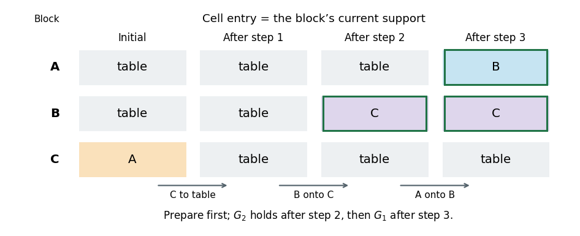

<h1 id="3/d/solution">Solution</h1>

↑ **Parent:** [D](../d.md)

Let $G_1=\operatorname{On}(A,B)$ and $G_2=\operatorname{On}(B,C)$. The familiar obstruction is the [Sussman anomaly](../../../../../sussman-anomaly.md) for restricted [goal-by-goal planning](../../../../../goal-by-goal-planning.md).

If one first constructs the obvious isolated plan for $G_1$, it moves $C$ off $A$ and then puts $A$ on $B$. Now $B$ is not clear, so achieving $G_2$ requires taking $A$ off $B$, undoing $G_1$. If one first achieves the isolated $G_2$ directly, it puts $B$ on $C$ while $C$ is still on $A$. To free $A$, it must move $C$, which first requires moving $B$ off $C$, undoing $G_2$. Therefore neither ordering of those independent subplans works while protecting the first achieved goal.

**The literal concatenation-only definition in the question is too weak to imply the requested impossibility.** A valid [plan](../../../../../plan.md) is

$$
\boxed{\operatorname{MoveToTable}(C,A),\quad\operatorname{Move}(B,\tau,C),\quad\operatorname{Move}(A,\tau,B).}
$$

The first two actions constitute a [plan](../../../../../plan.md) for $G_2$ from the original state, and the last action is a [plan](../../../../../plan.md) for $G_1$ from the resulting state, preserving $G_2$. Thus this is itself a concatenation of the stated kind. Its crucial first action prepares for the later subgoal before completing $G_2$.

**[Figure 1](#3/d/image-support-relations-along-the-derived-three-action-blocks-world-plan). Support relations along the derived three-action blocks world plan**.

The green-outlined cells mark achieved goal facts. This original solution timeline makes the distinction explicit: **independent goal-directed subplanning fails, but unrestricted concatenation does not**. To obtain the intended impossibility claim, “non-interleaved” must also forbid anticipatory preparation or require the isolated subplans described above. No source input is missing; the issue is the breadth of the printed definition.

## ↑ Ancestors (11)

1. [D](../d.md)
2. [3](../../3.md)
3. [Artificial intelligence](../../../artificial-intelligence-split.md)
4. [2019](../../../split.md)
5. [Past exam of the computer science course of the University of Oxford](../../../../split.md)
6. [Computer science course of the University of Oxford](../../../../../computer-science-course-of-the-university-of-oxford.md)
7. [Undergraduate course of the University of Oxford](../../../../../undergraduate-course-of-the-university-of-oxford.md)
8. [Course of the University of Oxford](../../../../../course-of-the-university-of-oxford.md)
9. [University of Oxford](../../../../../university-of-oxford-split.md)
10. [List of universities](../../../../../list-of-universities.md)
11. [Codex Wiki](../../../../../split.md)
