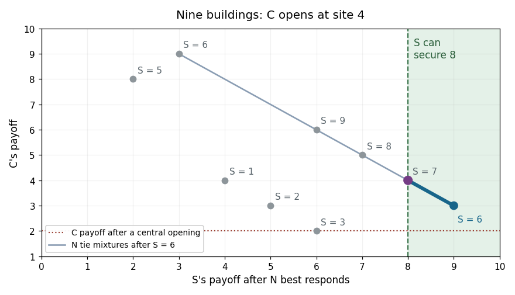

# Computational game theory

↑ **Parent:** [2019](../2019.md)

Source paper: [released Oxford examination archive](https://www.whatdotheyknow.com/request/ba_computer_science_past_papers/response/2577745/attach/2/202402%20183%20CS%20Papers.zip?cookie_passthrough=1), member `2018/T/a15684w1.pdf`. The actual cover identifies the Second Public Examination, Trinity Term 2019, Monday 3 June. Its printed time is **9:30 am–12:30 am**, including the apparent end-time typo; this is not silently changed to noon. All three questions are solved. Part 2(c) includes the necessary qualification of its literal premise.

**Table of contents**

- [1](#1)
  - [a](#1/a)
    - [Solution](#1/a/solution)
  - [b](#1/b)
    - [Solution](#1/b/solution)
  - [c](#1/c)
    - [Solution](#1/c/solution)
  - [d](#1/d)
    - [Solution](#1/d/solution)
  - [e](#1/e)
    - [Solution](#1/e/solution)
  - [f](#1/f)
    - [Solution](#1/f/solution)
  - [g](#1/g)
    - [Solution](#1/g/solution)
- [2](#2)
  - [a](#2/a)
    - [Solution](#2/a/solution)
  - [b](#2/b)
    - [Solution](#2/b/solution)
  - [c](#2/c)
    - [Solution](#2/c/solution)
  - [d](#2/d)
    - [Solution](#2/d/solution)
  - [e](#2/e)
    - [Solution](#2/e/solution)
  - [f](#2/f)
    - [Solution](#2/f/solution)
- [3](#3)
  - [a](#3/a)
    - [Solution](#3/a/solution)
  - [b](#3/b)
    - [Solution](#3/b/solution)
  - [c](#3/c)
    - [Solution](#3/c/solution)
  - [d](#3/d)
    - [Solution](#3/d/solution)
  - [e](#3/e)
    - [Solution](#3/e/solution)

## 1

↑ **Parent:** [Computational game theory](computational-game-theory.md)

<h3 id="1/a">a</h3>

↑ **Parent:** [1](#1)

<h4 id="1/a/solution">Solution</h4>

↑ **Parent:** [A](#1/a)

The players are the two chains, each with the [set](../../set.md) of [pure strategies](../../game-theory.md#pure-strategy) $\{1,2,3,4,5\}$. A [strategy profile](../../game-theory.md#strategy-profile) $(x,y)$ gives the sites of $S$ and $C$. For later use, write the first player's [payoff](../../game-theory.md#payoff) for a general street size as

$$
u(x,y)=\begin{cases}x+y-1,&x<y,\\k,&x=y,\\2k-x-y+1,&x>y.\end{cases}
$$

When $x<y$, count customers to the left of $(x+y)/2$, assigning value one rather than two to any midpoint customer. This gives $x+y-1$ whether the midpoint is an occupied building or lies between buildings. The other player receives $2k-u(x,y)$. At co-location, every customer's value is split, giving $k$ each.

For $k=5$, the [payoff matrix](../../game-theory.md#payoff-matrix) for $S$ is

$$
M=\begin{pmatrix}
5&2&3&4&5\\
8&5&4&5&6\\
7&6&5&6&7\\
6&5&4&5&8\\
5&4&3&2&5
\end{pmatrix}.
$$

Rows and columns are indexed by sites $1,\ldots,5$; the full ordered [payoff](../../game-theory.md#payoff) pair in cell $(x,y)$ is **$(M_{xy},10-M_{xy})$**. This [discrete location game](../../game-theory.md#discrete-location-game) is a [constant-sum game](../../game-theory.md#constant-sum-game).

<h3 id="1/b">b</h3>

↑ **Parent:** [1](#1)

<h4 id="1/b/solution">Solution</h4>

↑ **Parent:** [B](#1/b)

**Neither player has a [weakly dominant strategy](../../game-theory.md#weakly-dominant-strategy) among its [pure strategies](../../game-theory.md#pure-strategy).** Against an opponent at site one, the unique [best response](../../game-theory.md#best-response) is site two, yielding $2k-2$. Co-location yields only $k$, and moving further right reduces one's [payoff](../../game-theory.md#payoff). Against an opponent at site $k$, the unique [best response](../../game-theory.md#best-response) is $k-1$, by reflection. For $k\geq4$, these two sites differ. No single [pure strategy](../../game-theory.md#pure-strategy) can therefore be a [best response](../../game-theory.md#best-response) to both opposing actions, as a [weakly dominant strategy](../../game-theory.md#weakly-dominant-strategy) would require.

<h3 id="1/c">c</h3>

↑ **Parent:** [1](#1)

<h4 id="1/c/solution">Solution</h4>

↑ **Parent:** [C](#1/c)

**Yes to both questions, for both players.** Site one is [strictly dominated](../../game-theory.md#strict-dominance) by site two. Against opposing site $y$, the [payoff](../../game-theory.md#payoff) difference is

$$
u(2,y)-u(1,y)=\begin{cases}k-2,&y=1\text{ or }2,\\1,&3\leq y\leq k.\end{cases}
$$

Every difference is positive for $k\geq4$. By reflection, site $k$ is [strictly dominated](../../game-theory.md#strict-dominance) by site $k-1$. These endpoint actions are therefore also [weakly dominated strategies](../../game-theory.md#weakly-dominated-strategy), since [strict dominance](../../game-theory.md#strict-dominance) is stronger than the requirement of being no worse everywhere and better somewhere.

<h3 id="1/d">d</h3>

↑ **Parent:** [1](#1)

<h4 id="1/d/solution">Solution</h4>

↑ **Parent:** [D](#1/d)

If a player chooses site $x$, the opponent can co-locate and hold its [payoff](../../game-theory.md#payoff) to $k$. Among opposing sites to its right, the lowest [payoff](../../game-theory.md#payoff) is obtained against $x+1$, giving $2x$. Among opposing sites to its left, the lowest is against $x-1$, giving $2(k-x+1)$. Thus the pure-action [security level payoff](../../game-theory.md#security-level-payoff) is

$$
g(x)=\min\{k,\,2x,\,2(k-x+1)\}.
$$

The expression remains valid at an endpoint, where the missing-side term is redundant. It reaches its largest possible value $k$ exactly when $k/2\leq x\leq k/2+1$. Hence the pure maxmin [strategies](../../descriptive-set-theory.md#strategy-in-an-infinite-game) are

$$
\boxed{\begin{cases}x=(k+1)/2,&k\text{ odd},\\x\in\{k/2,k/2+1\},&k\text{ even},\end{cases}\qquad\text{with guaranteed payoff }k.}
$$

Reflection gives the same answer for the other player.

<h3 id="1/e">e</h3>

↑ **Parent:** [1](#1)

<h4 id="1/e/solution">Solution</h4>

↑ **Parent:** [E](#1/e)

Both players can guarantee $k$ by part (d), so at any [Nash equilibrium](../../game-theory.md#nash-equilibrium) each must receive at least $k$. Their [payoffs](../../game-theory.md#payoff) sum to $2k$, forcing both equilibrium [payoffs](../../game-theory.md#payoff) to equal $k$.

Moreover, an equilibrium action must itself have the maxmin guarantee $k$. If a player's chosen action allowed an opposing response that reduced its [payoff](../../game-theory.md#payoff) below $k$, that response would give the opponent more than $k$, a profitable [unilateral deviation](../../game-theory.md#unilateral-deviation). Thus both equilibrium sites belong to the central [set](../../set.md) identified in part (d).

Conversely, if both choose from that central [set](../../set.md), each chosen action guarantees $k$. Neither can improve above $k$, because the other player's fixed central action still guarantees the other player $k$. Consequently, **all pure [Nash equilibria](../../game-theory.md#nash-equilibrium) are**

$$
\boxed{\begin{cases}((k+1)/2,(k+1)/2),&k\text{ odd},\\(x,y)\in\{k/2,k/2+1\}^2,&k\text{ even}.\end{cases}}
$$

For even $k$, this includes both co-located central profiles and both orders of the two distinct central sites.

<h3 id="1/f">f</h3>

↑ **Parent:** [1](#1)

<h4 id="1/f/solution">Solution</h4>

↑ **Parent:** [F](#1/f)

**There is no pure [Nash equilibrium](../../game-theory.md#nash-equilibrium).** If the firms choose different sites, $S$ serves at least its own building, so $C$ receives less than $2k$. By moving onto $S$'s site, $C$ makes every customer equidistant from the two shops and wins every tie, obtaining $2k$. Thus any separated profile has a profitable [unilateral deviation](../../game-theory.md#unilateral-deviation) by $C$.

At any co-located profile, $S$ receives zero. It can move to a different site and capture at least that site's customers, obtaining at least two. Thus every co-located profile also has a profitable [unilateral deviation](../../game-theory.md#unilateral-deviation). These cases exhaust all pure [strategy profiles](../../game-theory.md#strategy-profile).

<h3 id="1/g">g</h3>

↑ **Parent:** [1](#1)

<h4 id="1/g/solution">Solution</h4>

↑ **Parent:** [G](#1/g)

Write $k=2m+1$, where $m\geq2$. For three distinct sites $a<b<c$, the left, middle and right firms receive respectively

$$
a+b-1,\qquad c-a,\qquad2k-b-c+1.
$$

These follow by counting the two midpoint boundaries, including split ties. Therefore, after two firms occupy $\ell<r$, the final entrant compares **$2(\ell-1)$ at $\ell-1$, $2(k-r)$ at $r+1$, and $r-\ell$ at every available interior site**. Omit an unavailable region and retain every maximizing tie. This is the [final entrant payoff in a discrete location game](../../game-theory.md#final-entrant-payoff-in-a-discrete-location-game).

First suppose $C$ opens at the central site $m+1$. If $S$ chooses $s\leq m$, the final entrant's best possible [payoffs](../../game-theory.md#payoff) on the left, right and interior are at most $2m-2$, exactly $2m$, and at most $m$, respectively. Hence $N$'s unique [best response](../../game-theory.md#best-response) is $m+2$. The resulting [payoff](../../game-theory.md#payoff) to $S$ is $m+s$, uniquely maximized on that side at $s=m$. Reflection gives the other optimal choice $s=m+2$, followed by $N=m$. Under either choice, **$C$ receives only $2$**. Any mixture of the tied optimal second-mover choices has the same consequence.

Now let $C$ deviate to $c=m$. If $S$ chooses $s<m$, the unique final [best response](../../game-theory.md#best-response) is $m+1$, yielding $S$ at most $2m-2$. If $S$ chooses $m+1$, the unique final [best response](../../game-theory.md#best-response) is $m+2$, yielding $S$ only two. Both classes will be strictly inferior to an available alternative, independently of how later ties are resolved:

- If $m\geq3$, $S$ can choose $m+3$. The final entrant compares $2m-2$, $2m-4$ and $3$, so uniquely chooses $m-1$. This gives $S$ exactly $2m$.
- If $m=2$, $S$ can choose site four after $C$ chooses two. All three remaining sites are final-mover [best responses](../../game-theory.md#best-response); they give $S$ [payoffs](../../game-theory.md#payoff) five, four and three. Thus $S$ guarantees at least three, exceeding the excluded choices' [payoff](../../game-theory.md#payoff) two.

Accordingly, in every [subgame perfect equilibrium](../../game-theory.md#subgame-perfect-equilibrium) continuation after $C=m$, the second mover must choose a site $s\geq m+2$. This remains true with [mixed strategies](../../game-theory.md#mixed-strategy): every excluded choice pays strictly less than the displayed guaranteed alternative, under every possible continuation tie policy.

For any such $s$, every legal final site gives $C$ at least three. If $N$ lies left of $m$, then $C$ is the middle firm and receives $s-N\geq3$. If $N$ lies right of $m$, then $C$ is the left firm and receives $m+\min(s,N)-1\geq2m\geq4$. Thus **the deviation gives $C$ at least $3$, against every subgame-perfect continuation**, whereas the central opening gives it $2$.

**[Figure 1](#1/g/image-final-mover-ties-and-the-second-mover-s-guarantee-after-the-first-firm-deviates-on-a-nine-building-street). Final-mover ties and the second mover's guarantee after the first firm deviates on a nine-building street**.

In this original example, a final-mover tie produces the [line segment](../../convex-set.md#line-segment) for $S=6$: its points are [expected payoff](../../game-theory.md#expected-payoff) pairs from a [mixed strategy](../../game-theory.md#mixed-strategy) over two final [best responses](../../game-theory.md#best-response). The second mover can independently secure eight by choosing $S=7$, so only the segment to the right of that guarantee can support its optimal choice. Mixing over a tied final response cannot make the first mover's [payoff](../../game-theory.md#payoff) fall below three.

A [subgame perfect equilibrium](../../game-theory.md#subgame-perfect-equilibrium) must prescribe optimal continuation play even after the first mover's off-path deviation. Since the deviation is strictly profitable under every such prescription, **no [subgame perfect equilibrium](../../game-theory.md#subgame-perfect-equilibrium) can have $C$ open centrally**. The argument does not select favourable ties or assume that off-path players cooperate with the deviator.

## 2

↑ **Parent:** [Computational game theory](computational-game-theory.md)

<h3 id="2/a">a</h3>

↑ **Parent:** [2](#2)

<h4 id="2/a/solution">Solution</h4>

↑ **Parent:** [A](#2/a)

Let $p$ be the row player's [probability](../../probability-theory.md#probability) of $T$. Its [expected payoffs](../../game-theory.md#expected-payoff) against $L$ and $R$ are $6-5p$ and $2+p$. The [security level payoff](../../game-theory.md#security-level-payoff) is therefore

$$
\max_{0\leq p\leq1}\min\{6-5p,2+p\}.
$$

The first line decreases and the second increases, so their intersection is optimal: $6-5p=2+p$ gives $p=2/3$. Hence

$$
\boxed{\text{Security level }=8/3,\qquad\Pr(T)=2/3,\quad\Pr(B)=1/3.}
$$

The two column actions then give the same [expected payoff](../../game-theory.md#expected-payoff), so an opposing [mixed strategy](../../game-theory.md#mixed-strategy) cannot reduce it further.

<h3 id="2/b">b</h3>

↑ **Parent:** [2](#2)

<h4 id="2/b/solution">Solution</h4>

↑ **Parent:** [B](#2/b)

The row player's unique [best response](../../game-theory.md#best-response) to $L$ is $B$ and to $R$ is $T$. The column player's unique [best response](../../game-theory.md#best-response) to $T$ is $R$ and to $B$ is $L$. Thus **the pure [Nash equilibria](../../game-theory.md#nash-equilibrium) are $(T,R)$ and $(B,L)$**.

For a fully mixed equilibrium, let $p=\Pr(T)$ and $q=\Pr(L)$. Row-player indifference requires

$$
q+3(1-q)=6q+2(1-q),\qquad q=1/6.
$$

Column-player indifference requires

$$
3(1-p)=6p+2(1-p),\qquad p=1/7.
$$

Both [probabilities](../../probability-theory.md#probability) lie strictly between zero and one, so these indifference conditions make both supported actions [best responses](../../game-theory.md#best-response). Hence the remaining equilibrium is

$$
\boxed{(\Pr(T),\Pr(B))=(1/7,6/7),\qquad(\Pr(L),\Pr(R))=(1/6,5/6).}
$$

Its [expected payoffs](../../game-theory.md#expected-payoff) are $(8/3,18/7)$. There are no other partly mixed equilibria: if either player is pure, the other's [best response](../../game-theory.md#best-response) is unique, forcing both to be pure. If both mix, the displayed linear indifference equations uniquely determine their [probabilities](../../probability-theory.md#probability). The row player's equilibrium mixture differs from its maxmin mixture in part (a); these are different optimization criteria in this non-zero-sum game.

<h3 id="2/c">c</h3>

↑ **Parent:** [2](#2)

<h4 id="2/c/solution">Solution</h4>

↑ **Parent:** [C](#2/c)

**As literally stated, the claim is false.** Give player one two pure actions, with [payoffs](../../game-theory.md#payoff) one and zero against every opposing action. A [mixed strategy](../../game-theory.md#mixed-strategy) assigning probability one to the first action has exactly that action's [payoffs](../../game-theory.md#payoff), so very weakly dominates it under the printed non-strict inequality. The other pure action nevertheless fails to dominate it.

The intended statement becomes true if the mixture gives positive [probability](../../probability-theory.md#probability) to some distinct action, equivalently $p_i<1$. Fix any opposing pure [strategy profile](../../game-theory.md#strategy-profile) at which $s_i$ pays one. Since all [payoffs](../../game-theory.md#payoff) are in $\{0,1\}$,

$$
1\leq\sum_jp_ju_1(s_j,s_{-1})\leq\sum_jp_j=1.
$$

Equality forces every positive-probability supported action to pay one there. At a profile where $s_i$ pays zero, every other action already pays at least zero. Therefore every action in the [support of a mixed strategy](../../game-theory.md#support-of-a-mixed-strategy) is no worse than $s_i$ against every opposing profile. Choosing a distinct supported action proves the corrected conclusion: **nontrivial mixed [very weak dominance](../../game-theory.md#very-weakly-dominated-strategy) implies very weak domination by a distinct pure action**. This proof does not insert the missing support condition silently.

<h3 id="2/d">d</h3>

↑ **Parent:** [2](#2)

<h4 id="2/d/solution">Solution</h4>

↑ **Parent:** [D](#2/d)

A pure action is weakly dominated by a mixture when the mixture's [expected payoff](../../game-theory.md#expected-payoff) is at least as high against every opposing pure [strategy profile](../../game-theory.md#strategy-profile), and strictly higher against at least one. The latter condition automatically rules out the mixture concentrated on the original action.

**Yes: the pure-domination conclusion remains true for this weak version.** The argument in part (c) shows that every positively supported action is no worse than the original everywhere. At a profile with strict mixed improvement, the original binary [payoff](../../game-theory.md#payoff) must be zero and the mixed [expected payoff](../../game-theory.md#expected-payoff) positive. Some positively supported action therefore pays one there. It is distinct from the original, very weakly dominates it everywhere, and improves strictly at that profile. Thus it **weakly dominates the original pure action**. Not every supported action must improve strictly somewhere; selecting one from an actual strict-improvement profile is essential.

<h3 id="2/e">e</h3>

↑ **Parent:** [2](#2)

<h4 id="2/e/solution">Solution</h4>

↑ **Parent:** [E](#2/e)

Write column $j$ as $((a_j,c_j),(b_j,d_j))^T$, where the row player's binary [payoff](../../game-theory.md#payoff) is first. Suppose, for a contradiction, there is no pure [Nash equilibrium](../../game-theory.md#nash-equilibrium).

The column player's maximum [payoff](../../game-theory.md#payoff) in the top row must be one. Otherwise every column would be its [best response](../../game-theory.md#best-response) there. To avoid a top-row equilibrium, every column would then need $a_j=0,b_j=1$. But a column maximizing $d_j$ would immediately give a bottom-row equilibrium. The same reasoning with rows exchanged shows that the maximum bottom-row column [payoff](../../game-theory.md#payoff) is also one.

Choose a column with $c_j=1$. To avoid a top-row equilibrium, it must have $a_j=0,b_j=1$. It cannot also have $d_j=1$, because its bottom cell would then be an equilibrium. Hence this column is $((0,1),(1,0))^T$, the specified second column type. Exchanging rows forces a column $((1,0),(0,1))^T$, the specified first type.

Thus **absence of a pure equilibrium forces both forbidden column types to occur**. If the given game omits them, this is a contradiction, proving existence of a pure [Nash equilibrium](../../game-theory.md#nash-equilibrium). The argument actually proves the stronger statement that omitting either one of the two types suffices.

<h3 id="2/f">f</h3>

↑ **Parent:** [2](#2)

<h4 id="2/f/solution">Solution</h4>

↑ **Parent:** [F](#2/f)

Compute $C=\max_jc_j$ and $D=\max_jd_j$ in one pass. Scan the columns again: return the top cell of column $j$ if $c_j=C$ and $a_j\geq b_j$, or its bottom cell if $d_j=D$ and $b_j\geq a_j$. Each test is exactly mutual [best response](../../game-theory.md#best-response), so any returned cell is a pure [Nash equilibrium](../../game-theory.md#nash-equilibrium).

If none is found, part (e) supplies columns

$$
\begin{pmatrix}(1,0)\\(0,1)\end{pmatrix},\qquad\begin{pmatrix}(0,1)\\(1,0)\end{pmatrix}.
$$

Locate one of each and mix with [probability](../../probability-theory.md#probability) $1/2$ on each of those two columns, while the row player mixes $1/2$ on each row. The two row actions then both have [expected payoff](../../game-theory.md#expected-payoff) $1/2$.

To check all opposing deviations, observe that no column can have $(c_j,d_j)=(1,1)$. Such a column would maximize the column player's [payoff](../../game-theory.md#payoff) in either row; choosing a row-player [best response](../../game-theory.md#best-response) within it would give a pure equilibrium, contrary to the failed scan. Therefore every column has $c_j+d_j\leq1$, and against the equal row mixture its [expected payoff](../../game-theory.md#expected-payoff) is at most $1/2$. The two supported columns attain that bound.

Hence **the returned half-half profile is a [Nash equilibrium](../../game-theory.md#nash-equilibrium) against every column, not only the two supported ones**. A constant number of scans takes **$O(n)$ [running time](../../algorithm.md#running-time)**, with constant auxiliary storage if the output mixture is represented by its two supported column indices and probabilities. This is the construction in [equilibrium in a two-row binary game](../../game-theory.md#equilibrium-in-a-two-row-binary-game).

## 3

↑ **Parent:** [Computational game theory](computational-game-theory.md)

<h3 id="3/a">a</h3>

↑ **Parent:** [3](#3)

<h4 id="3/a/solution">Solution</h4>

↑ **Parent:** [A](#3/a)

For a fixed finite player [set](../../set.md) $N$ and characteristic [function](../../function.md) $v$ with $v(\varnothing)=0$, let $\psi(v)$ be the allocated [payoff](../../game-theory.md#payoff) [vector](../../vector-space.md#vector). A standard four-axiom characterization is:

**[Cooperative-game efficiency](../../game-theory.md#efficiency-of-a-cooperative-game-value):** $\sum_{i\in N}\psi_i(v)=v(N)$.

**[Cooperative-game symmetry](../../game-theory.md#symmetry-of-a-cooperative-game-value):** if $v(S\cup\{i\})=v(S\cup\{j\})$ for every $S\subseteq N\setminus\{i,j\}$, then $\psi_i(v)=\psi_j(v)$.

**The [null player](../../game-theory.md#null-player) axiom:** if $v(S\cup\{i\})=v(S)$ for every $S\subseteq N\setminus\{i\}$, then $\psi_i(v)=0$.

**[Cooperative-game additivity](../../game-theory.md#additivity-of-a-cooperative-game-value):** for games $v,w$ on the same $N$, $\psi_i(v+w)=\psi_i(v)+\psi_i(w)$, where $(v+w)(S)=v(S)+w(S)$.

These axioms uniquely specify the [Shapley value](../../game-theory.md#shapley-value). This is the zero-marginal null-player convention. The original work combines some requirements into an equivalent formulation.[RAND P-295, 1952, abstract identifies an axiomatic construction; the four-part formulation and proof are given in Shapley value axioms](../../mathematics-bibliography.md#a-value-for-n-person-games-by-lloyd-shapley-rand-paper)

<h3 id="3/b">b</h3>

↑ **Parent:** [3](#3)

<h4 id="3/b/solution">Solution</h4>

↑ **Parent:** [B](#3/b)

Use the inclusive quota: a [coalition](../../game-theory.md#coalition-game-theory) wins at weight **at least $25$**. For each player, count losing predecessor [coalitions](../../game-theory.md#coalition-game-theory) that become winning when that player joins. Group these swing counts by predecessor [cardinality](../../cardinal-number.md#cardinality) $t=0,1,2,3$:

| Player and weight | Swing counts $(n_{i,0},n_{i,1},n_{i,2},n_{i,3})$ | [Shapley value](../../game-theory.md#shapley-value) | [Banzhaf index](../../game-theory.md#probabilistic-banzhaf-index) |
| --- | --- | --- | --- |
| $1:\ 15$ | $(0,1,3,1)$ | $7/12$ | $5/8$ |
| $2:\ 10$ | $(0,1,2,0)$ | $1/4$ | $3/8$ |
| $3:\ 5$ | $(0,0,1,0)$ | $1/12$ | $1/8$ |
| $4:\ 5$ | $(0,0,1,0)$ | $1/12$ | $1/8$ |

For example, player one is pivotal for predecessor [coalitions](../../game-theory.md#coalition-game-theory) $\{2\}$, $\{2,3\}$, $\{2,4\}$, $\{3,4\}$ and $\{2,3,4\}$. Player three is pivotal only for $\{1,4\}$; player four has the symmetric counterpart.

Each swing contributes $1/8$ to the [probabilistic Banzhaf index](../../game-theory.md#probabilistic-banzhaf-index). For the [Shapley value](../../game-theory.md#shapley-value), a swing with $t$ predecessors contributes $t!(3-t)!/4!$, which is $1/4,1/12,1/12,1/4$ for the four possible sizes. Applying these weights to the table gives

$$
\boxed{\phi=(7/12,\,1/4,\,1/12,\,1/12),\qquad\beta=(5/8,\,3/8,\,1/8,\,1/8).}
$$

The [Shapley values](../../game-theory.md#shapley-value) sum to one. The unnormalized [Banzhaf indices](../../game-theory.md#probabilistic-banzhaf-index) sum to $5/4$; they must not be replaced by normalized shares in this part.

<h3 id="3/c">c</h3>

↑ **Parent:** [3](#3)

<h4 id="3/c/solution">Solution</h4>

↑ **Parent:** [C](#3/c)

Fix distinct players $i,j$ and write $Ti=T\cup\{i\}$, with analogous notation for $Tj$ and $Tij$. Splitting sampled [coalitions](../../game-theory.md#coalition-game-theory) according to whether they contain the other player gives

$$
\begin{aligned}
2^{n-1}\beta_i(v)&=\sum_{T\subseteq N\setminus\{i,j\}}\bigl[v(Ti)-v(T)+v(Tij)-v(Tj)\bigr],\\
2^{n-1}\beta_j(v)&=\sum_{T\subseteq N\setminus\{i,j\}}\bigl[v(Tj)-v(T)+v(Tij)-v(Ti)\bigr].
\end{aligned}
$$

Subtracting yields the [Banzhaf difference identity](../../game-theory.md#banzhaf-difference-identity),

$$
\beta_j(v)-\beta_i(v)=\frac1{2^{n-2}}\sum_{T\subseteq N\setminus\{i,j\}}\bigl[v(Tj)-v(Ti)\bigr].
$$

In a [weighted voting game](../../game-theory.md#weighted-voting-game), $w_j>w_i$ means that $Tj$ has greater total weight than $Ti$. Thus $v(Tj)\geq v(Ti)$ for every $T$: if the lighter [coalition](../../game-theory.md#coalition-game-theory) reaches the quota, the heavier one does too. Every summand is nonnegative, proving **$\beta_i(v)\leq\beta_j(v)$**. Equality remains possible even when the weights differ.

<h3 id="3/d">d</h3>

↑ **Parent:** [3](#3)

<h4 id="3/d/solution">Solution</h4>

↑ **Parent:** [D](#3/d)

The [probabilistic Banzhaf index](../../game-theory.md#probabilistic-banzhaf-index) satisfies **[cooperative-game symmetry](../../game-theory.md#symmetry-of-a-cooperative-game-value), the [null player](../../game-theory.md#null-player) axiom and [cooperative-game additivity](../../game-theory.md#additivity-of-a-cooperative-game-value), but not [cooperative-game efficiency](../../game-theory.md#efficiency-of-a-cooperative-game-value)**.

For [cooperative-game symmetry](../../game-theory.md#symmetry-of-a-cooperative-game-value), interchangeable players have $v(Ti)=v(Tj)$ for every $T$ omitting them. The [Banzhaf difference identity](../../game-theory.md#banzhaf-difference-identity) therefore gives equal indices. For a [null player](../../game-theory.md#null-player), every [marginal contribution](../../game-theory.md#marginal-contribution) in the defining average is zero, so its index is zero.

For [cooperative-game additivity](../../game-theory.md#additivity-of-a-cooperative-game-value), each [marginal contribution](../../game-theory.md#marginal-contribution) is additive:

$$
(v+w)(S\cup\{i\})-(v+w)(S)=[v(S\cup\{i\})-v(S)]+[w(S\cup\{i\})-w(S)].
$$

Averaging both sides over the same $2^{n-1}$ [coalitions](../../game-theory.md#coalition-game-theory) gives $\beta_i(v+w)=\beta_i(v)+\beta_i(w)$.

For failure of [cooperative-game efficiency](../../game-theory.md#efficiency-of-a-cooperative-game-value), the indices computed in part (b) sum to $5/4$, whereas the grand-[coalition](../../game-theory.md#coalition-game-theory) value is one. This is already a counterexample. Independently, a three-player majority game gives each player index $1/2$, also exceeding the total value when summed. Pivotality averaged over independently chosen [coalitions](../../game-theory.md#coalition-game-theory) does not telescope in the way the ordering-average [Shapley value](../../game-theory.md#shapley-value) does.

<h3 id="3/e">e</h3>

↑ **Parent:** [3](#3)

<h4 id="3/e/solution">Solution</h4>

↑ **Parent:** [E](#3/e)

Where its denominator is nonzero, normalization enforces **[cooperative-game efficiency](../../game-theory.md#efficiency-of-a-cooperative-game-value)** and preserves **[cooperative-game symmetry](../../game-theory.md#symmetry-of-a-cooperative-game-value) and the [null player](../../game-theory.md#null-player) axiom**. The violated axiom is **[cooperative-game additivity](../../game-theory.md#additivity-of-a-cooperative-game-value)**.

For an exact counterexample on three players, let $v$ be the majority game, and let $w$ be the dictatorship in which a [coalition](../../game-theory.md#coalition-game-theory) wins precisely when it contains player one. Their [probabilistic Banzhaf indices](../../game-theory.md#probabilistic-banzhaf-index) are

$$
\beta(v)=(1/2,1/2,1/2),\qquad\beta(w)=(1,0,0),
$$

with $v(N)=w(N)=1$. Hence

$$
\beta'(v)=(1/3,1/3,1/3),\qquad\beta'(w)=(1,0,0).
$$

Unnormalized indices add, so $\beta(v+w)=(3/2,1/2,1/2)$. Their [sum](../../arithmetic.md#sum) is $5/2$, while $(v+w)(N)=2$. Therefore

$$
\boxed{\beta'(v+w)=(6/5,2/5,2/5)\ne(4/3,1/3,1/3)=\beta'(v)+\beta'(w).}
$$

The sum game is a valid [transferable utility game](../../game-theory.md#transferable-utility-game), although it is not binary; that is the natural domain of the additivity axiom. The failure comes from a game-dependent scaling factor. A zero denominator, as for the zero game, makes the displayed normalization undefined unless a separate convention is supplied; none of the counterexample's denominators vanish.

## ↑ Ancestors (8)

1. [2019](../2019.md)
2. [Past exam of the computer science course of the University of Oxford](../../past-exam-of-the-computer-science-course-of-the-university-of-oxford.md)
3. [Computer science course of the University of Oxford](../../university-of-oxford.md#computer-science-course-of-the-university-of-oxford)
4. [Undergraduate course of the University of Oxford](../../university-of-oxford.md#undergraduate-course-of-the-university-of-oxford)
5. [Course of the University of Oxford](../../university-of-oxford.md#course-of-the-university-of-oxford)
6. [University of Oxford](../../university-of-oxford.md)
7. [List of universities](../../README.md#list-of-universities)
8. [Codex Wiki](../../README.md)
