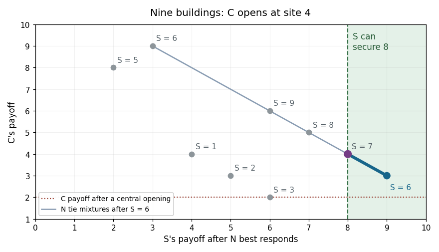

<h1 id="1/g/solution">Solution</h1>

↑ **Parent:** [G](../g.md)

Write $k=2m+1$, where $m\geq2$. For three distinct sites $a<b<c$, the left, middle and right firms receive respectively

$$
a+b-1,\qquad c-a,\qquad2k-b-c+1.
$$

These follow by counting the two midpoint boundaries, including split ties. Therefore, after two firms occupy $\ell<r$, the final entrant compares **$2(\ell-1)$ at $\ell-1$, $2(k-r)$ at $r+1$, and $r-\ell$ at every available interior site**. Omit an unavailable region and retain every maximizing tie. This is the [final entrant payoff in a discrete location game](../../../../../final-entrant-payoff-in-a-discrete-location-game.md).

First suppose $C$ opens at the central site $m+1$. If $S$ chooses $s\leq m$, the final entrant's best possible [payoffs](../../../../../payoff.md) on the left, right and interior are at most $2m-2$, exactly $2m$, and at most $m$, respectively. Hence $N$'s unique [best response](../../../../../best-response.md) is $m+2$. The resulting [payoff](../../../../../payoff.md) to $S$ is $m+s$, uniquely maximized on that side at $s=m$. Reflection gives the other optimal choice $s=m+2$, followed by $N=m$. Under either choice, **$C$ receives only $2$**. Any mixture of the tied optimal second-mover choices has the same consequence.

Now let $C$ deviate to $c=m$. If $S$ chooses $s<m$, the unique final [best response](../../../../../best-response.md) is $m+1$, yielding $S$ at most $2m-2$. If $S$ chooses $m+1$, the unique final [best response](../../../../../best-response.md) is $m+2$, yielding $S$ only two. Both classes will be strictly inferior to an available alternative, independently of how later ties are resolved:

- If $m\geq3$, $S$ can choose $m+3$. The final entrant compares $2m-2$, $2m-4$ and $3$, so uniquely chooses $m-1$. This gives $S$ exactly $2m$.
- If $m=2$, $S$ can choose site four after $C$ chooses two. All three remaining sites are final-mover [best responses](../../../../../best-response.md); they give $S$ [payoffs](../../../../../payoff.md) five, four and three. Thus $S$ guarantees at least three, exceeding the excluded choices' [payoff](../../../../../payoff.md) two.

Accordingly, in every [subgame perfect equilibrium](../../../../../subgame-perfect-equilibrium.md) continuation after $C=m$, the second mover must choose a site $s\geq m+2$. This remains true with [mixed strategies](../../../../../mixed-strategy.md): every excluded choice pays strictly less than the displayed guaranteed alternative, under every possible continuation tie policy.

For any such $s$, every legal final site gives $C$ at least three. If $N$ lies left of $m$, then $C$ is the middle firm and receives $s-N\geq3$. If $N$ lies right of $m$, then $C$ is the left firm and receives $m+\min(s,N)-1\geq2m\geq4$. Thus **the deviation gives $C$ at least $3$, against every subgame-perfect continuation**, whereas the central opening gives it $2$.

**[Figure 1](#1/g/image-final-mover-ties-and-the-second-mover-s-guarantee-after-the-first-firm-deviates-on-a-nine-building-street). Final-mover ties and the second mover's guarantee after the first firm deviates on a nine-building street**.

In this original example, a final-mover tie produces the [line segment](../../../../../line-segment.md) for $S=6$: its points are [expected payoff](../../../../../expected-payoff.md) pairs from a [mixed strategy](../../../../../mixed-strategy.md) over two final [best responses](../../../../../best-response.md). The second mover can independently secure eight by choosing $S=7$, so only the segment to the right of that guarantee can support its optimal choice. Mixing over a tied final response cannot make the first mover's [payoff](../../../../../payoff.md) fall below three.

A [subgame perfect equilibrium](../../../../../subgame-perfect-equilibrium.md) must prescribe optimal continuation play even after the first mover's off-path deviation. Since the deviation is strictly profitable under every such prescription, **no [subgame perfect equilibrium](../../../../../subgame-perfect-equilibrium.md) can have $C$ open centrally**. The argument does not select favourable ties or assume that off-path players cooperate with the deviator.

## ↑ Ancestors (11)

1. [G](../g.md)
2. [1](../../1.md)
3. [Computational game theory](../../../computational-game-theory-split.md)
4. [2019](../../../split.md)
5. [Past exam of the computer science course of the University of Oxford](../../../../split.md)
6. [Computer science course of the University of Oxford](../../../../../computer-science-course-of-the-university-of-oxford.md)
7. [Undergraduate course of the University of Oxford](../../../../../undergraduate-course-of-the-university-of-oxford.md)
8. [Course of the University of Oxford](../../../../../course-of-the-university-of-oxford.md)
9. [University of Oxford](../../../../../university-of-oxford-split.md)
10. [List of universities](../../../../../list-of-universities.md)
11. [Codex Wiki](../../../../../split.md)
