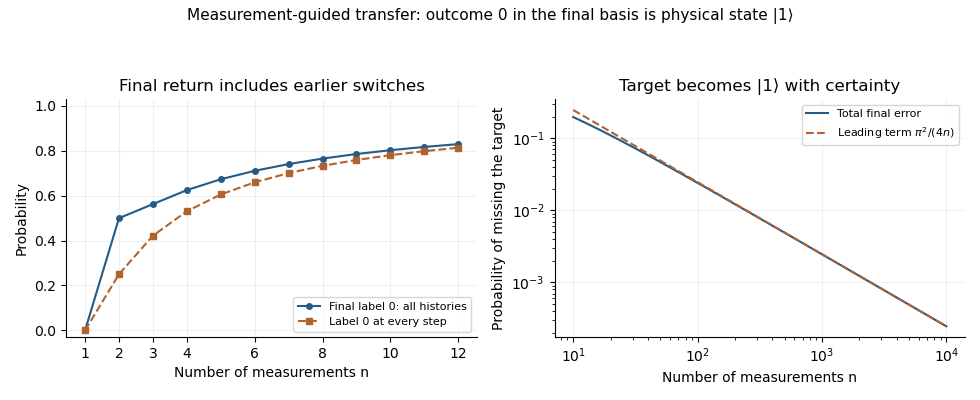

# Quantum information

↑ **Parent:** [2019](../2019.md)

Solutions to all three questions of the 15 June 2019 paper. [Released Oxford examination archive](https://www.whatdotheyknow.com/request/ba_computer_science_past_papers/response/2577745/attach/2/202402%20183%20CS%20Papers.zip?cookie_passthrough=1), member `2018/T/a16608w1.pdf`. The dated cover establishes 2019 despite that archive directory. [Vectors](../../vector-space.md#vector) are columns; the first tensor factor is the first wire; and the rightmost gate in an operator product acts first. Measurements use the printed outcome labels. [Global phases](../../quantum-system.md#global-phase) are identified physically, with the approximation convention made explicit in Question 3(a). All five source pages and all 27 terminal parts are covered.

**Table of contents**

- [1](#1)
  - [a](#1/a)
    - [Solution](#1/a/solution)
  - [b](#1/b)
    - [i](#1/b/i)
      - [Solution](#1/b/i/solution)
    - [ii](#1/b/ii)
      - [Solution](#1/b/ii/solution)
    - [iii](#1/b/iii)
      - [Solution](#1/b/iii/solution)
  - [c](#1/c)
    - [Solution](#1/c/solution)
  - [d](#1/d)
    - [i](#1/d/i)
      - [Solution](#1/d/i/solution)
    - [ii](#1/d/ii)
      - [Solution](#1/d/ii/solution)
    - [iii](#1/d/iii)
      - [Solution](#1/d/iii/solution)
  - [e](#1/e)
    - [i](#1/e/i)
      - [Solution](#1/e/i/solution)
    - [ii](#1/e/ii)
      - [Solution](#1/e/ii/solution)
- [2](#2)
  - [a](#2/a)
    - [i](#2/a/i)
      - [Solution](#2/a/i/solution)
    - [ii](#2/a/ii)
      - [Solution](#2/a/ii/solution)
  - [b](#2/b)
    - [i](#2/b/i)
      - [Solution](#2/b/i/solution)
    - [ii](#2/b/ii)
      - [Solution](#2/b/ii/solution)
  - [c](#2/c)
    - [Solution](#2/c/solution)
  - [d](#2/d)
    - [i](#2/d/i)
      - [Solution](#2/d/i/solution)
    - [ii](#2/d/ii)
      - [Solution](#2/d/ii/solution)
  - [e](#2/e)
    - [Solution](#2/e/solution)
- [3](#3)
  - [a](#3/a)
    - [i](#3/a/i)
      - [Solution](#3/a/i/solution)
    - [ii](#3/a/ii)
      - [Solution](#3/a/ii/solution)
    - [iii](#3/a/iii)
      - [Solution](#3/a/iii/solution)
  - [b](#3/b)
    - [i](#3/b/i)
      - [Solution](#3/b/i/solution)
    - [ii](#3/b/ii)
      - [Solution](#3/b/ii/solution)
  - [c](#3/c)
    - [Solution](#3/c/solution)
  - [d](#3/d)
    - [Solution](#3/d/solution)
  - [e](#3/e)
    - [Solution](#3/e/solution)
  - [f](#3/f)
    - [Solution](#3/f/solution)

## 1

↑ **Parent:** [Quantum information](quantum-information.md)

<h3 id="1/a">a</h3>

↑ **Parent:** [1](#1)

<h4 id="1/a/solution">Solution</h4>

↑ **Parent:** [A](#1/a)

A [basic measurement](../../quantum-measurement.md#basic-measurement) is specified by an [orthonormal basis](../../inner-product.md#orthonormal-basis) $\{|b_j\rangle\}_{j=0}^{d-1}$, with outcome $j$ associated with the rank-one [orthogonal projection](../../hilbert-space.md#orthogonal-projection) $P_j=|b_j\rangle\langle b_j|$. For a normalized [pure state](../../quantum-theory.md#pure-state) $|\psi\rangle$, the [Born rule](../../wave-function.md#born-rule) gives

$$
\boxed{p(j)=\langle\psi|P_j|\psi\rangle=|\langle b_j|\psi\rangle|^2.}
$$

The [probabilities](../../probability-theory.md#probability) sum to one because $\sum_jP_j=I$. Conditional on an outcome with $p(j)>0$, the [post-measurement state](../../quantum-measurement.md#post-measurement-state) is

$$
\boxed{\frac{P_j|\psi\rangle}{\sqrt{p(j)}}=\frac{\langle b_j|\psi\rangle}{|\langle b_j|\psi\rangle|}|b_j\rangle,}
$$

which represents $|b_j\rangle$ up to a [global phase](../../quantum-system.md#global-phase). An outcome of zero [probability](../../probability-theory.md#probability) has no conditional state to normalize. For a [density matrix](../../density-matrix.md) $\rho$, the corresponding expressions are $p(j)=\operatorname{Tr}(P_j\rho)$ and $P_j\rho P_j/p(j)$. If the outcome is ignored, the [nonselective projective measurement](../../quantum-measurement.md#nonselective-projective-measurement) instead produces $\sum_jP_j\rho P_j$, generally a [mixed state](../../density-matrix.md#mixed-state).[§2.3, Definition 2.34 and the outcome-probability rule; specialize to rank-one orthogonal projections](../../physics-bibliography.md#the-theory-of-quantum-information-by-john-watrous/basic-notions-of-quantum-information)

<h3 id="1/b">b</h3>

↑ **Parent:** [1](#1)

<h4 id="1/b/i">i</h4>

↑ **Parent:** [B](#1/b)

<h5 id="1/b/i/solution">Solution</h5>

↑ **Parent:** [I](#1/b/i)

The columns are $i|+\rangle$ and $-i|-\rangle$. Their [norms](../../normed-vector-space.md#norm) are one and their [inner product](../../inner-product.md) is zero, since $|+\rangle,|-\rangle$ are [orthonormal](../../inner-product.md#orthonormal-set). Thus **$M_1$ is a [unitary matrix](../../linear-operator-theory.md#unitary-matrix)**. Equivalently,

$$
M_1=iHZ,\qquad M_1^\dagger M_1=Z H^\dagger H Z=I,
$$

using the [Hadamard gate](../../quantum-theory.md#hadamard-gate) and [Pauli Z gate](../../quantum-theory.md#pauli-z-gate). The different column phases do not destroy [orthonormality](../../inner-product.md#orthonormal-set).

<h4 id="1/b/ii">ii</h4>

↑ **Parent:** [B](#1/b)

<h5 id="1/b/ii/solution">Solution</h5>

↑ **Parent:** [Ii](#1/b/ii)

The [Pauli Y gate](../../quantum-theory.md#pauli-y-gate) satisfies $Y^\dagger=Y$ and $Y^2=I$. With $c=\cos(\pi/6)=\sqrt3/2$ and $s=\sin(\pi/6)=1/2$, the given [matrix](../../vector-space.md#matrix) is [Hermitian](../../hilbert-space.md#hermitian-operator), and

$$
M_2^\dagger M_2=(cI+sY)^2=(c^2+s^2)I+2csY=I+\frac{\sqrt3}{2}Y\ne I.
$$

Therefore **$M_2$ is not a [unitary matrix](../../linear-operator-theory.md#unitary-matrix)**. Its [eigenvalues](../../linear-operator-theory.md#eigenvalue) are $c+s$ and $c-s$, neither of which has modulus one. An expression $\cos\theta\,I+i\sin\theta\,Y$ would behave differently, but the printed [matrix](../../vector-space.md#matrix) has no such factor of $i$.

<h4 id="1/b/iii">iii</h4>

↑ **Parent:** [B](#1/b)

<h5 id="1/b/iii/solution">Solution</h5>

↑ **Parent:** [Iii](#1/b/iii)

Set $A=U_A\otimes I_B$ and $B=I_A\otimes U_B$. They are [self-adjoint operators](../../linear-operator-theory.md#self-adjoint-operator) and satisfy $A^2=B^2=I$, because the original factors are both self-adjoint and unitary. They also commute: each acts on a different tensor factor. Hence

$$
M_3^\dagger M_3=\frac12(A-iB)(A+iB)=\frac12(A^2+B^2+iAB-iBA)=I.
$$

The same calculation in the opposite order gives $M_3M_3^\dagger=I$. Thus **$M_3$ is a [unitary matrix](../../linear-operator-theory.md#unitary-matrix) for every allowed pair of factors**. Commutation cancels the cross terms, while their relative imaginary coefficient supplies the opposite signs. This is the [commuting-involution unitary combination](../../vector-space.md#commuting-involution-unitary-combination).

<h3 id="1/c">c</h3>

↑ **Parent:** [1](#1)

<h4 id="1/c/solution">Solution</h4>

↑ **Parent:** [C](#1/c)

Let $p=|\alpha|^2$ and $1-p=|\beta|^2$. The first [basic measurement](../../quantum-measurement.md#basic-measurement) has outcome [probabilities](../../probability-theory.md#probability) $p$ and $1-p$, obtained by conjugating the amplitudes in the bras. Conditional on its first outcome, the next [computational-basis measurement](../../quantum-theory.md#quantum-measurement-in-the-computational-basis) returns 0 with [probability](../../probability-theory.md#probability) $p$; conditional on its second outcome, that [probability](../../probability-theory.md#probability) is $1-p$. The [law of total probability](../../probability-space.md#law-of-total-probability) therefore gives

$$
\Pr(\text{second outcome }0)=p^2+(1-p)^2=\frac12+2\left(p-\frac12\right)^2.
$$

Consequently the **minimum is $1/2$, attained exactly when $|\alpha|=|\beta|=1/\sqrt2$**. The relative complex phases do not affect this result. The alternatives after the first measurement form a classical mixture; their amplitudes must not be added coherently as if no measurement occurred.

<h3 id="1/d">d</h3>

↑ **Parent:** [1](#1)

<h4 id="1/d/i">i</h4>

↑ **Parent:** [D](#1/d)

<h5 id="1/d/i/solution">Solution</h5>

↑ **Parent:** [I](#1/d/i)

Choose **$|\psi_0\rangle=|+\rangle$** and its [orthogonal](../../inner-product.md#orthogonal-vectors) companion $|\psi_1\rangle=|-\rangle$. Since $X|+\rangle=|+\rangle$, either branch of `RandomFlip` returns the same [pure state](../../quantum-theory.md#pure-state). Alice therefore obtains label 0 with certainty, and

$$
\boxed{\Pr(1\mid\texttt{RandomFlip})=0.}
$$

The alternative choice $|-\rangle$ also works: its sign change under $X$ is only a [global phase](../../quantum-system.md#global-phase). The useful property is being a [Pauli eigenstate](../../quantum-circuit.md#pauli-eigenstate) of the [Pauli X gate](../../quantum-theory.md#pauli-x-gate).

<h4 id="1/d/ii">ii</h4>

↑ **Parent:** [D](#1/d)

<h5 id="1/d/ii/solution">Solution</h5>

↑ **Parent:** [Ii](#1/d/ii)

Use the preparation and measurement from part (i). `RandomReset` returns the [density matrix](../../density-matrix.md) $\rho_R=(|0\rangle\langle0|+|1\rangle\langle1|)/2=I/2$, a [maximally mixed state](../../density-matrix.md#maximally-mixed-state). In the $|+\rangle,|-\rangle$ basis its two outcomes each have [probability](../../probability-theory.md#probability) $1/2$. In contrast, `RandomFlip` always gives outcome 0.

Guess `RandomFlip` after 0 and `RandomReset` after 1. With the supplied equal priors,

$$
\boxed{P_{\rm success}=\frac12\Pr(0\mid\texttt{RandomFlip})+\frac12\Pr(1\mid\texttt{RandomReset})=\frac12+\frac14=\frac34.}
$$

An outcome 1 identifies the reset action, but outcome 0 does not identify the flip action with certainty. For example, [Bayes' theorem](../../probability-theory.md#bayes-theorem) gives posterior [probability](../../probability-theory.md#probability) $2/3$ for the flip action after 0. The total success rate already accounts for the reset runs that also produce 0.

<h4 id="1/d/iii">iii</h4>

↑ **Parent:** [D](#1/d)

<h5 id="1/d/iii/solution">Solution</h5>

↑ **Parent:** [Iii](#1/d/iii)

Prepare the uniform [pure state](../../quantum-theory.md#pure-state)

$$
|s\rangle=\frac1{\sqrt d}\sum_{j=0}^{d-1}|j\rangle.
$$

Every [permutation matrix](../../vector-space.md#permutation-matrix) fixes this [vector](../../vector-space.md#vector), so `RandomPermute` returns $|s\rangle$ with certainty. Choose an [orthonormal basis](../../inner-product.md#orthonormal-basis) with first [vector](../../vector-space.md#vector) $|\psi_0\rangle=|s\rangle$, for example the [quantum Fourier transform](../../quantum-fourier-transform.md) basis. Under `RandomReset`, the returned state is $I/d$, which gives each of the $d$ measurement labels [probability](../../probability-theory.md#probability) $1/d$.

Guess `RandomPermute` on label 0 and `RandomReset` on every other label. Then

$$
\boxed{P_{\rm success}=\frac12\cdot1+\frac12\cdot\frac{d-1}{d}=1-\frac1{2d}.}
$$

This is [invariant-pure-state discrimination against a maximally mixed reset](../../quantum-information-theory.md#invariant-pure-state-discrimination-against-a-maximally-mixed-reset). It also agrees with the [Holevo–Helstrom theorem](../../quantum-information-theory.md#holevo-helstrom-theorem): the [eigenvalues](../../linear-operator-theory.md#eigenvalue) of $|s\rangle\langle s|-I/d$ are $1-1/d$ once and $-1/d$ with [multiplicity](../../polynomial.md#multiplicity-mathematics) $d-1$, giving optimal equal-prior success $1/2+\|\rho_P-\rho_R\|_1/4=1-1/(2d)$. This confirms optimal discrimination of these returned states, in addition to constructing the requested strategy.[§3.1.1, Theorem 3.4 and equation (3.20), optimal binary-state discrimination](../../physics-bibliography.md#the-theory-of-quantum-information-by-john-watrous) For $d=1$, the actions coincide and the formula correctly gives random-guessing success $1/2$.

<h3 id="1/e">e</h3>

↑ **Parent:** [1](#1)

<h4 id="1/e/i">i</h4>

↑ **Parent:** [E](#1/e)

<h5 id="1/e/i/solution">Solution</h5>

↑ **Parent:** [I](#1/e/i)

Put $\delta=\pi/(2n)$. Between successive measurement bases, the squared overlap is $c=\cos^2\delta$ for retaining the same label and $s=\sin^2\delta$ for changing label. The first step obeys the same rule if we regard the initial state as label 0 at angle zero. Thus the recorded labels form a [Markov chain](../../markov-chain.md) with [transition matrix](../../markov-chain.md#stochastic-matrix) $\bigl(\begin{smallmatrix}c&s\\s&c\end{smallmatrix}\bigr)$.

Let $q_k$ be the [probability](../../probability-theory.md#probability) of label 0 after step $k$. Then $q_0=1$ and

$$
q_k=cq_{k-1}+s(1-q_{k-1}),\qquad 2q_k-1=(c-s)(2q_{k-1}-1).
$$

Since $c-s=\cos(\pi/n)$, iteration yields

$$
\boxed{q_n=\frac12\left[1+\cos^n\left(\frac\pi n\right)\right].}
$$

This is the total final-outcome [probability](../../probability-theory.md#probability), including histories that change label an [even number](../../integer.md#even-number) of times. The smaller quantity $\cos^{2n}(\pi/(2n))$ counts only the history with label 0 at every step and is not the requested total. For example, at $n=3$ the total is $9/16$, whereas the uninterrupted history has [probability](../../probability-theory.md#probability) $27/64$. At $n=1$, the final basis is $\{|1\rangle,|0\rangle\}$ up to signs, so the total [probability](../../probability-theory.md#probability) of label 0 is zero, as the formula also gives. This distinguishes nonselective [measurement-guided Zeno transfer](../../quantum-measurement.md#measurement-guided-zeno-transfer) from [postselection](../../quantum-measurement.md#postselection) on one record.

<h4 id="1/e/ii">ii</h4>

↑ **Parent:** [E](#1/e)

<h5 id="1/e/ii/solution">Solution</h5>

↑ **Parent:** [Ii](#1/e/ii)

At the last step, $|\psi_{0,n}\rangle=|1\rangle$ and $|\psi_{1,n}\rangle=|0\rangle$. Ignoring the recorded outcome, the final [density matrix](../../density-matrix.md) is

$$
\rho_n=q_n|1\rangle\langle1|+(1-q_n)|0\rangle\langle0|.
$$

For large $n$, the [Taylor expansion](../../calculus.md#taylor-expansion) $\log\cos x=-x^2/2+O(x^4)$ gives

$$
n\log\cos(\pi/n)=-\frac{\pi^2}{2n}+O(n^{-3})\longrightarrow0.
$$

Thus $q_n\to1$, and **the final state tends to $|1\rangle\langle1|$**, or $|1\rangle$ as a pure-state representative. In fact $1-q_n\sim\pi^2/(4n)$, and its [trace distance](../../density-matrix.md#trace-distance) from $|1\rangle\langle1|$ is exactly $1-q_n$. With records retained, the final conditional state is $|1\rangle$ with [probability](../../probability-theory.md#probability) tending to one. These are compatible descriptions, not a coherent sum of the two outcome branches. This [quantum Zeno effect](../../quantum-measurement.md#quantum-zeno-effect) guides a known preparation through slowly rotating measurement bases; it is not a unitary [Pauli X gate](../../quantum-theory.md#pauli-x-gate) acting coherently on an arbitrary unknown input.

**[Figure 1](#1/e/ii/image-total-probability-of-the-final-target-outcome-versus-the-uninterrupted-measurement-record-and-the-asymptotic-target-error-probability-in-measurement-guided-zeno-transfer). Total probability of the final target outcome versus the uninterrupted measurement record, and the asymptotic target-error probability in measurement-guided Zeno transfer**.

## 2

↑ **Parent:** [Quantum information](quantum-information.md)

<h3 id="2/a">a</h3>

↑ **Parent:** [2](#2)

<h4 id="2/a/i">i</h4>

↑ **Parent:** [A](#2/a)

<h5 id="2/a/i/solution">Solution</h5>

↑ **Parent:** [I](#2/a/i)

A normalized bipartite [pure state](../../quantum-theory.md#pure-state) is **entangled when it cannot be written as a [product state](../../bell-state.md#product-state)** $|a\rangle_A\otimes|b\rangle_B$. Equivalently, its [Schmidt rank](../../von-neumann-entropy.md#schmidt-rank) exceeds one. This definition concerns the specified partition into systems A and B; the mixed-state definition of separability requires a different convex-mixture condition.

<h4 id="2/a/ii">ii</h4>

↑ **Parent:** [A](#2/a)

<h5 id="2/a/ii/solution">Solution</h5>

↑ **Parent:** [Ii](#2/a/ii)

A bipartite [unitary operator](../../vector-space.md#unitary-operator) is an **[entangling gate](../../quantum-circuit.md#entangling-gate) if it maps at least one [product state](../../bell-state.md#product-state) to an [entangled state](../../bell-state.md#entangled-state)**. It need not entangle every product input. For example, the [controlled-NOT gate](../../quantum-theory.md#controlled-not-gate) entangles $|+\rangle|0\rangle$ but leaves $|00\rangle$ as a product. A gate that preserves every product input is not entangling, even if it exchanges the two subsystems.

<h3 id="2/b">b</h3>

↑ **Parent:** [2](#2)

<h4 id="2/b/i">i</h4>

↑ **Parent:** [B](#2/b)

<h5 id="2/b/i/solution">Solution</h5>

↑ **Parent:** [I](#2/b/i)

The joint [Born rule](../../wave-function.md#born-rule) uses the [tensor product](../../multilinear-algebra.md#tensor-product) of the two outcome bras. Its amplitude is

$$
(\langle0|\otimes\langle\theta_0|)|\psi\rangle_{AB}=\frac45\langle\theta_0|0\rangle=\frac45\cos\theta.
$$

The other source component vanishes on contraction with $\langle0|$ on A. Therefore

$$
\boxed{\Pr(A=0,B=\theta_0)=\frac{16}{25}\cos^2\theta.}
$$

This is a joint [probability](../../probability-theory.md#probability): $\Pr(A=0)=16/25$, while $\Pr(B=\theta_0\mid A=0)=\cos^2\theta$. Dropping the first factor would give only the [conditional probability](../../probability-theory.md#conditional-probability).

<h4 id="2/b/ii">ii</h4>

↑ **Parent:** [B](#2/b)

<h5 id="2/b/ii/solution">Solution</h5>

↑ **Parent:** [Ii](#2/b/ii)

Here $\langle+y|=(\langle0|-i\langle1|)/\sqrt2$. Keeping that [complex conjugation](../../complex-analysis.md#complex-conjugation), the joint amplitude is

$$
(\langle+|\otimes\langle+y|)|\psi\rangle_{AB}=\frac1{2\sqrt2}\bigl(1+(-i)(-i)\bigr)=0.
$$

Hence **$\Pr(A=+,B=+y)=0$**. The cancellation is destructive [quantum interference](../../quantum-system.md#quantum-interference) between the two source components, not the absence of either local outcome. Each local outcome individually has [probability](../../probability-theory.md#probability) $1/2$, since each [reduced density matrix](../../bell-state.md#reduced-density-matrix) is $I/2$. Omitting the conjugation in the second bra would turn the cancellation into reinforcement and give the wrong answer.

<h3 id="2/c">c</h3>

↑ **Parent:** [2](#2)

<h4 id="2/c/solution">Solution</h4>

↑ **Parent:** [C](#2/c)

For deterministic classical responses, denote the two possible local answers by $x_0,x_1$, $y_0,y_1$ and $z_0,z_1$. Certainty in the [GHZ game](../../quantum-theory.md#ghz-game) would require

$$
\begin{aligned}
x_0\oplus y_0\oplus z_0&=0,\\
x_0\oplus y_1\oplus z_1&=1,\\
x_1\oplus y_0\oplus z_1&=1,\\
x_1\oplus y_1\oplus z_0&=1.
\end{aligned}
$$

Taking the [exclusive or](../../theoretical-computer-science.md#exclusive-or) of all four equations gives zero on the left, since every answer occurs twice, but one on the right. This contradiction rules out deterministic certainty. Pre-shared randomness cannot cure it: conditioning on the random seed fixes a deterministic response table, and none succeeds on every allowed input. Thus **noncommunicating classical players cannot win with certainty**. No uniform distribution on the referee's questions is needed for this worst-case claim.

For the quantum strategy, share the [GHZ state](../../quantum-theory.md#greenberger-horne-zeilinger-state) and measure the [Pauli X gate](../../quantum-theory.md#pauli-x-gate) observable when the local question is 0, or the [Pauli Y gate](../../quantum-theory.md#pauli-y-gate) observable when it is 1. Return bit 0 for measurement [eigenvalue](../../linear-operator-theory.md#eigenvalue) $+1$ and bit 1 for [eigenvalue](../../linear-operator-theory.md#eigenvalue) $-1$. The four relevant operator identities are

$$
\begin{aligned}
(X\otimes X\otimes X)|GHZ\rangle&=|GHZ\rangle,\\
(X\otimes Y\otimes Y)|GHZ\rangle&=-|GHZ\rangle,\\
(Y\otimes X\otimes Y)|GHZ\rangle&=-|GHZ\rangle,\\
(Y\otimes Y\otimes X)|GHZ\rangle&=-|GHZ\rangle.
\end{aligned}
$$

For the first identity, the three bit flips exchange $|000\rangle$ and $|111\rangle$. For each remaining identity, the two Y actions contribute $i^2=-1$ on $|000\rangle$ and $(-i)^2=-1$ on $|111\rangle$, so they exchange the terms with a minus sign. Local measurements on separate systems commute, and the product of their observed [eigenvalues](../../linear-operator-theory.md#eigenvalue) is therefore fixed by the displayed joint [eigenvalue](../../linear-operator-theory.md#eigenvalue). That product equals $(-1)^{x+y+z}$, giving exactly the required output parity for each promised input. Hence **the quantum strategy wins with certainty without communication**. This is the [GHZ theorem](../../quantum-theory.md#ghz-theorem) in nonlocal-game form; it does not let a player control another player's individual outcome.

<h3 id="2/d">d</h3>

↑ **Parent:** [2](#2)

<h4 id="2/d/i">i</h4>

↑ **Parent:** [D](#2/d)

<h5 id="2/d/i/solution">Solution</h5>

↑ **Parent:** [I](#2/d/i)

Consider one normalized measurement [vector](../../vector-space.md#vector) $|u\rangle=a|0\rangle+b|1\rangle$ on C. The unnormalized [partial inner product](../../multilinear-algebra.md#partial-inner-product) on AB is

$$
|\chi_u\rangle=(I_{AB}\otimes\langle u|)|W\rangle=\frac1{\sqrt3}\bigl(\overline b|00\rangle+\overline a|01\rangle+\overline a|10\rangle\bigr).
$$

Its [tensor-product coefficient matrix](../../multilinear-algebra.md#tensor-product-coefficient-matrix) and determinant are

$$
C_u=\frac1{\sqrt3}\begin{pmatrix}\overline b&\overline a\\\overline a&0\end{pmatrix},\qquad \det C_u=-\frac{\overline a^{\,2}}3.
$$

The [two-qubit product-state determinant criterion](../../bell-state.md#two-qubit-product-state-determinant-criterion) therefore says that this branch is entangled whenever $a\ne0$. Its [probability](../../probability-theory.md#probability) is $(|b|^2+2|a|^2)/3>0$, so such a branch is physically possible and can be normalized without changing whether its determinant vanishes.

For an [orthonormal basis](../../inner-product.md#orthonormal-basis) $\{|u_0\rangle,|u_1\rangle\}$, completeness gives $|\langle0|u_0\rangle|^2+|\langle0|u_1\rangle|^2=1$. At least one [vector](../../vector-space.md#vector) has $a\ne0$. Hence **at least one nonzero-probability outcome leaves AB entangled**, proving [conditional entanglement of the three-qubit W state](../../quantum-system.md#conditional-entanglement-of-the-three-qubit-w-state). Some bases give two entangled branches; the [computational basis](../../quantum-theory.md#computational-basis) gives one entangled and one product branch. The claim is not that every outcome must entangle AB.

<h4 id="2/d/ii">ii</h4>

↑ **Parent:** [D](#2/d)

<h5 id="2/d/ii/solution">Solution</h5>

↑ **Parent:** [Ii](#2/d/ii)

Suppose $|W\rangle=(U_A\otimes U_B\otimes U_C)|GHZ\rangle$. Measure C in the [orthonormal basis](../../inner-product.md#orthonormal-basis) $\{U_C|0\rangle,U_C|1\rangle\}$. Its two AB conditional [vectors](../../vector-space.md#vector) would be proportional to

$$
(U_A|0\rangle)\otimes(U_B|0\rangle),\qquad (U_A|1\rangle)\otimes(U_B|1\rangle),
$$

respectively. Both are [product states](../../bell-state.md#product-state), because measuring the original GHZ state's C factor in the [computational basis](../../quantum-theory.md#computational-basis) selects $|00\rangle$ or $|11\rangle$. This contradicts part (i), which applies to every [basic measurement](../../quantum-measurement.md#basic-measurement) basis of the W state's C factor. Therefore **no local [unitary transformation](../../vector-space.md#unitary-operator) maps GHZ to W**.

An additional invariant makes the distinction visible without measurement records. Across the partition AB versus C, the GHZ [reduced density matrix](../../bell-state.md#reduced-density-matrix) on C has [eigenvalues](../../linear-operator-theory.md#eigenvalue) $1/2,1/2$, whereas the W state's are $2/3,1/3$. By [local-unitary invariance of reduced-state spectra](../../bell-state.md#local-unitary-invariance-of-reduced-state-spectra), these spectra cannot be changed by local unitaries. This supplies the same impossibility and emphasizes that the proposed transformation is a product of unitaries, not arbitrary postselected local processing.

<h3 id="2/e">e</h3>

↑ **Parent:** [2](#2)

<h4 id="2/e/solution">Solution</h4>

↑ **Parent:** [E](#2/e)

**For every nontrivial dimension $d\ge2$, no such [pure state](../../quantum-theory.md#pure-state) exists. The literal claim needs this qualification: for $d=1$, the only measurement outcome is necessarily the same for both parties.** The contradiction below requires allowing all complex [orthonormal bases](../../inner-product.md#orthonormal-basis), as quantum theory does.

If equal outcomes were certain in the [computational basis](../../quantum-theory.md#computational-basis), all amplitudes with different labels would vanish, so the normalized joint state would have the form

$$
|\Psi\rangle=\sum_{j=0}^{d-1}c_j|j\rangle|j\rangle.
$$

Choose distinct labels $j,k$ and replace their computational [vectors](../../vector-space.md#vector) in both local bases by $|+\rangle_{jk}=(|j\rangle+|k\rangle)/\sqrt2$ and $|-\rangle_{jk}=(|j\rangle-|k\rangle)/\sqrt2$, leaving all other [vectors](../../vector-space.md#vector) fixed. The joint amplitude for the _different_ outcomes $+,-$ is $(c_j-c_k)/2$. Certainty of equal outcomes would force $c_j=c_k$.

Now use the complex pair $|+i\rangle_{jk}=(|j\rangle+i|k\rangle)/\sqrt2$ and $|-i\rangle_{jk}=(|j\rangle-i|k\rangle)/\sqrt2$ in the same way on both systems. The amplitude for different outcomes $+i,-i$ is $(c_j+c_k)/2$, because the conjugated bra factors on the $|kk\rangle$ term multiply to $(-i)(i)=1$. Thus equal outcomes would also force $c_j=-c_k$. Combining the two requirements gives $c_j=c_k=0$. Every label belongs to such a pair when $d\ge2$, forcing the zero [vector](../../vector-space.md#vector) and contradicting [normalization](../../mathematics.md#normalization). This proves [impossibility of universal identical-basis perfect correlations](../../bell-state.md#impossibility-of-universal-identical-basis-perfect-correlations).

The maximally [entangled state](../../bell-state.md#entangled-state) $d^{-1/2}\sum_j|jj\rangle$ is not a counterexample: it correlates matching labels when one party uses a basis and the other its coordinatewise [complex conjugate](../../complex-analysis.md#complex-conjugate) basis. Requiring the two complex bases to be identical is different. This distinction also follows from [conjugate-state steering from a maximally entangled pair](../../quantum-theory.md#conjugate-state-steering-from-a-maximally-entangled-pair); restricting attention to real bases would miss the contradiction.

## 3

↑ **Parent:** [Quantum information](quantum-information.md)

<h3 id="3/a">a</h3>

↑ **Parent:** [3](#3)

<h4 id="3/a/i">i</h4>

↑ **Parent:** [A](#3/a)

<h5 id="3/a/i/solution">Solution</h5>

↑ **Parent:** [I](#3/a/i)

For normalized [vector](../../vector-space.md#vector) representatives in the same [Hilbert space](../../hilbert-space.md), the vector-norm convention is **$\||\psi\rangle-|\phi\rangle\|_2\le\varepsilon$**. Since physical [pure states](../../quantum-theory.md#pure-state) identify [global phases](../../quantum-system.md#global-phase), a phase-insensitive version is

$$
\boxed{\min_{\theta\in\mathbb R}\||\psi\rangle-e^{i\theta}|\phi\rangle\|_2=\sqrt{2-2|\langle\psi|\phi\rangle|}\le\varepsilon.}
$$

The equality follows by choosing the phase to make the overlap real and nonnegative. This states an explicit [pure-state norm distance](../../quantum-theory.md#pure-state-norm-distance) convention; fidelity-based or trace-distance conventions use different numerical error parameters. We use the phase-insensitive convention for the universality claim below.

<h4 id="3/a/ii">ii</h4>

↑ **Parent:** [A](#3/a)

<h5 id="3/a/ii/solution">Solution</h5>

↑ **Parent:** [Ii](#3/a/ii)

Under fixed phase representatives, two [unitary operators](../../vector-space.md#unitary-operator) on the same space are **$\varepsilon$-close when $\|U-V\|_{\rm op}\le\varepsilon$**, where the [operator norm](../../continuous-dual-space.md#operator-norm) is

$$
\|U-V\|_{\rm op}=\sup_{\|\psi\|_2=1}\|(U-V)|\psi\rangle\|_2.
$$

Thus every input [vector](../../vector-space.md#vector) is approximated uniformly, not merely one selected input. Under the phase-insensitive convention, replace this bound by $\min_\theta\|U-e^{i\theta}V\|_{\rm op}\le\varepsilon$. The minimization uses one phase for the whole operator, not a separately chosen phase inside the [supremum](../../real-analysis.md#supremum) for each input. This is [operator-norm distance between unitary gates](../../quantum-circuit.md#operator-norm-distance-between-unitary-gates) with the stated global-phase identification.

<h4 id="3/a/iii">iii</h4>

↑ **Parent:** [A](#3/a)

<h5 id="3/a/iii/solution">Solution</h5>

↑ **Parent:** [Iii](#3/a/iii)

A finite [universal quantum gate set](../../quantum-circuit.md#universal-quantum-gate-set) can approximate every unitary on any fixed finite number of [qubits](../../quantum-system.md#qubit) to any prescribed positive accuracy, using a finite circuit of its gates on allowed wires. Explicitly, for every target $U$ and $\varepsilon>0$ there is such a circuit $C$ with

$$
\boxed{\min_\theta\|U-e^{i\theta}C\|_{\rm op}<\varepsilon.}
$$

The global-phase convention is the one just specified. Universality means arbitrary approximation, not exact representation of an uncountable family by finitely described circuits. Products of approximate gates can be controlled using the [quantum circuit gate-error telescoping bound](../../quantum-circuit.md#quantum-circuit-gate-error-telescoping-bound).

<h3 id="3/b">b</h3>

↑ **Parent:** [3](#3)

<h4 id="3/b/i">i</h4>

↑ **Parent:** [B](#3/b)

<h5 id="3/b/i/solution">Solution</h5>

↑ **Parent:** [I](#3/b/i)

Both the [controlled-NOT gate](../../quantum-theory.md#controlled-not-gate) and [Pauli X gate](../../quantum-theory.md#pauli-x-gate) permute [computational basis](../../quantum-theory.md#computational-basis) [vectors](../../vector-space.md#vector). Any finite composition remains a [permutation matrix](../../vector-space.md#permutation-matrix), and so sends $|0\cdots0\rangle$ to another [computational basis](../../quantum-theory.md#computational-basis) [vector](../../vector-space.md#vector). It cannot prepare a superposition such as $|+\rangle\otimes|0\cdots0\rangle$.

This also rules out approximation: the squared overlap of that target with any [computational basis](../../quantum-theory.md#computational-basis) [vector](../../vector-space.md#vector) is at most $1/2$, so even after optimizing [global phase](../../quantum-system.md#global-phase) the [pure-state norm distance](../../quantum-theory.md#pure-state-norm-distance) is at least $\sqrt{2-\sqrt2}>0$. Hence **$\{CNOT,X\}$ is not universal**. Basis permutations can create entanglement on some superposed inputs, but this gate set cannot create the required superposition from the specified basis input.

<h4 id="3/b/ii">ii</h4>

↑ **Parent:** [B](#3/b)

<h5 id="3/b/ii/solution">Solution</h5>

↑ **Parent:** [Ii](#3/b/ii)

Squaring the diagonal gate gives

$$
V^2=\operatorname{diag}(e^{-i\pi/8},e^{i\pi/8})=e^{-i\pi/8}T.
$$

Thus the [T gate](../../quantum-theory.md#t-gate) is available up to a [global phase](../../quantum-system.md#global-phase). Reading the supplied W columns in order $00,01,10,11$, it sends $|01\rangle$ to $|11\rangle$, $|11\rangle$ to $|01\rangle$, and fixes the other two [vectors](../../vector-space.md#vector): it is CNOT with the _second_ wire controlling the first. Conjugating both wires by the [Hadamard gate](../../quantum-theory.md#hadamard-gate) reverses that orientation:

$$
\boxed{\mathrm{CNOT}_{1\to2}=(H\otimes H)W(H\otimes H).}
$$

For instance, write $W=I\otimes|0\rangle\langle0|+X\otimes|1\rangle\langle1|$. Conjugation uses $HXH=Z$ and $H|0\rangle=|+\rangle$, $H|1\rangle=|-\rangle$, yielding $I\otimes|+\rangle\langle+|+Z\otimes|-\rangle\langle-|$. Expanding the first-wire Z eigenspaces gives $|0\rangle\langle0|\otimes I+|1\rangle\langle1|\otimes X$, as required.

We have H directly and finite constructions of CNOT and T up to physically irrelevant [global phase](../../quantum-system.md#global-phase). By [universality transfer by exact gate synthesis](../../quantum-circuit.md#universality-transfer-by-exact-gate-synthesis), the assumed universality of $\{CNOT,H,T\}$ proves that **$\{V,H,W\}$ is universal under the phase-insensitive convention**. There is no assertion of arbitrary strict operator-norm phases: on a fixed register these generators have only a [finite set](../../set.md#finite-set) of possible determinants, which would obstruct density in the entire unitary group if [global phase](../../quantum-system.md#global-phase) were treated as an observable target.

<h3 id="3/c">c</h3>

↑ **Parent:** [3](#3)

<h4 id="3/c/solution">Solution</h4>

↑ **Parent:** [C](#3/c)

By the [spectral theorem](../../hilbert-space.md#spectral-theorem), the nonscalar unitary V has [orthonormal](../../inner-product.md#orthonormal-set) [eigenvectors](../../linear-operator-theory.md#eigenvector) $|v_0\rangle,|v_1\rangle$ with distinct [eigenvalues](../../linear-operator-theory.md#eigenvalue) $\lambda_0\ne\lambda_1$. Choose $|b\rangle=(|v_0\rangle+|v_1\rangle)/\sqrt2$. Then $V|b\rangle=(\lambda_0|v_0\rangle+\lambda_1|v_1\rangle)/\sqrt2$ is not proportional to $|b\rangle$.

On the product input $|+\rangle\otimes|b\rangle$, the [controlled unitary gate](../../quantum-theory.md#controlled-unitary-gate) produces

$$
U(|+\rangle\otimes|b\rangle)=\frac1{\sqrt2}\bigl(|0\rangle\otimes|b\rangle+|1\rangle\otimes V|b\rangle\bigr).
$$

Its two conditional target [vectors](../../vector-space.md#vector) are [linearly independent](../../vector-space.md#linear-independence), so the [conditional-vector product-state criterion](../../bell-state.md#conditional-vector-product-state-criterion) proves that the output is entangled. Equivalently, in the control [computational basis](../../quantum-theory.md#computational-basis) and target eigenbasis its [coefficient matrix](../../linear-algebra.md#coefficient-matrix) is $\tfrac12\bigl(\begin{smallmatrix}1&1\\\lambda_0&\lambda_1\end{smallmatrix}\bigr)$, whose determinant is $(\lambda_1-\lambda_0)/4\ne0$. Thus **U is an [entangling gate](../../quantum-circuit.md#entangling-gate)**. The excluded scalar case would only apply a [phase gate](../../quantum-theory.md#phase-gate) to the control and could not entangle the factors; this is the [controlled-unitary entangling criterion](../../quantum-theory.md#controlled-unitary-entangling-criterion).

<h3 id="3/d">d</h3>

↑ **Parent:** [3](#3)

<h4 id="3/d/solution">Solution</h4>

↑ **Parent:** [D](#3/d)

Let $N_0,N_1$ be the two output counts. Choose a known preparation unitary F with $F|0\rangle=N^{-1/2}\sum_x|x\rangle=:|s\rangle$. The [Deutsch-Jozsa algorithm](../../quantum-theory.md#deutsch-jozsa-algorithm) applies the supplied [phase oracle](../../theoretical-computer-science.md#phase-oracle) $O_f|x\rangle=(-1)^{f(x)}|x\rangle$ and then $F^\dagger$, declaring constant exactly for outcome 0. Its amplitude on that outcome is

$$
\langle0|F^\dagger O_fF|0\rangle=\langle s|O_f|s\rangle=\frac{N_0-N_1}{N}.
$$

This is the [Deutsch-Jozsa test with an arbitrary uniform-state unitary](../../quantum-theory.md#deutsch-jozsa-test-with-an-arbitrary-uniform-state-unitary). For $N=2^m$, the usual preparation is $F=H^{\otimes m}$; the argument itself needs only a uniform preparation on the stated N-dimensional space.

For an actually constant-up-to-k function, the two counts are $k$ and $N-k$, so the outcome-0 [probability](../../probability-theory.md#probability) is $(1-2k/N)^2$. The error is returning the other label. Therefore

$$
\boxed{P_{\rm error}=1-\left(1-\frac{2k}{N}\right)^2=\frac{4k}{N}\left(1-\frac{k}{N}\right).}
$$

Here the possible count k is nonnegative, and the supplied bound implies $0\le k/N\le1/8$. The error is consequently at most $7/16$; at $k=0$ it vanishes. This is the error conditional on the stated constant-up-to-k case, not an average over unspecified prior [probabilities](../../probability-theory.md#probability). For comparison, the printed balanced-up-to-k definition has count _difference_ $\pm k$, so its outcome-0 [probability](../../probability-theory.md#probability) would be $(k/N)^2$, not the expression for the constant-up-to-k case. No change to that promise definition is made.

<h3 id="3/e">e</h3>

↑ **Parent:** [3](#3)

<h4 id="3/e/solution">Solution</h4>

↑ **Parent:** [E](#3/e)

**One Grover iteration returns a marked label with certainty.** Prepare $|s\rangle=N^{-1/2}\sum_x|x\rangle$; apply the supplied [phase oracle](../../theoretical-computer-science.md#phase-oracle) to negate amplitudes on the $N/4$ marked inputs; apply the [Grover diffusion operator](../../quantum-theory.md#grover-diffusion-operator) $D=2|s\rangle\langle s|-I$; and measure in the [computational basis](../../quantum-theory.md#computational-basis). If F prepares $|s\rangle$ from $|0\rangle$, the reflection is $D=F(2|0\rangle\langle0|-I)F^\dagger$, requiring no further oracle query.

After the oracle the amplitudes are $1/\sqrt N$ on the $3N/4$ unmarked labels and $-1/\sqrt N$ on the marked labels. Their average is

$$
\mu=\frac1N\left(\frac{3N}{4\sqrt N}-\frac{N}{4\sqrt N}\right)=\frac1{2\sqrt N}.
$$

The reflection performs [inversion about the mean](../../quantum-theory.md#inversion-about-the-mean), $a_x\mapsto2\mu-a_x$. It therefore sends every unmarked amplitude to zero and every marked amplitude to $2/\sqrt N$. The resulting normalized state is

$$
\boxed{\frac2{\sqrt N}\sum_{f(x)=1}|x\rangle.}
$$

Each marked label has [Born rule](../../wave-function.md#born-rule) [probability](../../probability-theory.md#probability) $4/N$, every unmarked label has [probability](../../probability-theory.md#probability) zero, and the marked [probabilities](../../probability-theory.md#probability) sum to $(N/4)(4/N)=1$. This is [one-step exact Grover search with a quarter of the inputs marked](../../quantum-theory.md#one-step-exact-grover-search-with-a-quarter-of-the-inputs-marked), using one reduced-oracle query. The positive integer N must be divisible by four; a [qubit](../../quantum-system.md#qubit) implementation may take $N=2^m$, but the stated reflection proof does not assume that register convention.

<h3 id="3/f">f</h3>

↑ **Parent:** [3](#3)

<h4 id="3/f/solution">Solution</h4>

↑ **Parent:** [F](#3/f)

Use the [Bernstein-Vazirani algorithm](../../algorithm.md#bernstein-vazirani-algorithm): initialize n [qubits](../../quantum-system.md#qubit) in $|0^n\rangle$, apply $H^{\otimes n}$, query the supplied [phase oracle](../../theoretical-computer-science.md#phase-oracle) once, apply $H^{\otimes n}$ again, and measure all n computational bits. Immediately after the query the state is

$$
\frac1{\sqrt{2^n}}\sum_x(-1)^{a\cdot x}|x\rangle,
$$

where the dot product in the exponent is taken modulo two. The [Walsh-Hadamard transform](../../quantum-theory.md#walsh-hadamard-transform) gives amplitude

$$
\begin{aligned}
\langle y|H^{\otimes n}O_fH^{\otimes n}|0^n\rangle
&=\frac1{2^n}\sum_{x\in\{0,1\}^n}(-1)^{(a\oplus y)\cdot x}\\
&=\prod_{j=1}^n\frac{1+(-1)^{a_j\oplus y_j}}2.
\end{aligned}
$$

Every factor is one if $y_j=a_j$ and zero otherwise. Thus the final state is **exactly $|a\rangle$**, and the measurement outputs a with certainty after **one oracle query**. This is the character cancellation behind [Bernstein-Vazirani phase kickback](../../quantum-theory.md#bernstein-vazirani-phase-kickback); because access here is already to the reduced [phase oracle](../../theoretical-computer-science.md#phase-oracle), no extra target ancilla or conversion from a bit-flip oracle is required.

## ↑ Ancestors (8)

1. [2019](../2019.md)
2. [Past exam of the computer science course of the University of Oxford](../../past-exam-of-the-computer-science-course-of-the-university-of-oxford.md)
3. [Computer science course of the University of Oxford](../../university-of-oxford.md#computer-science-course-of-the-university-of-oxford)
4. [Undergraduate course of the University of Oxford](../../university-of-oxford.md#undergraduate-course-of-the-university-of-oxford)
5. [Course of the University of Oxford](../../university-of-oxford.md#course-of-the-university-of-oxford)
6. [University of Oxford](../../university-of-oxford.md)
7. [List of universities](../../README.md#list-of-universities)
8. [Codex Wiki](../../README.md)
