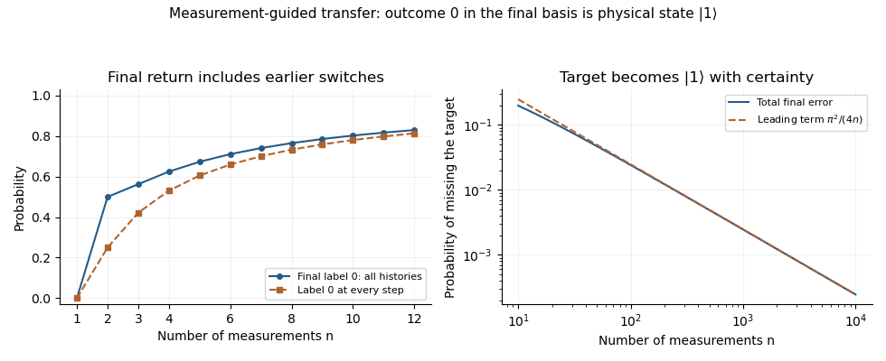

<h1 id="1/e/ii/solution">Solution</h1>

↑ **Parent:** [Ii](../ii.md)

At the last step, $|\psi_{0,n}\rangle=|1\rangle$ and $|\psi_{1,n}\rangle=|0\rangle$. Ignoring the recorded outcome, the final [density matrix](../../../../../../density-matrix-split.md) is

$$
\rho_n=q_n|1\rangle\langle1|+(1-q_n)|0\rangle\langle0|.
$$

For large $n$, the [Taylor expansion](../../../../../../taylor-expansion.md) $\log\cos x=-x^2/2+O(x^4)$ gives

$$
n\log\cos(\pi/n)=-\frac{\pi^2}{2n}+O(n^{-3})\longrightarrow0.
$$

Thus $q_n\to1$, and **the final state tends to $|1\rangle\langle1|$**, or $|1\rangle$ as a pure-state representative. In fact $1-q_n\sim\pi^2/(4n)$, and its [trace distance](../../../../../../trace-distance.md) from $|1\rangle\langle1|$ is exactly $1-q_n$. With records retained, the final conditional state is $|1\rangle$ with [probability](../../../../../../probability.md) tending to one. These are compatible descriptions, not a coherent sum of the two outcome branches. This [quantum Zeno effect](../../../../../../quantum-zeno-effect.md) guides a known preparation through slowly rotating measurement bases; it is not a unitary [Pauli X gate](../../../../../../pauli-x-gate.md) acting coherently on an arbitrary unknown input.

**[Figure 1](#1/e/ii/image-total-probability-of-the-final-target-outcome-versus-the-uninterrupted-measurement-record-and-the-asymptotic-target-error-probability-in-measurement-guided-zeno-transfer). Total probability of the final target outcome versus the uninterrupted measurement record, and the asymptotic target-error probability in measurement-guided Zeno transfer**.

## ↑ Ancestors (12)

1. [Ii](../ii.md)
2. [E](../../e.md)
3. [1](../../../1.md)
4. [Quantum information](../../../../quantum-information-split.md)
5. [2019](../../../../split.md)
6. [Past exam of the computer science course of the University of Oxford](../../../../../split.md)
7. [Computer science course of the University of Oxford](../../../../../../computer-science-course-of-the-university-of-oxford.md)
8. [Undergraduate course of the University of Oxford](../../../../../../undergraduate-course-of-the-university-of-oxford.md)
9. [Course of the University of Oxford](../../../../../../course-of-the-university-of-oxford.md)
10. [University of Oxford](../../../../../../university-of-oxford-split.md)
11. [List of universities](../../../../../../list-of-universities.md)
12. [Codex Wiki](../../../../../../split.md)
