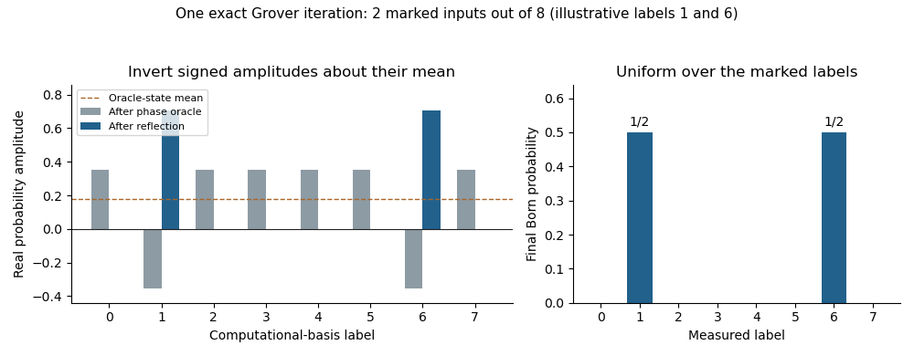

# Quantum information

↑ **Parent:** [2020](../2020.md)

Solutions to all three questions of the 11 June 2020 paper. [Released Oxford examination archive](https://www.whatdotheyknow.com/request/ba_computer_science_past_papers/response/2577745/attach/2/202402%20183%20CS%20Papers.zip?cookie_passthrough=1), member `2019/T/a16608w1.pdf`. The dated cover establishes 2020 despite the archive directory. All displayed state [vectors](../../vector-space.md#vector) are normalized unless described as unnormalized conditional [vectors](../../vector-space.md#vector). We use column [vectors](../../vector-space.md#vector), $|ij\rangle=|i\rangle\otimes|j\rangle$, and the left tensor factor as the first wire. In a product of gates, the rightmost gate acts first. A [global phase](../../quantum-system.md#global-phase) is physically irrelevant, but all relative signs and phases below are retained.

**Table of contents**

- [1](#1)
  - [a](#1/a)
    - [Solution](#1/a/solution)
  - [b](#1/b)
    - [i](#1/b/i)
      - [Solution](#1/b/i/solution)
    - [ii](#1/b/ii)
      - [Solution](#1/b/ii/solution)
    - [iii](#1/b/iii)
      - [Solution](#1/b/iii/solution)
  - [c](#1/c)
    - [Solution](#1/c/solution)
  - [d](#1/d)
    - [Solution](#1/d/solution)
  - [e](#1/e)
    - [i](#1/e/i)
      - [Solution](#1/e/i/solution)
    - [ii](#1/e/ii)
      - [Solution](#1/e/ii/solution)
    - [iii](#1/e/iii)
      - [Solution](#1/e/iii/solution)
  - [f](#1/f)
    - [i](#1/f/i)
      - [Solution](#1/f/i/solution)
    - [ii](#1/f/ii)
      - [Solution](#1/f/ii/solution)
    - [iii](#1/f/iii)
      - [Solution](#1/f/iii/solution)
- [2](#2)
  - [a](#2/a)
    - [Solution](#2/a/solution)
  - [b](#2/b)
    - [i](#2/b/i)
      - [Solution](#2/b/i/solution)
    - [ii](#2/b/ii)
      - [Solution](#2/b/ii/solution)
    - [iii](#2/b/iii)
      - [Solution](#2/b/iii/solution)
  - [c](#2/c)
    - [Solution](#2/c/solution)
  - [d](#2/d)
    - [i](#2/d/i)
      - [Solution](#2/d/i/solution)
    - [ii](#2/d/ii)
      - [Solution](#2/d/ii/solution)
    - [iii](#2/d/iii)
      - [Solution](#2/d/iii/solution)
    - [iv](#2/d/iv)
      - [Solution](#2/d/iv/solution)
- [3](#3)
  - [a](#3/a)
    - [Solution](#3/a/solution)
  - [b](#3/b)
    - [i](#3/b/i)
      - [Solution](#3/b/i/solution)
    - [ii](#3/b/ii)
      - [Solution](#3/b/ii/solution)
    - [iii](#3/b/iii)
      - [Solution](#3/b/iii/solution)
  - [c](#3/c)
    - [Solution](#3/c/solution)
  - [d](#3/d)
    - [Solution](#3/d/solution)
  - [e](#3/e)
    - [Solution](#3/e/solution)

## 1

↑ **Parent:** [Quantum information](quantum-information.md)

<h3 id="1/a">a</h3>

↑ **Parent:** [1](#1)

<h4 id="1/a/solution">Solution</h4>

↑ **Parent:** [A](#1/a)

For the three given [qutrit](../../quantum-system.md#qutrit) [vectors](../../vector-space.md#vector), $\langle\phi_0|=(\langle0|-i\langle2|)/\sqrt2$ and $\langle\phi_2|=(\langle0|+i\langle2|)/\sqrt2$. Taking the [complex conjugate](../../complex-analysis.md#complex-conjugate) in the bra is essential. Their squared [norms](../../normed-vector-space.md#norm) are $1,1,1$, and

$$
\langle\phi_0|\phi_2\rangle=\tfrac12\{1+(-i)(-i)\}=0,\qquad \langle\phi_0|\phi_1\rangle=\langle\phi_2|\phi_1\rangle=0.
$$

Thus they are an [orthonormal set](../../inner-product.md#orthonormal-set) of three [vectors](../../vector-space.md#vector) in the three-dimensional [inner product space](../../inner-product.md#inner-product-space) $\mathbb C^3$. Such a set is [linearly independent](../../vector-space.md#linear-independence) and spans the space, so **it is an [orthonormal basis](../../inner-product.md#orthonormal-basis)**.

<h3 id="1/b">b</h3>

↑ **Parent:** [1](#1)

For an [orthonormal basis](../../inner-product.md#orthonormal-basis), choosing coefficients with magnitudes $\sqrt{p_j}$ gives the required [Born rule](../../wave-function.md#born-rule) [probabilities](../../probability-theory.md#probability). More generally, $\sum_j\sqrt{p_j}e^{i\theta_j}|\phi_j\rangle$ realizes the same distribution for arbitrary phases. The following are convenient examples of [pure-state realization of a basis measurement distribution](../../wave-function.md#pure-state-realization-of-a-basis-measurement-distribution).

<h4 id="1/b/i">i</h4>

↑ **Parent:** [B](#1/b)

<h5 id="1/b/i/solution">Solution</h5>

↑ **Parent:** [I](#1/b/i)

Choose **$|\psi\rangle=|0\rangle$**. Since $|0\rangle=(|\phi_0\rangle+|\phi_2\rangle)/\sqrt2$, the [probability amplitudes](../../wave-function.md#probability-amplitude) in the measurement [basis](../../vector-space.md#basis) are $(1/\sqrt2,0,1/\sqrt2)$. Their squared moduli give $(1/2,0,1/2)$ by the [Born rule](../../wave-function.md#born-rule).

<h4 id="1/b/ii">ii</h4>

↑ **Parent:** [B](#1/b)

<h5 id="1/b/ii/solution">Solution</h5>

↑ **Parent:** [Ii](#1/b/ii)

Choose **$|\psi\rangle=|\phi_2\rangle$**. Its [inner products](../../inner-product.md) with the three measurement [vectors](../../vector-space.md#vector) are $(0,0,1)$, so the [Born rule](../../wave-function.md#born-rule) gives certainty for the outcome labelled 2 and zero [probability](../../probability-theory.md#probability) for the other two outcomes. This uses the measurement [basis](../../vector-space.md#basis), rather than assuming that its label 2 means the initial state must be the computational [vector](../../vector-space.md#vector) $|2\rangle$.

<h4 id="1/b/iii">iii</h4>

↑ **Parent:** [B](#1/b)

<h5 id="1/b/iii/solution">Solution</h5>

↑ **Parent:** [Iii](#1/b/iii)

Choose

$$
\boxed{|\psi\rangle=\frac{|\phi_0\rangle+|\phi_1\rangle}{\sqrt2}=\frac12|0\rangle+\frac1{\sqrt2}|1\rangle+\frac i2|2\rangle.}
$$

[Orthonormality](../../inner-product.md#orthonormal-set) makes this a [unit vector](../../vector-space.md#unit-vector). Its [probability amplitudes](../../wave-function.md#probability-amplitude) in the given measurement [basis](../../vector-space.md#basis) are $(1/\sqrt2,1/\sqrt2,0)$, so the required [probabilities](../../probability-theory.md#probability) are $(1/2,1/2,0)$.

<h3 id="1/c">c</h3>

↑ **Parent:** [1](#1)

<h4 id="1/c/solution">Solution</h4>

↑ **Parent:** [C](#1/c)

Swap the first two computational [vectors](../../vector-space.md#vector) and fix the third:

$$
\boxed{U=|1\rangle\langle0|+|0\rangle\langle1|+|2\rangle\langle2|=\begin{pmatrix}0&1&0\\1&0&0\\0&0&1\end{pmatrix}.}
$$

This [permutation matrix](../../vector-space.md#permutation-matrix) has [orthonormal](../../inner-product.md#orthonormal-set) columns; equivalently, $U^\dagger=U$ and $U^2=I$, proving [unitarity](../../vector-space.md#unitary-operator). Its first column gives $U|0\rangle=|1\rangle=|\phi_1\rangle$, as required. A unitary must also specify what happens to the rest of the [basis](../../vector-space.md#basis), which is why a single outer product alone would not suffice.

<h3 id="1/d">d</h3>

↑ **Parent:** [1](#1)

<h4 id="1/d/solution">Solution</h4>

↑ **Parent:** [D](#1/d)

The map sends $|0\rangle$ to $|0\rangle$, $|1\rangle$ to $|2\rangle$, and $|2\rangle$ to $\lambda|1\rangle$. These output columns are mutually [orthogonal](../../inner-product.md#orthogonal-vectors), with squared [norms](../../normed-vector-space.md#norm) $1,1,|\lambda|^2$. Consequently

$$
M_\lambda^\dagger M_\lambda=\operatorname{diag}(1,1,|\lambda|^2),
$$

and

$$
\boxed{M_\lambda\text{ is unitary if and only if }|\lambda|=1,\text{ equivalently }\lambda=e^{i\theta}\text{ for real }\theta.}
$$

Necessity follows from preserving the [norm](../../normed-vector-space.md#norm) of $|2\rangle$; sufficiency follows because the three columns are then an [orthonormal basis](../../inner-product.md#orthonormal-basis). Merely requiring $\lambda\ne0$ would establish invertibility but not [unitarity](../../vector-space.md#unitary-operator). This is the [weighted permutation unitarity criterion](../../vector-space.md#weighted-permutation-unitarity-criterion).

<h3 id="1/e">e</h3>

↑ **Parent:** [1](#1)

<h4 id="1/e/i">i</h4>

↑ **Parent:** [E](#1/e)

<h5 id="1/e/i/solution">Solution</h5>

↑ **Parent:** [I](#1/e/i)

Directly applying the [Hadamard gate](../../quantum-theory.md#hadamard-gate) gives

$$
H|+i\rangle=\frac12\{(1+i)|0\rangle+(1-i)|1\rangle\}=e^{i\pi/4}|-i\rangle,
$$

while

$$
H|-i\rangle=\frac12\{(1-i)|0\rangle+(1+i)|1\rangle\}=e^{-i\pi/4}|+i\rangle.
$$

Hence **the two states are interchanged up to the displayed [global phases](../../quantum-system.md#global-phase)**. Their relative factors $-i$ and $+i$ are retained. They are the two [Pauli eigenstates](../../quantum-circuit.md#pauli-eigenstate) of the [Pauli Y gate](../../quantum-theory.md#pauli-y-gate), and the [Hadamard interchange of Y eigenstates](../../quantum-theory.md#hadamard-interchange-of-y-eigenstates) is consistent with $HYH=-Y$.

<h4 id="1/e/ii">ii</h4>

↑ **Parent:** [E](#1/e)

<h5 id="1/e/ii/solution">Solution</h5>

↑ **Parent:** [Ii](#1/e/ii)

Compute the parity into the second wire, phase that wire with the [T gate](../../quantum-theory.md#t-gate), then uncompute with the same [controlled-NOT gate](../../quantum-theory.md#controlled-not-gate). The answer is

$$
\boxed{G=\mathrm{CNOT}\,(I\otimes T)\,\mathrm{CNOT}.}
$$

For computational bits $x,y$, the successive states are $|x,y\rangle\mapsto|x,x\oplus y\rangle\mapsto e^{i\pi(x\oplus y)/4}|x,x\oplus y\rangle\mapsto e^{i\pi(x\oplus y)/4}|x,y\rangle$. The parity $x\oplus y$ is one precisely on the two odd-parity inputs. Thus, in the ordered [computational basis](../../quantum-theory.md#computational-basis) $00,01,10,11$, the [matrix](../../vector-space.md#matrix) is exactly $\operatorname{diag}(1,e^{i\pi/4},e^{i\pi/4},1)$, with no omitted overall phase. This is a [two-qubit parity phase gate](../../quantum-theory.md#two-qubit-parity-phase-gate).

<h4 id="1/e/iii">iii</h4>

↑ **Parent:** [E](#1/e)

<h5 id="1/e/iii/solution">Solution</h5>

↑ **Parent:** [Iii](#1/e/iii)

Let $R=\operatorname{diag}(1,e^{i\pi/12})$. Since the [Hadamard gate](../../quantum-theory.md#hadamard-gate) maps the standard [basis](../../vector-space.md#basis) to $|+\rangle,|-\rangle$, the given gate is $Q=HRH$. Because $H^2=I$,

$$
Q^3=HR^3H=HTH,\qquad\boxed{T=HQ^3H.}
$$

Next, use $HZH=X$ on the target wire of the [Controlled-Z gate](../../quantum-theory.md#controlled-z-gate):

$$
\boxed{\mathrm{CNOT}=(I\otimes H)\,CZ\,(I\otimes H).}
$$

The control-zero block remains the identity, and the control-one block becomes $HZH=X$, proving the identity with the stated control convention. We have therefore constructed each gate in the assumed [universal quantum gate set](../../quantum-circuit.md#universal-quantum-gate-set) $\{\mathrm{CNOT},H,T\}$ using only $CZ,Q,H$.

Replacing every gate of a circuit by its displayed finite construction reproduces that circuit exactly. Thus **$\{CZ,Q,H\}$ is universal** under the usual arbitrary-accuracy convention: it can perform every approximation obtainable from the given universal set. The claim concerns approximation of arbitrary [unitary operators](../../vector-space.md#unitary-operator); it does not assert that finitely many circuits exactly represent an uncountable continuum of gates. This is [universality transfer by exact gate synthesis](../../quantum-circuit.md#universality-transfer-by-exact-gate-synthesis).

<h3 id="1/f">f</h3>

↑ **Parent:** [1](#1)

<h4 id="1/f/i">i</h4>

↑ **Parent:** [F](#1/f)

<h5 id="1/f/i/solution">Solution</h5>

↑ **Parent:** [I](#1/f/i)

The [controlled-NOT gate](../../quantum-theory.md#controlled-not-gate) is its own inverse, so $\mathrm{CNOT}^2=I$. Every remaining nontrivial gate acts on one wire. By the [tensor product](../../multilinear-algebra.md#tensor-product) rule, any circuit on a product input stays a [product state](../../bell-state.md#product-state); in particular, starting at $|00\rangle$ it cannot produce a [Bell state](../../bell-state.md).

This also prevents arbitrary approximation, not merely exact preparation. For normalized single-qubit [vectors](../../vector-space.md#vector) $|u\rangle,|v\rangle$,

$$
|\langle\Phi^+|u\otimes v\rangle|^2=\tfrac12|u_0v_0+u_1v_1|^2\leq\tfrac12
$$

by the [Cauchy-Schwarz inequality](../../probability-and-statistics.md#cauchy-schwarz-inequality). Hence the [quantum fidelity](../../quantum-information-theory.md#fidelity-of-quantum-states) with $|\Phi^+\rangle$ is bounded away from one for every reachable state. **This gate set is not universal.** The obstruction is preservation of [product states](../../bell-state.md#product-state), a special case of the existing [product-state obstruction to SWAP universality](../../quantum-theory.md#product-state-obstruction-to-swap-universality).

<h4 id="1/f/ii">ii</h4>

↑ **Parent:** [F](#1/f)

<h5 id="1/f/ii/solution">Solution</h5>

↑ **Parent:** [Ii](#1/f/ii)

Here $H^2=I$. Both remaining gates fix the all-zero computational [vector](../../vector-space.md#vector): the [T gate](../../quantum-theory.md#t-gate) fixes $|0\rangle$, and the [controlled-NOT gate](../../quantum-theory.md#controlled-not-gate) fixes $|00\rangle$. Therefore every finite circuit, on any number of initially zero wires, leaves $|0\cdots0\rangle$ unchanged.

It cannot even approximate $|+\rangle\otimes|0\cdots0\rangle$, whose squared overlap with that unchanged [vector](../../vector-space.md#vector) is $1/2$. Thus **the gate set is not universal**. The needed [quantum superposition](../../quantum-system.md#quantum-superposition) cannot be created from this input by [basis](../../vector-space.md#basis) permutations and diagonal phases alone.

<h4 id="1/f/iii">iii</h4>

↑ **Parent:** [F](#1/f)

<h5 id="1/f/iii/solution">Solution</h5>

↑ **Parent:** [Iii](#1/f/iii)

Now $T^2=S=\operatorname{diag}(1,i)$. The gates $H,S$ and CNOT are [Clifford gates](../../quantum-circuit.md#clifford-gate): conjugating a [Pauli matrix](../../algebra.md#pauli-matrices) or a [tensor product](../../multilinear-algebra.md#tensor-product) of them gives another signed Pauli tensor. On one wire,

$$
HXH=Z,\quad HZH=X,\quad SXS^\dagger=Y,\quad SZS^\dagger=Z.
$$

For CNOT the generator images are $X\otimes I\mapsto X\otimes X$, $I\otimes X\mapsto I\otimes X$, $Z\otimes I\mapsto Z\otimes I$, and $I\otimes Z\mapsto Z\otimes Z$. These identities can be checked on the four computational [vectors](../../vector-space.md#vector) and generate the preservation property for all Pauli tensors.[Section 3 and Table 1, Clifford generators and their Pauli conjugation rules](../../physics-bibliography.md#the-heisenberg-representation-of-quantum-computers-by-daniel-gottesman)

For a fixed number $n$ of wires there are only finitely many possible images of the $2n$ generators $X_j,Z_j$ in the [Pauli group](../../quantum-circuit.md#pauli-group). Their images determine a unitary up to [global phase](../../quantum-system.md#global-phase). To see this, if two [unitary operators](../../vector-space.md#unitary-operator) induce identical images, their quotient commutes with every $Z_j$, so is diagonal in the [computational basis](../../quantum-theory.md#computational-basis); commuting with every $X_j$ then forces all diagonal entries to be equal. The quotient is a scalar phase. Thus the generated gates form a finite set modulo [global phase](../../quantum-system.md#global-phase), which cannot be dense in the continuous space of all [unitary operators](../../vector-space.md#unitary-operator). This is [finiteness of the projective Clifford group](../../quantum-circuit.md#finiteness-of-the-projective-clifford-group).

A small visible consequence is that from $|0\rangle$, one-qubit [Clifford circuits](../../quantum-circuit.md#clifford-circuit) reach only the six states $|0\rangle,|1\rangle,|+\rangle,|-\rangle,|+i\rangle,|-i\rangle$ up to [global phase](../../quantum-system.md#global-phase). For instance, $T|+\rangle$ is outside this finite set. The fixed-$n$ Pauli argument also covers circuits using CNOT on several wires. Therefore **$\{\mathrm{CNOT},H,T^2\}$ is not universal**.

## 2

↑ **Parent:** [Quantum information](quantum-information.md)

<h3 id="2/a">a</h3>

↑ **Parent:** [2](#2)

<h4 id="2/a/solution">Solution</h4>

↑ **Parent:** [A](#2/a)

Write the [product state](../../bell-state.md#product-state) as $|\Psi\rangle=|a\rangle\otimes|b\rangle$. The two [partial inner products](../../multilinear-algebra.md#partial-inner-product) are

$$
|\psi'_j\rangle=(\langle\psi_j|a\rangle)|b\rangle=c_j|b\rangle,\qquad j=1,2.
$$

Both [vectors](../../vector-space.md#vector) therefore lie in the same one-dimensional [vector subspace](../../vector-space.md#vector-subspace), possibly with one or both equal to zero. If $(c_1,c_2)\ne(0,0)$, choose $\lambda_1=c_2$ and $\lambda_2=c_1$; then $\lambda_1|\psi'_1\rangle=\lambda_2|\psi'_2\rangle$, and the multipliers are not both zero. If both $c_j$ vanish, choose $(\lambda_1,\lambda_2)=(1,0)$.

Thus **the conditional [vectors](../../vector-space.md#vector) are [linearly dependent](../../vector-space.md#linear-dependence)**, with a nontrivial pair of multipliers in every case. The printed existential condition does not explicitly exclude $(0,0)$, which would make it vacuous for arbitrary [vectors](../../vector-space.md#vector); the argument establishes the stronger intended statement. These unnormalized [vectors](../../vector-space.md#vector) need not themselves be valid unit state [vectors](../../vector-space.md#vector), and a zero [vector](../../vector-space.md#vector) corresponds to a measurement outcome of [probability](../../probability-theory.md#probability) zero. This is the forward direction of the [conditional-vector product-state criterion](../../bell-state.md#conditional-vector-product-state-criterion).

<h3 id="2/b">b</h3>

↑ **Parent:** [2](#2)

<h4 id="2/b/i">i</h4>

↑ **Parent:** [B](#2/b)

<h5 id="2/b/i/solution">Solution</h5>

↑ **Parent:** [I](#2/b/i)

Factor the coefficients:

$$
|\Psi_1\rangle=\left(\frac{|0\rangle-|1\rangle}{\sqrt2}\right)\otimes\left(\frac{|0\rangle-|1\rangle}{\sqrt2}\right)=|-\rangle\otimes|-\rangle.
$$

Therefore **the first state is a [product state](../../bell-state.md#product-state), not [entangled](../../bell-state.md#entangled-state)**. Both factors have unit [norm](../../normed-vector-space.md#norm), so this factorization also checks [normalization](../../mathematics.md#normalization).

<h4 id="2/b/ii">ii</h4>

↑ **Parent:** [B](#2/b)

<h5 id="2/b/ii/solution">Solution</h5>

↑ **Parent:** [Ii](#2/b/ii)

Taking [partial inner products](../../multilinear-algebra.md#partial-inner-product) with $\langle0|$ and $\langle1|$ on the first wire gives $(|0\rangle+|1\rangle)/2$ and $(-|0\rangle+|1\rangle)/2$. They are nonzero and [orthogonal](../../inner-product.md#orthogonal-vectors), hence [linearly independent](../../vector-space.md#linear-independence). This contradicts the necessary product-state property proved in part (a), so **the second state is [entangled](../../bell-state.md#entangled-state)**.

Equivalently, its [tensor-product coefficient matrix](../../multilinear-algebra.md#tensor-product-coefficient-matrix) is $C=\tfrac12\bigl(\begin{smallmatrix}1&1\\-1&1\end{smallmatrix}\bigr)$, with $\det C=1/2\ne0$. The [two-qubit product-state determinant criterion](../../bell-state.md#two-qubit-product-state-determinant-criterion) gives the same conclusion. In fact $CC^\dagger=I/2$, so its [Schmidt coefficients](../../von-neumann-entropy.md#schmidt-coefficient) are both $1/\sqrt2$: it is maximally [entangled](../../bell-state.md#entangled-state).

<h4 id="2/b/iii">iii</h4>

↑ **Parent:** [B](#2/b)

<h5 id="2/b/iii/solution">Solution</h5>

↑ **Parent:** [Iii](#2/b/iii)

The corresponding conditional [vectors](../../vector-space.md#vector) are $|0\rangle/\sqrt2$ and $|+\rangle/\sqrt2$. The second has a nonzero $|1\rangle$ component while the first does not, so they are [linearly independent](../../vector-space.md#linear-independence). Therefore **the third state is also [entangled](../../bell-state.md#entangled-state)**. [Orthogonality](../../inner-product.md#orthogonal-vectors) of these two conditional [vectors](../../vector-space.md#vector) is not required for this conclusion.

For an independent [matrix](../../vector-space.md#matrix) check, expanding the second factor gives

$$
C=\begin{pmatrix}1/\sqrt2&0\\1/2&1/2\end{pmatrix},\qquad \det C=\frac1{2\sqrt2}\ne0.
$$

The original expression is normalized because its two first-wire factors are [orthogonal](../../inner-product.md#orthogonal-vectors): its squared [norm](../../normed-vector-space.md#norm) is $(1+1)/2=1$, despite the overlap between $|0\rangle$ and $|+\rangle$ on the second wire.

<h3 id="2/c">c</h3>

↑ **Parent:** [2](#2)

<h4 id="2/c/solution">Solution</h4>

↑ **Parent:** [C](#2/c)

Measure the first [qutrit](../../quantum-system.md#qutrit) in the [computational basis](../../quantum-theory.md#computational-basis) and the second in the [orthonormal basis](../../inner-product.md#orthonormal-basis) $\{|\phi_0\rangle,|\phi_1\rangle,|\phi_2\rangle\}$ from Question 1(a), with those labels as outcomes. For first-party outcome 0, the unnormalized conditional [vector](../../vector-space.md#vector) of the second party is $|0\rangle/\sqrt3$, so this outcome occurs with [probability](../../probability-theory.md#probability) $1/3$ and leaves the normalized state $|0\rangle$.

The second-party [Born rule](../../wave-function.md#born-rule) [probabilities](../../probability-theory.md#probability) are then $|\langle\phi_0|0\rangle|^2=1/2$, $|\langle\phi_1|0\rangle|^2=0$, and $|\langle\phi_2|0\rangle|^2=1/2$. Hence

$$
\boxed{\Pr(B=0\mid A=0)=\Pr(B=2\mid A=0)=\tfrac12,\qquad\Pr(B=1\mid A=0)=0.}
$$

The relevant joint [probabilities](../../probability-theory.md#probability) are $1/6,0,1/6$, each divided by $\Pr(A=0)=1/3$. This distinguishes the conditional statement from an unconditional outcome [probability](../../probability-theory.md#probability). More generally, [conjugate-state steering from a maximally entangled pair](../../quantum-theory.md#conjugate-state-steering-from-a-maximally-entangled-pair) explains how the first local measurement determines the second party's conditional [vector](../../vector-space.md#vector); the [basis](../../vector-space.md#basis) choice here makes that [vector](../../vector-space.md#vector) especially simple.

<h3 id="2/d">d</h3>

↑ **Parent:** [2](#2)

<h4 id="2/d/i">i</h4>

↑ **Parent:** [D](#2/d)

<h5 id="2/d/i/solution">Solution</h5>

↑ **Parent:** [I](#2/d/i)

Fix the two subsystem dimensions. For [reflexivity](../../set-theory.md#reflexive-relation), $|\Psi\rangle=(I_d\otimes I_{d'})|\Psi\rangle$, and both [identity operators](../../vector-space.md#identity-operator) are unitary.

For symmetry, if $|\Psi\rangle=(U\otimes V)|\Phi\rangle$, apply the inverse [local unitary transformation](../../bell-state.md#local-unitary-operation):

$$
|\Phi\rangle=(U^\dagger\otimes V^\dagger)|\Psi\rangle.
$$

The [conjugate transposes](../../linear-operator-theory.md#conjugate-transpose) of [unitary operators](../../vector-space.md#unitary-operator) are unitary, so the reverse relation holds.

For [transitivity](../../set-theory.md#transitive-relation), if additionally $|\Phi\rangle=(R\otimes S)|\Theta\rangle$, the [tensor product](../../multilinear-algebra.md#tensor-product) multiplication rule gives

$$
|\Psi\rangle=(U\otimes V)(R\otimes S)|\Theta\rangle=(UR\otimes VS)|\Theta\rangle.
$$

Both products are unitary, for example $(UR)^\dagger(UR)=R^\dagger U^\dagger UR=I$. Thus **[local-unitary equivalence](../../bell-state.md#local-unitary-equivalence) is reflexive, symmetric and transitive**, and hence is an [equivalence relation](../../set-theory.md#equivalence-relation).

<h4 id="2/d/ii">ii</h4>

↑ **Parent:** [D](#2/d)

<h5 id="2/d/ii/solution">Solution</h5>

↑ **Parent:** [Ii](#2/d/ii)

Use $S=\operatorname{diag}(1,i)=T^2$ and the [Pauli X gate](../../quantum-theory.md#pauli-x-gate). Starting with the [Bell state](../../bell-state.md) $|\Phi^+\rangle$, the exact constructions are

$$
\boxed{|\Psi_1\rangle=(S\otimes X)|\Phi^+\rangle,\qquad |\Psi_2\rangle=(I\otimes H)|\Phi^+\rangle.}
$$

For the first, $I\otimes X$ changes the two terms to $|01\rangle$ and $|10\rangle$, and $S\otimes I$ multiplies just the second term by $i$. For the second,

$$
(I\otimes H)|\Phi^+\rangle=\frac{|0\rangle|+\rangle+|1\rangle|-\rangle}{\sqrt2}=\frac{|00\rangle+|01\rangle+|10\rangle-|11\rangle}{2}.
$$

All factors are single-party [unitary operators](../../vector-space.md#unitary-operator), proving both claimed [local-unitary equivalences](../../bell-state.md#local-unitary-equivalence). The equations hold as [vectors](../../vector-space.md#vector), without even an additional [global phase](../../quantum-system.md#global-phase).

<h4 id="2/d/iii">iii</h4>

↑ **Parent:** [D](#2/d)

<h5 id="2/d/iii/solution">Solution</h5>

↑ **Parent:** [Iii](#2/d/iii)

Extend the normalized [vector](../../vector-space.md#vector) $|\phi\rangle$ to an [orthonormal basis](../../inner-product.md#orthonormal-basis) $\{|f_j\rangle\}_{j=1}^d$ with $|f_1\rangle=|\phi\rangle$, and extend $|\psi\rangle$ to an [orthonormal basis](../../inner-product.md#orthonormal-basis) $\{|e_j\rangle\}_{j=1}^d$ with $|e_1\rangle=|\psi\rangle$. The [Gram-Schmidt process](../../inner-product.md#gram-schmidt-process) provides such extensions. Define

$$
U=\sum_{j=1}^d|e_j\rangle\langle f_j|.
$$

Then $U^\dagger U=\sum_j|f_j\rangle\langle f_j|=I$ and $UU^\dagger=I$, so $U$ is unitary and $U|\phi\rangle=|\psi\rangle$. Construct $V$ on the second subsystem in the same way, sending $|\phi'\rangle$ to $|\psi'\rangle$. Consequently

$$
(U\otimes V)(|\phi\rangle\otimes|\phi'\rangle)=|\psi\rangle\otimes|\psi'\rangle.
$$

Thus **any two normalized [product states](../../bell-state.md#product-state) on the same pair of subsystem spaces are [local-unitary equivalent](../../bell-state.md#local-unitary-equivalence)**. The dimension and [normalization](../../mathematics.md#normalization) requirements matter because a unitary preserves both its domain and [vector](../../vector-space.md#vector) [norms](../../normed-vector-space.md#norm).

<h4 id="2/d/iv">iv</h4>

↑ **Parent:** [D](#2/d)

<h5 id="2/d/iv/solution">Solution</h5>

↑ **Parent:** [Iv](#2/d/iv)

A [local unitary transformation](../../bell-state.md#local-unitary-operation) preserves a product factorization:

$$
(U\otimes V)(|a\rangle\otimes|b\rangle)=(U|a\rangle)\otimes(V|b\rangle).
$$

The output is therefore another [product state](../../bell-state.md#product-state). If an [entangled state](../../bell-state.md#entangled-state) could be locally mapped to a [product state](../../bell-state.md#product-state), applying the inverse $U^\dagger\otimes V^\dagger$ would make the original [entangled state](../../bell-state.md#entangled-state) a product as well, a contradiction. Hence **a [product state](../../bell-state.md#product-state) and an [entangled state](../../bell-state.md#entangled-state) are never [local-unitary equivalent](../../bell-state.md#local-unitary-equivalence)**.

In terms of a [tensor-product coefficient matrix](../../multilinear-algebra.md#tensor-product-coefficient-matrix), $C$ changes to $UCV^T$, with an ordinary [transpose](../../vector-space.md#transpose) on the second factor. Both multiplying [matrices](../../vector-space.md#matrix) are invertible, so the [matrix rank](../../vector-space.md#matrix-rank), equivalently the [Schmidt rank](../../von-neumann-entropy.md#schmidt-rank), is unchanged. This supplies an algebraic form of the same argument: a nonzero [pure state](../../quantum-theory.md#pure-state) is a [product state](../../bell-state.md#product-state) exactly when that rank is one.

## 3

↑ **Parent:** [Quantum information](quantum-information.md)

Throughout this question let $|A_0\rangle=\sum_{f(x)=0}|x\rangle$, $|A_1\rangle=\sum_{f(x)=1}|x\rangle$, and $|J\rangle=\sum_{x=0}^{N-1}|x\rangle=\sqrt N\,|e_0\rangle$. These subset sums are unnormalized: $\langle A_j|A_j\rangle=S_j$ and $\langle A_0|A_1\rangle=0$. The promise implies that $N>0$ is divisible by four. No power-of-two assumption is needed for the abstract $N$-dimensional calculation.

<h3 id="3/a">a</h3>

↑ **Parent:** [3](#3)

<h4 id="3/a/solution">Solution</h4>

↑ **Parent:** [A](#3/a)

Substitute the promised cardinalities:

$$
\frac{2(S_0-S_1)}N=\frac2N\left(\frac{3N}4-\frac N4\right)=\frac2N\frac N2=\boxed{1}.
$$

The marked and unmarked subsets also exhaust the [computational basis](../../quantum-theory.md#computational-basis), so $S_0+S_1=N$; this will ensure that the uniform initial state has unit [norm](../../normed-vector-space.md#norm).

<h3 id="3/b">b</h3>

↑ **Parent:** [3](#3)

<h4 id="3/b/i">i</h4>

↑ **Parent:** [B](#3/b)

<h5 id="3/b/i/solution">Solution</h5>

↑ **Parent:** [I](#3/b/i)

By orthonormality of the [computational basis](../../quantum-theory.md#computational-basis),

$$
\langle e_0|x\rangle=\frac1{\sqrt N}\sum_{y=0}^{N-1}\langle y|x\rangle=\frac1{\sqrt N}\sum_{y=0}^{N-1}\delta_{yx}=\boxed{\frac1{\sqrt N}}.
$$

There is one nonzero term, the term with $y=x$. In particular, the uniform coefficient is unchanged when passing from the ket to its bra because it is real.

<h4 id="3/b/ii">ii</h4>

↑ **Parent:** [B](#3/b)

<h5 id="3/b/ii/solution">Solution</h5>

↑ **Parent:** [Ii](#3/b/ii)

Summing part (i) over the $S_0$ unmarked indices gives $\langle e_0|A_0\rangle=S_0/\sqrt N$. The [Grover diffusion operator](../../quantum-theory.md#grover-diffusion-operator) therefore acts as

$$
W|A_0\rangle=2|e_0\rangle\langle e_0|A_0\rangle-|A_0\rangle=\frac{2S_0}{\sqrt N}|e_0\rangle-|A_0\rangle=\boxed{\frac{2S_0}N|J\rangle-|A_0\rangle.}
$$

This is an identity for an unnormalized subset sum; it does not require replacing its [norm](../../normed-vector-space.md#norm) by one.

<h4 id="3/b/iii">iii</h4>

↑ **Parent:** [B](#3/b)

<h5 id="3/b/iii/solution">Solution</h5>

↑ **Parent:** [Iii](#3/b/iii)

For the marked subset, $\langle e_0|A_1\rangle=S_1/\sqrt N$ by the same summation of the individual [inner products](../../inner-product.md). Consequently

$$
W|A_1\rangle=2|e_0\rangle\frac{S_1}{\sqrt N}-|A_1\rangle=\boxed{\frac{2S_1}N|J\rangle-|A_1\rangle.}
$$

The cardinality is $S_1$ here. Its sign will reverse when this expression is used for the oracle's negative marked component.

<h3 id="3/c">c</h3>

↑ **Parent:** [3](#3)

<h4 id="3/c/solution">Solution</h4>

↑ **Parent:** [C](#3/c)

The [phase oracle](../../theoretical-computer-science.md#phase-oracle) multiplies an unmarked [basis](../../vector-space.md#basis) [vector](../../vector-space.md#vector) by $+1$ and a marked one by $-1$. Thus the state after the oracle is

$$
\boxed{V_f|e_0\rangle=\frac1{\sqrt N}\bigl(|A_0\rangle-|A_1\rangle\bigr).}
$$

Its squared [norm](../../normed-vector-space.md#norm) is $(S_0+S_1)/N=1$. All computational outcomes would still have [probability](../../probability-theory.md#probability) $1/N$ if measured at this point: the oracle has changed the [relative phase](../../quantum-system.md#relative-quantum-phase), not the magnitudes of the amplitudes. The following reflection converts that phase information into a changed [probability distribution](../../probability-distribution.md) through [quantum interference](../../quantum-system.md#quantum-interference).

<h3 id="3/d">d</h3>

↑ **Parent:** [3](#3)

<h4 id="3/d/solution">Solution</h4>

↑ **Parent:** [D](#3/d)

Apply parts (b)(ii) and (b)(iii), keeping the oracle's minus sign:

$$
\begin{aligned}
WV_f|e_0\rangle
&=\frac1{\sqrt N}\left[\frac{2(S_0-S_1)}N|J\rangle-|A_0\rangle+|A_1\rangle\right]\\
&=\frac1{\sqrt N}\bigl[|J\rangle-|A_0\rangle+|A_1\rangle\bigr]\\
&=\boxed{\frac2{\sqrt N}|A_1\rangle=\frac2{\sqrt N}\sum_{f(x)=1}|x\rangle.}
\end{aligned}
$$

The middle equality uses part (a), and the last uses $|J\rangle=|A_0\rangle+|A_1\rangle$. The final squared [norm](../../normed-vector-space.md#norm) is $4S_1/N=1$, providing a [normalization](../../mathematics.md#normalization) check.

The sign convention matters: here $W=2|e_0\rangle\langle e_0|-I$ fixes $|e_0\rangle$ and negates its [orthogonal](../../inner-product.md#orthogonal-vectors) complement. Its action on amplitudes is [inversion about the mean](../../quantum-theory.md#inversion-about-the-mean). The negative of this reflection would change the final [vector](../../vector-space.md#vector) by an overall [global phase](../../quantum-system.md#global-phase), but mixing those conventions midway would give incorrect intermediate signs.[Section 4, diffusion transform and equation (4.0), inversion-about-average interpretation](../../physics-bibliography.md#a-fast-quantum-mechanical-algorithm-for-database-search-by-lov-grover)

<h3 id="3/e">e</h3>

↑ **Parent:** [3](#3)

<h4 id="3/e/solution">Solution</h4>

↑ **Parent:** [E](#3/e)

The algorithm **returns a uniformly random marked input with certainty**. The [Born rule](../../wave-function.md#born-rule) applied to the final state gives, for each individual [basis](../../vector-space.md#basis) label $y$,

$$
\boxed{\Pr(Y=y)=\begin{cases}4/N=1/S_1,&f(y)=1,\\0,&f(y)=0.\end{cases}}
$$

Summing over the $S_1=N/4$ marked inputs gives $\Pr(f(Y)=1)=1$. The outcome is a marked input label, not merely the bit indicating whether some marked input exists. There is one use of the supplied [phase oracle](../../theoretical-computer-science.md#phase-oracle), together with the specified preparation, reflection and measurement.

The exact success relies on the marked fraction $r=S_1/N=1/4$. More generally, the mean amplitude immediately after the oracle is $(1-2r)/\sqrt N$. [Inversion about the mean](../../quantum-theory.md#inversion-about-the-mean) sends an unmarked amplitude to $(1-4r)/\sqrt N$ and a marked amplitude to $(3-4r)/\sqrt N$. Thus a single iteration has marked success [probability](../../probability-theory.md#probability) $r(3-4r)^2$. At $r=1/4$ the unmarked amplitudes vanish and the marked amplitudes become $2/\sqrt N$, giving the [one-step exact Grover search with a quarter of the inputs marked](../../quantum-theory.md#one-step-exact-grover-search-with-a-quarter-of-the-inputs-marked). No claim of one-query certainty for an arbitrary marked fraction is needed.

**[Figure 1](#3/e/image-original-amplitude-and-born-probability-illustration-for-eight-inputs-with-two-marked-the-oracle-s-relative-minus-signs-become-exact-concentration-on-the-marked-inputs-after-one-reflection). Original amplitude and Born-probability illustration for eight inputs with two marked. The oracle's relative minus signs become exact concentration on the marked inputs after one reflection.**

## ↑ Ancestors (8)

1. [2020](../2020.md)
2. [Past exam of the computer science course of the University of Oxford](../../past-exam-of-the-computer-science-course-of-the-university-of-oxford.md)
3. [Computer science course of the University of Oxford](../../university-of-oxford.md#computer-science-course-of-the-university-of-oxford)
4. [Undergraduate course of the University of Oxford](../../university-of-oxford.md#undergraduate-course-of-the-university-of-oxford)
5. [Course of the University of Oxford](../../university-of-oxford.md#course-of-the-university-of-oxford)
6. [University of Oxford](../../university-of-oxford.md)
7. [List of universities](../../README.md#list-of-universities)
8. [Codex Wiki](../../README.md)
