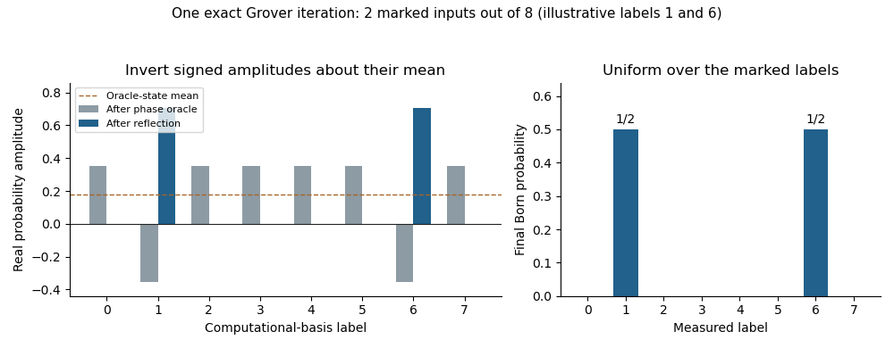

<h1 id="3/e/solution">Solution</h1>

↑ **Parent:** [E](../e.md)

The algorithm **returns a uniformly random marked input with certainty**. The [Born rule](../../../../../born-rule.md) applied to the final state gives, for each individual [basis](../../../../../basis.md) label $y$,

$$
\boxed{\Pr(Y=y)=\begin{cases}4/N=1/S_1,&f(y)=1,\\0,&f(y)=0.\end{cases}}
$$

Summing over the $S_1=N/4$ marked inputs gives $\Pr(f(Y)=1)=1$. The outcome is a marked input label, not merely the bit indicating whether some marked input exists. There is one use of the supplied [phase oracle](../../../../../phase-oracle.md), together with the specified preparation, reflection and measurement.

The exact success relies on the marked fraction $r=S_1/N=1/4$. More generally, the mean amplitude immediately after the oracle is $(1-2r)/\sqrt N$. [Inversion about the mean](../../../../../inversion-about-the-mean.md) sends an unmarked amplitude to $(1-4r)/\sqrt N$ and a marked amplitude to $(3-4r)/\sqrt N$. Thus a single iteration has marked success [probability](../../../../../probability.md) $r(3-4r)^2$. At $r=1/4$ the unmarked amplitudes vanish and the marked amplitudes become $2/\sqrt N$, giving the [one-step exact Grover search with a quarter of the inputs marked](../../../../../one-step-exact-grover-search-with-a-quarter-of-the-inputs-marked.md). No claim of one-query certainty for an arbitrary marked fraction is needed.

**[Figure 1](#3/e/image-original-amplitude-and-born-probability-illustration-for-eight-inputs-with-two-marked-the-oracle-s-relative-minus-signs-become-exact-concentration-on-the-marked-inputs-after-one-reflection). Original amplitude and Born-probability illustration for eight inputs with two marked. The oracle's relative minus signs become exact concentration on the marked inputs after one reflection.**

## ↑ Ancestors (11)

1. [E](../e.md)
2. [3](../../3.md)
3. [Quantum information](../../../quantum-information-split.md)
4. [2020](../../../split.md)
5. [Past exam of the computer science course of the University of Oxford](../../../../split.md)
6. [Computer science course of the University of Oxford](../../../../../computer-science-course-of-the-university-of-oxford.md)
7. [Undergraduate course of the University of Oxford](../../../../../undergraduate-course-of-the-university-of-oxford.md)
8. [Course of the University of Oxford](../../../../../course-of-the-university-of-oxford.md)
9. [University of Oxford](../../../../../university-of-oxford-split.md)
10. [List of universities](../../../../../list-of-universities.md)
11. [Codex Wiki](../../../../../split.md)
