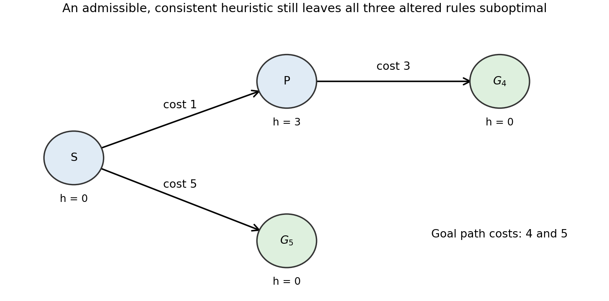
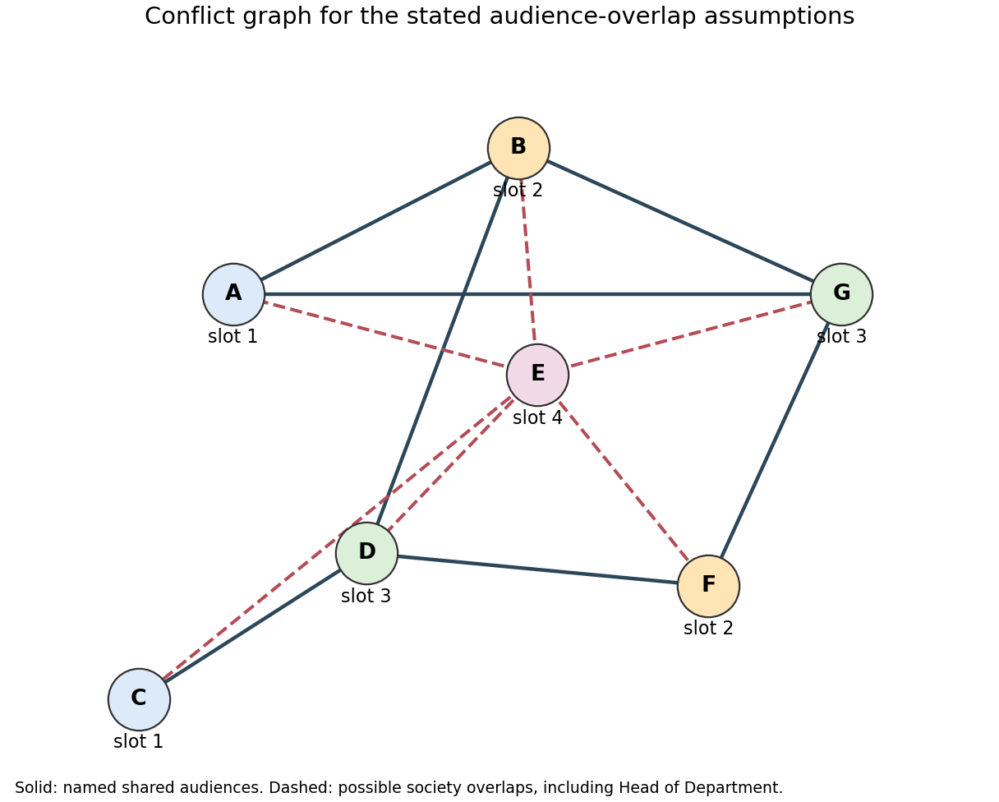
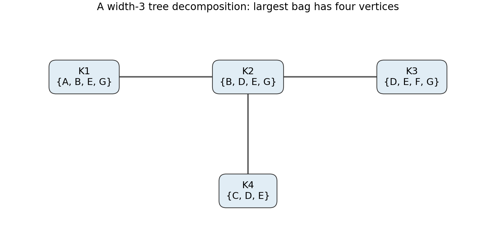

# Artificial intelligence

↑ **Parent:** [2021](../2021.md)

Source paper: [released examination archive](https://www.whatdotheyknow.com/request/ba_computer_science_past_papers/response/2577745/attach/2/202402%20183%20CS%20Papers.zip?cookie_passthrough=1).

**Table of contents**

- [1](#1)
  - [a](#1/a)
    - [Solution](#1/a/solution)
  - [b](#1/b)
    - [Solution](#1/b/solution)
  - [c](#1/c)
    - [Solution](#1/c/solution)
  - [d](#1/d)
    - [Solution](#1/d/solution)
  - [e](#1/e)
    - [Solution](#1/e/solution)
  - [f](#1/f)
    - [Solution](#1/f/solution)
  - [g](#1/g)
    - [Solution](#1/g/solution)
  - [h](#1/h)
    - [Solution](#1/h/solution)
  - [i](#1/i)
    - [Solution](#1/i/solution)
  - [j](#1/j)
    - [Solution](#1/j/solution)
- [2](#2)
  - [a](#2/a)
    - [Solution](#2/a/solution)
  - [b](#2/b)
    - [Solution](#2/b/solution)
  - [c](#2/c)
    - [Solution](#2/c/solution)
  - [d](#2/d)
    - [Solution](#2/d/solution)
  - [e](#2/e)
    - [Solution](#2/e/solution)
  - [f](#2/f)
    - [Solution](#2/f/solution)
  - [g](#2/g)
    - [Solution](#2/g/solution)
- [3](#3)
  - [a](#3/a)
    - [Solution](#3/a/solution)
  - [b](#3/b)
    - [Solution](#3/b/solution)
  - [c](#3/c)
    - [Solution](#3/c/solution)
  - [d](#3/d)
    - [Solution](#3/d/solution)
  - [e](#3/e)
    - [Solution](#3/e/solution)
  - [f](#3/f)
    - [Solution](#3/f/solution)

## 1

↑ **Parent:** [Artificial intelligence](artificial-intelligence.md)

<h3 id="1/a">a</h3>

↑ **Parent:** [1](#1)

<h4 id="1/a/solution">Solution</h4>

↑ **Parent:** [A](#1/a)

**All three variants are [complete search algorithms](../../algorithm.md#complete-search-algorithm) under the usual finite-[branching factor](../../theoretical-computer-science.md#branching-factor), nonnegative-[heuristic function](../../theoretical-computer-science.md#heuristic-function) assumptions.** Here $0\le h\le h^*$, with zero at goals; the supplied positive lower bound on step costs is also essential. The root is processed once before a parent-dependent priority is needed.[section 4.1, printed p. 100, footnote 4, finiteness and positive step costs](../../computer-science-bibliography.md#informed-search-and-exploration-by-stuart-russell-and-peter-norvig) Completeness means finding a solution if one exists, not necessarily terminating when none exists.

Fix a finite solution path. Every [search node](../../theoretical-computer-science.md#search-node) on that path has a finite priority, so let $K$ bound all of its relevant priorities. For ordinary [A-star search](../../graph.md#a-star-search) and the second variant, the priority is at least $g(n)$. Thus any [search node](../../theoretical-computer-science.md#search-node) with priority at most $K$ has depth at most $\lfloor K/\epsilon\rfloor$. In the third variant the priority is at least $g(n')$, so its depth is at most $\lfloor K/\epsilon\rfloor+1$. A finitely branching [search tree](../../theoretical-computer-science.md#search-tree) has finitely many [search nodes](../../theoretical-computer-science.md#search-node) at these depths. Therefore finitely many earlier [search nodes](../../theoretical-computer-science.md#search-node) can delay each successive [search node](../../theoretical-computer-science.md#search-node) on the chosen solution path; eventually its goal is generated or selected, as appropriate.

Moving the [goal test](../../theoretical-computer-science.md#goal-test) to generation cannot destroy that existence guarantee, although it can destroy optimality. Likewise the altered parent-dependent priorities remain bounded below by the accumulated cost to the [search node](../../theoretical-computer-science.md#search-node) or its parent, which is enough for this completeness argument. If “admissible” were interpreted to allow arbitrarily negative estimates, the lower-bound argument would need an additional hypothesis; the conventional nonnegative interpretation is being used explicitly. For the literal upper-bound-only interpretation, all three can fail completeness: attach an infinite unit-cost dead-end chain with $g(n_d)=d$ and $h(n_d)=-2d$ beside a finite goal branch beginning with a cost-$3$ edge and estimate zero. Its successive low priorities can starve the finite branch. Every negative chain estimate is still at most its infinite true remaining cost.

<h3 id="1/b">b</h3>

↑ **Parent:** [1](#1)

<h4 id="1/b/solution">Solution</h4>

↑ **Parent:** [B](#1/b)

**None of the three variants is an [optimal search algorithm](../../algorithm.md#optimal-search-algorithm) in general.** The following single [search tree](../../theoretical-computer-science.md#search-tree) supplies counterexamples for all three. Its [heuristic function](../../theoretical-computer-science.md#heuristic-function) is nonnegative, admissible and even a [consistent heuristic](../../theoretical-computer-science.md#consistent-heuristic).

**[Figure 1](#1/b/image-one-four-node-search-tree-showing-the-failure-of-each-altered-a-star-rule). One four-node search tree showing the failure of each altered A-star rule**.

The least-cost goal is $G_4$, reached at cost $1+3=4$; the other goal $G_5$ costs $5$. Assign $h(S)=0$, $h(P)=3$, and zero to both goals. For the first variant, expanding $S$ generates $G_5$ and immediately returns it, before $P$ can be expanded. A [goal test](../../theoretical-computer-science.md#goal-test) at generation therefore returns cost $5$.

For priority $g(n)+h(n')$, the root's children have priorities $1$ for $P$ and $5$ for $G_5$. Expanding $P$ generates $G_4$ with priority $4+3=7$. The algorithm next selects $G_5$, again returning cost $5$.

For priority $g(n')+h(n)$, the root's children instead have priorities $3$ for $P$ and $0$ for $G_5$. The suboptimal goal is selected immediately. The example uses no tie-breaking assumption. In contrast, ordinary [A-star search](../../graph.md#a-star-search) with its [goal test](../../theoretical-computer-science.md#goal-test) on selection compares the genuine estimated total costs and returns $G_4$.

<h3 id="1/c">c</h3>

↑ **Parent:** [1](#1)

<h4 id="1/c/solution">Solution</h4>

↑ **Parent:** [C](#1/c)

**Maintain a certified solution-cost ceiling and prune only [search nodes](../../theoretical-computer-science.md#search-node) whose lower bound strictly exceeds it.** Initially let $B=\infty$, or set $B=u(r)$ at the root $r$ when that value is finite. Whenever a [search node](../../theoretical-computer-science.md#search-node) $n$ is generated, update

$$
B\leftarrow\min\{B,\ g(n)+u(n)\}.
$$

Run ordinary [A-star search](../../graph.md#a-star-search) with $f(n)=g(n)+h(n)$ and a [goal test](../../theoretical-computer-science.md#goal-test) when removing a [search node](../../theoretical-computer-science.md#search-node) from the [search frontier](../../theoretical-computer-science.md#search-frontier). Discard a generated [search node](../../theoretical-computer-science.md#search-node), or a queued [search node](../../theoretical-computer-science.md#search-node) encountered after a later bound improvement, if

$$
\boxed{f(n)>B.}
$$

This is [branch and bound](../../mathematical-optimization.md#branch-and-bound) using a lower bound $f$ and an upper bound $B$. A finite $u(n)$ certifies that some goal is reachable from $n$ within that remaining-cost ceiling; for a dead end, $h^*(n)=\infty$ forces $u(n)=\infty$ too. Every finite quantity $g(n)+u(n)$ is consequently at least the global optimum $C^*$.

On an optimal solution path, [admissible heuristic](../../theoretical-computer-science.md#admissible-heuristic) estimates ensure $f(n)\le C^*\le B$. Hence no [search node](../../theoretical-computer-science.md#search-node) of that path is pruned. The finite-[branching factor](../../theoretical-computer-science.md#branching-factor) and positive step-cost hypotheses from (a) still ensure completeness, and the usual [A-star search](../../graph.md#a-star-search) argument makes the first selected goal optimal. A smaller bound can remove branches earlier; it need not improve every instance.

The strict inequality matters: $u$ is only a numerical bound and need not provide an actual stored solution path. If $B=C^*$, pruning at $f(n)\ge B$ could remove every optimal continuation. Nor may the algorithm return a path merely because its lower bound meets $B$ when no witnessing path has been constructed. With an actual incumbent solution, the familiar equality-pruning variant can instead retain and return that incumbent.

<h3 id="1/d">d</h3>

↑ **Parent:** [1](#1)

<h4 id="1/d/solution">Solution</h4>

↑ **Parent:** [D](#1/d)

**Yes. [Greedy best-first search](../../graph.md#greedy-best-first-search) needs only the ordering of remaining-cost estimates.** Store generated but unexpanded [search nodes](../../theoretical-computer-science.md#search-node) in a [search frontier](../../theoretical-computer-science.md#search-frontier). To choose the next [search node](../../theoretical-computer-science.md#search-node), compare candidates with $\kappa$ and retain the one it returns; a linear scan suffices, or a [priority queue](../../data-structure.md#priority-queue) can use the comparison rule. Remove that [search node](../../theoretical-computer-science.md#search-node), apply the [goal test](../../theoretical-computer-science.md#goal-test), and otherwise generate its children.

This implements [best-first search](../../graph.md#best-first-search) ordered by $h^*$ without ever evaluating $h^*$. If stable tie handling is wanted, comparing both argument orders distinguishes equality, after which insertion order can break ties. No estimate of accumulated-plus-remaining cost is required for this greedy ordering.

<h3 id="1/e">e</h3>

↑ **Parent:** [1](#1)

<h4 id="1/e/solution">Solution</h4>

↑ **Parent:** [E](#1/e)

**The comparator alone cannot generally reproduce informed [A-star search](../../graph.md#a-star-search) priorities. A valid weaker fallback is [uniform-cost search](../../graph.md#uniform-cost-search), namely [A-star search](../../graph.md#a-star-search) with $h=0$.** The issue is that ordering $h^*(n)$ and $h^*(m)$ does not supply the numerical difference needed to compare $g(n)+h^*(n)$ with $g(m)+h^*(m)$.

For example, take accumulated costs $g(n)=5$, $g(m)=1$. Remaining costs $h^*(n)=1$, $h^*(m)=2$ rank $n$ ahead under $\kappa$ but give total estimates $6$ and $3$, so informed [A-star search](../../graph.md#a-star-search) selects $m$. Remaining costs $1$ and $10$ give the same pairwise comparator ranking but totals $6$ and $11$, selecting $n$. Thus the comparator's ordering cannot simply replace the cardinal [heuristic function](../../theoretical-computer-science.md#heuristic-function) inside $f=g+h$.

If “do [A-star search](../../graph.md#a-star-search)” includes choosing any available [admissible heuristic](../../theoretical-computer-science.md#admissible-heuristic), set it identically to zero and prioritize by the known accumulated cost $g$. Apply the [goal test](../../theoretical-computer-science.md#goal-test) on removal from the [search frontier](../../theoretical-computer-science.md#search-frontier). This is complete and optimal under the stated finiteness and step-cost assumptions, but it does not recover the unavailable perfect-[heuristic function](../../theoretical-computer-science.md#heuristic-function) ordering or its search reduction. The distinction is between implementing the informed priority from $\kappa$ and retaining the algorithm's guarantees through this uninformed special case.

<h3 id="1/f">f</h3>

↑ **Parent:** [1](#1)

<h4 id="1/f/solution">Solution</h4>

↑ **Parent:** [F](#1/f)

**[Minimax search](../../game-theory.md#minimax-search) applies because this is a finite, deterministic two-player [zero-sum game](../../game-theory.md#zero-sum-game) with perfect information.** Each move assigns a previously unassigned [Boolean variable](../../theoretical-computer-science.md#boolean-variable), so play terminates after exactly $N$ moves. Both players observe the whole partial [Boolean valuation](../../mathematical-logic.md#boolean-valuation), and there are no chance moves. Give terminal positions [payoff](../../game-theory.md#payoff) $+1$ when the [propositional formula](../../mathematical-logic.md#propositional-formula) is true and $-1$ when it is false, measured for $A$. At an $A$-node take the maximum child value and at a $B$-node the minimum. [Backward induction](../../foundations-of-mathematics.md#backward-induction) then computes the winner and a corresponding [winning strategy](../../descriptive-set-theory.md#winning-strategy-in-an-infinite-game).

<h3 id="1/g">g</h3>

↑ **Parent:** [1](#1)

<h4 id="1/g/solution">Solution</h4>

↑ **Parent:** [G](#1/g)

**Depth $N$; at most $2^N N!$ complete plays; $3^N$ partial-assignment states; and $\sum_{k=0}^N2^kN!/(N-k)!$ [tree](../../tree-graph-theory.md) nodes.** Here “different games” means complete move histories for the fixed [propositional formula](../../mathematical-logic.md#propositional-formula), rather than different syntactic formulas or merely different terminal [Boolean valuations](../../mathematical-logic.md#boolean-valuation).

At depth $k$, the players have chosen an ordered list of $k$ distinct [variables](../../mathematics.md#variable-mathematics) and a truth value for each, giving

$$
L_k=\frac{N!}{(N-k)!}\,2^k.
$$

Thus complete histories number $L_N=2^N N!$: $N!$ [variable](../../mathematics.md#variable-mathematics) orders and $2^N$ assignments. Different [variable](../../mathematics.md#variable-mathematics) orders can reach the same terminal [Boolean valuation](../../mathematical-logic.md#boolean-valuation), of which there are only $2^N$.

For a game state, each [variable](../../mathematics.md#variable-mathematics) is unassigned, false or true, giving $3^N$ possibilities. Ownership and variable-assignment order are irrelevant in this version, and the next player is determined by the parity of the number already assigned. The full [game tree](../../game-theory.md#game-tree), which keeps histories separate, has

$$
\boxed{\sum_{k=0}^N L_k=2^N N!\sum_{j=0}^N\frac1{2^j j!}<2^{N+1}N!.}
$$

The depth counts [edges](../../graph-theory.md#edge-of-a-graph); there are $N+1$ levels. These bounds explore the full [tree](../../tree-graph-theory.md) even when a formula's truth might be inferable from a partial assignment, since the stated stopping rule waits for all [variables](../../mathematics.md#variable-mathematics).

<h3 id="1/h">h</h3>

↑ **Parent:** [1](#1)

<h4 id="1/h/solution">Solution</h4>

↑ **Parent:** [H](#1/h)

**Take $\varphi_1=p$ for an $A$ win and $\varphi_2=p\land\neg p$ for a $B$ win.** In the first case $A$ assigns $p$ true and play terminates immediately. In the second, either value of $p$ completes an assignment making the [contradiction](../../mathematical-logic.md#contradiction) false, so $B$ wins regardless of $A$'s move. These examples force termination and do not rely on a stalling convention.

For the subsequent parts, adopt the explicit convention that an infinite play is a draw, with [payoff](../../game-theory.md#payoff) $0$, between an $A$ win at $+1$ and a $B$ win at $-1$. The source does not assign a value to nontermination. Different conventions can change values of cyclic positions; the forced finite wins above remain valid.

<h3 id="1/i">i</h3>

↑ **Parent:** [1](#1)

<h4 id="1/i/solution">Solution</h4>

↑ **Parent:** [I](#1/i)

**For $N\ge3$, depth and history-[tree](../../tree-graph-theory.md) size can be infinite, while a sufficient finite state bound is $2\cdot5^N$.** The number of possible completed histories also becomes unbounded. With [variables](../../mathematics.md#variable-mathematics) $p,q,r$, first let $A$ assign $p$ and $B$ assign $q$. Both can then keep flipping their own [variable](../../mathematics.md#variable-mathematics), leaving $r$ unassigned. After four such flips the same assignment, ownership and player-to-move recur. Arbitrarily many repetitions can precede assignment of $r$, so there are infinitely many distinct finite complete histories as well as legal infinite plays.

A state must now record ownership: for each [variable](../../mathematics.md#variable-mathematics) the possibilities are unassigned, $A$-owned false, $A$-owned true, $B$-owned false, and $B$-owned true. Include the player to move, since flips break the old link between turn parity and the number assigned. This gives

$$
\boxed{|V|\le2\cdot5^N.}
$$

Many encoded positions are unreachable, so this is an upper bound. Each nonterminal state has at most $2N$ legal moves: two assignments per unassigned [variable](../../mathematics.md#variable-mathematics) and one flip per [variable](../../mathematics.md#variable-mathematics) owned by the acting player. Thus the finite [directed graph](../../graph-theory.md#directed-graph) has at most $2N|V|$ [edges](../../graph-theory.md#edge-of-a-graph) even though its unrolled [game tree](../../game-theory.md#game-tree) is infinite. The $2^N$ possible final [Boolean valuations](../../mathematical-logic.md#boolean-valuation) are unchanged, but they no longer count distinct plays or complete ownership states. For $N=1,2$, no player gets a legal opportunity to flip before all [variables](../../mathematics.md#variable-mathematics) are assigned, so the original finite bounds still apply.

<h3 id="1/j">j</h3>

↑ **Parent:** [1](#1)

<h4 id="1/j/solution">Solution</h4>

↑ **Parent:** [J](#1/j)

**Solve the finite state [graph](../../graph.md) by winning-set [fixed-point iteration](../../numerical-analysis.md#fixed-point-iteration), treating positions outside both winning regions as draws.** A naive recursive [minimax search](../../game-theory.md#minimax-search) over histories may run forever around a cycle. Store each ownership-sensitive state once, with a player-to-move flag and all legal successors.

Let $T_A$ and $T_B$ be terminal states where the [propositional formula](../../mathematical-logic.md#propositional-formula) is true and false, respectively. Initialize $W_A^0=T_A$. Repeatedly add nonterminal positions as follows:

$$
W_A^{k+1}=W_A^k\cup\{s\text{ controlled by }A:\exists s'\in\operatorname{Succ}(s),\ s'\in W_A^k\}
\cup\{s\text{ controlled by }B:\operatorname{Succ}(s)\subseteq W_A^k\}.
$$

For $W_B$, start at $T_B$ and exchange the players in the existential and universal conditions. Terminal states keep their original labels and are excluded from these predecessor rules, avoiding a vacuous all-successors test at a terminal loss. Each process stabilizes after at most $|V|$ strict growth steps; predecessor counters implement both regions via the [winning-position attractor in an infinite game](../../descriptive-set-theory.md#winning-position-attractor-in-an-infinite-game) construction in $O(|V|+|E|)$ [graph](../../graph.md) time.

The admission round supplies a decreasing rank. At a state controlled by the winning player, choose a successor of smaller rank; at an opposing state, every successor already has smaller rank. Hence these strategies force a finite terminal win. The two winning regions are disjoint. Outside both, each player can keep the play outside the opponent's winning region, so neither can force a terminal win against best defence. Under the convention in (h), assign those remaining positions value $0$; the other regions have values $+1$ and $-1$.

This is a finite [reachability game](../../game-theory.md#reachability-game) calculation, with [memoryless strategies](../../descriptive-set-theory.md#memoryless-strategy) read from successor choices. Merely calling the first back-[edge](../../graph-theory.md#edge-of-a-graph) encountered a draw is unsound: a cycle can have an exit through which one player can force a win.

## 2

↑ **Parent:** [Artificial intelligence](artificial-intelligence.md)

<h3 id="2/a">a</h3>

↑ **Parent:** [2](#2)

<h4 id="2/a/solution">Solution</h4>

↑ **Parent:** [A](#2/a)

**Use seven [variables](../../mathematics.md#variable-mathematics) $X_A,\ldots,X_G$, with $D_A=\{1\}$ and every other [constraint domain](../../theoretical-computer-science.md#constraint-domain) $\{1,2,3,4\}$. Each conflict is a [binary constraint](../../theoretical-computer-science.md#binary-constraint) $X_U\ne X_V$.**

The audience assumptions are part of the [constraint satisfaction problem](../../theoretical-computer-science.md#constraint-satisfaction-problem). Talks occupy whole common-length slots, room capacity and travel times impose no additional restrictions, and different CS year cohorts do not overlap. Physics attendees are treated as separate from those cohorts and the Head of Department. To protect possible society overlaps, assume society members occur in each relevant student cohort and that the Head of Department may also need to attend $E$. No additional overlap between otherwise distinct audience groups is assumed. These are declared modelling choices, rather than claims about the actual membership of any group.

The shared-audience restrictions give the [edge](../../graph-theory.md#edge-of-a-graph) pairs

$$
\{CD,FG,BD,AB,AG,BG,DF\}.
$$

For example, the Head of Department's three introductions produce all three pairwise inequalities on $A,B,G$; the Physics audience gives $D\ne F$. The possible society overlaps add

$$
\{EA,EB,EC,ED,EF,EG\}.
$$

Together these thirteen inequalities and $X_A=1$ give a binary formulation. There is no need for an [all-different constraint](../../theoretical-computer-science.md#all-different-constraint) on all seven [variables](../../mathematics.md#variable-mathematics): compatible talks may run in parallel. At least two rooms suffice for the solution below.

If the Head of Department is stipulated not to attend $E$, remove just $EA$; the exhibited schedule remains valid. If actual society membership excludes a specified cohort, remove its corresponding additional conflicts too. This separation makes clear which restrictions are direct requirements and which protect assumed overlapping attendance.

<h3 id="2/b">b</h3>

↑ **Parent:** [2](#2)

<h4 id="2/b/solution">Solution</h4>

↑ **Parent:** [B](#2/b)

The [constraint graph](../../theoretical-computer-science.md#constraint-graph) has [vertices](../../graph.md#vertex-graph-theory) $A,B,C,D,E,F,G$ and the thirteen [edges](../../graph-theory.md#edge-of-a-graph) listed in (a). The following original drawing distinguishes named shared-audience [edges](../../graph-theory.md#edge-of-a-graph) from the additional society-overlap [edges](../../graph-theory.md#edge-of-a-graph). [Vertex](../../graph.md#vertex-graph-theory) colours show one valid slot assignment; they are not extra constraints.

**[Figure 2](#2/b/image-the-scheduling-constraint-graph-with-direct-conflicts-and-explicitly-assumed-society-overlaps). The scheduling constraint graph with direct conflicts and explicitly assumed society overlaps**.

The unary restriction $X_A=1$ is a [constraint domain](../../theoretical-computer-science.md#constraint-domain) restriction and adds no [edge](../../graph-theory.md#edge-of-a-graph). For reference, $E$ is adjacent to every other [vertex](../../graph.md#vertex-graph-theory); among the remaining [vertices](../../graph.md#vertex-graph-theory) there is a triangle $ABG$, a cycle $BDFG$, and the [edge](../../graph-theory.md#edge-of-a-graph) $CD$.

<h3 id="2/c">c</h3>

↑ **Parent:** [2](#2)

<h4 id="2/c/solution">Solution</h4>

↑ **Parent:** [C](#2/c)

**A solution is $(A,B,C,D,E,F,G)=(1,2,1,3,4,2,3)$.** Here is a [backtracking](../../algorithm.md#backtracking) search with [forward checking](../../theoretical-computer-science.md#forward-checking), listing the chosen value order rather than assuming ascending values. No backtrack is needed on this branch.

Start with the [constraint domains](../../theoretical-computer-science.md#constraint-domain) in (a). Assign $A=1$; remove $1$ from $B,G,E$. Choose $E=4$; remove $4$ from each remaining neighbour. Now $B,G$ both have domain $\{2,3\}$ and $C,D,F$ each have $\{1,2,3\}$. Choose $B=2$. Its inequality removes $2$ from $G$, forcing $G=3$, and also removes $2$ from $D$, leaving $D\in\{1,3\}$. Assigning $G=3$ removes $3$ from $F$, leaving $F\in\{1,2\}$.

Choose $D=3$. The [edge](../../graph-theory.md#edge-of-a-graph) $DC$ reduces $C$ to $\{1,2\}$; $DF$ makes no further deletion because $3$ is already absent from $F$. Choose $F=2$ and then $C=1$. All [variables](../../mathematics.md#variable-mathematics) are assigned, and every constrained pair has different values.

In time order, the schedule is

| Slot | Talks in parallel |
| --- | --- |
| $1$ | $A,C$ |
| $2$ | $B,F$ |
| $3$ | $D,G$ |
| $4$ | $E$ |

The Head of Department attends slots $1,2,3$ for $A,B,G$; first-year attendees see $C,D$ in slots $1,3$; second-year attendees see $F,G$ in $2,3$; the third-year Keble group sees $B,D$ in $2,3$; Physics attendees see $D,F$ in $3,2$. Slot $4$ is free of every competing talk, so all assumed society overlaps are respected.

<h3 id="2/d">d</h3>

↑ **Parent:** [2](#2)

<h4 id="2/d/solution">Solution</h4>

↑ **Parent:** [D](#2/d)

**A [tree decomposition](../../graph-theory.md#tree-decomposition) of width $3$ has bags**

$$
K_1=\{A,B,E,G\},\quad K_2=\{B,D,E,G\},\quad
K_3=\{D,E,F,G\},\quad K_4=\{C,D,E\},
$$

with [tree](../../tree-graph-theory.md) [edges](../../graph-theory.md#edge-of-a-graph) $K_1K_2$, $K_2K_3$, $K_2K_4$.

**[Figure 3](#2/d/image-a-tree-decomposition-of-the-scheduling-graph-with-maximum-bag-size-four). A tree decomposition of the scheduling graph with maximum bag size four**.

Every [graph](../../graph.md) [vertex](../../graph.md#vertex-graph-theory) occurs in a bag and every constraint [edge](../../graph-theory.md#edge-of-a-graph) has both endpoints in some bag. The bags containing any fixed [vertex](../../graph.md#vertex-graph-theory) form a connected [connected subgraph of a tree](../../tree-graph-theory.md#connected-subgraph-of-a-tree): $B$ occurs in $K_1,K_2$, $G$ in $K_1,K_2,K_3$, $D$ in $K_2,K_3,K_4$, and $E$ in all four. The remaining [vertices](../../graph.md#vertex-graph-theory) occur once. Hence the running-intersection condition holds. The maximum bag size is four, giving width $4-1=3$.

Under the stated overlap assumptions, $\{A,B,E,G\}$ is a four-[vertex](../../graph.md#vertex-graph-theory) [clique](../../graph-theory.md#clique-graph-theory), so the [treewidth](../../graph-theory.md#treewidth) is at least $3$; this decomposition attains it. A proof of that lower bound is not needed to use the displayed decomposition.

<h3 id="2/e">e</h3>

↑ **Parent:** [2](#2)

<h4 id="2/e/solution">Solution</h4>

↑ **Parent:** [E](#2/e)

**This is a [graph colouring](../../graph-coloring.md) [constraint satisfaction problem](../../theoretical-computer-science.md#constraint-satisfaction-problem), with four available colours and one fixed colour.** Interpret slot labels as colours. Every conflict [edge](../../graph-theory.md#edge-of-a-graph) requires distinct endpoint colours, exactly as in [proper graph colouring](../../graph-coloring.md); [independent sets](../../graph-theory.md#independent-set-graph-theory) of [vertices](../../graph.md#vertex-graph-theory) can share a slot. The unary restriction on $A$ fixes its colour to $1$.

The lecture's 3-colouring problem is the same construction with domains $\{1,2,3\}$. For the present [graph](../../graph.md) under the assumptions in (a), the [clique](../../graph-theory.md#clique-graph-theory) $\{A,B,E,G\}$ prevents a 3-colouring, while (c) supplies a 4-colouring. The fixed colour on $A$ does not otherwise change existence, since an unconstrained colouring can have its colour names permuted to put $A$ in colour $1$.

This four-colour necessity is conditional on the explicit $EA$ overlap. Removing that one [edge](../../graph-theory.md#edge-of-a-graph) permits, for example, the 3-colouring $(A,B,C,D,E,F,G)=(1,2,2,3,1,2,3)$; the four-slot schedule remains valid in either model. Thus attendee modelling, rather than the mere availability of four slots, determines the required number of colours.

<h3 id="2/f">f</h3>

↑ **Parent:** [2](#2)

<h4 id="2/f/solution">Solution</h4>

↑ **Parent:** [F](#2/f)

**There is exactly one solution: $X_i=i$ for $i=1,\ldots,n$.** Strict increase makes all $n$ values distinct. Since all lie in the $n$-element domain $\{1,\ldots,n\}$, they must use every value, and their increasing order fixes their positions.

Equivalently, $X_i\ge i$ by propagation from the lower endpoint, and $X_i\le i$ by propagating backwards from $X_n\le n$. For general $m\ge n$, choosing any $n$-element subset determines one increasing solution, giving the [binomial coefficient](../../binomial-coefficient.md) $\binom mn$; the case $m=n$ gives $1$.

<h3 id="2/g">g</h3>

↑ **Parent:** [2](#2)

<h4 id="2/g/solution">Solution</h4>

↑ **Parent:** [G](#2/g)

**Choose one global direction and impose it on every adjacent pair.** Keep $X_i\in\{1,\ldots,m\}$, introduce $D\in\{+,-\}$, and impose for each $i<n$ the relation

$$
R(D,X_i,X_{i+1})\iff
(D=+\land X_i<X_{i+1})\lor(D=-\land X_i>X_{i+1}).
$$

Because the same $D$ occurs everywhere, [transitivity](../../set-theory.md#transitive-relation) gives either a strictly increasing whole sequence or a strictly decreasing one. Choosing independently between $<$ and $>$ at each [edge](../../graph-theory.md#edge-of-a-graph) would merely require adjacent values to differ and would incorrectly allow zigzags.

If a binary formulation is required, replace each ternary relation by a [hidden-variable encoding](../../theoretical-computer-science.md#hidden-variable-encoding). Add a [variable](../../mathematics.md#variable-mathematics) $Y_i$ with domain

$$
\{(+,a,b):1\le a<b\le m\}\cup\{(-,a,b):1\le b<a\le m\}.
$$

Use three [binary constraints](../../theoretical-computer-science.md#binary-constraint): the sign component of $Y_i$ equals $D$, its first numeric component equals $X_i$, and its second equals $X_{i+1}$. These enforce exactly the relation above while leaving the original [variable](../../mathematics.md#variable-mathematics) domains unchanged. Each auxiliary domain has $m(m-1)$ values.

For $n\ge2$, the projected solutions in the original $X_i$ [variables](../../mathematics.md#variable-mathematics) number $2\binom mn$ when $m\ge n$, and zero otherwise. In particular $m=n=3$ gives exactly $(1,2,3)$ and $(3,2,1)$. For $n=1$, direction is irrelevant and the projected solutions number $m$, not $2m$.

## 3

↑ **Parent:** [Artificial intelligence](artificial-intelligence.md)

<h3 id="3/a">a</h3>

↑ **Parent:** [3](#3)

<h4 id="3/a/solution">Solution</h4>

↑ **Parent:** [A](#3/a)

**Use location, holding and hand-capacity [planning fluents](../../artificial-intelligence.md#planning-fluent), together with static object types.** Write $\operatorname{In}(b,k)$, $\operatorname{Holding}(b)$, $\operatorname{At}(k)$ and $\operatorname{Empty}$ for a ball's bucket, the held ball, the arm's location and an empty hand. Static predicates $\operatorname{Ball}(b)$, $\operatorname{Bucket}(k)$ and $\operatorname{Different}(k,\ell)$ identify types and distinct buckets. The latter can equivalently be a [action grounding](../../artificial-intelligence.md#action-grounding) restriction.

For typed parameters, the [STRIPS](../../artificial-intelligence.md#strips) actions are

$$
\begin{array}{c|l|l|l}
\text{Action}&\text{Preconditions}&\text{Add}&\text{Delete}\\\hline
\operatorname{Pick}(b,k)&\operatorname{In}(b,k),\operatorname{At}(k),\operatorname{Empty}&\operatorname{Holding}(b)&\operatorname{In}(b,k),\operatorname{Empty}\\
\operatorname{Drop}(b,k)&\operatorname{Holding}(b),\operatorname{At}(k)&\operatorname{In}(b,k),\operatorname{Empty}&\operatorname{Holding}(b)\\
\operatorname{Move}(k,\ell)&\operatorname{At}(k),\operatorname{Different}(k,\ell)&\operatorname{At}(\ell)&\operatorname{At}(k)
\end{array}
$$

Untyped notation adds the appropriate $\operatorname{Ball}$ and $\operatorname{Bucket}$ facts to every [precondition](../../algorithm.md#precondition) set. Static type and inequality facts have no add or delete effects. A state is a set of true ground facts under the [closed-world assumption](../../mathematical-logic.md#closed-world-assumption), and an applicable action produces $(S\setminus\operatorname{Del})\cup\operatorname{Add}$.

Start from a physically valid state: each ball is in exactly one bucket or held; at most one ball is held; the arm is at exactly one bucket; and $\operatorname{Empty}$ is true exactly when no ball is held. The operators preserve these [planning state invariants](../../algorithm.md#planning-state-invariant). In particular, picking requires an empty hand, dropping releases the held ball, and moving deletes the old arm location. Moving while holding a ball is permitted, so a separate carried-ball movement action is unnecessary.

<h3 id="3/b">b</h3>

↑ **Parent:** [3](#3)

<h4 id="3/b/solution">Solution</h4>

↑ **Parent:** [B](#3/b)

Label the balls $a,b,c,d$ and buckets $1,2,3$. Ignoring unchanged static type facts, the initial state's true [planning fluents](../../artificial-intelligence.md#planning-fluent) are

$$
S_0=\{\operatorname{In}(a,1),\operatorname{In}(b,1),\operatorname{In}(c,2),\operatorname{Holding}(d),\operatorname{At}(1)\}.
$$

**Expanding it produces exactly three successors.** The held ball makes $\operatorname{Empty}$ false, so neither ball in bucket $1$ can be picked up yet.

For $\operatorname{Drop}(d,1)$, replace $\operatorname{Holding}(d)$ by $\operatorname{In}(d,1)$ and $\operatorname{Empty}$; the arm stays at bucket $1$. All four balls are then in buckets, with $a,b,d$ in $1$ and $c$ in $2$.

For $\operatorname{Move}(1,2)$, replace $\operatorname{At}(1)$ by $\operatorname{At}(2)$ and leave every ball [planning fluent](../../artificial-intelligence.md#planning-fluent) unchanged, including $\operatorname{Holding}(d)$.

For $\operatorname{Move}(1,3)$, similarly replace only the arm-location [planning fluent](../../artificial-intelligence.md#planning-fluent) by $\operatorname{At}(3)$. The arm is now over the destination while still holding $d$; it has not yet dropped that ball.

No other action is applicable: the other drop locations fail their arm-location [precondition](../../algorithm.md#precondition), no pick has an empty hand, and moves from another source bucket fail their source-location [precondition](../../algorithm.md#precondition). None of these three successors satisfies $\bigwedge_{z\in\{a,b,c,d\}}\operatorname{In}(z,3)$. This describes one [forward state-space planning](../../artificial-intelligence.md#forward-state-space-planning) expansion, not an assertion that the search has already found a complete [plan](../../artificial-intelligence.md#plan).

<h3 id="3/c">c</h3>

↑ **Parent:** [3](#3)

<h4 id="3/c/solution">Solution</h4>

↑ **Parent:** [C](#3/c)

**There are $G=2mn+n(n-1)$ distinct [ground actions](../../artificial-intelligence.md#ground-action), or $tG$ time-indexed action [variables](../../mathematics.md#variable-mathematics) over $t$ transition steps.** Each of [STRIPS](../../artificial-intelligence.md#strips)'s pick and drop [action schemas](../../artificial-intelligence.md#action-schema) has $mn$ type-correct instantiations. A move chooses an ordered pair of distinct buckets, giving $n(n-1)$. Every physical action is a [ground action](../../artificial-intelligence.md#ground-action) before it receives a time index in [SATPlan](../../artificial-intelligence.md#satplan).

$$
\boxed{G=2mn+n(n-1),\qquad G_t=t\,[2mn+n(n-1)]=O\bigl(t(mn+n^2)\bigr).}
$$

These counts exclude static type checks after [action grounding](../../artificial-intelligence.md#action-grounding) and exclude optional persistence/no-op action symbols. Using [successor-state axioms](../../artificial-intelligence.md#successor-state-axiom) supplies persistence without separate no-op action [variables](../../mathematics.md#variable-mathematics). If one action occurrence is allowed per layer, it is selected from the same ground-action set; a parallel encoding also begins with these physical [ground actions](../../artificial-intelligence.md#ground-action), but has a different exclusion policy.

<h3 id="3/d">d</h3>

↑ **Parent:** [3](#3)

<h4 id="3/d/solution">Solution</h4>

↑ **Parent:** [D](#3/d)

**A sufficient sequential bound is $T_{\max}=4m+2$ for any physically valid initial and [goal states](../../theoretical-computer-science.md#goal-state), assuming every bucket is directly reachable.** A goal must be consistent with the stated one-hand and one-location invariants. No bound can guarantee a satisfying [plan](../../artificial-intelligence.md#plan) for an inconsistent goal, such as requiring the same ball in two buckets simultaneously.

Here is a constructive bound independent of the number of buckets. If the hand initially holds a ball, drop it in the current bucket, costing at most one action. For each ball that should end in a bucket, move to its current bucket, pick it up, move to its target bucket, and drop it: at most four actions per ball, omitting unnecessary actions. If the final state requires a held ball, reserve it for last, move to its current bucket and pick it up, costing at most two more actions. Finally move the arm to its prescribed final location, costing at most one action.

If the final hand is empty, this costs at most $1+4m+1=4m+2$. If it holds a ball, only $m-1$ balls need bucket placement, giving at most $1+4(m-1)+2+1=4m$ for $m\ge1$. Thus the common bound is valid. A partially specified, physically consistent goal can first be completed to a valid target state. For the special goal of putting all balls in one bucket with no specified final arm location, $4m$ is already a sufficient bound.

A separate finite-state check is available: physically valid configurations number

$$
|S|=n\left(n^m+m n^{m-1}\right)=n^m(n+m),
$$

counting an empty hand or the choice of a held ball, and the arm's location. A shortest [plan](../../artificial-intelligence.md#plan) never repeats a state, so $|S|-1$ also bounds a shortest solution whenever one exists. The constructive bound is much smaller.

For an encoding requiring a fixed horizon, permit idle layers, or run [SATPlan](../../artificial-intelligence.md#satplan) through all horizons up to the bound. A [plan](../../artificial-intelligence.md#plan) shorter than $T_{\max}$ need not be padded by arbitrary physical actions. The sequential bound also suffices for a parallel encoding, since a serial [plan](../../artificial-intelligence.md#plan) is a permitted special case.

<h3 id="3/e">e</h3>

↑ **Parent:** [3](#3)

<h4 id="3/e/solution">Solution</h4>

↑ **Parent:** [E](#3/e)

Use balls $a,b$, buckets $1,2$, transition index $k$ and the grounded [action schemas](../../artificial-intelligence.md#action-schema) from (a). Under a sequential encoding, one example [successor-state axiom](../../artificial-intelligence.md#successor-state-axiom) is

$$
\boxed{\operatorname{In}(a,1)_{k+1}\leftrightarrow
\operatorname{Drop}(a,1)_k\lor
\bigl(\operatorname{In}(a,1)_k\land\neg\operatorname{Pick}(a,1)_k\bigr).}
$$

Ball $a$ is in bucket $1$ afterwards exactly when it is dropped there now, or it was there and is not picked up. Actions involving other balls or arm movement leave this fact unchanged. This is both an effect rule and a persistence rule, rather than an implication that permits spontaneous appearances.

An example [action precondition axiom](../../artificial-intelligence.md#action-precondition-axiom) is

$$
\boxed{\operatorname{Pick}(a,1)_k\to
\operatorname{In}(a,1)_k\land\operatorname{At}(1)_k\land\operatorname{Empty}_k.}
$$

A selected pick action must have the ball, arm and empty hand in the appropriate current state. The static type conditions have already been satisfied by [action grounding](../../artificial-intelligence.md#action-grounding).

An example [action exclusion axiom](../../artificial-intelligence.md#action-exclusion-axiom) is

$$
\boxed{\neg\bigl(\operatorname{Pick}(a,1)_k\land\operatorname{Pick}(b,1)_k\bigr).}
$$

The single arm cannot pick up both balls in one step. For a serial encoding include such an exclusion for every pair of distinct action occurrences at one layer; with at-most-one rather than exactly-one actions, a layer may idle. Initial-state clauses, goal clauses and corresponding [successor-state axioms](../../artificial-intelligence.md#successor-state-axiom) for all other [planning fluents](../../artificial-intelligence.md#planning-fluent) complete the plan-as-[SAT](../../theoretical-computer-science.md#boolean-satisfiability-problem) construction. The plan-as-[SAT](../../theoretical-computer-science.md#boolean-satisfiability-problem) approach was introduced by [Henry Kautz](../../computer-science.md#henry-kautz) and [Bart Selman](../../computer-science.md#bart-selman) in 1992.[ECAI 1992, pp. 359–363; author-hosted publication listing](../../computer-science-bibliography.md#planning-as-satisfiability-by-henry-kautz-and-bart-selman)

<h3 id="3/f">f</h3>

↑ **Parent:** [3](#3)

<h4 id="3/f/solution">Solution</h4>

↑ **Parent:** [F](#3/f)

**Use backward deletion of achieved goal requirements; this decides [precondition](../../algorithm.md#precondition)-free ground [STRIPS](../../artificial-intelligence.md#strips) [planning](../../artificial-intelligence.md#planning) in [polynomial time](../../theoretical-computer-science.md#polynomial-time).** Let $I$ be the initial set of true facts, $G$ the positive conjunctive goal set and $\mathcal A$ the [ground actions](../../artificial-intelligence.md#ground-action). Assume the usual disjoint add and delete lists; if both lists contain a fact, first normalize the net effect according to the action semantics.

Maintain residual goal set $R=G$ and an initially empty list $L$. While $R\nsubseteq I$, look for an action $a$ satisfying

$$
\boxed{\operatorname{Del}(a)\cap R=\varnothing,
\qquad \operatorname{Add}(a)\cap R\ne\varnothing.}
$$

If no such action exists, reject. Otherwise record $a$ in $L$ and replace $R$ by $R\setminus\operatorname{Add}(a)$. When $R\subseteq I$, return the actions in reverse order of recording. All actions are applicable because their [precondition](../../algorithm.md#precondition) sets are empty.

For soundness, the selected action can be put last in a [plan](../../artificial-intelligence.md#plan) for the current residual goals: it supplies the removed goals and deletes none of the goals still being required. Reversing all recorded selections makes the final state satisfy the original $G$.

For completeness, suppose $R$ is not already satisfied initially but a [plan](../../artificial-intelligence.md#plan) achieves it. Consider the last action in that [plan](../../artificial-intelligence.md#plan) that changes any fact of $R$. Its effective changes cannot delete any member of $R$, because no later action repairs it; it must add at least one member. Thus a candidate exists. Moreover any candidate chosen by the algorithm is safe: removing some requirements gives a subset of $R$, so a [plan](../../artificial-intelligence.md#plan) for $R$, if one exists, also establishes the smaller goal set. Appending the chosen last action then restores the removed requirements without harming the rest. [Mathematical induction](../../foundations-of-mathematics.md#mathematical-induction) therefore preserves solvability during all choices.

Each successful iteration removes at least one residual goal, so there are at most $|G|$ iterations and the returned [plan](../../artificial-intelligence.md#plan) has at most $|G|$ actions. Scanning all actions and their effect lists per iteration is polynomial in the input size, for example $O(|G|\,|\mathcal A|\,|P|)$ with simple fact-set representations over $P$. Merely taking the union of all add effects would be unsound, since actions can delete each other's achievements. This algorithm is the [last-achiever algorithm for precondition-free planning](../../artificial-intelligence.md#last-achiever-algorithm-for-precondition-free-planning).

## ↑ Ancestors (8)

1. [2021](../2021.md)
2. [Past exam of the computer science course of the University of Oxford](../../past-exam-of-the-computer-science-course-of-the-university-of-oxford.md)
3. [Computer science course of the University of Oxford](../../university-of-oxford.md#computer-science-course-of-the-university-of-oxford)
4. [Undergraduate course of the University of Oxford](../../university-of-oxford.md#undergraduate-course-of-the-university-of-oxford)
5. [Course of the University of Oxford](../../university-of-oxford.md#course-of-the-university-of-oxford)
6. [University of Oxford](../../university-of-oxford.md)
7. [List of universities](../../README.md#list-of-universities)
8. [Codex Wiki](../../README.md)
