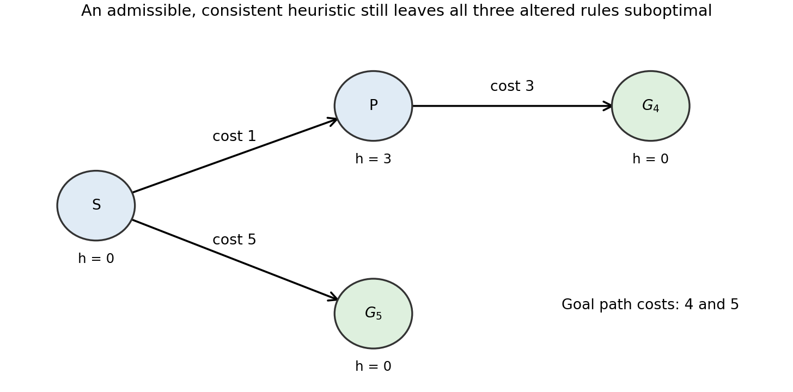

<h1 id="1/b/solution">Solution</h1>

↑ **Parent:** [B](../b.md)

**None of the three variants is an [optimal search algorithm](../../../../../optimal-search-algorithm.md) in general.** The following single [search tree](../../../../../search-tree.md) supplies counterexamples for all three. Its [heuristic function](../../../../../heuristic-function.md) is nonnegative, admissible and even a [consistent heuristic](../../../../../consistent-heuristic.md).

**[Figure 1](#1/b/image-one-four-node-search-tree-showing-the-failure-of-each-altered-a-star-rule). One four-node search tree showing the failure of each altered A-star rule**.

The least-cost goal is $G_4$, reached at cost $1+3=4$; the other goal $G_5$ costs $5$. Assign $h(S)=0$, $h(P)=3$, and zero to both goals. For the first variant, expanding $S$ generates $G_5$ and immediately returns it, before $P$ can be expanded. A [goal test](../../../../../goal-test.md) at generation therefore returns cost $5$.

For priority $g(n)+h(n')$, the root's children have priorities $1$ for $P$ and $5$ for $G_5$. Expanding $P$ generates $G_4$ with priority $4+3=7$. The algorithm next selects $G_5$, again returning cost $5$.

For priority $g(n')+h(n)$, the root's children instead have priorities $3$ for $P$ and $0$ for $G_5$. The suboptimal goal is selected immediately. The example uses no tie-breaking assumption. In contrast, ordinary [A-star search](../../../../../a-star-search.md) with its [goal test](../../../../../goal-test.md) on selection compares the genuine estimated total costs and returns $G_4$.

## ↑ Ancestors (11)

1. [B](../b.md)
2. [1](../../1.md)
3. [Artificial intelligence](../../../artificial-intelligence-split.md)
4. [2021](../../../split.md)
5. [Past exam of the computer science course of the University of Oxford](../../../../split.md)
6. [Computer science course of the University of Oxford](../../../../../computer-science-course-of-the-university-of-oxford.md)
7. [Undergraduate course of the University of Oxford](../../../../../undergraduate-course-of-the-university-of-oxford.md)
8. [Course of the University of Oxford](../../../../../course-of-the-university-of-oxford.md)
9. [University of Oxford](../../../../../university-of-oxford-split.md)
10. [List of universities](../../../../../list-of-universities.md)
11. [Codex Wiki](../../../../../split.md)
