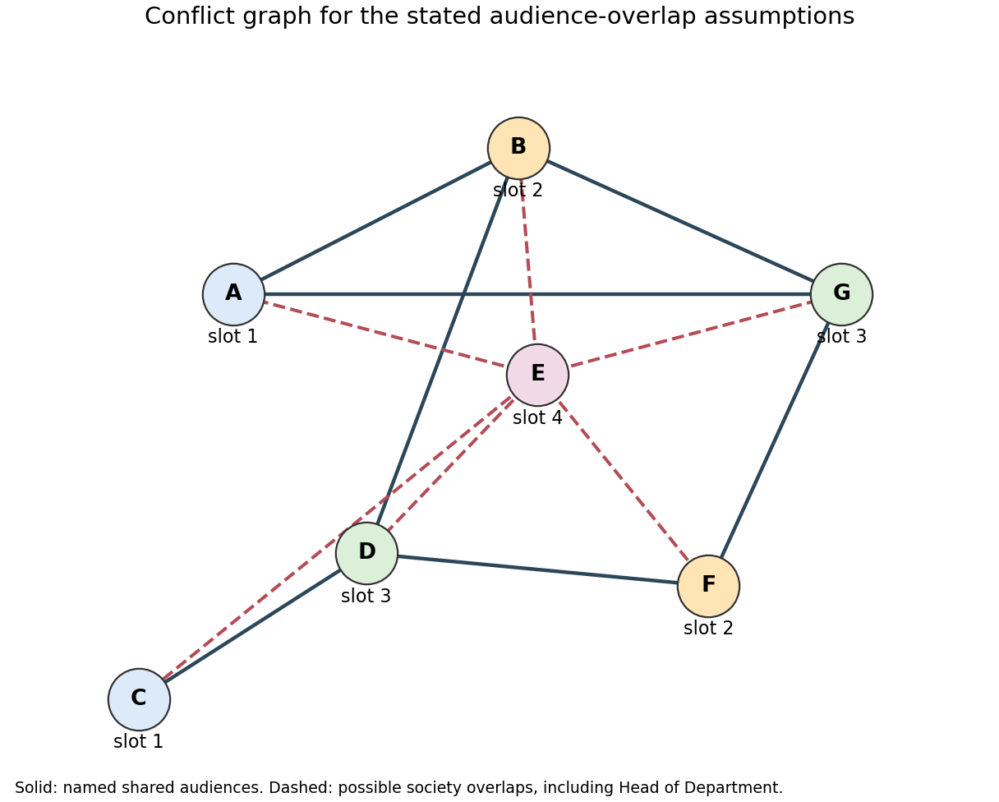

<h1 id="2/b/solution">Solution</h1>

↑ **Parent:** [B](../b.md)

The [constraint graph](../../../../../constraint-graph.md) has [vertices](../../../../../vertex-graph-theory.md) $A,B,C,D,E,F,G$ and the thirteen [edges](../../../../../edge-of-a-graph.md) listed in (a). The following original drawing distinguishes named shared-audience [edges](../../../../../edge-of-a-graph.md) from the additional society-overlap [edges](../../../../../edge-of-a-graph.md). [Vertex](../../../../../vertex-graph-theory.md) colours show one valid slot assignment; they are not extra constraints.

**[Figure 2](#2/b/image-the-scheduling-constraint-graph-with-direct-conflicts-and-explicitly-assumed-society-overlaps). The scheduling constraint graph with direct conflicts and explicitly assumed society overlaps**.

The unary restriction $X_A=1$ is a [constraint domain](../../../../../constraint-domain.md) restriction and adds no [edge](../../../../../edge-of-a-graph.md). For reference, $E$ is adjacent to every other [vertex](../../../../../vertex-graph-theory.md); among the remaining [vertices](../../../../../vertex-graph-theory.md) there is a triangle $ABG$, a cycle $BDFG$, and the [edge](../../../../../edge-of-a-graph.md) $CD$.

## ↑ Ancestors (11)

1. [B](../b.md)
2. [2](../../2.md)
3. [Artificial intelligence](../../../artificial-intelligence-split.md)
4. [2021](../../../split.md)
5. [Past exam of the computer science course of the University of Oxford](../../../../split.md)
6. [Computer science course of the University of Oxford](../../../../../computer-science-course-of-the-university-of-oxford.md)
7. [Undergraduate course of the University of Oxford](../../../../../undergraduate-course-of-the-university-of-oxford.md)
8. [Course of the University of Oxford](../../../../../course-of-the-university-of-oxford.md)
9. [University of Oxford](../../../../../university-of-oxford-split.md)
10. [List of universities](../../../../../list-of-universities.md)
11. [Codex Wiki](../../../../../split.md)
