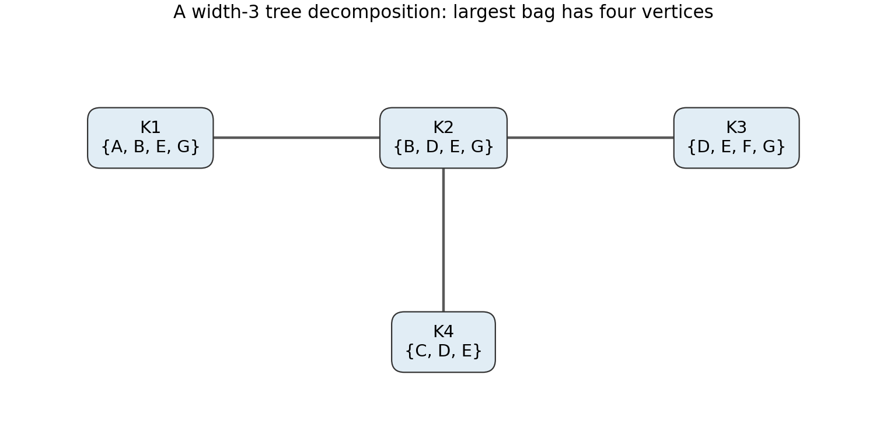

<h1 id="2/d/solution">Solution</h1>

↑ **Parent:** [D](../d.md)

**A [tree decomposition](../../../../../tree-decomposition.md) of width $3$ has bags**

$$
K_1=\{A,B,E,G\},\quad K_2=\{B,D,E,G\},\quad
K_3=\{D,E,F,G\},\quad K_4=\{C,D,E\},
$$

with [tree](../../../../../tree-graph-theory-split.md) [edges](../../../../../edge-of-a-graph.md) $K_1K_2$, $K_2K_3$, $K_2K_4$.

**[Figure 3](#2/d/image-a-tree-decomposition-of-the-scheduling-graph-with-maximum-bag-size-four). A tree decomposition of the scheduling graph with maximum bag size four**.

Every [graph](../../../../../graph-split.md) [vertex](../../../../../vertex-graph-theory.md) occurs in a bag and every constraint [edge](../../../../../edge-of-a-graph.md) has both endpoints in some bag. The bags containing any fixed [vertex](../../../../../vertex-graph-theory.md) form a connected [connected subgraph of a tree](../../../../../connected-subgraph-of-a-tree.md): $B$ occurs in $K_1,K_2$, $G$ in $K_1,K_2,K_3$, $D$ in $K_2,K_3,K_4$, and $E$ in all four. The remaining [vertices](../../../../../vertex-graph-theory.md) occur once. Hence the running-intersection condition holds. The maximum bag size is four, giving width $4-1=3$.

Under the stated overlap assumptions, $\{A,B,E,G\}$ is a four-[vertex](../../../../../vertex-graph-theory.md) [clique](../../../../../clique-graph-theory.md), so the [treewidth](../../../../../treewidth.md) is at least $3$; this decomposition attains it. A proof of that lower bound is not needed to use the displayed decomposition.

## ↑ Ancestors (11)

1. [D](../d.md)
2. [2](../../2.md)
3. [Artificial intelligence](../../../artificial-intelligence-split.md)
4. [2021](../../../split.md)
5. [Past exam of the computer science course of the University of Oxford](../../../../split.md)
6. [Computer science course of the University of Oxford](../../../../../computer-science-course-of-the-university-of-oxford.md)
7. [Undergraduate course of the University of Oxford](../../../../../undergraduate-course-of-the-university-of-oxford.md)
8. [Course of the University of Oxford](../../../../../course-of-the-university-of-oxford.md)
9. [University of Oxford](../../../../../university-of-oxford-split.md)
10. [List of universities](../../../../../list-of-universities.md)
11. [Codex Wiki](../../../../../split.md)
