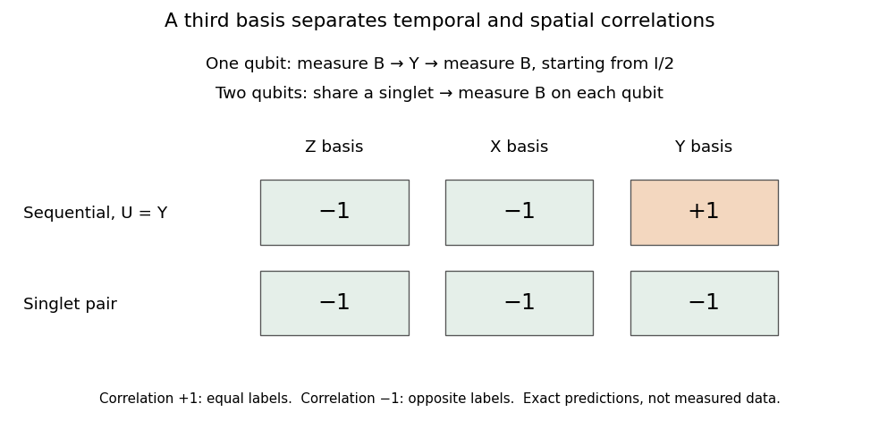
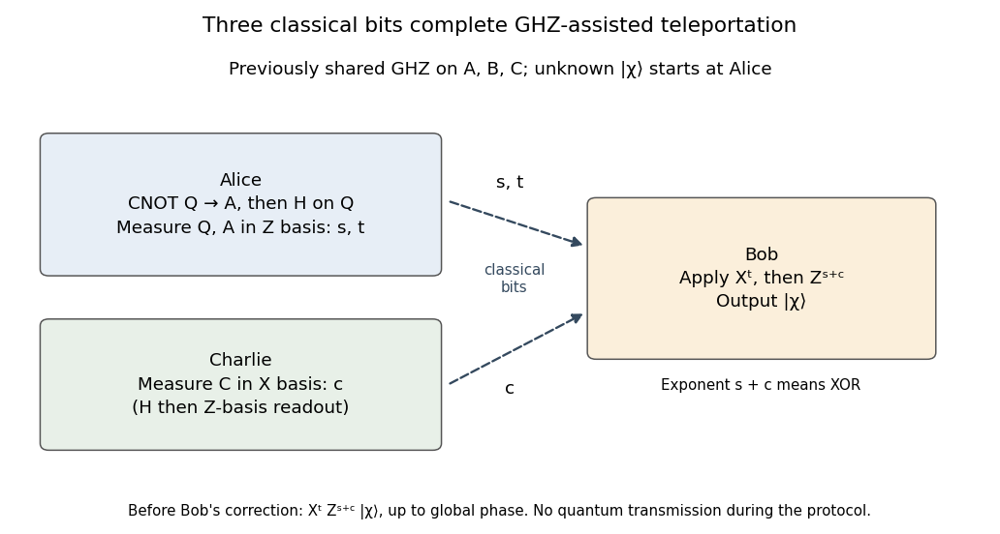

# Quantum information

↑ **Parent:** [2021](../2021.md)

Source paper: [released examination archive](https://www.whatdotheyknow.com/request/ba_computer_science_past_papers/response/2577745/attach/2/202402%20183%20CS%20Papers.zip?cookie_passthrough=1), member `2020/T/a16608w1.pdf`. The printed sitting is 27 May 2021; the ZIP directory names 2020. All three questions and all 21 marked subparts are answered. This is the canonical CS paper; the raster-identical Physics-held copy is a source reference, while Mathematics C7.4 is a different examination.[Cover and printed pages 2–5; all three questions](../../quantum-information-theory.md#quantum-information-examination-paper-a16608w1-2021)

An identical copy is available in [the released combined PDF, pages 111–115](https://www.whatdotheyknow.com/request/oxford_physics_past_papers_2/response/2340696/attach/9/Physics%20Papers%202020.pdf?cookie_passthrough=1#page=111). Its historical folder and attachment name do not change the Computer Science cover identity.

Tensor factors follow their displayed subsystem order, and the rightmost operator acts first. Computational labels are $0,1$; Hadamard- and Pauli-Y-basis labels are the corresponding plus/minus [eigenvalue](../../linear-operator-theory.md#eigenvalue) labels. The exact correlations in Question 2 are interpreted as ideal [probability](../../probability-theory.md#probability)-one predictions, not certainty inferred from a finite experimental sample.

**Table of contents**

- [1](#1)
  - [a](#1/a)
    - [i](#1/a/i)
      - [Solution](#1/a/i/solution)
    - [ii](#1/a/ii)
      - [Solution](#1/a/ii/solution)
  - [b](#1/b)
    - [i](#1/b/i)
      - [Solution](#1/b/i/solution)
    - [ii](#1/b/ii)
      - [Solution](#1/b/ii/solution)
  - [c](#1/c)
    - [i](#1/c/i)
      - [Solution](#1/c/i/solution)
    - [ii](#1/c/ii)
      - [Solution](#1/c/ii/solution)
    - [iii](#1/c/iii)
      - [Solution](#1/c/iii/solution)
    - [iv](#1/c/iv)
      - [Solution](#1/c/iv/solution)
- [2](#2)
  - [a](#2/a)
    - [i](#2/a/i)
      - [Solution](#2/a/i/solution)
    - [ii](#2/a/ii)
      - [Solution](#2/a/ii/solution)
  - [b](#2/b)
    - [i](#2/b/i)
      - [Solution](#2/b/i/solution)
    - [ii](#2/b/ii)
      - [Solution](#2/b/ii/solution)
  - [c](#2/c)
    - [i](#2/c/i)
      - [Solution](#2/c/i/solution)
    - [ii](#2/c/ii)
      - [Solution](#2/c/ii/solution)
    - [iii](#2/c/iii)
      - [Solution](#2/c/iii/solution)
- [3](#3)
  - [a](#3/a)
    - [i](#3/a/i)
      - [Solution](#3/a/i/solution)
    - [ii](#3/a/ii)
      - [Solution](#3/a/ii/solution)
  - [b](#3/b)
    - [i](#3/b/i)
      - [Solution](#3/b/i/solution)
    - [ii](#3/b/ii)
      - [Solution](#3/b/ii/solution)
  - [c](#3/c)
    - [i](#3/c/i)
      - [Solution](#3/c/i/solution)
    - [ii](#3/c/ii)
      - [Solution](#3/c/ii/solution)

## 1

↑ **Parent:** [Quantum information](quantum-information.md)

<h3 id="1/a">a</h3>

↑ **Parent:** [1](#1)

<h4 id="1/a/i">i</h4>

↑ **Parent:** [A](#1/a)

<h5 id="1/a/i/solution">Solution</h5>

↑ **Parent:** [I](#1/a/i)

In an orthonormal [computational basis](../../quantum-theory.md#computational-basis), the squared [norm](../../normed-vector-space.md#norm) is the sum of the squared [moduli](../../complex-analysis.md#modulus) of the coefficients:

$$
\langle\phi|\phi\rangle=\left|\frac{\sqrt3}{2}\right|^2+\left|\frac{1+i\sqrt3}{4}\right|^2
=\frac34+\frac{1+3}{16}=\boxed{1}.
$$

Thus the [vector](../../vector-space.md#vector) is normalized and represents a [pure state](../../quantum-theory.md#pure-state) of a [qubit](../../quantum-system.md#qubit). The [imaginary part](../../complex-analysis.md#imaginary-part) contributes positively to the squared [modulus](../../complex-analysis.md#modulus); squaring the coefficient without [complex conjugation](../../complex-analysis.md#complex-conjugation) would give the wrong [norm](../../normed-vector-space.md#norm).

<h4 id="1/a/ii">ii</h4>

↑ **Parent:** [A](#1/a)

<h5 id="1/a/ii/solution">Solution</h5>

↑ **Parent:** [Ii](#1/a/ii)

For the [Hadamard basis](../../quantum-theory.md#hadamard-basis), $|\pm\rangle=(|0\rangle\pm|1\rangle)/\sqrt2$. The [Born rule](../../wave-function.md#born-rule) gives

$$
\Pr(\pm)=|\langle\pm|\phi\rangle|^2
=\frac12\left|\frac{\sqrt3}{2}\pm\frac{1+i\sqrt3}{4}\right|^2.
$$

Writing the two [computational basis](../../quantum-theory.md#computational-basis) amplitudes as $a,b$, [normalization](../../mathematics.md#normalization) gives $\Pr(\pm)=\frac12\pm\operatorname{Re}(a^*b)$, and $\operatorname{Re}(a^*b)=\sqrt3/8$. Hence

$$
\boxed{\Pr(+)=\frac{4+\sqrt3}{8},\qquad\Pr(-)=\frac{4-\sqrt3}{8}.}
$$

These [probabilities](../../probability-theory.md#probability) sum to one. The cross term is [interference](../../physical-optics.md#interference-wave-propagation) between [probability amplitudes](../../wave-function.md#probability-amplitude), so the [probabilities](../../probability-theory.md#probability) cannot be obtained by treating the input as an incoherent mixture of the [computational basis](../../quantum-theory.md#computational-basis) alternatives.

<h3 id="1/b">b</h3>

↑ **Parent:** [1](#1)

<h4 id="1/b/i">i</h4>

↑ **Parent:** [B](#1/b)

<h5 id="1/b/i/solution">Solution</h5>

↑ **Parent:** [I](#1/b/i)

**No.** [Perfect discrimination of pure states requires orthogonality](../../quantum-measurement.md#perfect-discrimination-of-pure-states-requires-orthogonality), whereas

$$
\langle\phi_0|\phi_1\rangle=\frac14-\frac14+\frac12=\frac12\ne0.
$$

To see the obstruction directly for a [basic measurement](../../quantum-measurement.md#basic-measurement), let $\{|b_j\rangle\}$ be its [orthonormal basis](../../inner-product.md#orthonormal-basis). Certain identification would require disjoint sets of possible outcome labels for two different preparations. For every $j$, at least one of $\langle b_j|\phi_0\rangle$ and $\langle b_j|\phi_1\rangle$ would therefore vanish. Completeness would then give

$$
\langle\phi_0|\phi_1\rangle=\sum_j\langle\phi_0|b_j\rangle\langle b_j|\phi_1\rangle=0,
$$

contradicting the computed overlap. Failure to distinguish just this pair already rules out certain identification of the three-state family.

<h4 id="1/b/ii">ii</h4>

↑ **Parent:** [B](#1/b)

<h5 id="1/b/ii/solution">Solution</h5>

↑ **Parent:** [Ii](#1/b/ii)

Identification is stronger than [quantum state exclusion](../../quantum-information-theory.md#quantum-state-exclusion). Here an outcome only needs to rule out its associated preparation. Use the following [orthonormal basis](../../inner-product.md#orthonormal-basis) for a [basic measurement](../../quantum-measurement.md#basic-measurement)

$$
|b_0\rangle=\frac{|0\rangle-|1\rangle}{\sqrt2},\qquad
|b_1\rangle=\frac{|0\rangle+|1\rangle}{\sqrt2},\qquad
|b_2\rangle=|2\rangle.
$$

Its defining overlaps satisfy $\langle b_m|\phi_m\rangle=0$ for $m=0,1,2$. By the [Born rule](../../wave-function.md#born-rule), observing $b_m$ makes preparation $\phi_m$ impossible. **Measure in this basis and send its outcome label $m$; the prize is guaranteed.**

For completeness, the [conditional probability](../../probability-theory.md#conditional-probability) matrix, with rows $m$ and columns the prepared-state label $j$, is

$$
\bigl[\Pr(m\mid\phi_j)\bigr]_{m,j}
=\begin{pmatrix}0&1/2&1/2\\1/2&0&1/2\\1/2&1/2&0\end{pmatrix}.
$$

Every column sums to one and the diagonal vanishes. Each result leaves two possible preparations, so this [projective state exclusion](../../quantum-information-theory.md#projective-state-exclusion) does not contradict the impossibility of perfect identification. The family consists of [antidistinguishable quantum states](../../quantum-measurement.md#antidistinguishable-quantum-states).

<h3 id="1/c">c</h3>

↑ **Parent:** [1](#1)

<h4 id="1/c/i">i</h4>

↑ **Parent:** [C](#1/c)

<h5 id="1/c/i/solution">Solution</h5>

↑ **Parent:** [I](#1/c/i)

Prepare Bob in $|0\rangle_B$ and encode the [bit](../../information-theory.md#bit) using Alice's preparation $|m\rangle_A$. The [controlled-NOT gate](../../quantum-theory.md#controlled-not-gate) gives

$$
\operatorname{CNOT}_{A\to B}|m\rangle_A|0\rangle_B
=|m\rangle_A|m\rangle_B.
$$

**Bob measures in the [computational basis](../../quantum-theory.md#computational-basis) and reads $m$ with [probability](../../probability-theory.md#probability) one.** Alice's final measurement is unnecessary. The interaction transmits a [classical bit](../../information-theory.md#bit); it does not clone an arbitrary unknown [qubit](../../quantum-system.md#qubit).

<h4 id="1/c/ii">ii</h4>

↑ **Parent:** [C](#1/c)

<h5 id="1/c/ii/solution">Solution</h5>

↑ **Parent:** [Ii](#1/c/ii)

**Reverse communication is also possible.** Prepare Alice in $|+\rangle_A$. Bob encodes $m=0$ as $|+\rangle_B$ and $m=1$ as $|-\rangle_B$. Since $X|\pm\rangle=\pm|\pm\rangle$, [phase kickback](../../quantum-theory.md#phase-kickback) gives

$$
\operatorname{CNOT}_{A\to B}\bigl(|+\rangle_A|(-)^m\rangle_B\bigr)
=\frac{|0\rangle_A+(-1)^m|1\rangle_A}{\sqrt2}\otimes|(-)^m\rangle_B,
$$

where $|(-)^0\rangle=|+\rangle$ and $|(-)^1\rangle=|-\rangle$. Alice measures in the [Hadamard basis](../../quantum-theory.md#hadamard-basis): $+$ means zero and $-$ means one, deterministically.

The target's [Pauli X gate](../../quantum-theory.md#pauli-x-gate) [eigenvalue](../../linear-operator-theory.md#eigenvalue) becomes a [relative phase](../../quantum-system.md#relative-quantum-phase) on the control. This is the operational content of [CNOT control reversal in the Hadamard basis](../../quantum-theory.md#cnot-control-reversal-in-the-hadamard-basis); the [computational basis](../../quantum-theory.md#computational-basis) control arrow alone does not determine every possible direction of communication.

<h4 id="1/c/iii">iii</h4>

↑ **Parent:** [C](#1/c)

<h5 id="1/c/iii/solution">Solution</h5>

↑ **Parent:** [Iii](#1/c/iii)

**Charlie cannot send a [bit](../../information-theory.md#bit) to Alice with the stated preparation, fixed interaction and final local measurements.** Write $V=\operatorname{CNOT}_{B\to A}$ and $W=\operatorname{CNOT}_{B\to C}$, so the complete gate is $U=WV$ with the rightmost gate acting first. Alice has finished interacting before the gate involving Charlie acts.

For arbitrary product input [density matrices](../../density-matrix.md), put $\tau_{AB}=V(\rho_A\otimes\rho_B)V^\dagger$. The final [reduced density matrix](../../bell-state.md#reduced-density-matrix) of Alice is

$$
\rho_A'=\operatorname{Tr}_{BC}\!\left[W(\tau_{AB}\otimes\rho_C)W^\dagger\right]
=\operatorname{Tr}_{B}\tau_{AB}.
$$

The equality follows because a [unitary operator](../../vector-space.md#unitary-operator) on the traced-out systems leaves the [partial trace](../../quantum-theory.md#partial-trace) unchanged. The right-hand side is independent of Charlie's preparation. Therefore every outcome [probability](../../probability-theory.md#probability) of every local measurement by Alice is independent of Charlie's message. [Quantum no-signalling](../../quantum-theory.md#quantum-no-signalling) applies after Alice's last interaction, even though [phase kickback](../../quantum-theory.md#phase-kickback) can allow communication between the two [qubits](../../quantum-system.md#qubit) of an individual [CNOT gate](../../quantum-theory.md#controlled-not-gate).

<h4 id="1/c/iv">iv</h4>

↑ **Parent:** [C](#1/c)

<h5 id="1/c/iv/solution">Solution</h5>

↑ **Parent:** [Iv](#1/c/iv)

**Alice cannot send a [bit](../../information-theory.md#bit) to Charlie either.** An argument based only on the apparent chronological chain would be insufficient: Alice interacts with Bob before Bob interacts with Charlie. The extra fact is that these particular gates commute.

In Bob's [computational basis](../../quantum-theory.md#computational-basis) the complete gate is

$$
U=I_A\otimes|0\rangle\langle0|_B\otimes I_C
+X_A\otimes|1\rangle\langle1|_B\otimes X_C.
$$

Both [controlled-NOT gates](../../quantum-theory.md#controlled-not-gate) preserve Bob's control label, and their target operations act on different systems. Thus $WV=VW$. We may consequently regard Bob–Charlie as the first interaction and Bob–Alice as the last one. The final operation on $AB$ cannot change Charlie's [reduced density matrix](../../bell-state.md#reduced-density-matrix), and Charlie's earlier state cannot depend on Alice's initially separate preparation.

The [target no-signalling in a common-control unitary](../../quantum-theory.md#target-no-signalling-in-a-common-control-unitary) formula makes the independence explicit:

$$
\boxed{\rho_C'=\langle0|\rho_B|0\rangle\rho_C
+\langle1|\rho_B|1\rangle X\rho_CX.}
$$

Alice's [density matrix](../../density-matrix.md) does not appear. The formula includes arbitrary complex initial amplitudes and every final measurement on Charlie. This conclusion uses the specified pair of gates; a general intervening operation on Bob could change the communication possibilities.

## 2

↑ **Parent:** [Quantum information](quantum-information.md)

<h3 id="2/a">a</h3>

↑ **Parent:** [2](#2)

<h4 id="2/a/i">i</h4>

↑ **Parent:** [A](#2/a)

<h5 id="2/a/i/solution">Solution</h5>

↑ **Parent:** [I](#2/a/i)

Factor the sum before making an [entanglement](../../bell-state.md#entangled-state) claim:

$$
|\Phi\rangle=\frac12\bigl(|+\rangle+|-\rangle\bigr)\otimes\bigl(|0\rangle+|1\rangle\bigr)
=\boxed{|0\rangle\otimes|+\rangle}.
$$

**The state is not entangled:** it is a [product state](../../bell-state.md#product-state). A sum written with several tensor-product terms need not be entangled; those terms may combine into a single [tensor product](../../multilinear-algebra.md#tensor-product).

<h4 id="2/a/ii">ii</h4>

↑ **Parent:** [A](#2/a)

<h5 id="2/a/ii/solution">Solution</h5>

↑ **Parent:** [Ii](#2/a/ii)

The displayed [computational basis](../../quantum-theory.md#computational-basis) expansion is already a [Schmidt decomposition](../../von-neumann-entropy.md#schmidt-decomposition), with coefficients $\sqrt{1-p}$ and $\sqrt p$. For $0<p<1$ both are nonzero, so the [Schmidt rank](../../von-neumann-entropy.md#schmidt-rank) is two. A pure [product state](../../bell-state.md#product-state) has [Schmidt rank](../../von-neumann-entropy.md#schmidt-rank) one. **The state is therefore entangled throughout the specified open interval.**

Equivalently, the [reduced density matrix](../../bell-state.md#reduced-density-matrix) is

$$
\rho_A=\begin{pmatrix}1-p&0\\0&p\end{pmatrix},\qquad
\operatorname{Tr}(\rho_A^2)=1-2p(1-p)<1.
$$

The reduced state is a [mixed state](../../density-matrix.md#mixed-state), which is impossible for one factor of a pure [product state](../../bell-state.md#product-state). At the excluded endpoints the [Schmidt rank](../../von-neumann-entropy.md#schmidt-rank) drops to one, giving $|00\rangle$ or $|11\rangle$.

<h3 id="2/b">b</h3>

↑ **Parent:** [2](#2)

<h4 id="2/b/i">i</h4>

↑ **Parent:** [B](#2/b)

<h5 id="2/b/i/solution">Solution</h5>

↑ **Parent:** [I](#2/b/i)

Put $D_\theta=\operatorname{diag}(1,e^{i\theta})$. Factoring the target operator gives

$$
U=D_\theta\otimes V,
$$

whereas $U'=I\otimes V$. Their difference is a [relative phase](../../quantum-system.md#relative-quantum-phase) on the first [qubit](../../quantum-system.md#qubit), not one overall [global phase](../../quantum-system.md#global-phase).

For an explicit witness, choose the product input $|+\rangle\otimes|\chi\rangle$, with any normalized $|\chi\rangle$. The first-[qubit](../../quantum-system.md#qubit) outputs are respectively $(|0\rangle+e^{i\theta}|1\rangle)/\sqrt2$ and $|+\rangle$. A [Hadamard basis](../../quantum-theory.md#hadamard-basis) measurement returns $+$ with [probabilities](../../probability-theory.md#probability)

$$
\cos^2(\theta/2)\quad\text{and}\quad1.
$$

These differ because $\theta$ is not a multiple of $2\pi$. **The two [unitary operators](../../vector-space.md#unitary-operator) implement different [quantum channels](../../quantum-information-theory.md#quantum-channel).** The [global phase](../../quantum-system.md#global-phase) of the conditional target operation has become a physically observable phase on its control.

<h4 id="2/b/ii">ii</h4>

↑ **Parent:** [B](#2/b)

<h5 id="2/b/ii/solution">Solution</h5>

↑ **Parent:** [Ii](#2/b/ii)

**No: $U$ is not an [entangling gate](../../quantum-circuit.md#entangling-gate).** Its factorization gives, for every product input,

$$
U\bigl(|a\rangle\otimes|b\rangle\bigr)
=(D_\theta|a\rangle)\otimes(V|b\rangle),
$$

which remains a [product state](../../bell-state.md#product-state). More generally, a convex mixture of product [density matrices](../../density-matrix.md) remains separable under these local [unitary operators](../../vector-space.md#unitary-operator). Thus being distinguishable from $I\otimes V$ does not require creating [entanglement](../../bell-state.md#entangled-state). The first [qubit](../../quantum-system.md#qubit) undergoes a genuine local [phase gate](../../quantum-theory.md#phase-gate), while the target undergoes the same $V$ in both branches.

<h3 id="2/c">c</h3>

↑ **Parent:** [2](#2)

<h4 id="2/c/i">i</h4>

↑ **Parent:** [C](#2/c)

<h5 id="2/c/i/solution">Solution</h5>

↑ **Parent:** [I](#2/c/i)

**Either experiment is possible.** In the sequential experiment choose $U=X$. The first [computational basis](../../quantum-theory.md#computational-basis) measurement on $I/2$ returns a uniform [bit](../../information-theory.md#bit) $j$ and prepares $|j\rangle$. The [Pauli X gate](../../quantum-theory.md#pauli-x-gate) changes it to $|1-j\rangle$, so the second result is always opposite. The two possible records have [probabilities](../../probability-theory.md#probability) $\Pr(0,1)=\Pr(1,0)=1/2$.

In the two-[qubit](../../quantum-system.md#qubit) experiment choose the fixed [pure state](../../quantum-theory.md#pure-state)

$$
|\psi\rangle=|\Psi^+\rangle=\frac{|01\rangle+|10\rangle}{\sqrt2}.
$$

The [Born rule](../../wave-function.md#born-rule) gives the same two possible records, again with [probability](../../probability-theory.md#probability) $1/2$ each. The observed [computational basis](../../quantum-theory.md#computational-basis) anticorrelation alone does not identify whether the correlation was generated sequentially or shared between two [qubits](../../quantum-system.md#qubit).

<h4 id="2/c/ii">ii</h4>

↑ **Parent:** [C](#2/c)

<h5 id="2/c/ii/solution">Solution</h5>

↑ **Parent:** [Ii](#2/c/ii)

**Either experiment is again possible.** The sequential experiment with $U=I$ repeats its first measurement outcome in every basis: the first [projective measurement](../../quantum-measurement.md#projective-measurement) has prepared one of that basis's [eigenstates](../../energy-eigenvalue.md#eigenstate), and the identity leaves it unchanged.

For the two-[qubit](../../quantum-system.md#qubit) experiment choose

$$
|\psi\rangle=|\Phi^+\rangle=\frac{|00\rangle+|11\rangle}{\sqrt2}
=\frac{|++\rangle+|--\rangle}{\sqrt2}.
$$

The two expansions exhibit identical outcomes in both specified bases. Each allowed equal-label record has [probability](../../probability-theory.md#probability) $1/2$. These are fixed choices of $U$ and $|\psi\rangle$, respectively; neither depends on which of the two bases Alice selects.

<h4 id="2/c/iii">iii</h4>

↑ **Parent:** [C](#2/c)

<h5 id="2/c/iii/solution">Solution</h5>

↑ **Parent:** [Iii](#2/c/iii)

**Only the two-[qubit](../../quantum-system.md#qubit) experiment is possible.** Choose the [spin singlet state](../../bell-state.md#spin-singlet-state)

$$
|\psi\rangle=|\Psi^-\rangle=\frac{|01\rangle-|10\rangle}{\sqrt2}.
$$

It has [eigenvalue](../../linear-operator-theory.md#eigenvalue) $-1$ under each of $X\otimes X$, $Y\otimes Y$ and $Z\otimes Z$. Thus measuring either [qubit](../../quantum-system.md#qubit) in the same Pauli basis as the other always gives opposite [eigenvalue](../../linear-operator-theory.md#eigenvalue) labels. Each opposite-label pair occurs with [probability](../../probability-theory.md#probability) $1/2$. More generally, [collective-unitary covariance of the two-qubit singlet](../../bell-state.md#collective-unitary-covariance-of-the-two-qubit-singlet) ensures opposite outcomes in any common orthonormal [qubit](../../quantum-system.md#qubit) basis.

For the sequential experiment, the first outcome is uniformly distributed and the [Lüders rule](../../quantum-measurement.md#luders-rule) prepares the corresponding [eigenstate](../../energy-eigenvalue.md#eigenstate). Certain opposite outcomes in the [computational basis](../../quantum-theory.md#computational-basis) force the fixed [unitary matrix](../../linear-operator-theory.md#unitary-matrix) to have the form

$$
U=\begin{pmatrix}0&a\\b&0\end{pmatrix},\qquad |a|=|b|=1.
$$

Certain opposite [Hadamard basis](../../quantum-theory.md#hadamard-basis) outcomes require $\langle+|U|+\rangle=(a+b)/2=0$, hence $b=-a$. Therefore $U=iaY$. But this operator preserves the two [Pauli Y eigenstate](../../quantum-circuit.md#pauli-y-eigenstate) rays: it gives the same Y-basis label on the second measurement, rather than the opposite one. This contradicts the third set of observations.

Equivalently, flipping all three bases would require $U^\dagger XU=-X$, $U^\dagger YU=-Y$, and $U^\dagger ZU=-Z$. Conjugating $XY=iZ$ in these two ways gives both $iZ$ and $-iZ$, an impossibility. This [three-axis obstruction to unitary qubit orthogonalization](../../quantum-information-theory.md#three-axis-obstruction-to-unitary-qubit-orthogonalization) is a finite test of the obstruction behind the [universal NOT gate](../../quantum-information-theory.md#universal-not-gate).

**[Figure 1](#2/c/iii/image-sequential-qubit-correlations-and-singlet-correlations-differ-in-the-third-basis). Sequential qubit correlations and singlet correlations differ in the third basis**. Original exact predictions, not measured data. With a maximally mixed initial qubit, the sequential experiment using U=Y has opposite Z and X results but equal Y results. A singlet pair has opposite results in all three bases. Correlation +1 means equal labels and −1 means opposite labels.

## 3

↑ **Parent:** [Quantum information](quantum-information.md)

<h3 id="3/a">a</h3>

↑ **Parent:** [3](#3)

<h4 id="3/a/i">i</h4>

↑ **Parent:** [A](#3/a)

<h5 id="3/a/i/solution">Solution</h5>

↑ **Parent:** [I](#3/a/i)

**Prepare $|0\rangle$, then apply $H$, then $T$.** With $T=\operatorname{diag}(1,e^{i\pi/4})$,

$$
TH|0\rangle=T\frac{|0\rangle+|1\rangle}{\sqrt2}
=\frac{|0\rangle+e^{i\pi/4}|1\rangle}{\sqrt2}.
$$

This uses only the allowed state preparation and elementary gates. The rightmost operator acts first, so $TH$ denotes the temporal order $H$ followed by $T$.

<h4 id="3/a/ii">ii</h4>

↑ **Parent:** [A](#3/a)

<h5 id="3/a/ii/solution">Solution</h5>

↑ **Parent:** [Ii](#3/a/ii)

The required [superposition](../../vector-space.md#superposition-principle) is the [Bell state](../../bell-state.md)

$$
\frac{|++\rangle+|--\rangle}{\sqrt2}
=\frac{|00\rangle+|11\rangle}{\sqrt2}=|\Phi^+\rangle.
$$

**Prepare $|00\rangle$, apply $H$ to the first [qubit](../../quantum-system.md#qubit), then apply CNOT from the first to the second.** The intermediate state is $(|00\rangle+|10\rangle)/\sqrt2$, and the [controlled-NOT gate](../../quantum-theory.md#controlled-not-gate) gives the required [Bell state](../../bell-state.md). No final basis change is needed: the two displayed expressions represent exactly the same [vector](../../vector-space.md#vector).

<h3 id="3/b">b</h3>

↑ **Parent:** [3](#3)

<h4 id="3/b/i">i</h4>

↑ **Parent:** [B](#3/b)

<h5 id="3/b/i/solution">Solution</h5>

↑ **Parent:** [I](#3/b/i)

Write $\rho_0=|\phi\rangle\langle\phi|=(I+r_xX+r_yY+r_zZ)/2$. Conjugating by a [Pauli matrix](../../algebra.md#pauli-matrices) keeps its own Bloch component and reverses the other two; for example,

$$
X\rho_0X=\tfrac12(I+r_xX-r_yY-r_zZ).
$$

In the average of the four conjugations, the coefficient of every nonidentity [Pauli matrix](../../algebra.md#pauli-matrices) is zero. Consequently

$$
\boxed{\frac{\rho_0+X\rho_0X+Y\rho_0Y+Z\rho_0Z}{4}=\frac I2.}
$$

The [Pauli operator basis](../../algebra.md#pauli-operator-basis) gives the Bloch representation of a [qubit](../../quantum-system.md#qubit) [density operator](../../density-matrix.md).[§2.3.2, printed pp. 18–19, equations (2.62)–(2.65)](../../physics-bibliography.md#foundations-i-states-and-ensembles-by-john-preskill)

This is the [qubit Pauli twirl](../../quantum-information-theory.md#qubit-pauli-twirl), the dimension-two case of the [Heisenberg-Weyl twirling channel](../../quantum-information-theory.md#heisenberg-weyl-twirling-channel). The argument uses only [trace](../../linear-algebra.md#matrix-trace) one, so it also works for mixed [qubit](../../quantum-system.md#qubit) inputs. The preparation label must be forgotten: conditioning on the label would retain a known pure branch rather than the [maximally mixed state](../../density-matrix.md#maximally-mixed-state) obtained by the ensemble average.

<h4 id="3/b/ii">ii</h4>

↑ **Parent:** [B](#3/b)

<h5 id="3/b/ii/solution">Solution</h5>

↑ **Parent:** [Ii](#3/b/ii)

Take the [trine state ensemble](../../density-matrix.md#trine-state-ensemble)

$$
\boxed{|t_j\rangle=\frac{|0\rangle+\omega^j|1\rangle}{\sqrt2},\qquad
p_j=\frac13,\qquad j=0,1,2,\quad\omega=e^{2\pi i/3}.}
$$

All three states are normalized. Since $1+\omega+\omega^2=0$, their average [density matrix](../../density-matrix.md) is

$$
\frac13\sum_{j=0}^2|t_j\rangle\langle t_j|
=\frac16\sum_{j=0}^2\begin{pmatrix}1&\omega^{-j}\\\omega^j&1\end{pmatrix}
=\frac I2.
$$

Geometrically, their unit [Bloch vectors](../../density-matrix.md#bloch-vector) form an [equilateral triangle](../../euclidean-geometry.md#equilateral-triangle) on the equator and sum to zero. [Orthogonality](../../inner-product.md#orthogonal-vectors) is unnecessary for an ensemble decomposition of a [mixed state](../../density-matrix.md#mixed-state): three distinct, nonorthogonal [pure states](../../quantum-theory.md#pure-state) can give the same maximally mixed average as two orthogonal states.

<h3 id="3/c">c</h3>

↑ **Parent:** [3](#3)

<h4 id="3/c/i">i</h4>

↑ **Parent:** [C](#3/c)

<h5 id="3/c/i/solution">Solution</h5>

↑ **Parent:** [I](#3/c/i)

**No test on Alice and Bob's systems gives any information about which global state was prepared, even with arbitrarily many independent copies.** In the pure GHZ [density matrix](../../density-matrix.md), the off-diagonal terms contain $|0\rangle\langle1|_C$ or its adjoint. Their [partial traces](../../quantum-theory.md#partial-trace) vanish. Hence both preparations have the same [reduced density matrix](../../bell-state.md#reduced-density-matrix)

$$
\sigma_{AB}=\operatorname{Tr}_C(|\mathrm{GHZ}\rangle\langle\mathrm{GHZ}|)
=\operatorname{Tr}_C\rho
=\tfrac12\bigl(|00\rangle\langle00|+|11\rangle\langle11|\bigr).
$$

For any [POVM](../../quantum-measurement.md#positive-operator-valued-measure) effect $E$ acting jointly on $AB$, the outcome [probability](../../probability-theory.md#probability) is $\operatorname{Tr}(E\sigma_{AB})$ in either case. [Equal reduced states give identical local statistics](../../bell-state.md#equal-reduced-states-give-identical-local-statistics), where local here means local to the entire accessible laboratory $AB$, not separate operations on $A$ and $B$.[§2.3.1, printed pp. 14–17, reduced density operators and accessible expectation values](../../physics-bibliography.md#foundations-i-states-and-ensembles-by-john-preskill)

For $n$ independent copies, taking the [partial trace](../../quantum-theory.md#partial-trace) of each inaccessible $C$ system yields $\sigma_{AB}^{\otimes n}$ under either hypothesis. Even an arbitrary collective [quantum measurement](../../quantum-measurement.md) on all $2n$ accessible [qubits](../../quantum-system.md#qubit) therefore has identical outcome [probabilities](../../probability-theory.md#probability). Adaptive local processing cannot change equality of the accessible [density matrices](../../density-matrix.md). With equal prior [probabilities](../../probability-theory.md#probability) the optimal guessing [probability](../../probability-theory.md#probability) remains $1/2$; with other priors, no observation updates their ratio.

<h4 id="3/c/ii">ii</h4>

↑ **Parent:** [C](#3/c)

<h5 id="3/c/ii/solution">Solution</h5>

↑ **Parent:** [Ii](#3/c/ii)

**Charlie's [Hadamard basis](../../quantum-theory.md#hadamard-basis) measurement, Alice's [Bell-basis measurement](../../bell-state.md#bell-basis-measurement) and communicated correction [bits](../../information-theory.md#bit) give deterministic [GHZ-assisted quantum teleportation](../../bell-state.md#ghz-assisted-quantum-teleportation).** Let the unknown input be $|\chi\rangle_Q=\alpha|0\rangle+\beta|1\rangle$. Charlie measures $C$ in the [Hadamard basis](../../quantum-theory.md#hadamard-basis) and labels $+$ by $c=0$, $-$ by $c=1$. The identity

$$
|\mathrm{GHZ}\rangle_{ABC}=\frac1{\sqrt2}\left(
|\Phi^+\rangle_{AB}|+\rangle_C+|\Phi^-\rangle_{AB}|-\rangle_C\right)
$$

shows that $AB$ is conditionally a [Bell pair](../../bell-state.md#bell-pair) with phase label $c$. Charlie sends that one [classical bit](../../information-theory.md#bit) to Bob. The procedure for [localizing a Bell pair from a GHZ state](../../quantum-theory.md#localizing-a-bell-pair-from-a-ghz-state) supplies precisely the missing conditional information; forgetting $c$ leaves the mixed reduced state of the preceding part.

Alice performs the usual [Bell-basis measurement](../../bell-state.md#bell-basis-measurement) on $QA$. Operationally, she applies $\operatorname{CNOT}_{Q\to A}$, applies $H_Q$, and measures $Q$ and $A$ in the [computational basis](../../quantum-theory.md#computational-basis), obtaining [bits](../../information-theory.md#bit) $s,t$. She sends both [bits](../../information-theory.md#bit) to Bob. To track the correction without a convention ambiguity, conditional on $s,t$ the normalized state on $BC$ is

$$
\alpha|t\rangle_B|t\rangle_C+(-1)^s\beta|1\mathbin\oplus t\rangle_B|1\mathbin\oplus t\rangle_C.
$$

Projecting Charlie's factor onto his recorded [Hadamard basis](../../quantum-theory.md#hadamard-basis) state gives Bob, up to the [global phase](../../quantum-system.md#global-phase) $(-1)^{ct}$,

$$
X^tZ^{s\oplus c}|\chi\rangle_B.
$$

Consequently the inverse Pauli correction is

$$
\boxed{Z^{s\oplus c}X^t:\quad X^tZ^{s\oplus c}|\chi\rangle\longmapsto|\chi\rangle.}
$$

Bob applies $X^t$ first and $Z^{s\oplus c}$ second. The measurements on Charlie and on Alice commute because they act on different systems, so deriving the conditional state with Alice's measurement first gives the same protocol as Charlie measuring first. Each triple $(s,t,c)$ has [probability](../../probability-theory.md#probability) $1/8$, independent of the unknown input, and every triple succeeds after correction.

**[Figure 2](#3/c/ii/image-three-classical-bits-complete-ghz-assisted-teleportation). Three classical bits complete GHZ-assisted teleportation**. Original protocol diagram for a previously distributed GHZ resource on A, B and C. Alice performs CNOT from Q to A, then H on Q and Z-basis readout of Q and A. Charlie performs H followed by Z-basis readout, equivalent to X-basis measurement. Bob receives s, t and c, applies X to the power t, then Z to the power s XOR c. The dashed lines carry classical bits.

This uses one previously shared [GHZ state](../../quantum-theory.md#greenberger-horne-zeilinger-state), two [classical bits](../../information-theory.md#bit) from Alice and one from Charlie, with no quantum transmission during the transfer. The standard Bell-measurement/Pauli-correction mechanism was established in the original [quantum teleportation](../../bell-state.md#quantum-teleportation) proposal.[1993, printed p. 1896, equations (5)–(6): outcome-conditioned states and unitary corrections](../../quantum-information-theory.md#teleporting-an-unknown-quantum-state-via-dual-classical-and-einstein-podolsky-rosen-channels-by-charles-h-bennett-and-others) Here Charlie's record supplies the Bell-pair phase, giving a [controlled quantum teleportation](../../bell-state.md#controlled-quantum-teleportation) protocol. Alice's input is consumed by her measurement; Bob reconstructs its state without learning $\alpha,\beta$ and without making a second surviving copy.

## ↑ Ancestors (8)

1. [2021](../2021.md)
2. [Past exam of the computer science course of the University of Oxford](../../past-exam-of-the-computer-science-course-of-the-university-of-oxford.md)
3. [Computer science course of the University of Oxford](../../university-of-oxford.md#computer-science-course-of-the-university-of-oxford)
4. [Undergraduate course of the University of Oxford](../../university-of-oxford.md#undergraduate-course-of-the-university-of-oxford)
5. [Course of the University of Oxford](../../university-of-oxford.md#course-of-the-university-of-oxford)
6. [University of Oxford](../../university-of-oxford.md)
7. [List of universities](../../README.md#list-of-universities)
8. [Codex Wiki](../../README.md)
