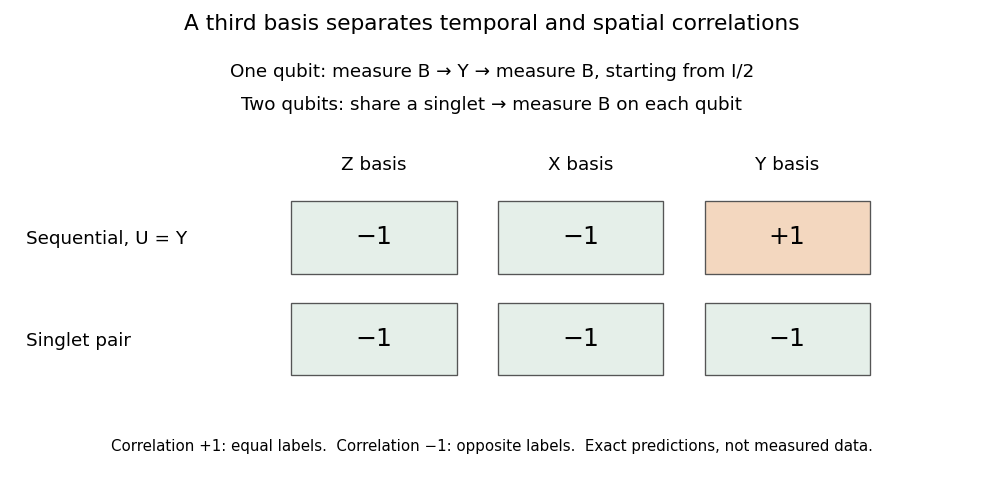

<h1 id="2/c/iii/solution">Solution</h1>

↑ **Parent:** [Iii](../iii.md)

**Only the two-[qubit](../../../../../../qubit.md) experiment is possible.** Choose the [spin singlet state](../../../../../../spin-singlet-state.md)

$$
|\psi\rangle=|\Psi^-\rangle=\frac{|01\rangle-|10\rangle}{\sqrt2}.
$$

It has [eigenvalue](../../../../../../eigenvalue.md) $-1$ under each of $X\otimes X$, $Y\otimes Y$ and $Z\otimes Z$. Thus measuring either [qubit](../../../../../../qubit.md) in the same Pauli basis as the other always gives opposite [eigenvalue](../../../../../../eigenvalue.md) labels. Each opposite-label pair occurs with [probability](../../../../../../probability.md) $1/2$. More generally, [collective-unitary covariance of the two-qubit singlet](../../../../../../collective-unitary-covariance-of-the-two-qubit-singlet.md) ensures opposite outcomes in any common orthonormal [qubit](../../../../../../qubit.md) basis.

For the sequential experiment, the first outcome is uniformly distributed and the [Lüders rule](../../../../../../luders-rule.md) prepares the corresponding [eigenstate](../../../../../../eigenstate.md). Certain opposite outcomes in the [computational basis](../../../../../../computational-basis.md) force the fixed [unitary matrix](../../../../../../unitary-matrix.md) to have the form

$$
U=\begin{pmatrix}0&a\\b&0\end{pmatrix},\qquad |a|=|b|=1.
$$

Certain opposite [Hadamard basis](../../../../../../hadamard-basis.md) outcomes require $\langle+|U|+\rangle=(a+b)/2=0$, hence $b=-a$. Therefore $U=iaY$. But this operator preserves the two [Pauli Y eigenstate](../../../../../../pauli-y-eigenstate.md) rays: it gives the same Y-basis label on the second measurement, rather than the opposite one. This contradicts the third set of observations.

Equivalently, flipping all three bases would require $U^\dagger XU=-X$, $U^\dagger YU=-Y$, and $U^\dagger ZU=-Z$. Conjugating $XY=iZ$ in these two ways gives both $iZ$ and $-iZ$, an impossibility. This [three-axis obstruction to unitary qubit orthogonalization](../../../../../../three-axis-obstruction-to-unitary-qubit-orthogonalization.md) is a finite test of the obstruction behind the [universal NOT gate](../../../../../../universal-not-gate.md).

**[Figure 1](#2/c/iii/image-sequential-qubit-correlations-and-singlet-correlations-differ-in-the-third-basis). Sequential qubit correlations and singlet correlations differ in the third basis**. Original exact predictions, not measured data. With a maximally mixed initial qubit, the sequential experiment using U=Y has opposite Z and X results but equal Y results. A singlet pair has opposite results in all three bases. Correlation +1 means equal labels and −1 means opposite labels.

## ↑ Ancestors (12)

1. [Iii](../iii.md)
2. [C](../../c.md)
3. [2](../../../2.md)
4. [Quantum information](../../../../quantum-information-split.md)
5. [2021](../../../../split.md)
6. [Past exam of the computer science course of the University of Oxford](../../../../../split.md)
7. [Computer science course of the University of Oxford](../../../../../../computer-science-course-of-the-university-of-oxford.md)
8. [Undergraduate course of the University of Oxford](../../../../../../undergraduate-course-of-the-university-of-oxford.md)
9. [Course of the University of Oxford](../../../../../../course-of-the-university-of-oxford.md)
10. [University of Oxford](../../../../../../university-of-oxford-split.md)
11. [List of universities](../../../../../../list-of-universities.md)
12. [Codex Wiki](../../../../../../split.md)
