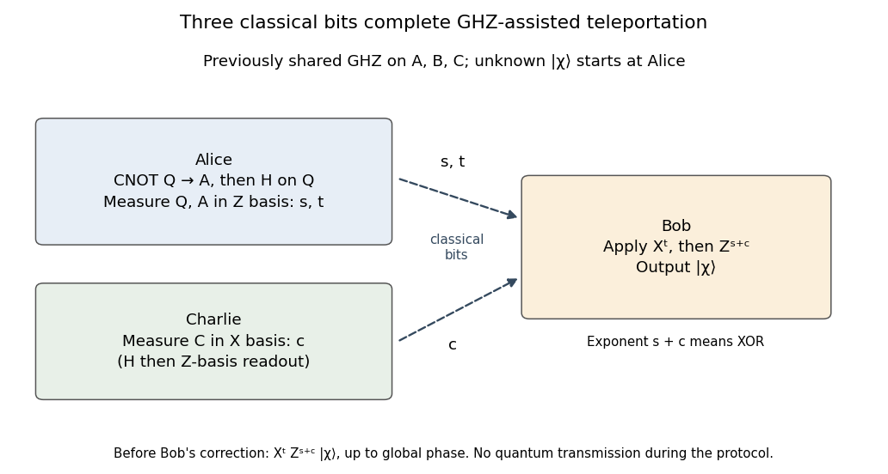

<h1 id="3/c/ii/solution">Solution</h1>

↑ **Parent:** [Ii](../ii.md)

**Charlie's [Hadamard basis](../../../../../../hadamard-basis.md) measurement, Alice's [Bell-basis measurement](../../../../../../bell-basis-measurement.md) and communicated correction [bits](../../../../../../bit.md) give deterministic [GHZ-assisted quantum teleportation](../../../../../../ghz-assisted-quantum-teleportation.md).** Let the unknown input be $|\chi\rangle_Q=\alpha|0\rangle+\beta|1\rangle$. Charlie measures $C$ in the [Hadamard basis](../../../../../../hadamard-basis.md) and labels $+$ by $c=0$, $-$ by $c=1$. The identity

$$
|\mathrm{GHZ}\rangle_{ABC}=\frac1{\sqrt2}\left(
|\Phi^+\rangle_{AB}|+\rangle_C+|\Phi^-\rangle_{AB}|-\rangle_C\right)
$$

shows that $AB$ is conditionally a [Bell pair](../../../../../../bell-pair.md) with phase label $c$. Charlie sends that one [classical bit](../../../../../../bit.md) to Bob. The procedure for [localizing a Bell pair from a GHZ state](../../../../../../localizing-a-bell-pair-from-a-ghz-state.md) supplies precisely the missing conditional information; forgetting $c$ leaves the mixed reduced state of the preceding part.

Alice performs the usual [Bell-basis measurement](../../../../../../bell-basis-measurement.md) on $QA$. Operationally, she applies $\operatorname{CNOT}_{Q\to A}$, applies $H_Q$, and measures $Q$ and $A$ in the [computational basis](../../../../../../computational-basis.md), obtaining [bits](../../../../../../bit.md) $s,t$. She sends both [bits](../../../../../../bit.md) to Bob. To track the correction without a convention ambiguity, conditional on $s,t$ the normalized state on $BC$ is

$$
\alpha|t\rangle_B|t\rangle_C+(-1)^s\beta|1\mathbin\oplus t\rangle_B|1\mathbin\oplus t\rangle_C.
$$

Projecting Charlie's factor onto his recorded [Hadamard basis](../../../../../../hadamard-basis.md) state gives Bob, up to the [global phase](../../../../../../global-phase.md) $(-1)^{ct}$,

$$
X^tZ^{s\oplus c}|\chi\rangle_B.
$$

Consequently the inverse Pauli correction is

$$
\boxed{Z^{s\oplus c}X^t:\quad X^tZ^{s\oplus c}|\chi\rangle\longmapsto|\chi\rangle.}
$$

Bob applies $X^t$ first and $Z^{s\oplus c}$ second. The measurements on Charlie and on Alice commute because they act on different systems, so deriving the conditional state with Alice's measurement first gives the same protocol as Charlie measuring first. Each triple $(s,t,c)$ has [probability](../../../../../../probability.md) $1/8$, independent of the unknown input, and every triple succeeds after correction.

**[Figure 2](#3/c/ii/image-three-classical-bits-complete-ghz-assisted-teleportation). Three classical bits complete GHZ-assisted teleportation**. Original protocol diagram for a previously distributed GHZ resource on A, B and C. Alice performs CNOT from Q to A, then H on Q and Z-basis readout of Q and A. Charlie performs H followed by Z-basis readout, equivalent to X-basis measurement. Bob receives s, t and c, applies X to the power t, then Z to the power s XOR c. The dashed lines carry classical bits.

This uses one previously shared [GHZ state](../../../../../../greenberger-horne-zeilinger-state.md), two [classical bits](../../../../../../bit.md) from Alice and one from Charlie, with no quantum transmission during the transfer. The standard Bell-measurement/Pauli-correction mechanism was established in the original [quantum teleportation](../../../../../../quantum-teleportation.md) proposal.[1993, printed p. 1896, equations (5)–(6): outcome-conditioned states and unitary corrections](../../../../../../teleporting-an-unknown-quantum-state-via-dual-classical-and-einstein-podolsky-rosen-channels-by-charles-h-bennett-and-others.md) Here Charlie's record supplies the Bell-pair phase, giving a [controlled quantum teleportation](../../../../../../controlled-quantum-teleportation.md) protocol. Alice's input is consumed by her measurement; Bob reconstructs its state without learning $\alpha,\beta$ and without making a second surviving copy.

## ↑ Ancestors (12)

1. [Ii](../ii.md)
2. [C](../../c.md)
3. [3](../../../3.md)
4. [Quantum information](../../../../quantum-information-split.md)
5. [2021](../../../../split.md)
6. [Past exam of the computer science course of the University of Oxford](../../../../../split.md)
7. [Computer science course of the University of Oxford](../../../../../../computer-science-course-of-the-university-of-oxford.md)
8. [Undergraduate course of the University of Oxford](../../../../../../undergraduate-course-of-the-university-of-oxford.md)
9. [Course of the University of Oxford](../../../../../../course-of-the-university-of-oxford.md)
10. [University of Oxford](../../../../../../university-of-oxford-split.md)
11. [List of universities](../../../../../../list-of-universities.md)
12. [Codex Wiki](../../../../../../split.md)
