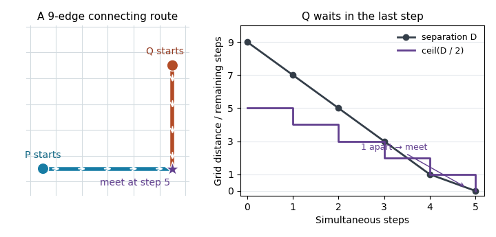
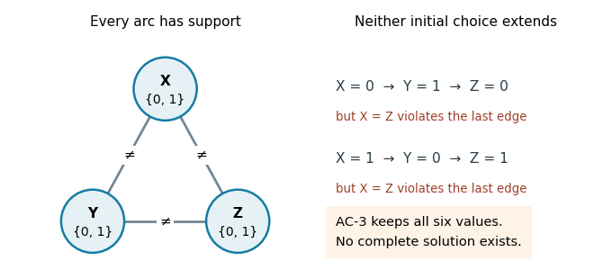

# Artificial intelligence

↑ **Parent:** [2022](../2022.md)

Source release: [Oxford examination release, archive member `2021/T/a16607w1.pdf`](https://www.whatdotheyknow.com/request/ba_computer_science_past_papers/response/2577745/attach/2/202402%20183%20CS%20Papers.zip?cookie_passthrough=1). The printed paper is dated 27 May 2022; the archive member’s directory names 2021. All three questions are solved below.

**Table of contents**

- [1](#1)
  - [a](#1/a)
    - [Solution](#1/a/solution)
  - [b](#1/b)
    - [Solution](#1/b/solution)
  - [c](#1/c)
    - [Solution](#1/c/solution)
  - [d](#1/d)
    - [Solution](#1/d/solution)
  - [e](#1/e)
    - [Solution](#1/e/solution)
- [2](#2)
  - [a](#2/a)
    - [Solution](#2/a/solution)
  - [b](#2/b)
    - [Solution](#2/b/solution)
  - [c](#2/c)
    - [Solution](#2/c/solution)
  - [d](#2/d)
    - [Solution](#2/d/solution)
  - [e](#2/e)
    - [Solution](#2/e/solution)
  - [f](#2/f)
    - [Solution](#2/f/solution)
  - [g](#2/g)
    - [Solution](#2/g/solution)
  - [h](#2/h)
    - [Solution](#2/h/solution)
  - [i](#2/i)
    - [Solution](#2/i/solution)
- [3](#3)
  - [a](#3/a)
    - [Solution](#3/a/solution)
  - [b](#3/b)
    - [Solution](#3/b/solution)
  - [c](#3/c)
    - [Solution](#3/c/solution)
  - [d](#3/d)
    - [Solution](#3/d/solution)
  - [e](#3/e)
    - [Solution](#3/e/solution)
  - [f](#3/f)
    - [Solution](#3/f/solution)

## 1

↑ **Parent:** [Artificial intelligence](artificial-intelligence.md)

<h3 id="1/a">a</h3>

↑ **Parent:** [1](#1)

<h4 id="1/a/solution">Solution</h4>

↑ **Parent:** [A](#1/a)

Use $a,w,g,r$ for the agent, monster, gold and arrow, and abbreviate $sq_{ij}$ to $s_{ij}$. A physically safe [STRIPS](../../artificial-intelligence.md#strips) plan is

$$
\begin{aligned}
&\operatorname{Move}(a,s_{11},s_{21}),\quad \operatorname{Move}(a,s_{21},s_{22}),\\
&\operatorname{Shoot}(a,s_{22},r,w,s_{23}),\\
&\operatorname{Move}(a,s_{22},s_{23}),\quad \operatorname{Move}(a,s_{23},s_{13}),\\
&\operatorname{Take}(a,g,s_{13}),\\
&\operatorname{Move}(a,s_{13},s_{23}),\quad \operatorname{Move}(a,s_{23},s_{22}),\\
&\operatorname{Move}(a,s_{22},s_{21}),\quad \operatorname{Move}(a,s_{21},s_{11}).
\end{aligned}
$$

Every movement follows a listed adjacency [predicate](../../analysis-of-boolean-functions.md#predicate). The shot is taken from $s_{22}$ while the arrow is held, and kills the monster before entry into $s_{23}$. The pit at $s_{12}$ is never entered. The pickup establishes possession of the gold, and the last four movements restore the exit location while preserving that possession. Thus **ten actions achieve the formal goal and the intended safe return**; arriving at the exit is the source model’s representation of leaving.

<h3 id="1/b">b</h3>

↑ **Parent:** [1](#1)

<h4 id="1/b/solution">Solution</h4>

↑ **Parent:** [B](#1/b)

Three different omissions produce concrete erroneous [STRIPS](../../artificial-intelligence.md#strips) plans. Here a route means the corresponding successive $\operatorname{Move}$ actions with the indicated first argument.

**No lethal-entry condition.** Move the agent along $s_{11},s_{21},s_{22},s_{23},s_{13}$, take the gold at $s_{13}$, and reverse the route. This nine-action [STRIPS](../../artificial-intelligence.md#strips) plan satisfies every supplied [precondition](../../algorithm.md#precondition) and the final [goal test](../../theoretical-computer-science.md#goal-test), without firing. Physically it fails on entering the live monster’s room: the supplied [search transition model](../../theoretical-computer-science.md#search-transition-model) neither forbids the entry nor records death. The omitted pit cell happens to be disconnected in the supplied adjacency relation, so this particular instance already excludes pit entry; that accidental protection does not encode the monster hazard.

**Supposedly stationary objects can move themselves.** The five-action [STRIPS](../../artificial-intelligence.md#strips) plan

$$
\begin{aligned}
&\operatorname{Move}(g,s_{13},s_{23}),\quad\operatorname{Move}(g,s_{23},s_{22}),\\
&\operatorname{Move}(g,s_{22},s_{21}),\quad\operatorname{Move}(g,s_{21},s_{11}),\\
&\operatorname{Take}(a,g,s_{11})
\end{aligned}
$$

leaves the agent at the exit and brings it the gold. The formal [preconditions](../../algorithm.md#precondition) hold because $x$ in $\operatorname{Move}(x,y,z)$ has no actor restriction. Gold cannot actually propel itself. The same flaw permits moving the supposedly stationary monster.

**Unrestricted pickup permits impossible inventory.** Follow the first example’s outward route, but insert $\operatorname{Take}(a,w,s_{23})$ immediately after reaching $s_{23}$. Continue to $s_{13}$, take the gold and return. This ten-action [STRIPS](../../artificial-intelligence.md#strips) plan ends with both $\operatorname{have}(a,w)$ and $\operatorname{have}(a,g)$ and satisfies the supplied goal. Its entrance also exposes the first flaw, but the additional, distinct defect is that pickup treats the live monster as a collectible object and deletes its location. A movement safety check alone is not a specification of which objects are collectible. The shot schema likewise lacks restrictions to the designated shooter, projectile and victim; fixing the action roles together prevents these type errors.

<h3 id="1/c">c</h3>

↑ **Parent:** [1](#1)

<h4 id="1/c/solution">Solution</h4>

↑ **Parent:** [C](#1/c)

A corrected [STRIPS](../../artificial-intelligence.md#strips) model can fix object roles in the action names, leaving only room parameters to instantiate. Use the same $a,w,g,r$ and introduce static $\operatorname{pitfree}(z)$ and $\operatorname{exit}(z)$ facts, plus a [planning fluent](../../artificial-intelligence.md#planning-fluent) $\operatorname{clear}(z)$ meaning “no live monster occupies $z$”. Unlike the supplied adjacency relation, let $\operatorname{adj}$ describe all geometrically adjacent rooms; safety is then explicit rather than hidden by missing [edges](../../graph-theory.md#edge-of-a-graph).

Initially the agent, monster and gold have their specified locations, $\operatorname{have}(a,r)$, $\operatorname{alive}(w)$ and $\operatorname{active}$ hold, $\operatorname{exit}(s_{11})$ holds, $\operatorname{pitfree}$ holds at every room except $s_{12}$, and $\operatorname{clear}$ holds at every room except $s_{23}$. All unlisted facts are false by the [closed-world assumption](../../mathematical-logic.md#closed-world-assumption). The following positive [preconditions](../../algorithm.md#precondition), add lists and delete lists are a complete action specification:

$$
\begin{array}{c|l|l|l}
\text{action}&\text{preconditions}&\text{add}&\text{delete}\\\hline
\operatorname{Walk}(y,z)&\begin{gathered}\operatorname{active},\operatorname{at}(a,y),\operatorname{adj}(y,z),\\\operatorname{pitfree}(z),\operatorname{clear}(z)\end{gathered}&\operatorname{at}(a,z)&\operatorname{at}(a,y)\\[3pt]
\operatorname{Fire}(y,z)&\begin{gathered}\operatorname{active},\operatorname{at}(a,y),\operatorname{adj}(y,z),\\\operatorname{at}(w,z),\operatorname{alive}(w),\operatorname{have}(a,r)\end{gathered}&\begin{gathered}\operatorname{dead}(w),\\\operatorname{clear}(z)\end{gathered}&\begin{gathered}\operatorname{alive}(w),\\\operatorname{have}(a,r)\end{gathered}\\[3pt]
\operatorname{Collect}(z)&\begin{gathered}\operatorname{active},\operatorname{at}(a,z),\\\operatorname{at}(g,z)\end{gathered}&\operatorname{have}(a,g)&\operatorname{at}(g,z)\\[3pt]
\operatorname{Leave}(z)&\begin{gathered}\operatorname{active},\operatorname{at}(a,z),\\\operatorname{exit}(z),\operatorname{have}(a,g)\end{gathered}&\operatorname{exited}&\operatorname{active}
\end{array}
$$

Require $\operatorname{exited}$ as the goal. If reaching the exit suffices, omit $\operatorname{Leave}$ and use the original two goal facts. Instantiating these schemata over the finite room [set](../../set.md) gives ordinary ground [STRIPS](../../artificial-intelligence.md#strips) actions.

Only $a$ moves, only $g$ is collectible and only $r$ can be fired at $w$. No action changes the monster’s location; its corpse can stay there, while $\operatorname{clear}$ records that it is harmless. The gold stays at its original room until collection. The arrow is consumed by its only use. By [mathematical induction](../../foundations-of-mathematics.md#mathematical-induction) on plan length, every applicable action preserves the [planning state invariant](../../algorithm.md#planning-state-invariant) that the active agent occupies one pit-free room without a live monster. Consequently every solution is a safe execution. The plan in part a, followed by $\operatorname{Leave}(s_{11})$, is one such execution.

<h3 id="1/d">d</h3>

↑ **Parent:** [1](#1)

<h4 id="1/d/solution">Solution</h4>

↑ **Parent:** [D](#1/d)

Ordinary [classical planning](../../artificial-intelligence.md#classical-planning) with [STRIPS](../../artificial-intelligence.md#strips) starts from one completely specified state. Here the missing locations express ignorance: not listing a pit or a monster at a room does not establish its absence. Applying the [closed-world assumption](../../mathematical-logic.md#closed-world-assumption) to those omissions would manufacture knowledge of safety. Moreover, future sensor readings can determine which action is appropriate, so a fixed action sequence need not suffice.

The suitable object is a [belief state](../../theoretical-computer-science.md#belief-state) and a [contingent plan](../../artificial-intelligence.md#contingent-planning) that branches on observations. A finite [belief state](../../theoretical-computer-science.md#belief-state) model could in principle be compiled into a larger [classical planning](../../artificial-intelligence.md#classical-planning) instance, but the ordinary physical-state [STRIPS](../../artificial-intelligence.md#strips) representation does not directly represent the required uncertainty and sensing.

<h3 id="1/e">e</h3>

↑ **Parent:** [1](#1)

<h4 id="1/e/solution">Solution</h4>

↑ **Parent:** [E](#1/e)

This is a **finite, discrete, partially observable, single-agent, sequential [search problem](../../theoretical-computer-science.md#search-problem) with an unknown initial state**. The cave is static while the agent deliberates. Given a complete world and an action, the described physical effects and ideal sensor readings are deterministic; ignorance of the world does not itself supply a [probability distribution](../../probability-distribution.md). The fixed monster and gold are environmental objects, not competing decision makers. A known action/sensor law with unknown object locations is different from having to learn an unknown [search transition model](../../theoretical-computer-science.md#search-transition-model).

Use [partially observable search](../../theoretical-computer-science.md#partially-observable-search) over [belief states](../../theoretical-computer-science.md#belief-state). A complete physical state can be written

$$
s=(p,m,P,g,\ell,r,k,e),
$$

where $p$ is the agent’s room, $m$ the fixed monster room, $P$ the pit [set](../../set.md), $g$ the fixed gold room, $\ell$ records whether the monster lives, $r$ whether the arrow remains, $k$ whether gold has been collected and $e$ whether the agent has exited or failed. The known room dimensions and exit are fixed data. Include death or entrapment as failure states. Movement, shooting toward an adjacent room, collection and departure have their physical meanings. In particular, a shot consumes the arrow, and kills the monster exactly when it targets the live monster’s room.

Let $T(s,a)$ be this physical [search transition model](../../theoretical-computer-science.md#search-transition-model). For a surviving agent, an ideal observation is the tuple of three [truth values](../../mathematical-logic.md#truth-value)

$$
O(s)=\bigl(\mathbf1_{\{\ell\ \text{and}\ m\sim p\}},\ \mathbf1_{\{\exists q\in P:q\sim p\}},\ \mathbf1_{\{p=g\ \text{and}\ k=0\}}\bigr),
$$

recording sound, breeze and glitter. Here $\sim$ denotes geometric adjacency and $\mathbf1$ an [indicator function](../../measure-theory.md#indicator-function). Initially $B_0$ contains all worlds compatible with the known facts and any initial observation. After action $a$ and observation $o$, update the [belief state](../../theoretical-computer-science.md#belief-state) by

$$
\boxed{B'_{a,o}=\{T(s,a):s\in B,\ O(T(s,a))=o\}.}
$$

Known success or failure observations are included as needed. No prior [probabilities](../../probability-theory.md#probability) are required. A guaranteed-success [goal test](../../theoretical-computer-science.md#goal-test) accepts $B$ only when every $s\in B$ has exited carrying gold. A policy must use the same action in all worlds still indistinguishable to the agent.

An [AND-OR search](../../algorithm.md#and-or-search) has OR choices for the agent’s next action and AND branches for every possible resulting observation with nonempty $B'_{a,o}$. Its output is a [contingent plan](../../artificial-intelligence.md#contingent-planning), not merely a route. To demand safe success, reject any action whose possible outcomes include irreversible death or entrapment, and require a successful continuation on every observation branch. In an online execution the agent updates its [belief state](../../theoretical-computer-science.md#belief-state), follows the observation branch and can plan again. A [strong plan](../../artificial-intelligence.md#strong-plan) need not exist: some admissible worlds have no safe route, and even solvable worlds can be observationally indistinguishable until a dangerous choice. Without an added prior and numerical rewards, expected-risk optimization is not determined by the description.

## 2

↑ **Parent:** [Artificial intelligence](artificial-intelligence.md)

<h3 id="2/a">a</h3>

↑ **Parent:** [2](#2)

<h4 id="2/a/solution">Solution</h4>

↑ **Parent:** [A](#2/a)

Regard the rooms as the [vertices](../../graph.md#vertex-graph-theory) of a [grid graph](../../combinatorics.md#grid-graph). Let $C=\{1,\ldots,n\}^2$ and let the two robot positions be $p,q\in C$. A single controller chooses both commands, so the [state space](../../dynamical-systems.md#state-space) is the ordered [Cartesian product](../../set-theory.md#cartesian-product) $S=C\times C$, with initial state $(p_0,q_0)$. Distinguishing the robots matters because their later action laws need not be identical.

For a room $x$, let $A(x)$ consist of wait and all cardinal moves remaining in $C$; write $\delta(x,u)$ for the resulting room. At $(p,q)$ an action is the ordered pair $(u,v)\in A(p)\times A(q)$, and the deterministic [search transition model](../../theoretical-computer-science.md#search-transition-model) is

$$
T((p,q),(u,v))=(\delta(p,u),\delta(q,v)).
$$

The [goal test](../../theoretical-computer-science.md#goal-test) is **$p=q$**, checked at integer time boundaries, and every joint action costs one. Swapping two distinct rooms does not satisfy the [goal test](../../theoretical-computer-science.md#goal-test). No internal walls are supplied; if walls were specified, they would simply restrict the move relation.

<h3 id="2/b">b</h3>

↑ **Parent:** [2](#2)

<h4 id="2/b/solution">Solution</h4>

↑ **Parent:** [B](#2/b)

The ordered [Cartesian product](../../set-theory.md#cartesian-product) has **$n^4$ states**, including $n^2$ goal states. Each robot has at most five commands, so the [search tree](../../theoretical-computer-science.md#search-tree) has **[branching factor](../../theoretical-computer-science.md#branching-factor) at most $25$**, attained when both are interior for $n\ge3$. Boundary states have fewer actions under the legal-move convention. For $n=2$ the maximum is $3^2=9$, and for $n=1$ it is one if waiting is retained.

The [state space](../../dynamical-systems.md#state-space) is finite, but the unrestricted [search tree](../../theoretical-computer-science.md#search-tree) is infinite because both robots can wait repeatedly. $n^4$ counts physical states, not distinct action histories.

<h3 id="2/c">c</h3>

↑ **Parent:** [2](#2)

<h4 id="2/c/solution">Solution</h4>

↑ **Parent:** [C](#2/c)

Let $D(p,q)=|p_x-q_x|+|p_y-q_y|$ be their [Manhattan distance](../../topological-analysis.md#manhattan-distance). Each joint action can reduce $D$ by at most two, so use the [simultaneous rendezvous distance](../../theoretical-computer-science.md#simultaneous-rendezvous-distance)

$$
\boxed{h(p,q)=\left\lceil\frac{D(p,q)}2\right\rceil.}
$$

This [heuristic function](../../theoretical-computer-science.md#heuristic-function) is nonzero whenever the robots are apart. For a transition $(p,q)\to(p',q')$, the [triangle inequality](../../topological-analysis.md#triangle-inequality) gives

$$
D(p,q)\le D(p,p')+D(p',q')+D(q',q)\le2+D(p',q').
$$

Applying the [ceiling function](../../calculus.md#ceiling-function) yields $h(p,q)\le1+h(p',q')$, and $h(p,p)=0$. Thus **$h$ is a [consistent heuristic](../../theoretical-computer-science.md#consistent-heuristic)**, hence an [admissible heuristic](../../theoretical-computer-science.md#admissible-heuristic).

In the unobstructed grid this estimate is exact. Along a shortest route of length $D$, both robots approach a middle room, taking at most $\lceil D/2\rceil$ steps each; when $D$ is an [odd integer](../../integer.md#odd-integer), the robot with the shorter route waits once. That final wait prevents a crossing from being mistaken for a meeting. With obstacles the same formula remains a [relaxation heuristic](../../theoretical-computer-science.md#relaxation-heuristic), though it need not be exact.

**[Figure 1](#2/c/image-an-original-nine-edge-route-needs-five-simultaneous-steps-the-last-wait-produces-a-meeting-rather-than-a-crossing). An original nine-edge route needs five simultaneous steps: the last wait produces a meeting rather than a crossing**.

<h3 id="2/d">d</h3>

↑ **Parent:** [2](#2)

<h4 id="2/d/solution">Solution</h4>

↑ **Parent:** [D](#2/d)

Write $h^*(s)$ for the optimal remaining cost and suppose $h_i(s)\le h^*(s)$ for $i=1,2$. The conclusions hold pointwise:

- **$\max(h_1,h_2)$ is an [admissible heuristic](../../theoretical-computer-science.md#admissible-heuristic)**, because both arguments are at most $h^*$.
- **$\min(h_1,h_2)$ is an [admissible heuristic](../../theoretical-computer-science.md#admissible-heuristic)**, since it is no larger than either argument.
- **$h_1+h_2$ is not necessarily an [admissible heuristic](../../theoretical-computer-science.md#admissible-heuristic).** A state with a single cost-one move to a goal can have $h_1=h_2=1$ at that state and both zero at the goal. Both original [heuristic functions](../../theoretical-computer-science.md#heuristic-function) are exact, but their sum is $2>1$.
- **$\alpha h_1+(1-\alpha)h_2$ is an [admissible heuristic](../../theoretical-computer-science.md#admissible-heuristic) for $0\le\alpha\le1$**, since nonnegative weighting gives $\alpha h_1+(1-\alpha)h_2\le\alpha h^*+(1-\alpha)h^*=h^*$.

These are [admissible heuristic combinations](../../theoretical-computer-science.md#admissible-heuristic-combination). An unweighted sum needs an extra condition, such as distributing action costs between the component estimates, to prevent counting the same required work twice.

<h3 id="2/e">e</h3>

↑ **Parent:** [2](#2)

<h4 id="2/e/solution">Solution</h4>

↑ **Parent:** [E](#2/e)

**Use $H=\max(h_1,h_2)$** if each estimate is available at comparable cost. For every $\alpha\in[0,1]$,

$$
\min(h_1,h_2)\le\alpha h_1+(1-\alpha)h_2\le H\le h^*.
$$

Thus $H$ has [heuristic dominance](../../theoretical-computer-science.md#heuristic-dominance) over all the other combinations guaranteed to remain [admissible heuristics](../../theoretical-computer-science.md#admissible-heuristic). [A-star search](../../graph.md#a-star-search) orders nodes by $f=g+h$, where $g$ is the accumulated path cost. A larger [admissible heuristic](../../theoretical-computer-science.md#admissible-heuristic) excludes more nodes from the compulsory $f<C^*$ region, where $C^*$ is the optimal solution cost. Under the usual nonnegative-cost and goal-normalization assumptions, this gives at least as informative a search guide while preserving the optimality guarantee of [A-star search](../../graph.md#a-star-search) with [tree search](../../algorithm.md#tree-search).

The unweighted sum loses that guarantee. The dominance statement does not promise smaller wall-clock time in every implementation: evaluating estimates costs time, and nodes with $f=C^*$ depend on tie handling. Nor does admissibility of the inputs alone imply [consistent heuristics](../../theoretical-computer-science.md#consistent-heuristic). If both inputs are [consistent heuristics](../../theoretical-computer-science.md#consistent-heuristic), however, their pointwise maximum is also a [consistent heuristic](../../theoretical-computer-science.md#consistent-heuristic).

<h3 id="2/f">f</h3>

↑ **Parent:** [2](#2)

<h4 id="2/f/solution">Solution</h4>

↑ **Parent:** [F](#2/f)

Retain the ordered position state $(p,q)$, the same initial state and the [goal test](../../theoretical-computer-science.md#goal-test) $p=q$, with unit joint-action cost. Replace the deterministic [search transition model](../../theoretical-computer-science.md#search-transition-model) by a [set](../../set.md)-valued outcome relation. Let

$$
R(p,u)=
\begin{cases}
\{\delta(p,L),\delta(p,R)\},&u\in\{L,R\},\\
\{\delta(p,u)\},&u\in\{U,D,W\}.
\end{cases}
$$

Then

$$
\boxed{\operatorname{Results}((p,q),(u,v))=R(p,u)\times\{\delta(q,v)\}.}
$$

Here $\delta$ for an attempted move leaving the board returns the current room. This explicit boundary convention keeps every outcome inside the [state space](../../dynamical-systems.md#state-space); alternatively disable a horizontal command unless both possible destinations are legal. Mrs Robot’s commands can still be restricted to legal moves as before.

The result is a fully observable [nondeterministic planning](../../artificial-intelligence.md#nondeterministic-planning) problem, assuming that actual positions are observed after every step. Both possible horizontal outcomes must be represented, even though they may coincide at a boundary or when $n=1$. No outcome [probabilities](../../probability-theory.md#probability) are supplied, so attaching equal [probabilities](../../probability-theory.md#probability) would add an assumption. Its solution is a position-dependent plan or policy.

<h3 id="2/g">g</h3>

↑ **Parent:** [2](#2)

<h4 id="2/g/solution">Solution</h4>

↑ **Parent:** [G](#2/g)

Use **[AND-OR search](../../algorithm.md#and-or-search) for a [strong plan](../../artificial-intelligence.md#strong-plan)**. At an OR node choose a joint action; at its AND node require successful continuations for every possible outcome. A repeated state on the current branch cannot by itself establish progress. On a finite [state space](../../dynamical-systems.md#state-space), the equivalent [strong planning winning-set iteration](../../artificial-intelligence.md#strong-planning-winning-set-iteration) starts with $W_0=\{(p,p):p\in C\}$ and repeatedly adds states with an action whose nonempty outcome [set](../../set.md) is contained in the current winning [set](../../set.md):

$$
W_{t+1}=W_t\cup\{s:\exists a,\ \varnothing\ne\operatorname{Results}(s,a)\subseteq W_t\}.
$$

A newly admitted state has a plan with at most $t+1$ remaining steps in the worst case. This [algorithm](../../algorithm.md) terminates on the finite [state space](../../dynamical-systems.md#state-space) and is complete for finite guaranteed-success plans. In a general [nondeterministic planning](../../artificial-intelligence.md#nondeterministic-planning) problem it cannot guarantee that a [strong plan](../../artificial-intelligence.md#strong-plan) exists: an uncontrollable self-loop can prevent inevitable progress.

**For this particular unobstructed grid, a [strong plan](../../artificial-intelligence.md#strong-plan) does exist.** Command Mr Robot to wait throughout and move Mrs Robot along a shortest route to his initial room. Her movement is deterministic and his waiting is unaffected by the horizontal uncertainty. This meets in $D(p_0,q_0)$ steps, regardless of every uncertain outcome, because no uncertain command is used. Thus a complete finite [AND-OR search](../../algorithm.md#and-or-search) will find a solution here. With an unspecified disconnected maze, existence would instead require both robots to lie in the same reachable [graph component](../../graph.md#component-graph-theory).

<h3 id="2/h">h</h3>

↑ **Parent:** [2](#2)

<h4 id="2/h/solution">Solution</h4>

↑ **Parent:** [H](#2/h)

Include all four positions and a turn marker:

$$
s=(p,q,z_1,z_2,\tau),\qquad\tau\in\{\mathrm{R},\mathrm{M}\}.
$$

The initial marker is $\mathrm{R}$. There are at most $2n^8$ such states before terminal compression. The two robots form one maximizing team in the [adversarial search](../../theoretical-computer-science.md#adversarial-search) representation. At an R state their actions are joint legal moves, including waiting, with deterministic successor positions and marker M. At an M state the monster outcome is a pair of legal cardinal moves, producing marker R.

Check termination initially and after each simultaneous pair of moves. A state is a failure if $\{p,q\}\cap\{z_1,z_2\}\ne\varnothing$. Otherwise it is a success if $p=q$. **Collision takes priority over meeting**, so meeting on an occupied room fails. A safe meeting ends immediately, before a further monster response. Room swaps without a shared position at a checked boundary are neither capture nor meeting.

The monsters move randomly, so their nodes are **chance nodes**, not minimizing decisions. Under independent uniform legal moves, if monster $j$ currently has $d_j$ available destinations, each joint outcome has [probability](../../probability-theory.md#probability) $1/(d_1d_2)$. If several commands produce the same state, add their [probabilities](../../probability-theory.md#probability). This specifies a stochastic [game tree](../../game-theory.md#game-tree), equivalently a [Markov decision process](../../control-theory.md#markov-decision-process) for the robot team. Uniform legal moves and independent monsters are explicit boundary/joint-law conventions; uniform attempted directions with blocked moves staying put is another convention, with different boundary [transition probabilities](../../markov-chain.md#transition-probability) but the same search method. For the one-cell grid, a monster with no legal move stays; all four initial positions then coincide and the instance immediately fails.

<h3 id="2/i">i</h3>

↑ **Parent:** [2](#2)

<h4 id="2/i/solution">Solution</h4>

↑ **Parent:** [I](#2/i)

The [game tree](../../game-theory.md#game-tree) alternates **MAX nodes for joint robot choices and CHANCE nodes for joint monster outcomes**. An interior MAX node has at most $25$ children; an interior CHANCE node at most $4^2=16$. A terminal safe meeting has [utility](../../mathematics.md#utility) one and capture has [utility](../../mathematics.md#utility) zero. With no specified preference for speed, the objective is to maximize the [probability](../../probability-theory.md#probability) of eventual safe meeting.

Use **[expectimax](../../theoretical-computer-science.md#expectimax)**: maximize at MAX nodes and take the [expected value](../../expected-value.md) at CHANCE nodes. For nonterminal states, its finite-horizon backup is

$$
V_{t+1}(s)=
\begin{cases}
\displaystyle\max_a V_t(T(s,a)),&\tau=\mathrm R,\\[3pt]
\displaystyle\sum_{s'}P(s'\mid s)V_t(s'),&\tau=\mathrm M.
\end{cases}
$$

Here the horizon counts half-turns, terminal values stay fixed at zero or one, and $V_0$ is zero at nonterminal states. This computes the best chance of success within the horizon. Maximizing the worst monster outcome would solve a different problem from the stipulated random movement.

Because waiting and movement cycles can repeat states, the infinite [game tree](../../game-theory.md#game-tree) need not terminate. For the unbounded objective, use [value iteration](../../mathematical-optimization.md#value-iteration) on the finite state [graph](../../graph.md), starting from terminal-success indicators as above: $V_t$ increases to the optimal eventual-success [probability](../../probability-theory.md#probability). A reachability-policy method or sufficiently long finite-horizon policies can extract the actions; arbitrary tie choices in the limiting equations must not select a policy that waits forever instead of realizing the value. Alternatively impose an explicit finite horizon and use depth-limited [expectimax](../../theoretical-computer-science.md#expectimax), stating that changed objective. No method guarantees success with [probability](../../probability-theory.md#probability) one from every initial configuration.

## 3

↑ **Parent:** [Artificial intelligence](artificial-intelligence.md)

<h3 id="3/a">a</h3>

↑ **Parent:** [3](#3)

<h4 id="3/a/solution">Solution</h4>

↑ **Parent:** [A](#3/a)

**The first assertion is true.** Each deletion removes a value with no support in an adjacent [constraint domain](../../theoretical-computer-science.md#constraint-domain). If a complete solution still used that value, the solution’s neighboring value would supply exactly such a support, a contradiction. By [mathematical induction](../../foundations-of-mathematics.md#mathematical-induction), [AC-3](../../theoretical-computer-science.md#ac-3) never deletes a value used by an original solution. An empty [constraint domain](../../theoretical-computer-science.md#constraint-domain) therefore proves that no solution exists.

**The second assertion is false.** Take three [Boolean variables](../../theoretical-computer-science.md#boolean-variable) $X,Y,Z$ with [constraint domains](../../theoretical-computer-science.md#constraint-domain) $\{0,1\}$ and the [binary constraints](../../theoretical-computer-science.md#binary-constraint) $X\ne Y$, $Y\ne Z$, $Z\ne X$. Every value has the opposite value as support across each [edge](../../graph-theory.md#edge-of-a-graph), so [AC-3](../../theoretical-computer-science.md#ac-3) deletes nothing and returns true. Yet $X\ne Y$ and $Y\ne Z$ imply $X=Z$, contradicting $Z\ne X$. [Arc consistency](../../theoretical-computer-science.md#arc-consistency) checks local support, not compatibility of all supports in one complete assignment.

**[Figure 2](#3/a/image-every-value-has-pairwise-support-but-following-the-three-inequality-constraints-makes-a-complete-assignment-impossible). Every value has pairwise support, but following the three inequality constraints makes a complete assignment impossible**.

**The third assertion is true under the usual explicit-input, constant-cost constraint-checking model.** With $v$ variables, $e$ constrained pairs and maximum [constraint domain](../../theoretical-computer-science.md#constraint-domain) size $d$, [AC-3](../../theoretical-computer-science.md#ac-3) has [time complexity](../../theoretical-computer-science.md#time-complexity) $O(v+ed^3)$ in [Big O notation](../../real-analysis.md#big-o-notation). A revision costs $O(d^2)$; each deletion can re-enqueue incoming arcs, and each [constraint domain](../../theoretical-computer-science.md#constraint-domain) loses at most $d$ values, giving $O(ed)$ revisions including the initial arcs. For two-valued [constraint domains](../../theoretical-computer-science.md#constraint-domain), $d\le2$, so this is **$O(v+e)$**, linear in the explicit input size. This uses fixed-size relations, or already combined constant-time tests per pair. “Binary” normally describes constraint arity, not two-valued [constraint domains](../../theoretical-computer-science.md#constraint-domain); the latter restriction is the extra hypothesis needed here. As usual, initially empty [constraint domains](../../theoretical-computer-science.md#constraint-domain) should be rejected before entering the algorithm, including isolated variables.

<h3 id="3/b">b</h3>

↑ **Parent:** [3](#3)

<h4 id="3/b/solution">Solution</h4>

↑ **Parent:** [B](#3/b)

Interpret MyAC as doing at least one initial sweep, then repeating while the preceding sweep deleted a value. Its loop guard otherwise has no initialized truth condition. Both procedures apply the same support-based deletion rule, so both preserve every solution and terminate because finite [constraint domains](../../theoretical-computer-science.md#constraint-domain) only shrink. Both return false on a detected empty [constraint domain](../../theoretical-computer-science.md#constraint-domain); neither successful return establishes satisfiability.

If a sweep changes no [constraint domain](../../theoretical-computer-science.md#constraint-domain), every directed arc has been revised against unchanged [constraint domains](../../theoretical-computer-science.md#constraint-domain), so all arcs satisfy [arc consistency](../../theoretical-computer-science.md#arc-consistency). Conversely, [AC-3](../../theoretical-computer-science.md#ac-3) places every potentially affected incoming arc back on its work list after a deletion. Its empty work list therefore also establishes [arc consistency](../../theoretical-computer-science.md#arc-consistency). When both run to successful completion, they compute the same [arc-consistency closure](../../theoretical-computer-science.md#arc-consistency-closure), independently of revision order. To see maximality, any subdomains of the initial [constraint domains](../../theoretical-computer-science.md#constraint-domain) that satisfy [arc consistency](../../theoretical-computer-science.md#arc-consistency) survive every revision: each of their values retains a support inside those subdomains. Thus neither procedure can delete a value belonging to any such fixed point. Early failure may leave different intermediate [constraint domains](../../theoretical-computer-science.md#constraint-domain), but both failures correctly prove impossibility.

Their scheduling costs differ. [AC-3](../../theoretical-computer-science.md#ac-3) directs work toward arcs that may have lost supports, with standard [time complexity](../../theoretical-computer-science.md#time-complexity) $O(v+ed^3)$. The [full-sweep arc consistency](../../theoretical-computer-science.md#full-sweep-arc-consistency) method revisits all $2e$ arcs after even one remote change. There are at most $vd$ value deletions, so at most $vd+1$ sweeps; a direct implementation including a scan for empty [constraint domains](../../theoretical-computer-science.md#constraint-domain) costs

$$
\boxed{O\bigl((vd+1)(ed^2+v)\bigr).}
$$

If empty-domain detection is maintained during revisions rather than rescanned, the familiar comparison is $O(ved^3)$ versus $O(ed^3)$, apart from initialization. These are upper bounds, not exact costs on every input.

In practice MyAC is simple and may have low overhead or benefit from a fortunate sweep order. It can also waste many scans after changes propagate slowly opposite to that order. [AC-3](../../theoretical-computer-science.md#ac-3) incurs work-list bookkeeping but normally avoids those unrelated revisions. Both inherit the inability of [arc consistency](../../theoretical-computer-science.md#arc-consistency) to decide arbitrary [constraint satisfaction problems](../../theoretical-computer-science.md#constraint-satisfaction-problem).

<h3 id="3/c">c</h3>

↑ **Parent:** [3](#3)

<h4 id="3/c/solution">Solution</h4>

↑ **Parent:** [C](#3/c)

For a finite [constraint satisfaction problem](../../theoretical-computer-science.md#constraint-satisfaction-problem) with $v$ variables, all complete assignments have depth $v$ when each step assigns one new variable. Thus the shallowest-solution property of [breadth-first search](../../tree-graph-theory.md#breadth-first-search) offers no advantage: every complete solution is already at that depth.

[Depth-first search](../../algorithm.md#depth-first-search) with [backtracking](../../algorithm.md#backtracking) stores a path and pending choices, using $O(vd)$ auxiliary space with ordinary explicit choice bookkeeping, or $O(v)$ when each level stores only a current value index. [Breadth-first search](../../tree-graph-theory.md#breadth-first-search) may store an exponentially large frontier, up to $O(d^v)$ partial assignments. [Depth-first search](../../algorithm.md#depth-first-search) can also combine naturally with immediate [constraint propagation](../../theoretical-computer-science.md#constraint-propagation) and undoing changes. The finite depth avoids the infinite-branch obstruction of unrestricted [depth-first tree search](../../algorithm.md#depth-first-tree-search). Neither traversal removes the possible exponential [time complexity](../../theoretical-computer-science.md#time-complexity).

<h3 id="3/d">d</h3>

↑ **Parent:** [3](#3)

<h4 id="3/d/solution">Solution</h4>

↑ **Parent:** [D](#3/d)

Write $F\subseteq\{1,\ldots,N\}^2$ for the prescribed occupied cells, with $k=|F|$. The source’s lowercase $n$ in its coordinate bound is read as the stated board size $N$. If two prescribed queens already attack each other, no completion exists. Each model below correctly expresses that impossibility as well as consistent inputs.

**Model 1: one [Boolean variable](../../theoretical-computer-science.md#boolean-variable) per cell.** Let $B_{rc}\in\{0,1\}$ indicate occupancy. Require

$$
\sum_{r=1}^N\sum_{c=1}^N B_{rc}=N,\qquad B_{rc}=1\quad((r,c)\in F),
$$

and impose $B_{rc}+B_{st}\le1$ for every two distinct cells sharing a row, a column or a diagonal. Equivalently, impose exactly one queen in each row and column and at most one on each diagonal. Explicit diagonal constraints are

$$
\sum_{r-c=d}B_{rc}\le1\quad(-(N-1)\le d\le N-1),\qquad
\sum_{r+c=u}B_{rc}\le1\quad(2\le u\le2N).
$$

Together with the total-count constraint and the attacking-pair [binary constraints](../../theoretical-computer-science.md#binary-constraint), these force exactly the intended boards. The count and diagonal-sum constraints are legitimate many-variable constraints; this model need not be binary.

**Model 2: one variable per labeled queen.** Let $Q_i=(R_i,C_i)\in\{1,\ldots,N\}^2$ for $1\le i\le N$. Enumerate $F=\{f_1,\ldots,f_k\}$ and restrict $D_i=\{f_i\}$ for $i\le k$. For every $i<j$, impose the [binary constraint](../../theoretical-computer-science.md#binary-constraint)

$$
R_i\ne R_j,\qquad C_i\ne C_j,\qquad |R_i-R_j|\ne|C_i-C_j|.
$$

There are exactly $N$ variables and distinct rows, so these are $N$ distinct queens. Labeling the prescribed queens does not lose a board completion: the queens are physically indistinguishable, and any completion can be labeled to give the prescribed ones those indices. It does create redundant assignments for the remaining labels.

**Model 3: one variable per row.** Let $C_r\in\{1,\ldots,N\}$ be the queen’s column in row $r$. For every $r<s$, require

$$
C_r\ne C_s,\qquad |C_r-C_s|\ne s-r,
$$

and impose $C_r=c$ for every $(r,c)\in F$. These restrictions give $N$ queens, one per row; the [all-different constraint](../../theoretical-computer-science.md#all-different-constraint) on the columns gives one per column. For $N$ nonattacking queens on $N$ rows, exactly one per row is forced by the [pigeonhole principle](../../combinatorics.md#pigeonhole-principle), so no solutions are lost. Inconsistent prescribed positions in a single row give incompatible unary restrictions. All three are exact [constraint satisfaction problem](../../theoretical-computer-science.md#constraint-satisfaction-problem) encodings of the [queens completion problem](../../theoretical-computer-science.md#queens-completion-problem).

<h3 id="3/e">e</h3>

↑ **Parent:** [3](#3)

<h4 id="3/e/solution">Solution</h4>

↑ **Parent:** [E](#3/e)

The conventional worst-case estimate is the [backtracking leaf bound](../../algorithm.md#backtracking-leaf-bound) given by the [product](../../arithmetic.md#product-of-numbers) of the initial [constraint domain](../../theoretical-computer-science.md#constraint-domain) sizes. Before exploiting any attacking-queen constraints, the three models give respectively

$$
\boxed{2^{N^2},\qquad (N^2)^N=N^{2N},\qquad N^N.}
$$

Model 1 has $N^2$ binary choices. Model 2 has $N$ labeled queens with $N^2$ possible cells each. Model 3 has $N$ row variables with $N$ possible columns each. The [rule of product](../../combinatorics.md#rule-of-product) gives the displayed bounds; assigning variables in one prescribed order avoids multiplying again by the number of variable orderings.

With $k$ mutually nonattacking prescribed queens incorporated as singleton [constraint domains](../../theoretical-computer-science.md#constraint-domain), the corresponding bounds improve to

$$
\boxed{2^{N^2-k},\qquad N^{2(N-k)},\qquad N^{N-k}.}
$$

In Model 1 only the $k$ prescribed occupied cells have been fixed in this estimate; immediate deletion of attacked cells tightens it further. In Model 3 consistent clues occupy $k$ distinct rows. If the clues are inconsistent, preprocessing can reject the instance immediately.

These are **upper bounds on leaves, rather than exact attained counts for a fully specified pruning implementation**. Ordinary [backtracking](../../algorithm.md#backtracking) rejects inconsistent partial assignments and often creates far fewer leaves; a stopped branch is itself a leaf even if not all variables were assigned. Such early leaves still obey the [backtracking leaf bound](../../algorithm.md#backtracking-leaf-bound), since distinct leaves describe disjoint nonempty families of full domain assignments when constraints are ignored. Counting only possible complete nonattacking assignments is a different question. For example, row/column restrictions alone reduce full assignments to at most $N!$ in Model 3, but that number does not directly count failed partial leaves. Exact counts depend on variable ordering and [constraint propagation](../../theoretical-computer-science.md#constraint-propagation), neither of which is specified.

<h3 id="3/f">f</h3>

↑ **Parent:** [3](#3)

<h4 id="3/f/solution">Solution</h4>

↑ **Parent:** [F](#3/f)

Use Model 3 and keep every prescribed row at its prescribed column. Initialize one queen in every other row, and minimize the conflict count

$$
E(C)=\sum_{1\le r<s\le N}\mathbf1_{\{C_r=C_s\ \text{or}\ |C_r-C_s|=s-r\}}.
$$

This [sum](../../arithmetic.md#sum) counts attacking pairs; $E=0$ is exactly a valid completion. A neighbor changes the column of one unfixed row. Evaluate such neighbors and move to one with lower $E$, breaking equal choices arbitrarily. Minimizing $E$, or maximizing $-E$, is [hill climbing](../../mathematical-optimization.md#hill-climbing) on complete domain assignments; these assignments need not yet satisfy the inter-row constraints. Fixed rows are never moved.

The [min-conflicts algorithm](../../mathematical-optimization.md#min-conflicts-algorithm) chooses a conflicted unfixed queen and places it in a column giving the smallest conflict count against the other queens. Recomputing only the affected pair contributions makes a move cheaper than reevaluating every pair. Equal-cost moves can help cross plateaus; bounded sideways moves or repeated random starts of only the unfixed queens can escape some traps. These modifications still preserve the prescribed positions.

**Return a board only after checking $E=0$ and every prescribed position.** A [local minimum](../../analysis.md#local-minimum) with positive $E$ is not proof of impossibility. A [queens completion problem](../../theoretical-computer-science.md#queens-completion-problem) may be unsatisfiable even when its prescribed queens do not attack each other; unrestricted restart policies give no finite worst-case success bound. If every row is fixed, simply validate the one board. For a guaranteed decision procedure use finite [backtracking](../../algorithm.md#backtracking), possibly with [constraint propagation](../../theoretical-computer-science.md#constraint-propagation), instead of relying on [hill climbing](../../mathematical-optimization.md#hill-climbing).

## ↑ Ancestors (8)

1. [2022](../2022.md)
2. [Past exam of the computer science course of the University of Oxford](../../past-exam-of-the-computer-science-course-of-the-university-of-oxford.md)
3. [Computer science course of the University of Oxford](../../university-of-oxford.md#computer-science-course-of-the-university-of-oxford)
4. [Undergraduate course of the University of Oxford](../../university-of-oxford.md#undergraduate-course-of-the-university-of-oxford)
5. [Course of the University of Oxford](../../university-of-oxford.md#course-of-the-university-of-oxford)
6. [University of Oxford](../../university-of-oxford.md)
7. [List of universities](../../README.md#list-of-universities)
8. [Codex Wiki](../../README.md)
