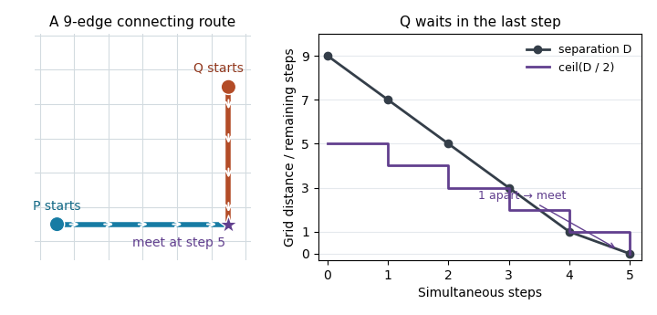

<h1 id="2/c/solution">Solution</h1>

↑ **Parent:** [C](../c.md)

Let $D(p,q)=|p_x-q_x|+|p_y-q_y|$ be their [Manhattan distance](../../../../../manhattan-distance.md). Each joint action can reduce $D$ by at most two, so use the [simultaneous rendezvous distance](../../../../../simultaneous-rendezvous-distance.md)

$$
\boxed{h(p,q)=\left\lceil\frac{D(p,q)}2\right\rceil.}
$$

This [heuristic function](../../../../../heuristic-function.md) is nonzero whenever the robots are apart. For a transition $(p,q)\to(p',q')$, the [triangle inequality](../../../../../triangle-inequality.md) gives

$$
D(p,q)\le D(p,p')+D(p',q')+D(q',q)\le2+D(p',q').
$$

Applying the [ceiling function](../../../../../ceiling-function.md) yields $h(p,q)\le1+h(p',q')$, and $h(p,p)=0$. Thus **$h$ is a [consistent heuristic](../../../../../consistent-heuristic.md)**, hence an [admissible heuristic](../../../../../admissible-heuristic.md).

In the unobstructed grid this estimate is exact. Along a shortest route of length $D$, both robots approach a middle room, taking at most $\lceil D/2\rceil$ steps each; when $D$ is an [odd integer](../../../../../odd-integer.md), the robot with the shorter route waits once. That final wait prevents a crossing from being mistaken for a meeting. With obstacles the same formula remains a [relaxation heuristic](../../../../../relaxation-heuristic.md), though it need not be exact.

**[Figure 1](#2/c/image-an-original-nine-edge-route-needs-five-simultaneous-steps-the-last-wait-produces-a-meeting-rather-than-a-crossing). An original nine-edge route needs five simultaneous steps: the last wait produces a meeting rather than a crossing**.

## ↑ Ancestors (11)

1. [C](../c.md)
2. [2](../../2.md)
3. [Artificial intelligence](../../../artificial-intelligence-split.md)
4. [2022](../../../split.md)
5. [Past exam of the computer science course of the University of Oxford](../../../../split.md)
6. [Computer science course of the University of Oxford](../../../../../computer-science-course-of-the-university-of-oxford.md)
7. [Undergraduate course of the University of Oxford](../../../../../undergraduate-course-of-the-university-of-oxford.md)
8. [Course of the University of Oxford](../../../../../course-of-the-university-of-oxford.md)
9. [University of Oxford](../../../../../university-of-oxford-split.md)
10. [List of universities](../../../../../list-of-universities.md)
11. [Codex Wiki](../../../../../split.md)
