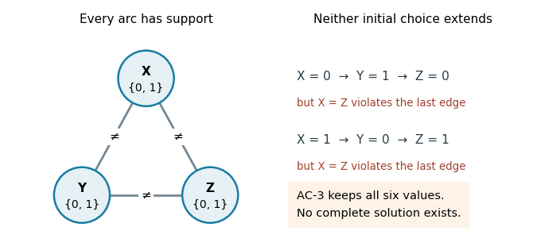

<h1 id="3/a/solution">Solution</h1>

↑ **Parent:** [A](../a.md)

**The first assertion is true.** Each deletion removes a value with no support in an adjacent [constraint domain](../../../../../constraint-domain.md). If a complete solution still used that value, the solution’s neighboring value would supply exactly such a support, a contradiction. By [mathematical induction](../../../../../mathematical-induction.md), [AC-3](../../../../../ac-3.md) never deletes a value used by an original solution. An empty [constraint domain](../../../../../constraint-domain.md) therefore proves that no solution exists.

**The second assertion is false.** Take three [Boolean variables](../../../../../boolean-variable.md) $X,Y,Z$ with [constraint domains](../../../../../constraint-domain.md) $\{0,1\}$ and the [binary constraints](../../../../../binary-constraint.md) $X\ne Y$, $Y\ne Z$, $Z\ne X$. Every value has the opposite value as support across each [edge](../../../../../edge-of-a-graph.md), so [AC-3](../../../../../ac-3.md) deletes nothing and returns true. Yet $X\ne Y$ and $Y\ne Z$ imply $X=Z$, contradicting $Z\ne X$. [Arc consistency](../../../../../arc-consistency.md) checks local support, not compatibility of all supports in one complete assignment.

**[Figure 2](#3/a/image-every-value-has-pairwise-support-but-following-the-three-inequality-constraints-makes-a-complete-assignment-impossible). Every value has pairwise support, but following the three inequality constraints makes a complete assignment impossible**.

**The third assertion is true under the usual explicit-input, constant-cost constraint-checking model.** With $v$ variables, $e$ constrained pairs and maximum [constraint domain](../../../../../constraint-domain.md) size $d$, [AC-3](../../../../../ac-3.md) has [time complexity](../../../../../time-complexity.md) $O(v+ed^3)$ in [Big O notation](../../../../../big-o-notation.md). A revision costs $O(d^2)$; each deletion can re-enqueue incoming arcs, and each [constraint domain](../../../../../constraint-domain.md) loses at most $d$ values, giving $O(ed)$ revisions including the initial arcs. For two-valued [constraint domains](../../../../../constraint-domain.md), $d\le2$, so this is **$O(v+e)$**, linear in the explicit input size. This uses fixed-size relations, or already combined constant-time tests per pair. “Binary” normally describes constraint arity, not two-valued [constraint domains](../../../../../constraint-domain.md); the latter restriction is the extra hypothesis needed here. As usual, initially empty [constraint domains](../../../../../constraint-domain.md) should be rejected before entering the algorithm, including isolated variables.

## ↑ Ancestors (11)

1. [A](../a.md)
2. [3](../../3.md)
3. [Artificial intelligence](../../../artificial-intelligence-split.md)
4. [2022](../../../split.md)
5. [Past exam of the computer science course of the University of Oxford](../../../../split.md)
6. [Computer science course of the University of Oxford](../../../../../computer-science-course-of-the-university-of-oxford.md)
7. [Undergraduate course of the University of Oxford](../../../../../undergraduate-course-of-the-university-of-oxford.md)
8. [Course of the University of Oxford](../../../../../course-of-the-university-of-oxford.md)
9. [University of Oxford](../../../../../university-of-oxford-split.md)
10. [List of universities](../../../../../list-of-universities.md)
11. [Codex Wiki](../../../../../split.md)
