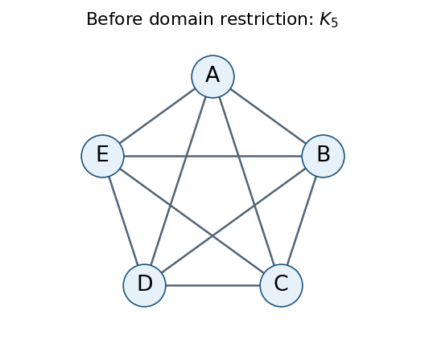
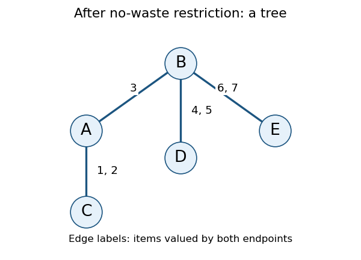

# Artificial intelligence

↑ **Parent:** [2023](../2023.md)

Solutions to all three questions of the University of Oxford examination held on 29 May 2023, including all 23 lettered parts. The paper allowed candidates to answer two questions; all three are solved here. Source release: [released examination archive](https://www.whatdotheyknow.com/request/ba_computer_science_past_papers/response/2577745/attach/2/202402%20183%20CS%20Papers.zip?cookie_passthrough=1), member 2022/T/a16607w1.pdf, whose cover dates the examination to Trinity Term 2023. Question statements and the source illustration are omitted.

**Table of contents**

- [1](#1)
  - [a](#1/a)
    - [Solution](#1/a/solution)
  - [b](#1/b)
    - [Solution](#1/b/solution)
  - [c](#1/c)
    - [Solution](#1/c/solution)
  - [d](#1/d)
    - [Solution](#1/d/solution)
  - [e](#1/e)
    - [Solution](#1/e/solution)
  - [f](#1/f)
    - [Solution](#1/f/solution)
  - [g](#1/g)
    - [Solution](#1/g/solution)
  - [h](#1/h)
    - [Solution](#1/h/solution)
  - [i](#1/i)
    - [Solution](#1/i/solution)
- [2](#2)
  - [a](#2/a)
    - [Solution](#2/a/solution)
  - [b](#2/b)
    - [Solution](#2/b/solution)
  - [c](#2/c)
    - [Solution](#2/c/solution)
  - [d](#2/d)
    - [Solution](#2/d/solution)
  - [e](#2/e)
    - [Solution](#2/e/solution)
  - [f](#2/f)
    - [Solution](#2/f/solution)
  - [g](#2/g)
    - [Solution](#2/g/solution)
  - [h](#2/h)
    - [Solution](#2/h/solution)
- [3](#3)
  - [a](#3/a)
    - [Solution](#3/a/solution)
  - [b](#3/b)
    - [Solution](#3/b/solution)
  - [c](#3/c)
    - [Solution](#3/c/solution)
  - [d](#3/d)
    - [Solution](#3/d/solution)
  - [e](#3/e)
    - [Solution](#3/e/solution)
  - [f](#3/f)
    - [Solution](#3/f/solution)

## 1

↑ **Parent:** [Artificial intelligence](artificial-intelligence.md)

<h3 id="1/a">a</h3>

↑ **Parent:** [1](#1)

<h4 id="1/a/solution">Solution</h4>

↑ **Parent:** [A](#1/a)

Let $V$ be the traversable squares and $H\subseteq V$ the exits. Sample the [state space](../../dynamical-systems.md#state-space) at the end of each complete round, so a live state is $s=(r,f)\in V\times V$ with $r\ne f$. The given starting positions specify the initial state. The board and exits are fixed problem data, rather than changing components of the [state space](../../dynamical-systems.md#state-space).

The rabbit has at most five actions: stay or move to one of its traversable orthogonally adjacent squares. A [search transition model](../../theoretical-computer-science.md#search-transition-model) first applies that action, giving $r'$, and immediately checks for capture at $r'=f$. Otherwise hold $r'$ fixed and apply the fox rule twice, checking for capture after each step. A capture is terminal failure; it must not be overlooked merely because the fox could subsequently move elsewhere. A surviving successor is $(r',f'')$. Equivalently, omit actions whose complete-round outcome is capture.

The [goal test](../../theoretical-computer-science.md#goal-test) is **the rabbit is on an exit after surviving the fox's entire turn**: $r'\in H$ and no capture occurred in that round. Merely entering an exit before the fox moves is insufficient. Each surviving [search transition model](../../theoretical-computer-science.md#search-transition-model) step has cost one when minimizing rounds.

Only legal moves are considered when applying the stated horizontal preference: try a legal horizontal step that reduces horizontal separation, otherwise a legal vertical step that reduces vertical separation, otherwise stay. If a blocked preferred direction is instead interpreted as forcing a stay immediately, the counterexamples below and all completeness and optimality conclusions remain valid.

<h3 id="1/b">b</h3>

↑ **Parent:** [1](#1)

<h4 id="1/b/solution">Solution</h4>

↑ **Parent:** [B](#1/b)

Write $F=|V|\le mn$. The ordered position pairs give at most $F^2$ states, or $F(F-1)$ live states after excluding capture. Thus the usual [Big O notation](../../real-analysis.md#big-o-notation) estimate is **$O(m^2n^2)$**. An additional terminal-failure marker changes this by only one.

For $k$ distinguishable foxes, retain $(r,f_1,\ldots,f_k)$. Different foxes may share a square; none may share the rabbit's square in a live state. There are at most $F(F-1)^k$ live position tuples, giving **$O((mn)^{k+1})$**. These counts describe possible encodings; obstacles, starting positions and the fixed fox rule can make the reachable [state space](../../dynamical-systems.md#state-space) much smaller.

<h3 id="1/c">c</h3>

↑ **Parent:** [1](#1)

<h4 id="1/c/solution">Solution</h4>

↑ **Parent:** [C](#1/c)

The [branching factor](../../theoretical-computer-science.md#branching-factor) of the [search tree](../../theoretical-computer-science.md#search-tree) is at most five, so through depth $d$ it has at most

$$
1+5+\cdots+5^d=\frac{5^{d+1}-1}{4}=O(5^d)
$$

nodes in [Big O notation](../../real-analysis.md#big-o-notation). With no depth bound, **the [search tree](../../theoretical-computer-science.md#search-tree) can be infinite**, despite the finite [state space](../../dynamical-systems.md#state-space): [tree search](../../algorithm.md#tree-search) retains different action histories even when they end at the same position pair.

For a concrete repeating history, use a two-row, three-column board, indexed from zero, with the sole obstacle $(0,1)$, rabbit at $(0,2)$ and fox at $(0,0)$. Repeated rabbit stays leave the fox blocked horizontally with no vertical separation to reduce. Hence the same live state can repeat forever. An exit at $(1,2)$ is nevertheless safely reachable in one round.

<h3 id="1/d">d</h3>

↑ **Parent:** [1](#1)

<h4 id="1/d/solution">Solution</h4>

↑ **Parent:** [D](#1/d)

**[Breadth-first tree search](../../tree-graph-theory.md#breadth-first-tree-search) is complete and optimal for minimizing rounds.** If a successful escape has finite length $d$, there are only finitely many nodes at depths below $d$, since the [branching factor](../../theoretical-computer-science.md#branching-factor) is at most five. [Breadth-first tree search](../../tree-graph-theory.md#breadth-first-tree-search) therefore reaches a shallowest successful node after finite work, even if other branches continue forever.

It is an [optimal search algorithm](../../algorithm.md#optimal-search-algorithm) because every [search transition model](../../theoretical-computer-science.md#search-transition-model) step costs one round, so minimum depth is exactly the desired minimum number of rounds. The [goal test](../../theoretical-computer-science.md#goal-test) must be applied to the surviving complete-round successor. Here a [complete search algorithm](../../algorithm.md#complete-search-algorithm) guarantees finding an escape when one exists; it need not terminate on every unsolvable instance.

<h3 id="1/e">e</h3>

↑ **Parent:** [1](#1)

<h4 id="1/e/solution">Solution</h4>

↑ **Parent:** [E](#1/e)

**[Depth-first tree search](../../algorithm.md#depth-first-tree-search) is neither complete nor optimal for minimizing rounds.**

For incompleteness, use the two-row, three-column board from part (c), with exit $(1,2)$. If stay is the first action explored, [depth-first tree search](../../algorithm.md#depth-first-tree-search) follows the repeating state forever. Moving the rabbit down instead survives the round: under legal horizontal-then-vertical movement the fox moves to $(1,0)$ and then $(1,1)$, leaving the rabbit safely at the exit. Thus a one-round escape exists but is never reached in this action order.

For nonoptimality, use an unobstructed one-row board with columns $0,\ldots,6$, initial fox column $0$, initial rabbit column $4$, and exits at columns $3$ and $6$. Moving left once escapes at column $3$ with the fox at column $2$. Moving right twice escapes at column $6$ with successive fox positions $2,4$. A [depth-first tree search](../../algorithm.md#depth-first-tree-search) that explores the latter route first returns **two rounds although one suffices**. This counterexample supplies an actual returned, suboptimal escape independently of the infinite-branch example.

<h3 id="1/f">f</h3>

↑ **Parent:** [1](#1)

<h4 id="1/f/solution">Solution</h4>

↑ **Parent:** [F](#1/f)

Ignore the fox and obstacles when estimating the remaining number of rabbit moves. Define the [heuristic function](../../theoretical-computer-science.md#heuristic-function)

$$
\boxed{h(r,f)=\min_{e\in H}\bigl(|r_1-e_1|+|r_2-e_2|\bigr).}
$$

This is [Manhattan distance](../../topological-analysis.md#manhattan-distance) to the nearest exit, a [relaxation heuristic](../../theoretical-computer-science.md#relaxation-heuristic). Assume at least one exit; with none the instance is immediately unsolvable. The estimate is generally nonconstant and is not the perfect escape cost: obstacles can force detours, while pursuit can make an apparently nearby exit unreachable.

To prove it is a [consistent heuristic](../../theoretical-computer-science.md#consistent-heuristic), consider a surviving one-round transition from $(r,f)$ to $(r',f')$. Let $e'$ attain the minimum defining $h(r',f')$. The [triangle inequality](../../topological-analysis.md#triangle-inequality) for [Manhattan distance](../../topological-analysis.md#manhattan-distance) and the rabbit's move bound give

$$
h(r,f)\le d_1(r,e')\le d_1(r,r')+d_1(r',e')
\le 1+h(r',f').
$$

Every successful terminal state has $h=0$. This proves consistency with unit round costs; summing the inequality along any successful route also proves that it is an [admissible heuristic](../../theoretical-computer-science.md#admissible-heuristic). Failed transitions need no successor estimate because they are discarded.

<h3 id="1/g">g</h3>

↑ **Parent:** [1](#1)

<h4 id="1/g/solution">Solution</h4>

↑ **Parent:** [G](#1/g)

**[Breadth-first tree search](../../tree-graph-theory.md#breadth-first-tree-search) remains complete but is not optimal for maximizing the bonus.** Completeness depends on the finite [branching factor](../../theoretical-computer-science.md#branching-factor) and a finite successful depth, not on the objective used to compare escapes.

Use the one-row, seven-square example from part (e). The one-round escape at column $3$ leaves the fox at column $2$, so its [graph distance](../../graph-theory.md#distance-graph-theory) to the exit, and hence the bonus, is $1$. The two-round escape at column $6$ leaves the fox at column $4$, giving bonus $2$. The earliest successful node therefore has **bonus $1$ when bonus $2$ is achievable**. [Breadth-first tree search](../../tree-graph-theory.md#breadth-first-tree-search) orders by rounds rather than terminal [graph distance](../../graph-theory.md#distance-graph-theory).

<h3 id="1/h">h</h3>

↑ **Parent:** [1](#1)

<h4 id="1/h/solution">Solution</h4>

↑ **Parent:** [H](#1/h)

**[Breadth-first tree search](../../tree-graph-theory.md#breadth-first-tree-search) is complete and is still not bonus-optimal.** Fix any deterministic rule for choosing among equally short fox routes; the completeness argument again uses only the finite [branching factor](../../theoretical-computer-science.md#branching-factor). The unobstructed corridor of part (g) has unique [shortest paths](../../shortest-path-problem.md#shortest-path), so its fox moves are exactly the same under the new strategy. The one-round bonus is $1$ and the two-round bonus is $2$, proving nonoptimality without any tie-breaking ambiguity.

If there is no route between fox and rabbit, the printed shortest-path rule needs a convention; letting the fox stay supplies a natural extension. The completeness argument is unchanged, and the counterexample above uses only connected squares. When the fox and rabbit initially belong to the same [connected component of a graph](../../graph.md#component-graph-theory), the [shortest-path pursuit distance bound](../../shortest-path-problem.md#shortest-path-pursuit-distance-bound) also makes every surviving branch finite. That additional property does not make the first escape maximize its bonus.

<h3 id="1/i">i</h3>

↑ **Parent:** [1](#1)

<h4 id="1/i/solution">Solution</h4>

↑ **Parent:** [I](#1/i)

**[Depth-first tree search](../../algorithm.md#depth-first-tree-search) is complete under the stated initial [reachability](../../graph.md#reachability-in-a-graph) assumption, but is not bonus-optimal.**

Let $d_t$ be the [graph distance](../../graph-theory.md#distance-graph-theory) between fox and rabbit after round $t$, with $d_0$ their initial [graph distance](../../graph-theory.md#distance-graph-theory). Initial [reachability](../../graph.md#reachability-in-a-graph) makes $d_0$ finite, and ordinary moves preserve membership in their common [connected component of a graph](../../graph.md#component-graph-theory). After the rabbit's next move, the [triangle inequality](../../topological-analysis.md#triangle-inequality) gives intermediate separation at most $d_t+1$. If that separation is at most two, the fox catches the rabbit that round. Otherwise the fox takes two steps along a [shortest path](../../shortest-path-problem.md#shortest-path), leaving

$$
1\le d_{t+1}\le d_t-1.
$$

Thus a successful surviving history has at most $d_0-1$ rounds; if it does not escape by then, the next round captures it. The [shortest-path pursuit distance bound](../../shortest-path-problem.md#shortest-path-pursuit-distance-bound) excludes infinite live branches, even when the rabbit stays. Together with the finite [branching factor](../../theoretical-computer-science.md#branching-factor), it makes the whole relevant [search tree](../../theoretical-computer-science.md#search-tree) finite, so [depth-first tree search](../../algorithm.md#depth-first-tree-search) eventually finds an escape whenever one exists.

For nonoptimality, take the corridor of part (g) and let [depth-first tree search](../../algorithm.md#depth-first-tree-search) try left first. It immediately returns the one-round escape with bonus $1$, whereas trying right twice earns $2$. The decreasing separation proves termination, **not optimality of the first returned escape**.

## 2

↑ **Parent:** [Artificial intelligence](artificial-intelligence.md)

<h3 id="2/a">a</h3>

↑ **Parent:** [2](#2)

<h4 id="2/a/solution">Solution</h4>

↑ **Parent:** [A](#2/a)

In [STRIPS](../../artificial-intelligence.md#strips), a state records the true ground facts; under the [closed-world assumption](../../mathematical-logic.md#closed-world-assumption), an absent fact is false. An action with positive [preconditions](../../algorithm.md#precondition) $P$, add effects $A$ and delete effects $D$ applies when $P\subseteq S$, producing $(S\setminus D)\cup A$.

The given movement action adds the destination fact without deleting the old boat location. After its first crossing the boat can therefore be recorded at both banks, allowing physically impossible loading. Its source-bank symbol is also not a declared action parameter. Repair both issues by using the fully parameterized [STRIPS](../../artificial-intelligence.md#strips) action

$$
\begin{aligned}
\mathrm{Move}(s,t):\quad
P&=\{\mathrm{isBank}(s),\mathrm{isBank}(t),
\mathrm{notEqual}(s,t),\mathrm{at}(\mathrm{BOAT},s)\},\\
A&=\{\mathrm{at}(\mathrm{BOAT},t)\},\\
D&=\{\mathrm{at}(\mathrm{BOAT},s)\}.
\end{aligned}
$$

Here $\mathrm{notEqual}(s,t)$ excludes a vacuous same-bank crossing. The two static inequality facts already supplied suffice.

The given loading action has no capacity check. Consecutive loads can put arbitrarily many items aboard. Introduce a nullary [planning fluent](../../artificial-intelligence.md#planning-fluent) $\mathrm{Empty}$, true initially, and repair loading to

$$
\begin{aligned}
\mathrm{Load}(x,s):\quad
P&=\{\mathrm{isItem}(x),\mathrm{isBank}(s),\mathrm{at}(x,s),
\mathrm{at}(\mathrm{BOAT},s),\mathrm{Empty}\},\\
A&=\{\mathrm{onBoat}(x)\},\\
D&=\{\mathrm{at}(x,s),\mathrm{Empty}\}.
\end{aligned}
$$

Unloading must restore $\mathrm{Empty}$, as in part (c). Including the bank $s$ explicitly as an action parameter removes the other unbound action variable. Equivalently, instantiate separate east-bank and west-bank actions.

These repairs establish the [planning state invariants](../../algorithm.md#planning-state-invariant) that the boat is at exactly one bank, each item is either at one bank or aboard, and at most one item is aboard. The first two hold initially and are preserved by deleting the former location when adding the new one; the capacity marker permits loading only when no item is aboard. Grounding implicit location variables alone would not repair the missing delete effect or the missing capacity check.

<h3 id="2/b">b</h3>

↑ **Parent:** [2](#2)

<h4 id="2/b/solution">Solution</h4>

↑ **Parent:** [B](#2/b)

The [automated planning](../../artificial-intelligence.md#automated-planning) goal is the conjunction of the delivered-item facts:

$$
\boxed{G=\bigwedge_{i=1}^{n}\mathrm{at}(\mathrm{ITEM}i,\mathrm{WEST}).}
$$

The boat need not separately be constrained to end west, although any successful plan with $n>0$ must bring the final item there before unloading it.

<h3 id="2/c">c</h3>

↑ **Parent:** [2](#2)

<h4 id="2/c/solution">Solution</h4>

↑ **Parent:** [C](#2/c)

Use the [STRIPS](../../artificial-intelligence.md#strips) action

$$
\begin{aligned}
\mathrm{Unload}(x,s):\quad
P&=\{\mathrm{isItem}(x),\mathrm{isBank}(s),
\mathrm{onBoat}(x),\mathrm{at}(\mathrm{BOAT},s)\},\\
A&=\{\mathrm{at}(x,s),\mathrm{Empty}\},\\
D&=\{\mathrm{onBoat}(x)\}.
\end{aligned}
$$

The onboard [precondition](../../algorithm.md#precondition) prevents inventing an item at a bank, and deleting $\mathrm{onBoat}(x)$ preserves the item's unique location. Restoring $\mathrm{Empty}$ preserves the one-item [planning state invariant](../../algorithm.md#planning-state-invariant).

<h3 id="2/d">d</h3>

↑ **Parent:** [2](#2)

<h4 id="2/d/solution">Solution</h4>

↑ **Parent:** [D](#2/d)

For $i=1,\ldots,n$, execute

$$
\mathrm{Load}(\mathrm{ITEM}i,\mathrm{EAST}),\quad
\mathrm{Move}(\mathrm{EAST},\mathrm{WEST}),\quad
\mathrm{Unload}(\mathrm{ITEM}i,\mathrm{WEST}),
$$

and, if $i<n$, append $\mathrm{Move}(\mathrm{WEST},\mathrm{EAST})$ before the next iteration.

Each load starts with an empty boat beside an undelivered item. Each unload leaves that item west and restores the loading [precondition](../../algorithm.md#precondition). By [mathematical induction](../../foundations-of-mathematics.md#mathematical-induction) on $i$, after iteration $i$ the first $i$ items are west and the remaining items are east. Thus the [automated planning](../../artificial-intelligence.md#automated-planning) goal holds after **$2n-1$ crossings and $4n-1$ actions** for $n\ge1$. For $n=0$, the empty plan already achieves the goal.

<h3 id="2/e">e</h3>

↑ **Parent:** [2](#2)

<h4 id="2/e/solution">Solution</h4>

↑ **Parent:** [E](#2/e)

Replace the one-place marker $\mathrm{Empty}$ by three nullary [planning fluents](../../artificial-intelligence.md#planning-fluent) $q_0,q_1,q_2$, meaning that zero, one or two items are aboard. Initially only $q_0$ is true. Exactly one of these facts is maintained. No additional object constants are needed.

For compactness, define the common loading [preconditions](../../algorithm.md#precondition)

$$
L(x,s)=\{\mathrm{isItem}(x),\mathrm{isBank}(s),
\mathrm{at}(x,s),\mathrm{at}(\mathrm{BOAT},s)\}
$$

and common unloading [preconditions](../../algorithm.md#precondition)

$$
U(x,s)=\{\mathrm{isItem}(x),\mathrm{isBank}(s),
\mathrm{onBoat}(x),\mathrm{at}(\mathrm{BOAT},s)\}.
$$

The four [STRIPS](../../artificial-intelligence.md#strips) actions are

$$
\begin{aligned}
\mathrm{LoadFirst}(x,s):\quad
P&=L(x,s)\cup\{q_0\},\\
A&=\{\mathrm{onBoat}(x),q_1\},&
D&=\{\mathrm{at}(x,s),q_0\};\\[3pt]
\mathrm{LoadLast}(x,s):\quad
P&=L(x,s)\cup\{q_1\},\\
A&=\{\mathrm{onBoat}(x),q_2\},&
D&=\{\mathrm{at}(x,s),q_1\};\\[3pt]
\mathrm{UnloadFirst}(x,s):\quad
P&=U(x,s)\cup\{q_2\},\\
A&=\{\mathrm{at}(x,s),q_1\},&
D&=\{\mathrm{onBoat}(x),q_2\};\\[3pt]
\mathrm{UnloadLast}(x,s):\quad
P&=U(x,s)\cup\{q_1\},\\
A&=\{\mathrm{at}(x,s),q_0\},&
D&=\{\mathrm{onBoat}(x),q_1\}.
\end{aligned}
$$

Here the first unloading removes one of two items, and the last unloading removes the sole remaining item; items do not require fixed seat identities. The movement action remains as repaired in part (a) and changes none of the occupancy facts.

The [planning state invariant](../../algorithm.md#planning-state-invariant) is $q_j$ true exactly when $j$ items are aboard. Every action changes the marker by the same amount as the actual onboard count, so it follows by [mathematical induction](../../foundations-of-mathematics.md#mathematical-induction) from the initial empty boat. In particular, a third load is impossible.

<h3 id="2/f">f</h3>

↑ **Parent:** [2](#2)

<h4 id="2/f/solution">Solution</h4>

↑ **Parent:** [F](#2/f)

Partition the items into successive groups of size two, with a singleton final group if $n$ is [odd](../../calculus.md#odd-function). For a pair $(x,y)$ on the east bank, execute

$$
\mathrm{LoadFirst}(x,\mathrm{EAST}),\
\mathrm{LoadLast}(y,\mathrm{EAST}),\
\mathrm{Move}(\mathrm{EAST},\mathrm{WEST}),\
\mathrm{UnloadFirst}(y,\mathrm{WEST}),\
\mathrm{UnloadLast}(x,\mathrm{WEST}).
$$

For a singleton $x$, execute

$$
\mathrm{LoadFirst}(x,\mathrm{EAST}),\
\mathrm{Move}(\mathrm{EAST},\mathrm{WEST}),\
\mathrm{UnloadLast}(x,\mathrm{WEST}).
$$

Return the empty boat east between groups. Each group starts and ends with marker $q_0$, and its items finish west, proving all [preconditions](../../algorithm.md#precondition) and the final goal by [mathematical induction](../../foundations-of-mathematics.md#mathematical-induction) over the groups. For $n\ge1$ there are $\lceil n/2\rceil$ outward journeys and **$2\lceil n/2\rceil-1$ crossings** in total; $\lceil\cdot\rceil$ is the [ceiling function](../../calculus.md#ceiling-function). Again $n=0$ needs no actions.

<h3 id="2/g">g</h3>

↑ **Parent:** [2](#2)

<h4 id="2/g/solution">Solution</h4>

↑ **Parent:** [G](#2/g)

Keep the corrected one-place [STRIPS](../../artificial-intelligence.md#strips) model, replace the item constants and their initial typing facts by $\mathrm{FOX},\mathrm{RABBIT},\mathrm{CARROT}$, and require all three west in the goal. The farmer travels with the boat, so the boat's bank also records where supervision is available. The new requirement concerns the bank being left: incompatible items may coexist at the farmer's current bank, but must not be left there together.

Here is a compilation using only ordinary positive [STRIPS](../../artificial-intelligence.md#strips) [preconditions](../../algorithm.md#precondition). Replace $\mathrm{onBoat}(x)$ everywhere by $\mathrm{at}(x,\mathrm{BOAT})$, extending the item's possible locations to

$$
\mathcal L=\{\mathrm{EAST},\mathrm{WEST},\mathrm{BOAT}\}.
$$

The boat itself still has only bank locations, enforced by $\mathrm{isBank}$. Initialize a static relation $\mathrm{SafePair}(p,q,s)$ for every $p,q\in\mathcal L$ and bank $s$ except $p=q=s$. It states that two incompatible items at locations $p,q$ are not both on the bank about to be left.

Introduce [planning safety certificates](../../algorithm.md#planning-safety-certificate) $\mathrm{SafeToSail}(\mathrm{EAST})$ and $\mathrm{SafeToSail}(\mathrm{WEST})$, neither initially true. The following checking action grants a certificate:

$$
\begin{aligned}
\mathrm{Check}(s,p_F,p_R,p_C):\quad
P=\{&
\mathrm{isBank}(s),\mathrm{at}(\mathrm{BOAT},s),\\
&\mathrm{at}(\mathrm{FOX},p_F),\mathrm{at}(\mathrm{RABBIT},p_R),
\mathrm{at}(\mathrm{CARROT},p_C),\\
&\mathrm{SafePair}(p_F,p_R,s),\mathrm{SafePair}(p_R,p_C,s)\},\\
A&=\{\mathrm{SafeToSail}(s)\},\qquad D=\varnothing.
\end{aligned}
$$

Add $\mathrm{SafeToSail}(s)$ to the [preconditions](../../algorithm.md#precondition) of $\mathrm{Move}(s,t)$. Every load, unload and move deletes **both** certificate facts. The other movement and capacity effects remain unchanged.

Deleting certificates on every location change prevents a stale safety check from authorizing a later unsafe departure. A certificate is granted only for the actual current locations and only when both incompatible pairs are separated on the departure bank. During a crossing the remaining bank is therefore safe; on arrival the farmer supervises the destination bank. This proves the required safety property by [mathematical induction](../../foundations-of-mathematics.md#mathematical-induction) over crossings. The static $\mathrm{SafePair}$ facts are never changed.

<h3 id="2/h">h</h3>

↑ **Parent:** [2](#2)

<h4 id="2/h/solution">Solution</h4>

↑ **Parent:** [H](#2/h)

Write $F,R,C$ for the three item constants, $E,W$ for the banks, $L,U,M$ for the corrected load, unload and move actions, and $K_s$ for $\mathrm{Check}(s,p_F,p_R,p_C)$ instantiated with the items' actual current locations. A fully executable plan in the [STRIPS](../../artificial-intelligence.md#strips) model of part (g) is

$$
\begin{aligned}
&L(R,E),\ K_E,\ M(E,W),\ U(R,W),\\
&K_W,\ M(W,E),\\
&L(F,E),\ K_E,\ M(E,W),\ U(F,W),\\
&L(R,W),\ K_W,\ M(W,E),\ U(R,E),\\
&L(C,E),\ K_E,\ M(E,W),\ U(C,W),\\
&K_W,\ M(W,E),\\
&L(R,E),\ K_E,\ M(E,W),\ U(R,W).
\end{aligned}
$$

Thus the seven crossings carry **rabbit west, nothing east, fox west, rabbit east, carrot west, nothing east, rabbit west**.

Immediately before those crossings, the items left on the departure bank are respectively $\{F,C\},\{R\},\{C\},\{F\},\{R\},\{F,C\},\varnothing$. None contains an incompatible pair, so each displayed $K_s$ has its safety [preconditions](../../algorithm.md#precondition). Each loaded crossing carries exactly one item, and all three finish west.

## 3

↑ **Parent:** [Artificial intelligence](artificial-intelligence.md)

<h3 id="3/a">a</h3>

↑ **Parent:** [3](#3)

<h4 id="3/a/solution">Solution</h4>

↑ **Parent:** [A](#3/a)

For [fair division](../../game-theory.md#fair-division), let $J=\{1,\ldots,m\}$ and let the [additive valuation](../../game-theory.md#additive-valuation) of agent $i$ be $v_i(S)=\sum_{j\in S}v_{ij}$. Use one variable $X_i$ per agent, with [constraint domain](../../theoretical-computer-science.md#constraint-domain) $\mathcal P(J)$, the [power set](../../set.md#power-set) of the items. Empty bundles are permitted in this original formulation.

Require pairwise [disjoint sets](../../set.md#disjoint-sets):

$$
X_i\cap X_\ell=\varnothing\qquad(1\le i<\ell\le n).
$$

Each such [binary constraint](../../theoretical-computer-science.md#binary-constraint) involves exactly $X_i,X_\ell$. Require complete allocation by the single all-variable constraint

$$
\bigcup_{i=1}^{n}X_i=J.
$$

Finally impose the [envy-free allocation](../../game-theory.md#envy-free-allocation) [binary constraints](../../theoretical-computer-science.md#binary-constraint)

$$
v_i(X_i)\ge v_i(X_\ell)\qquad(i\ne\ell),
$$

each on $X_i,X_\ell$. The two directions for a pair use different agents' [additive valuations](../../game-theory.md#additive-valuation) and must both hold. These conditions give precisely an ordered [set partition](../../combinatorics.md#set-partition) of the items that is an [envy-free allocation](../../game-theory.md#envy-free-allocation).

<h3 id="3/b">b</h3>

↑ **Parent:** [3](#3)

<h4 id="3/b/solution">Solution</h4>

↑ **Parent:** [B](#3/b)

Use one variable $Y_j$ per item, with [constraint domain](../../theoretical-computer-science.md#constraint-domain) $\{1,\ldots,n\}$. Its value is the recipient agent. Every assignment automatically allocates each item exactly once, so separate coverage and disjointness constraints are unnecessary.

For every ordered pair $i\ne\ell$, impose

$$
\boxed{\sum_{j=1}^{m}v_{ij}\mathbf1_{\{Y_j=i\}}
\ge
\sum_{j=1}^{m}v_{ij}\mathbf1_{\{Y_j=\ell\}}.}
$$

Here $\mathbf1$ is an [indicator function](../../measure-theory.md#indicator-function). The constraint involves every $Y_j$ with $v_{ij}\ne0$; one may formally give it scope $\{Y_1,\ldots,Y_m\}$, since zero coefficients make the other variables irrelevant. These constraints state [envy-free allocation](../../game-theory.md#envy-free-allocation) using the comparing agent's [additive valuation](../../game-theory.md#additive-valuation) on both sides. In contrast to part (a), they generally involve more than two variables.

<h3 id="3/c">c</h3>

↑ **Parent:** [3](#3)

<h4 id="3/c/solution">Solution</h4>

↑ **Parent:** [C](#3/c)

With agent variables, each [constraint domain](../../theoretical-computer-science.md#constraint-domain) has [cardinality](../../cardinal-number.md#cardinality) $2^m$. Their total number of listed domain values is $n2^m$, while the [Cartesian product](../../set-theory.md#cartesian-product) of the domains has

$$
\boxed{(2^m)^n=2^{mn}}
$$

complete assignments before constraints.

With item variables, each [constraint domain](../../theoretical-computer-science.md#constraint-domain) has [cardinality](../../cardinal-number.md#cardinality) $n$. Their total number of listed domain values is $mn$, while their [Cartesian product](../../set-theory.md#cartesian-product) has

$$
\boxed{n^m}
$$

complete assignments. These are raw domain-space sizes. The larger agent-variable space includes overlaps and missing items; imposing the allocation constraints reduces it to the same $n^m$ actual complete allocations represented directly by item variables.

<h3 id="3/d">d</h3>

↑ **Parent:** [3](#3)

<h4 id="3/d/solution">Solution</h4>

↑ **Parent:** [D](#3/d)

Before using [no-waste allocation](../../game-theory.md#no-waste-allocation) to restrict the [constraint domains](../../theoretical-computer-science.md#constraint-domain), there is one [constraint graph](../../theoretical-computer-science.md#constraint-graph) [vertex](../../graph.md#vertex-graph-theory) for each of $A,B,C,D,E$. Every distinct pair has a disjointness [binary constraint](../../theoretical-computer-science.md#binary-constraint), and also the two directional [envy-free allocation](../../game-theory.md#envy-free-allocation) constraints. Thus the [constraint graph](../../theoretical-computer-science.md#constraint-graph) is **the [complete graph](../../graph-theory.md#complete-graph) $K_5$**, with all ten [edges](../../graph-theory.md#edge-of-a-graph).

The nonempty-bundle and [no-waste allocation](../../game-theory.md#no-waste-allocation) requirements are unary and add no [edges](../../graph-theory.md#edge-of-a-graph). The original all-item coverage constraint has been removed because this variant permits unallocated items.

**[Figure 1](#3/d/image-the-allocation-constraint-graph-before-restricting-the-constraint-domains). The allocation constraint graph before restricting the constraint domains**.

<h3 id="3/e">e</h3>

↑ **Parent:** [3](#3)

<h4 id="3/e/solution">Solution</h4>

↑ **Parent:** [E](#3/e)

Restrict each agent to nonempty bundles of items that they value positively. Let the positive-value supports be

$$
\begin{aligned}
S_A&=\{1,2,3\},&S_B&=\{3,4,5,6,7\},&S_C&=\{1,2\},\\
S_D&=\{4,5\},&S_E&=\{6,7\}.
\end{aligned}
$$

The residual [constraint domains](../../theoretical-computer-science.md#constraint-domain) are $D_i=\mathcal P(S_i)\setminus\{\varnothing\}$, with sizes **$7,31,3,3,3$**, respectively. The [no-waste allocation](../../game-theory.md#no-waste-allocation) and nonempty-bundle requirements are now built into these [constraint domains](../../theoretical-computer-science.md#constraint-domain).

If $S_i\cap S_\ell=\varnothing$, every pair $X_i\in D_i$, $X_\ell\in D_\ell$ is disjoint. Moreover, $v_i(X_\ell)=v_\ell(X_i)=0$, so both [envy-free allocation](../../game-theory.md#envy-free-allocation) inequalities hold automatically because all values are nonnegative. Thus all three [binary constraints](../../theoretical-computer-science.md#binary-constraint) disappear for the pairs

$$
AD,\ AE,\ BC,\ CD,\ CE,\ DE.
$$

The only positive-support overlaps, and hence the remaining [constraint graph](../../theoretical-computer-science.md#constraint-graph) [edges](../../graph-theory.md#edge-of-a-graph), are

$$
\boxed{AC\ (1,2),\qquad AB\ (3),\qquad BD\ (4,5),\qquad BE\ (6,7),}
$$

where parentheses list the shared items.

Each listed pair really retains restrictions. For $AC$, $AB$, $BD$, $BE$, respectively, let both endpoints choose $\{1\}$, $\{3\}$, $\{4\}$, $\{6\}$: this violates disjointness while belonging to both residual [constraint domains](../../theoretical-computer-science.md#constraint-domain). The directional [envy-free allocation](../../game-theory.md#envy-free-allocation) inequalities are also individually nontrivial. For example, for $AB$, choosing $X_A=\{1\}$ and $X_B=\{3\}$ makes $A$ envious, while choosing $X_A=\{3\}$ and $X_B=\{4\}$ makes $B$ envious. The analogous shared-item comparisons apply on the other three [edges](../../graph-theory.md#edge-of-a-graph).

**[Figure 2](#3/e/image-the-residual-allocation-constraint-graph-labels-show-shared-positive-value-items). The residual allocation constraint graph; labels show shared positive-value items**.

<h3 id="3/f">f</h3>

↑ **Parent:** [3](#3)

<h4 id="3/f/solution">Solution</h4>

↑ **Parent:** [F](#3/f)

The residual [constraint graph](../../theoretical-computer-science.md#constraint-graph) is a **[tree](../../tree-graph-theory.md)**, rooted conveniently at $B$, with children $A,D,E$ and with $C$ a child of $A$. Solve it by the [tree-structured constraint satisfaction](../../theoretical-computer-science.md#tree-structured-constraint-satisfaction) [algorithm](../../algorithm.md): enforce [arc consistency](../../theoretical-computer-science.md#arc-consistency) from children toward their parents, then choose a surviving root value and select supported child values in the opposite direction.

For adjacent agents define the combined [binary constraint](../../theoretical-computer-science.md#binary-constraint)

$$
R_{i\ell}(X,Y)\iff
X\cap Y=\varnothing,\quad v_i(X)\ge v_i(Y),\quad
v_\ell(Y)\ge v_\ell(X).
$$

A child-to-parent [arc consistency](../../theoretical-computer-science.md#arc-consistency) step deletes each parent bundle with no compatible child bundle. Process the [edges](../../graph-theory.md#edge-of-a-graph) in the order $A\leftarrow C$, $B\leftarrow A$, $B\leftarrow D$, $B\leftarrow E$.

First, $C$ needs a nonempty subset of $\{1,2\}$. Supporting $C$ reduces $A$'s [constraint domain](../../theoretical-computer-science.md#constraint-domain) to

$$
D_A'=\bigl\{\{2\},\{3\},\{1,3\},\{2,3\}\bigr\}.
$$

Indeed, $\{1\}$ leaves only $\{2\}$ for $C$ but gives $A$ value $2<3$; $\{1,2\}$ and $\{1,2,3\}$ leave no possible item for $C$. Each of the four retained choices has a compatible choice for $C$.

Next, supporting $A$ reduces $B$'s [constraint domain](../../theoretical-computer-science.md#constraint-domain) to all nonempty subsets of $\{4,5,6,7\}$. To see why item $3$ cannot remain in $B$'s bundle, a disjoint compatible $A$ bundle from $D_A'$ would have to be $\{2\}$, but $A$ then values its own bundle at $3$ and $B$'s at least at $6$. Conversely any nonempty subset of $\{4,5,6,7\}$ is compatible with $A=\{2\}$.

Supporting $D$ next reduces $B$'s [constraint domain](../../theoretical-computer-science.md#constraint-domain) to

$$
\bigl\{\{6\},\{7\},\{4,6\},\{4,7\},\{6,7\},\{4,6,7\}\bigr\}.
$$

If $B$ held item $5$, disjointness would force $D=\{4\}$, whose value $1$ is below $D$'s value $4$ for $B$'s bundle. If $B$ holds $4$ but not $5$, then $D=\{5\}$, and $B$ needs value at least $6$ to avoid envying $D$. If $B$ holds neither, $D=\{4\}$ supports every nonempty subset of $\{6,7\}$.

Finally, supporting $E$ leaves

$$
D_B'=\bigl\{\{6\},\{7\},\{4,6\},\{4,7\}\bigr\}.
$$

The removed choices contained both $6$ and $7$, leaving no item for $E$. Every displayed choice has a compatible choice for $E$.

Choose $B=\{6\}$, then supported child values, giving

$$
\boxed{X_A=\{2\},\quad X_B=\{6\},\quad X_C=\{1\},\quad
X_D=\{4\},\quad X_E=\{7\}.}
$$

Items $3,5$ remain unallocated, which this variant expressly permits. To check every [envy-free allocation](../../game-theory.md#envy-free-allocation) inequality, the matrix of agents' [additive valuations](../../game-theory.md#additive-valuation) of these bundles, with rows and columns both ordered $A,B,C,D,E$, is

$$
\begin{pmatrix}
3&0&2&0&0\\
0&3&0&3&3\\
1&0&1&0&0\\
0&0&0&1&0\\
0&2&0&0&2
\end{pmatrix}.
$$

Each diagonal entry is at least every entry in its row. The bundles are nonempty, pairwise disjoint, and contain only positively valued items, so all remaining requirements hold.

Why does selecting supported children suffice? The residual [constraint graph](../../theoretical-computer-science.md#constraint-graph) has no [graph cycle](../../graph-theory.md#cycle-in-a-graph), so different child subtrees have no constraints between them. Child-to-parent [arc consistency](../../theoretical-computer-science.md#arc-consistency) has already ensured a compatible continuation below every retained parent value. Applying this observation recursively proves that the downward choices complete a solution without [backtracking](../../algorithm.md#backtracking). With $N$ variables and maximum [constraint domain](../../theoretical-computer-science.md#constraint-domain) size $d$, the basic compatibility checks require $O(Nd^2)$ [time complexity](../../theoretical-computer-science.md#time-complexity) in [Big O notation](../../real-analysis.md#big-o-notation), counting each [binary constraint](../../theoretical-computer-science.md#binary-constraint) evaluation as one operation; evaluating bundle sums has its own input-dependent cost.

## ↑ Ancestors (8)

1. [2023](../2023.md)
2. [Past exam of the computer science course of the University of Oxford](../../past-exam-of-the-computer-science-course-of-the-university-of-oxford.md)
3. [Computer science course of the University of Oxford](../../university-of-oxford.md#computer-science-course-of-the-university-of-oxford)
4. [Undergraduate course of the University of Oxford](../../university-of-oxford.md#undergraduate-course-of-the-university-of-oxford)
5. [Course of the University of Oxford](../../university-of-oxford.md#course-of-the-university-of-oxford)
6. [University of Oxford](../../university-of-oxford.md)
7. [List of universities](../../README.md#list-of-universities)
8. [Codex Wiki](../../README.md)
