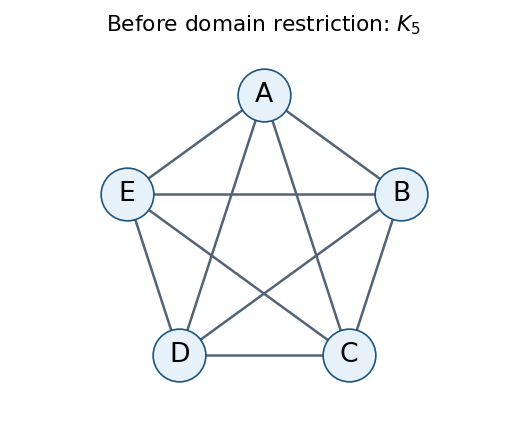

<h1 id="3/d/solution">Solution</h1>

↑ **Parent:** [D](../d.md)

Before using [no-waste allocation](../../../../../no-waste-allocation.md) to restrict the [constraint domains](../../../../../constraint-domain.md), there is one [constraint graph](../../../../../constraint-graph.md) [vertex](../../../../../vertex-graph-theory.md) for each of $A,B,C,D,E$. Every distinct pair has a disjointness [binary constraint](../../../../../binary-constraint.md), and also the two directional [envy-free allocation](../../../../../envy-free-allocation.md) constraints. Thus the [constraint graph](../../../../../constraint-graph.md) is **the [complete graph](../../../../../complete-graph.md) $K_5$**, with all ten [edges](../../../../../edge-of-a-graph.md).

The nonempty-bundle and [no-waste allocation](../../../../../no-waste-allocation.md) requirements are unary and add no [edges](../../../../../edge-of-a-graph.md). The original all-item coverage constraint has been removed because this variant permits unallocated items.

**[Figure 1](#3/d/image-the-allocation-constraint-graph-before-restricting-the-constraint-domains). The allocation constraint graph before restricting the constraint domains**.

## ↑ Ancestors (11)

1. [D](../d.md)
2. [3](../../3.md)
3. [Artificial intelligence](../../../artificial-intelligence-split.md)
4. [2023](../../../split.md)
5. [Past exam of the computer science course of the University of Oxford](../../../../split.md)
6. [Computer science course of the University of Oxford](../../../../../computer-science-course-of-the-university-of-oxford.md)
7. [Undergraduate course of the University of Oxford](../../../../../undergraduate-course-of-the-university-of-oxford.md)
8. [Course of the University of Oxford](../../../../../course-of-the-university-of-oxford.md)
9. [University of Oxford](../../../../../university-of-oxford-split.md)
10. [List of universities](../../../../../list-of-universities.md)
11. [Codex Wiki](../../../../../split.md)
