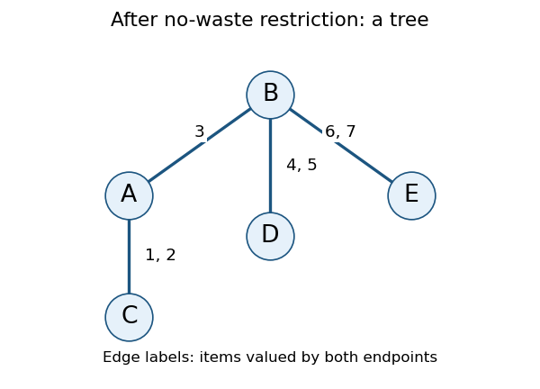

<h1 id="3/e/solution">Solution</h1>

↑ **Parent:** [E](../e.md)

Restrict each agent to nonempty bundles of items that they value positively. Let the positive-value supports be

$$
\begin{aligned}
S_A&=\{1,2,3\},&S_B&=\{3,4,5,6,7\},&S_C&=\{1,2\},\\
S_D&=\{4,5\},&S_E&=\{6,7\}.
\end{aligned}
$$

The residual [constraint domains](../../../../../constraint-domain.md) are $D_i=\mathcal P(S_i)\setminus\{\varnothing\}$, with sizes **$7,31,3,3,3$**, respectively. The [no-waste allocation](../../../../../no-waste-allocation.md) and nonempty-bundle requirements are now built into these [constraint domains](../../../../../constraint-domain.md).

If $S_i\cap S_\ell=\varnothing$, every pair $X_i\in D_i$, $X_\ell\in D_\ell$ is disjoint. Moreover, $v_i(X_\ell)=v_\ell(X_i)=0$, so both [envy-free allocation](../../../../../envy-free-allocation.md) inequalities hold automatically because all values are nonnegative. Thus all three [binary constraints](../../../../../binary-constraint.md) disappear for the pairs

$$
AD,\ AE,\ BC,\ CD,\ CE,\ DE.
$$

The only positive-support overlaps, and hence the remaining [constraint graph](../../../../../constraint-graph.md) [edges](../../../../../edge-of-a-graph.md), are

$$
\boxed{AC\ (1,2),\qquad AB\ (3),\qquad BD\ (4,5),\qquad BE\ (6,7),}
$$

where parentheses list the shared items.

Each listed pair really retains restrictions. For $AC$, $AB$, $BD$, $BE$, respectively, let both endpoints choose $\{1\}$, $\{3\}$, $\{4\}$, $\{6\}$: this violates disjointness while belonging to both residual [constraint domains](../../../../../constraint-domain.md). The directional [envy-free allocation](../../../../../envy-free-allocation.md) inequalities are also individually nontrivial. For example, for $AB$, choosing $X_A=\{1\}$ and $X_B=\{3\}$ makes $A$ envious, while choosing $X_A=\{3\}$ and $X_B=\{4\}$ makes $B$ envious. The analogous shared-item comparisons apply on the other three [edges](../../../../../edge-of-a-graph.md).

**[Figure 2](#3/e/image-the-residual-allocation-constraint-graph-labels-show-shared-positive-value-items). The residual allocation constraint graph; labels show shared positive-value items**.

## ↑ Ancestors (11)

1. [E](../e.md)
2. [3](../../3.md)
3. [Artificial intelligence](../../../artificial-intelligence-split.md)
4. [2023](../../../split.md)
5. [Past exam of the computer science course of the University of Oxford](../../../../split.md)
6. [Computer science course of the University of Oxford](../../../../../computer-science-course-of-the-university-of-oxford.md)
7. [Undergraduate course of the University of Oxford](../../../../../undergraduate-course-of-the-university-of-oxford.md)
8. [Course of the University of Oxford](../../../../../course-of-the-university-of-oxford.md)
9. [University of Oxford](../../../../../university-of-oxford-split.md)
10. [List of universities](../../../../../list-of-universities.md)
11. [Codex Wiki](../../../../../split.md)
