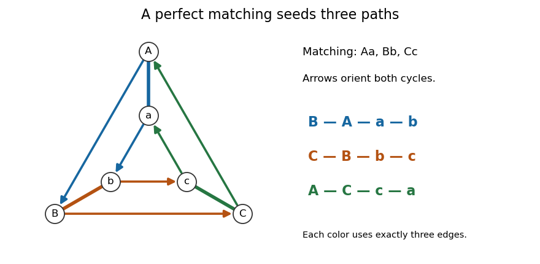
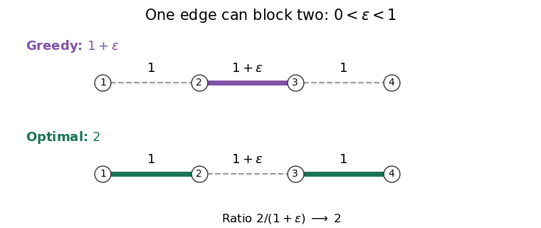

# Combinatorial optimisation

↑ **Parent:** [2023](../2023.md)

Worked solutions to all three questions of the Oxford examination held on 25 May 2023. Source release: [released examination archive](https://www.whatdotheyknow.com/request/ba_computer_science_past_papers/response/2577745/attach/2/202402%20183%20CS%20Papers.zip?cookie_passthrough=1), member `2022/T/a18330w1.pdf`; the cover identifies the examination as Trinity Term 2023. Numbering follows the source PDF, pages 2–4. The examination asks candidates to choose two questions; all three are solved here.

We use finite [simple graphs](../../graph.md#simple-graph) throughout the [graph](../../graph.md) arguments. In Question 1(c), $V$ must be nonempty for the stated minimum to exist. In Question 3(d), an [edge cover](../../graph-theory.md#edge-cover) exists only when there is no [isolated vertex](../../random-graph.md#isolated-vertex); for a nonempty [connected graph](../../graph.md#connected-graph) this excludes the one-[vertex](../../graph.md#vertex-graph-theory) [graph](../../graph.md). These minor domain qualifications are made explicit in the affected solutions.

**Table of contents**

- [1](#1)
  - [a](#1/a)
    - [Solution](#1/a/solution)
  - [b](#1/b)
    - [Solution](#1/b/solution)
  - [c](#1/c)
    - [i](#1/c/i)
      - [Solution](#1/c/i/solution)
    - [ii](#1/c/ii)
      - [Solution](#1/c/ii/solution)
  - [d](#1/d)
    - [i](#1/d/i)
      - [Solution](#1/d/i/solution)
    - [ii](#1/d/ii)
      - [Solution](#1/d/ii/solution)
    - [iii](#1/d/iii)
      - [Solution](#1/d/iii/solution)
    - [iv](#1/d/iv)
      - [Solution](#1/d/iv/solution)
  - [e](#1/e)
    - [Solution](#1/e/solution)
  - [f](#1/f)
    - [Solution](#1/f/solution)
- [2](#2)
  - [a](#2/a)
    - [Solution](#2/a/solution)
  - [b](#2/b)
    - [i](#2/b/i)
      - [Solution](#2/b/i/solution)
    - [ii](#2/b/ii)
      - [Solution](#2/b/ii/solution)
  - [c](#2/c)
    - [i](#2/c/i)
      - [Solution](#2/c/i/solution)
    - [ii](#2/c/ii)
      - [Solution](#2/c/ii/solution)
    - [iii](#2/c/iii)
      - [Solution](#2/c/iii/solution)
    - [iv](#2/c/iv)
      - [Solution](#2/c/iv/solution)
    - [v](#2/c/v)
      - [Solution](#2/c/v/solution)
    - [vi](#2/c/vi)
      - [Solution](#2/c/vi/solution)
    - [vii](#2/c/vii)
      - [Solution](#2/c/vii/solution)
    - [viii](#2/c/viii)
      - [Solution](#2/c/viii/solution)
- [3](#3)
  - [a](#3/a)
    - [Solution](#3/a/solution)
  - [b](#3/b)
    - [i](#3/b/i)
      - [Solution](#3/b/i/solution)
    - [ii](#3/b/ii)
      - [Solution](#3/b/ii/solution)
  - [c](#3/c)
    - [i](#3/c/i)
      - [Solution](#3/c/i/solution)
    - [ii](#3/c/ii)
      - [Solution](#3/c/ii/solution)
  - [d](#3/d)
    - [i](#3/d/i)
      - [Solution](#3/d/i/solution)
    - [ii](#3/d/ii)
      - [Solution](#3/d/ii/solution)
    - [iii](#3/d/iii)
      - [Solution](#3/d/iii/solution)

## 1

↑ **Parent:** [Combinatorial optimisation](combinatorial-optimisation.md)

<h3 id="1/a">a</h3>

↑ **Parent:** [1](#1)

<h4 id="1/a/solution">Solution</h4>

↑ **Parent:** [A](#1/a)

For a [set function](../../function.md#set-function) $f:2^V\to\mathbb R$, the four properties are:

- A [normalised set function](../../function.md#normalised-set-function) satisfies **$f(\varnothing)=0$**.
- A [nonnegative function](../../function.md#nonnegative-function) satisfies **$f(S)\geq0$ for every $S\subseteq V$**.
- A [monotone set function](../../function.md#monotone-set-function) satisfies **$f(A)\leq f(B)$ whenever $A\subseteq B\subseteq V$**.
- A [symmetric set function](../../function.md#symmetric-set-function) satisfies **$f(S)=f(V\setminus S)$ for every $S\subseteq V$**.

Here [monotone set function](../../function.md#monotone-set-function) means nondecreasing under inclusion; it does not require strict increase.

<h3 id="1/b">b</h3>

↑ **Parent:** [1](#1)

<h4 id="1/b/solution">Solution</h4>

↑ **Parent:** [B](#1/b)

The intersection–union definition of a [submodular set function](../../function.md#submodular-set-function) is

$$
f(A)+f(B)\geq f(A\cap B)+f(A\cup B)\qquad(A,B\subseteq V).
$$

The [diminishing returns characterization of submodularity](../../function.md#diminishing-returns-characterization-of-submodularity) says that its [marginal increments](../../function.md#marginal-increment-of-a-set-function) decrease as the conditioning [set](../../set.md) grows:

$$
\Delta_x f(A):=f(A\cup\{x\})-f(A)\geq f(B\cup\{x\})-f(B)=:\Delta_x f(B)
\quad(A\subseteq B,\ x\notin B).
$$

To obtain [diminishing returns](../../function.md#diminishing-returns-characterization-of-submodularity) from [submodularity](../../function.md#submodular-set-function), apply the intersection–union inequality to $A\cup\{x\}$ and $B$. Their [intersection](../../set.md#set-intersection) is $A$ and their [union](../../set.md#set-union) is $B\cup\{x\}$, giving exactly the displayed comparison.

Conversely, assume [diminishing returns](../../function.md#diminishing-returns-characterization-of-submodularity), and enumerate $A\setminus B=\{x_1,\ldots,x_m\}$. Put $C_j=(A\cap B)\cup\{x_1,\ldots,x_j\}$ and $D_j=B\cup\{x_1,\ldots,x_j\}$. Since $C_{j-1}\subseteq D_{j-1}$ and $x_j\notin D_{j-1}$, summing the [marginal increment](../../function.md#marginal-increment-of-a-set-function) comparisons gives the [telescoping sum](../../arithmetic.md#telescoping-sum)

$$
f(A)-f(A\cap B)=\sum_{j=1}^m\Delta_{x_j}f(C_{j-1})
\geq\sum_{j=1}^m\Delta_{x_j}f(D_{j-1})=f(A\cup B)-f(B).
$$

Rearrangement proves [submodularity](../../function.md#submodular-set-function). When $A\setminus B$ is empty, both sums are zero, so the proof includes that case.

<h3 id="1/c">c</h3>

↑ **Parent:** [1](#1)

<h4 id="1/c/i">i</h4>

↑ **Parent:** [C](#1/c)

<h5 id="1/c/i/solution">Solution</h5>

↑ **Parent:** [I](#1/c/i)

**Yes: this is a [monotone set function](../../function.md#monotone-set-function).** Assume $V\ne\varnothing$, as required by its definition at the [empty set](../../set.md#empty-set). If $\varnothing\ne A\subseteq B$, every weight considered in the maximum over $A$ is considered in the maximum over $B$, hence $f(A)\leq f(B)$. If $A=\varnothing$ and $B\ne\varnothing$, the minimum over $V$ is at most every weight in $B$, hence again $f(A)\leq f(B)$. No sign condition on the weights is needed.

<h4 id="1/c/ii">ii</h4>

↑ **Parent:** [C](#1/c)

<h5 id="1/c/ii/solution">Solution</h5>

↑ **Parent:** [Ii](#1/c/ii)

For every $S\subseteq V$ and $x\notin S$, including $S=\varnothing$, the [marginal increment](../../function.md#marginal-increment-of-a-set-function) is

$$
\Delta_x f(S)=\max\{0,w(x)-f(S)\}.
$$

For the [empty set](../../set.md#empty-set), this uses $w(x)\geq f(\varnothing)=\min_{v\in V}w(v)$. The [monotone set function](../../function.md#monotone-set-function) property from (i) gives $f(A)\leq f(B)$ when $A\subseteq B$. Consequently

$$
\max\{0,w(x)-f(A)\}\geq\max\{0,w(x)-f(B)\}.
$$

Thus [diminishing returns](../../function.md#diminishing-returns-characterization-of-submodularity) holds, so **$f$ is a [submodular set function](../../function.md#submodular-set-function)** by (b).

<h3 id="1/d">d</h3>

↑ **Parent:** [1](#1)

<h4 id="1/d/i">i</h4>

↑ **Parent:** [D](#1/d)

<h5 id="1/d/i/solution">Solution</h5>

↑ **Parent:** [I](#1/d/i)

**Yes, for arbitrary signed weights.** A [hyperedge](../../hypergraph.md#hyperedge) meets both $S$ and $V\setminus S$ exactly when it meets both $V\setminus S$ and $S$. Therefore $\delta(S)=\delta(V\setminus S)$, and their weighted sums agree. The [hypergraph cut function](../../hypergraph.md#hypergraph-cut-function) is a [symmetric set function](../../function.md#symmetric-set-function) regardless of the signs of its weights.

<h4 id="1/d/ii">ii</h4>

↑ **Parent:** [D](#1/d)

<h5 id="1/d/ii/solution">Solution</h5>

↑ **Parent:** [Ii](#1/d/ii)

**No.** Take the [hypergraph](../../hypergraph.md) with $V=\{a,b\}$ and its single [hyperedge](../../hypergraph.md#hyperedge) $\{a,b\}$ of weight $1$. Then $\{a\}\subseteq V$ but $f(\{a\})=1>0=f(V)$, violating the [monotone set function](../../function.md#monotone-set-function) property. This example already has strictly positive weights.

<h4 id="1/d/iii">iii</h4>

↑ **Parent:** [D](#1/d)

<h5 id="1/d/iii/solution">Solution</h5>

↑ **Parent:** [Iii](#1/d/iii)

**No for arbitrary signed weights.** Give the same single [hyperedge](../../hypergraph.md#hyperedge) weight $-1$. For $A=\{a\}$ and $B=\{b\}$,

$$
f(A)+f(B)=-2<0=f(A\cap B)+f(A\cup B).
$$

This directly violates the defining inequality for a [submodular set function](../../function.md#submodular-set-function).

<h4 id="1/d/iv">iv</h4>

↑ **Parent:** [D](#1/d)

<h5 id="1/d/iv/solution">Solution</h5>

↑ **Parent:** [Iv](#1/d/iv)

**With nonnegative weights, the [hypergraph cut function](../../hypergraph.md#hypergraph-cut-function) is a [symmetric set function](../../function.md#symmetric-set-function) and a [submodular set function](../../function.md#submodular-set-function), but need not be a [monotone set function](../../function.md#monotone-set-function).** The proofs of symmetry and failure of monotonicity in (i) and (ii) still apply.

For [submodularity](../../function.md#submodular-set-function), write $f(S)=\sum_{e\in E}w(e)q_e(S)$, where $q_e(S)$ is the [indicator function](../../measure-theory.md#indicator-function) that $e$ meets both sides. Fix $x\notin S$. If $x\notin e$, its [marginal increment](../../function.md#marginal-increment-of-a-set-function) is zero. If $x\in e$, let $m=|e|\geq2$ and $j=|S\cap(e\setminus\{x\})|$. Its [marginal increment](../../function.md#marginal-increment-of-a-set-function) is

$$
\Delta_x q_e(S)=
\begin{cases}
1,&j=0,\\
0,&0<j<m-1,\\
-1,&j=m-1.
\end{cases}
$$

For $m=2$, the middle case is absent. As $S$ grows without acquiring $x$, $j$ can only increase, so these [marginal increments](../../function.md#marginal-increment-of-a-set-function) can only decrease. Each $q_e$ therefore satisfies [diminishing returns](../../function.md#diminishing-returns-characterization-of-submodularity). Multiplying by $w(e)\geq0$ and summing preserves the inequality, proving [submodularity](../../function.md#submodular-set-function) of $f$.

<h3 id="1/e">e</h3>

↑ **Parent:** [1](#1)

<h4 id="1/e/solution">Solution</h4>

↑ **Parent:** [E](#1/e)

Use the [chain lower bound for a submodular set function](../../function.md#chain-lower-bound-for-a-submodular-set-function). Order $T=\{x_1,\ldots,x_n\}$, set $P_j=\{x_1,\ldots,x_j\}$ with $P_0=\varnothing$, and put $a_j=f(P_j)-f(P_{j-1})$. For each $U\subseteq T$, reveal its elements in this same order. Since $U\cap P_{j-1}\subseteq P_{j-1}$, [diminishing returns](../../function.md#diminishing-returns-characterization-of-submodularity) and the [normalised set function](../../function.md#normalised-set-function) property give

$$
f(U)=\sum_{j:x_j\in U}\Delta_{x_j}f(U\cap P_{j-1})
\geq\sum_{j:x_j\in U}a_j.
$$

Apply this to each $T_i$ and interchange the finite sums. Every element occurs exactly $k$ times, so

$$
\boxed{\sum_{i=1}^t f(T_i)\geq\sum_{j=1}^n k a_j=k\bigl(f(T)-f(\varnothing)\bigr)=k f(T).}
$$

This is the [exact-cover inequality for submodular set functions](../../function.md#exact-cover-inequality-for-submodular-set-functions). Some $a_j$ can be negative: exact multiplicity, rather than merely at least $k$ occurrences, is what makes the argument valid without monotonicity. In fact the [nonnegative function](../../function.md#nonnegative-function) hypothesis is unnecessary here. If $T=\varnothing$, every $T_i$ is empty and both sides vanish.

<h3 id="1/f">f</h3>

↑ **Parent:** [1](#1)

<h4 id="1/f/solution">Solution</h4>

↑ **Parent:** [F](#1/f)

The [monotone decomposition of a submodular set function](../../function.md#monotone-decomposition-of-a-submodular-set-function) subtracts each element's smallest possible [marginal increment](../../function.md#marginal-increment-of-a-set-function). For $x\in V$, define

$$
d_x=f(V)-f(V\setminus\{x\}),\qquad
h(S)=f(\varnothing)+\sum_{x\in S}d_x,\qquad
g(S)=f(S)-h(S).
$$

The [set function](../../function.md#set-function) $h$ is a [modular set function](../../function.md#modular-set-function): the contributions of each element, and the constant $f(\varnothing)$, cancel in

$$
h(A)+h(B)=h(A\cap B)+h(A\cup B).
$$

Subtracting this equality from the [submodularity](../../function.md#submodular-set-function) inequality for $f$ proves that $g$ is a [submodular set function](../../function.md#submodular-set-function). Also $g(\varnothing)=0$, so it is a [normalised set function](../../function.md#normalised-set-function).

For $x\notin S$, the inclusion $S\subseteq V\setminus\{x\}$ and [diminishing returns](../../function.md#diminishing-returns-characterization-of-submodularity) imply

$$
\Delta_x g(S)=\Delta_x f(S)-d_x\geq0.
$$

Adding elements one at a time now proves that $g$ is a [monotone set function](../../function.md#monotone-set-function). Since it starts at zero, it is also a [nonnegative function](../../function.md#nonnegative-function). Thus **$f=g+h$ has all the required properties**.

Here [modular set function](../../function.md#modular-set-function) means equality in the intersection–union identity; a constant term is allowed. If one imposed the additional convention $h(\varnothing)=0$, the claimed decomposition of an arbitrary $f$ would require $f(\varnothing)=0$. The displayed constant is essential for the problem as stated. For $V=\varnothing$, take $g=0$ and $h=f$.

## 2

↑ **Parent:** [Combinatorial optimisation](combinatorial-optimisation.md)

<h3 id="2/a">a</h3>

↑ **Parent:** [2](#2)

<h4 id="2/a/solution">Solution</h4>

↑ **Parent:** [A](#2/a)

A [matroid](../../combinatorics.md#matroid) is a pair $(X,\mathcal I)$, where $X$ is a finite [ground set](../../combinatorics.md#ground-set) and $\mathcal I\subseteq2^X$ is its collection of [matroid independent sets](../../combinatorics.md#independent-set-of-a-matroid), satisfying the [matroid independence axioms](../../combinatorics.md#matroid-independence-axioms):

- $\varnothing\in\mathcal I$.
- If $I\in\mathcal I$ and $J\subseteq I$, then $J\in\mathcal I$.
- If $I,J\in\mathcal I$ and $|I|<|J|$, some $x\in J\setminus I$ satisfies $I\cup\{x\}\in\mathcal I$.

The last axiom is augmentation. In particular, every maximal [matroid independent set](../../combinatorics.md#independent-set-of-a-matroid) within a given [subset](../../set.md#subset) has maximum [cardinality](../../cardinal-number.md#cardinality) there: otherwise augmentation would enlarge it.

<h3 id="2/b">b</h3>

↑ **Parent:** [2](#2)

<h4 id="2/b/i">i</h4>

↑ **Parent:** [B](#2/b)

<h5 id="2/b/i/solution">Solution</h5>

↑ **Parent:** [I](#2/b/i)

On fixed labelled [ground sets](../../combinatorics.md#ground-set) of [cardinality](../../cardinal-number.md#cardinality) $1,2,3$, the numbers of [matroids](../../combinatorics.md#matroid) are respectively **$2,5,16$**.

For one element, the element is either a [loop of a matroid](../../combinatorics.md#loop-of-a-matroid) or a [nonloop](../../combinatorics.md#nonloop-of-a-matroid), giving two choices. For two elements, [rank of a matroid](../../combinatorics.md#rank-of-a-matroid) zero and two each give one possibility. At [rank of a matroid](../../combinatorics.md#rank-of-a-matroid) one, the [nonloops](../../combinatorics.md#nonloop-of-a-matroid) form any nonempty [subset](../../set.md#subset), giving $2^2-1=3$ more possibilities: total $1+3+1=5$.

For three elements, classify by the total [rank of a matroid](../../combinatorics.md#rank-of-a-matroid). At [rank of a matroid](../../combinatorics.md#rank-of-a-matroid) zero every element is a [matroid loop](../../combinatorics.md#loop-of-a-matroid); at [rank of a matroid](../../combinatorics.md#rank-of-a-matroid) three every [subset](../../set.md#subset) is a [matroid independent set](../../combinatorics.md#independent-set-of-a-matroid). At [rank of a matroid](../../combinatorics.md#rank-of-a-matroid) one, choose any nonempty [subset](../../set.md#subset) of [nonloops](../../combinatorics.md#nonloop-of-a-matroid); exactly the [empty set](../../set.md#empty-set) and their [singletons](../../set.md#singleton-mathematics) are [matroid independent sets](../../combinatorics.md#independent-set-of-a-matroid). This gives seven possibilities.

At [rank of a matroid](../../combinatorics.md#rank-of-a-matroid) two, either exactly two elements are [nonloops](../../combinatorics.md#nonloop-of-a-matroid), giving three choices for the remaining [loop of a matroid](../../combinatorics.md#loop-of-a-matroid), or all three are [nonloops](../../combinatorics.md#nonloop-of-a-matroid). In the latter case, pairs that are [matroid dependent sets](../../combinatorics.md#dependent-set-of-a-matroid) define [parallel elements of a matroid](../../combinatorics.md#parallel-elements-of-a-matroid). There can be no such pair, giving the [uniform matroid](../../combinatorics.md#uniform-matroid) $U_{2,3}$, or exactly one such pair, giving three choices. There cannot be exactly two such pairs: if $\{a,b\}$ and $\{a,c\}$ were [matroid dependent sets](../../combinatorics.md#dependent-set-of-a-matroid) but $\{b,c\}$ a [matroid independent set](../../combinatorics.md#independent-set-of-a-matroid), augmentation from $\{a\}$ to $\{b,c\}$ would fail. If all three pairs were [matroid dependent sets](../../combinatorics.md#dependent-set-of-a-matroid), the [rank of a matroid](../../combinatorics.md#rank-of-a-matroid) would be one. Hence [rank of a matroid](../../combinatorics.md#rank-of-a-matroid) two gives $3+1+3=7$ examples.

Every listed possibility satisfies augmentation: the only nontrivial comparison on three elements is from a [singleton](../../set.md#singleton-mathematics) to a two-element [matroid independent set](../../combinatorics.md#independent-set-of-a-matroid), and with at most one two-element [matroid dependent set](../../combinatorics.md#dependent-set-of-a-matroid) at least one addition works. The total is therefore $1+7+7+1=16$.

<h4 id="2/b/ii">ii</h4>

↑ **Parent:** [B](#2/b)

<h5 id="2/b/ii/solution">Solution</h5>

↑ **Parent:** [Ii](#2/b/ii)

Up to [matroid isomorphism](../../combinatorics.md#matroid-isomorphism), the numbers for $n=1,2,3$ are **$2,4,8$**. A [matroid isomorphism](../../combinatorics.md#matroid-isomorphism) may relabel elements but preserves which [subsets](../../set.md#subset) are [matroid independent sets](../../combinatorics.md#independent-set-of-a-matroid).

For $n=1$, the [loop of a matroid](../../combinatorics.md#loop-of-a-matroid) and the [nonloop](../../combinatorics.md#nonloop-of-a-matroid) are different types. For $n=2$, there is one type each at [rank of a matroid](../../combinatorics.md#rank-of-a-matroid) zero and two, and two types at [rank of a matroid](../../combinatorics.md#rank-of-a-matroid) one, distinguished by having one or two [nonloops](../../combinatorics.md#nonloop-of-a-matroid). Thus there are four.

For $n=3$, the seven labelled examples of [rank of a matroid](../../combinatorics.md#rank-of-a-matroid) one reduce to three types, distinguished by having one, two or three [nonloops](../../combinatorics.md#nonloop-of-a-matroid). The seven labelled examples of [rank of a matroid](../../combinatorics.md#rank-of-a-matroid) two also reduce to three types: one [loop of a matroid](../../combinatorics.md#loop-of-a-matroid) and two independent elements; no [matroid loops](../../combinatorics.md#loop-of-a-matroid) and one pair of [parallel elements of a matroid](../../combinatorics.md#parallel-elements-of-a-matroid); or the [uniform matroid](../../combinatorics.md#uniform-matroid) $U_{2,3}$. Different choices of labels within each description are isomorphic. Together with the unique types of [rank of a matroid](../../combinatorics.md#rank-of-a-matroid) zero and three, this gives $1+3+3+1=8$. The [rank of a matroid](../../combinatorics.md#rank-of-a-matroid), number of [matroid loops](../../combinatorics.md#loop-of-a-matroid) and presence of [parallel elements of a matroid](../../combinatorics.md#parallel-elements-of-a-matroid) distinguish every type just listed.

<h3 id="2/c">c</h3>

↑ **Parent:** [2](#2)

<h4 id="2/c/i">i</h4>

↑ **Parent:** [C](#2/c)

<h5 id="2/c/i/solution">Solution</h5>

↑ **Parent:** [I](#2/c/i)

The [rank of a matroid](../../combinatorics.md#rank-of-a-matroid) on a [subset](../../set.md#subset) $A\subseteq X$ is

$$
\boxed{r(A)=\max\{|I|:I\subseteq A,\ I\in\mathcal I\}.}
$$

The [matroid independence axioms](../../combinatorics.md#matroid-independence-axioms) imply that every maximal [matroid independent set](../../combinatorics.md#independent-set-of-a-matroid) in $A$ has this [cardinality](../../cardinal-number.md#cardinality). We write $A+x=A\cup\{x\}$, as in the source. Directly from the definition,

$$
A\subseteq B\Longrightarrow r(A)\leq r(B),\qquad
r(A)\leq r(A+x)\leq r(A)+1.
$$

For the last upper bound, deleting $x$ from any [matroid independent set](../../combinatorics.md#independent-set-of-a-matroid) in $A+x$ leaves an independent [subset](../../set.md#subset) of $A$.

<h4 id="2/c/ii">ii</h4>

↑ **Parent:** [C](#2/c)

<h5 id="2/c/ii/solution">Solution</h5>

↑ **Parent:** [Ii](#2/c/ii)

If $x\in Y$, then $Y+x=Y$, so $r(Y+x)=r(Y)$. By the definition of the [closure of a matroid](../../combinatorics.md#closure-of-a-matroid), $x\in\sigma(Y)$. Hence **$Y\subseteq\sigma(Y)$**.

<h4 id="2/c/iii">iii</h4>

↑ **Parent:** [C](#2/c)

<h5 id="2/c/iii/solution">Solution</h5>

↑ **Parent:** [Iii](#2/c/iii)

We first justify the [submodularity of matroid rank](../../combinatorics.md#submodularity-of-matroid-rank), which will also support later arguments. Choose a maximal [matroid independent set](../../combinatorics.md#independent-set-of-a-matroid) $I_0$ in $A\cap B$, extend it to a maximal [matroid independent set](../../combinatorics.md#independent-set-of-a-matroid) $I_A$ in $A$, and then to one $I_U$ in $A\cup B$. These extensions exist by successive additions, and their sizes are the respective values of the [rank of a matroid](../../combinatorics.md#rank-of-a-matroid). No element of $I_U\setminus I_A$ lies in $A$: such an element could have been added to $I_A$, contradicting maximality in $A$. Therefore $I_0\cup(I_U\setminus I_A)$ is an independent [subset](../../set.md#subset) of $B$, giving

$$
r(A\cap B)+r(A\cup B)-r(A)\leq r(B).
$$

Now let $Y\subseteq Z$ and $x\in\sigma(Y)$. If $x\in Z$, then $x\in\sigma(Z)$ by (ii). Otherwise apply [submodularity of matroid rank](../../combinatorics.md#submodularity-of-matroid-rank) to $Y+x$ and $Z$, whose [intersection](../../set.md#set-intersection) is $Y$:

$$
r(Z+x)+r(Y)\leq r(Y+x)+r(Z)=r(Y)+r(Z).
$$

The monotonicity of the [rank of a matroid](../../combinatorics.md#rank-of-a-matroid) supplies the opposite bound $r(Z+x)\geq r(Z)$, so equality holds. Thus $x\in\sigma(Z)$, proving **$\sigma(Y)\subseteq\sigma(Z)$**.

<h4 id="2/c/iv">iv</h4>

↑ **Parent:** [C](#2/c)

<h5 id="2/c/iv/solution">Solution</h5>

↑ **Parent:** [Iv](#2/c/iv)

Since $Y$ is a maximal [matroid independent set](../../combinatorics.md#independent-set-of-a-matroid) in $Z$, augmentation gives $r(Y)=|Y|=r(Z)$. For any $x\in X$, the [rank of a matroid](../../combinatorics.md#rank-of-a-matroid) of $Z+x$ equals that of $Y+x$. Indeed, if $x\notin Z$, either $Y+x$ is independent and has the largest possible size $|Y|+1$, or it is dependent and $Y$ is still maximal in $Z+x$: no element of $Z\setminus Y$ can be added, and neither can $x$. If $x\in Z$, both ranks are simply $|Y|$.

Consequently $r(Y+x)=r(Y)$ if and only if $r(Z+x)=r(Z)$, which proves **$\sigma(Y)=\sigma(Z)$** for the [closure of a matroid](../../combinatorics.md#closure-of-a-matroid).

<h4 id="2/c/v">v</h4>

↑ **Parent:** [C](#2/c)

<h5 id="2/c/v/solution">Solution</h5>

↑ **Parent:** [V](#2/c/v)

Choose a maximal [matroid independent set](../../combinatorics.md#independent-set-of-a-matroid) $B\subseteq Y$. Its [cardinality](../../cardinal-number.md#cardinality) is $r(Y)=r(Z)$, so it is also maximal in $Z$. Apply (iv) first inside $Y$ and then inside $Z$:

$$
\boxed{\sigma(Y)=\sigma(B)=\sigma(Z).}
$$

This proves that nested [subsets](../../set.md#subset) of equal [rank of a matroid](../../combinatorics.md#rank-of-a-matroid) have the same [closure of a matroid](../../combinatorics.md#closure-of-a-matroid).

<h4 id="2/c/vi">vi</h4>

↑ **Parent:** [C](#2/c)

<h5 id="2/c/vi/solution">Solution</h5>

↑ **Parent:** [Vi](#2/c/vi)

List $\sigma(Y)\setminus Y=\{x_1,\ldots,x_m\}$ and put $Y_j=Y\cup\{x_1,\ldots,x_j\}$. Each $x_j\in\sigma(Y)$ also belongs to $\sigma(Y_{j-1})$ by (iii). Thus the definition of the [closure of a matroid](../../combinatorics.md#closure-of-a-matroid) gives $r(Y_j)=r(Y_{j-1})$ at every step. Iteration yields

$$
\boxed{r(\sigma(Y))=r(Y_m)=r(Y).}
$$

In particular, collecting all elements that individually fail to increase the [rank of a matroid](../../combinatorics.md#rank-of-a-matroid) does not create a collective increase.

<h4 id="2/c/vii">vii</h4>

↑ **Parent:** [C](#2/c)

<h5 id="2/c/vii/solution">Solution</h5>

↑ **Parent:** [Vii](#2/c/vii)

By (ii), $Y\subseteq\sigma(Y)$, and by (vi) these [subsets](../../set.md#subset) have equal [rank of a matroid](../../combinatorics.md#rank-of-a-matroid). Apply (v) to this pair to obtain

$$
\boxed{\sigma(\sigma(Y))=\sigma(Y).}
$$

Thus the [closure of a matroid](../../combinatorics.md#closure-of-a-matroid) is an [idempotent function](../../function.md#idempotent-function).

<h4 id="2/c/viii">viii</h4>

↑ **Parent:** [C](#2/c)

<h5 id="2/c/viii/solution">Solution</h5>

↑ **Parent:** [Viii](#2/c/viii)

Write $r(Y)=r$. Since $y\notin\sigma(Y)$, the one-element increment bound gives $r(Y+y)=r+1$. Since $y\in\sigma(Y+x)$,

$$
r(Y+x+y)=r(Y+x)\leq r+1.
$$

But $Y+y\subseteq Y+x+y$ gives the reverse lower bound $r(Y+x+y)\geq r(Y+y)=r+1$. Hence $r(Y+x+y)=r(Y+y)$, which is precisely **$x\in\sigma(Y+y)$**. This is the [matroid closure exchange property](../../combinatorics.md#matroid-closure-exchange-property); it follows from one-element [rank of a matroid](../../combinatorics.md#rank-of-a-matroid) increments and does not require exchanging an entire [matroid basis](../../combinatorics.md#basis-of-a-matroid).

## 3

↑ **Parent:** [Combinatorial optimisation](combinatorial-optimisation.md)

<h3 id="3/a">a</h3>

↑ **Parent:** [3](#3)

<h4 id="3/a/solution">Solution</h4>

↑ **Parent:** [A](#3/a)

A [matching in a graph](../../matching-graph-theory.md) is a [subset](../../set.md#subset) $M\subseteq E$ whose [edges](../../graph-theory.md#edge-of-a-graph) have pairwise disjoint endpoints. It is a [perfect matching](../../matching-graph-theory.md#perfect-matching) when every [vertex](../../graph.md#vertex-graph-theory) is incident to exactly one [edge](../../graph-theory.md#edge-of-a-graph) in $M$.

<h3 id="3/b">b</h3>

↑ **Parent:** [3](#3)

<h4 id="3/b/i">i</h4>

↑ **Parent:** [B](#3/b)

<h5 id="3/b/i/solution">Solution</h5>

↑ **Parent:** [I](#3/b/i)

Use [Tutte's theorem on perfect matchings](../../matching-graph-theory.md#tutte-s-theorem-on-perfect-matchings): a finite [graph](../../graph.md) has a [perfect matching](../../matching-graph-theory.md#perfect-matching) if and only if, for every $S\subseteq V$, the number $q(S)$ of [connected components of a graph](../../graph.md#component-graph-theory) of [odd integer](../../integer.md#odd-integer) order in $G-S$ is at most $|S|$.

First, the [handshaking lemma](../../combinatorics.md#degree-sum-formula) gives $3|V|=2|E|$, so $|V|$ is an [even integer](../../integer.md#even-number). Fix $S\ne\varnothing$. For each [connected component of a graph](../../graph.md#component-graph-theory) $C$ of [odd integer](../../integer.md#odd-integer) order in $G-S$, let $d(C)$ count its [edges](../../graph-theory.md#edge-of-a-graph) to $S$. Counting [vertex degrees](../../graph-theory.md#degree-graph-theory) inside $C$ gives

$$
3|C|=2|E(C)|+d(C).
$$

Thus $d(C)$ is an [odd integer](../../integer.md#odd-integer); it is positive because $G$ is a [connected graph](../../graph.md#connected-graph). If $d(C)=1$, its unique outgoing [edge](../../graph-theory.md#edge-of-a-graph) is a [bridge](../../graph.md#bridge-graph-theory). Distinct such components yield distinct [bridges](../../graph.md#bridge-graph-theory), so there are at most two of them. Every other such component has $d(C)\geq3$. Therefore

$$
3q(S)-4\leq\sum_{C:\,|C|\text{ odd}}d(C)\leq3|S|.
$$

The last inequality holds because each [vertex](../../graph.md#vertex-graph-theory) of $S$ has [vertex degree](../../graph-theory.md#degree-graph-theory) three. Furthermore,

$$
q(S)\equiv |V\setminus S|\equiv |S|\pmod2,
$$

since components of [even integer](../../integer.md#even-number) order do not affect [parity](../../quantum-mechanics.md#parity), and $|V|$ is an [even integer](../../integer.md#even-number). If $q(S)>|S|$, this [parity](../../quantum-mechanics.md#parity) forces $q(S)\geq|S|+2$, contradicting the bound $3q(S)\leq3|S|+4$.

For $S=\varnothing$, the only component is the whole [connected graph](../../graph.md#connected-graph), of [even integer](../../integer.md#even-number) order, so $q(\varnothing)=0$. Thus every $S$ satisfies the criterion, and **$G$ has a [perfect matching](../../matching-graph-theory.md#perfect-matching)**. This proves the [perfect matching theorem for a cubic graph with at most two bridges](../../graph.md#perfect-matching-theorem-for-a-cubic-graph-with-at-most-two-bridges) directly from [Tutte's theorem on perfect matchings](../../matching-graph-theory.md#tutte-s-theorem-on-perfect-matchings).

<h4 id="3/b/ii">ii</h4>

↑ **Parent:** [B](#3/b)

<h5 id="3/b/ii/solution">Solution</h5>

↑ **Parent:** [Ii](#3/b/ii)

Choose a [perfect matching](../../matching-graph-theory.md#perfect-matching) $M$ from (i). Every [vertex](../../graph.md#vertex-graph-theory) has exactly two incident [edges](../../graph-theory.md#edge-of-a-graph) in $E\setminus M$, so this spanning [subgraph](../../graph-theory.md#subgraph) is a disjoint [union](../../set.md#set-union) of [graph cycles](../../graph-theory.md#cycle-in-a-graph). Orient each [graph cycle](../../graph-theory.md#cycle-in-a-graph) cyclically, and let $s(v)$ be the next [vertex](../../graph.md#vertex-graph-theory) after $v$ along its oriented [graph cycle](../../graph-theory.md#cycle-in-a-graph).

For each $uv\in M$, take the three-[edge](../../graph-theory.md#edge-of-a-graph) sequence

$$
s(u),\ u,\ v,\ s(v).
$$

Its four [vertices](../../graph.md#vertex-graph-theory) are distinct. Each $s(u)\ne u$ and $s(v)\ne v$ because the [graph](../../graph.md) is a [simple graph](../../graph.md#simple-graph). Also $s(u)\ne v$ and $s(v)\ne u$, since $uv$ belongs to $M$, rather than $E\setminus M$. Finally $s(u)\ne s(v)$ because the successor map $s$ is a [bijection](../../function.md#bijection) on the disjoint [graph cycles](../../graph-theory.md#cycle-in-a-graph). Thus this is a [graph path](../../graph-theory.md#path-in-a-graph) of length exactly three.

Every [edge](../../graph-theory.md#edge-of-a-graph) of $M$ is used once as a middle [edge](../../graph-theory.md#edge-of-a-graph). Every [edge](../../graph-theory.md#edge-of-a-graph) of $E\setminus M$ is used once as the outgoing [edge](../../graph-theory.md#edge-of-a-graph) of its tail, whose unique [edge](../../graph-theory.md#edge-of-a-graph) of $M$ determines which [graph path](../../graph-theory.md#path-in-a-graph) contains it. Hence these [graph paths](../../graph-theory.md#path-in-a-graph) are pairwise edge-disjoint and cover $E$. This is the [three-edge path decomposition from a perfect matching](../../graph.md#three-edge-path-decomposition-from-a-perfect-matching).

**[Figure 1](#3/b/ii/image-on-a-triangular-prism-orient-the-two-remaining-graph-cycles-and-extend-each-perfect-matching-edge-by-its-endpoints-outgoing-edges-the-three-colors-partition-all-nine-edges-into-length-three-graph-paths). On a triangular prism, orient the two remaining graph cycles and extend each perfect matching edge by its endpoints' outgoing edges; the three colors partition all nine edges into length-three graph paths**.

<h3 id="3/c">c</h3>

↑ **Parent:** [3](#3)

<h4 id="3/c/i">i</h4>

↑ **Parent:** [C](#3/c)

<h5 id="3/c/i/solution">Solution</h5>

↑ **Parent:** [I](#3/c/i)

The [maximum-weight matching](../../matching-graph-theory.md#maximum-weight-matching) problem asks for a [matching in a graph](../../matching-graph-theory.md) $M\subseteq E$ maximizing its total weight:

$$
\boxed{\max_{M\text{ a matching}}w(M),\qquad w(M)=\sum_{e\in M}w(e).}
$$

The requirement is on weight; a [maximum cardinality matching](../../matching-graph-theory.md#maximum-cardinality-matching) need not solve this [optimization](../../mathematical-optimization.md) problem.

<h4 id="3/c/ii">ii</h4>

↑ **Parent:** [C](#3/c)

<h5 id="3/c/ii/solution">Solution</h5>

↑ **Parent:** [Ii](#3/c/ii)

The sharp [approximation algorithm](../../mathematical-optimization.md#approximation-algorithm) factor is **$c=2$**. Charge each [edge](../../graph-theory.md#edge-of-a-graph) $e$ of an optimal [maximum-weight matching](../../matching-graph-theory.md#maximum-weight-matching) $M_o$ to an [edge](../../graph-theory.md#edge-of-a-graph) of the [greedy matching](../../matching-graph-theory.md#greedy-matching) $M_g$. If $e\in M_g$, charge it to itself. Otherwise it was rejected because a previously selected [edge](../../graph-theory.md#edge-of-a-graph) $g\in M_g$ shared an endpoint; charge $e$ to one such $g$. Since the scan is in nonincreasing weight order, $w(e)\leq w(g)$.

Each $g\in M_g$ receives at most two charges, since each of its two endpoints meets at most one [edge](../../graph-theory.md#edge-of-a-graph) of the [matching in a graph](../../matching-graph-theory.md) $M_o$. If $g\in M_o$, only its own charge is possible. Thus

$$
\boxed{w(M_o)\leq2w(M_g).}
$$

This inequality also covers the edgeless [graph](../../graph.md), for which both weights are zero and the displayed ratio in the question is undefined.

For tightness, take a four-[vertex](../../graph.md#vertex-graph-theory) [path graph](../../graph-theory.md#path-graph) with weights $1,1+\varepsilon,1$ in order, where $0<\varepsilon<1$. The [greedy matching](../../matching-graph-theory.md#greedy-matching) chooses only the middle [edge](../../graph-theory.md#edge-of-a-graph), of weight $1+\varepsilon$, whereas the optimal [matching in a graph](../../matching-graph-theory.md) chooses both outer [edges](../../graph-theory.md#edge-of-a-graph), of total weight $2$. Hence

$$
\frac{w(M_o)}{w(M_g)}=\frac{2}{1+\varepsilon}\longrightarrow2\qquad(\varepsilon\downarrow0).
$$

To obtain infinitely many different sizes, for each $k\geq2$ take $k$ disjoint copies with $\varepsilon=1/k$. Their weights add, so their ratio is $2/(1+1/k)\to2$. All weights are strictly positive, and the middle [edge](../../graph-theory.md#edge-of-a-graph) is uniquely heaviest in each copy. With all three weights equal to $1$, a permitted tie order selecting each middle [edge](../../graph-theory.md#edge-of-a-graph) first attains ratio $2$ exactly. The [greedy two-approximation for maximum-weight matching](../../matching-graph-theory.md#greedy-two-approximation-for-maximum-weight-matching) is therefore best possible.

**[Figure 2](#3/c/ii/image-a-uniquely-heavier-middle-edge-gives-a-greedy-matching-of-weight-1-plus-varepsilon-while-the-two-outer-edges-give-a-maximum-weight-matching-of-weight-2). A uniquely heavier middle edge gives a greedy matching of weight $1+\varepsilon$, while the two outer edges give a maximum-weight matching of weight $2$**.

<h3 id="3/d">d</h3>

↑ **Parent:** [3](#3)

<h4 id="3/d/i">i</h4>

↑ **Parent:** [D](#3/d)

<h5 id="3/d/i/solution">Solution</h5>

↑ **Parent:** [I](#3/d/i)

Assume $G$ has no [isolated vertex](../../random-graph.md#isolated-vertex); otherwise an [edge cover](../../graph-theory.md#edge-cover) does not exist. In particular, a one-[vertex](../../graph.md#vertex-graph-theory) [connected graph](../../graph.md#connected-graph) is an excluded degenerate case of the statement.

Let $M$ be a [maximum cardinality matching](../../matching-graph-theory.md#maximum-cardinality-matching), of size $m(G)$, and let $U$ be its [unmatched vertices in a matching](../../matching-graph-theory.md#unmatched-vertex-in-a-matching). There is no [edge](../../graph-theory.md#edge-of-a-graph) joining two [vertices](../../graph.md#vertex-graph-theory) of $U$, since adding it would enlarge $M$. Choose one incident [edge](../../graph-theory.md#edge-of-a-graph) for each $u\in U$. These chosen [edges](../../graph-theory.md#edge-of-a-graph) are distinct and outside $M$, so together they form an [edge cover](../../graph-theory.md#edge-cover) of size

$$
m(G)+|U|=m(G)+|V|-2m(G)=|V|-m(G).
$$

Consequently $e(G)\leq|V|-m(G)$.

For the opposite bound, let $F$ be a minimum-[cardinality](../../cardinal-number.md#cardinality) [edge cover](../../graph-theory.md#edge-cover). It is inclusion-minimal. Every selected [edge](../../graph-theory.md#edge-of-a-graph) has an endpoint of [vertex degree](../../graph-theory.md#degree-graph-theory) one in $(V,F)$: otherwise deleting that [edge](../../graph-theory.md#edge-of-a-graph) would leave both endpoints covered. Each [connected component of a graph](../../graph.md#component-graph-theory) of $(V,F)$ is therefore a [star graph](../../bipartite-graph.md#star-graph-theory). To see this, a component can have at most one [vertex](../../graph.md#vertex-graph-theory) of [vertex degree](../../graph-theory.md#degree-graph-theory) greater than one; a shortest [graph path](../../graph-theory.md#path-in-a-graph) between two such [vertices](../../graph.md#vertex-graph-theory) would contain an [edge](../../graph-theory.md#edge-of-a-graph) whose endpoints both have [vertex degree](../../graph-theory.md#degree-graph-theory) greater than one. A component with no such [vertex](../../graph.md#vertex-graph-theory) is a single [edge](../../graph-theory.md#edge-of-a-graph), also a [star graph](../../bipartite-graph.md#star-graph-theory).

If there are $t$ such [star graphs](../../bipartite-graph.md#star-graph-theory), each has one fewer [edge](../../graph-theory.md#edge-of-a-graph) than [vertices](../../graph.md#vertex-graph-theory), so $|F|=|V|-t$. Select one [edge](../../graph-theory.md#edge-of-a-graph) from each component to get a [matching in a graph](../../matching-graph-theory.md) of size $t$. Hence $m(G)\geq t=|V|-e(G)$, proving the [edge cover and matching identity](../../matching-graph-theory.md#edge-cover-and-matching-identity)

$$
\boxed{e(G)+m(G)=|V|.}
$$

<h4 id="3/d/ii">ii</h4>

↑ **Parent:** [D](#3/d)

<h5 id="3/d/ii/solution">Solution</h5>

↑ **Parent:** [Ii](#3/d/ii)

First test for an [isolated vertex](../../random-graph.md#isolated-vertex), reporting infeasibility if one exists. Otherwise compute a [maximum cardinality matching](../../matching-graph-theory.md#maximum-cardinality-matching) $M$ using a general-[graph](../../graph.md) [polynomial-time algorithm](../../theoretical-computer-science.md#polynomial-time-algorithm), then add one arbitrary incident [edge](../../graph-theory.md#edge-of-a-graph) for each [unmatched vertex in a matching](../../matching-graph-theory.md#unmatched-vertex-in-a-matching). The proof in (i) shows that the resulting [edge cover](../../graph-theory.md#edge-cover) has **minimum [cardinality](../../cardinal-number.md#cardinality) $|V|-|M|$**.

The final scan takes $O(|V|+|E|)$ time with [adjacency lists](../../data-structure.md#adjacency-list); the [maximum cardinality matching](../../matching-graph-theory.md#maximum-cardinality-matching) computation is polynomial. One may obtain it from a general-[graph](../../graph.md) [maximum-weight matching](../../matching-graph-theory.md#maximum-weight-matching) routine with every weight equal to one.[max\_weight\_matching, unit weights give maximum cardinality; Notes: cubic vertex-count running time](../../computer-science-bibliography.md#maximum-weight-matching-documentation-by-networkx)

<h4 id="3/d/iii">iii</h4>

↑ **Parent:** [D](#3/d)

<h5 id="3/d/iii/solution">Solution</h5>

↑ **Parent:** [Iii](#3/d/iii)

Use [minimum-weight edge cover by matching savings](../../matching-graph-theory.md#minimum-weight-edge-cover-by-matching-savings). Reject inputs with an [isolated vertex](../../random-graph.md#isolated-vertex). For every [vertex](../../graph.md#vertex-graph-theory) $v$, choose a cheapest incident [edge](../../graph-theory.md#edge-of-a-graph) $e_v$ and write $c_v=w(e_v)$. Define a baseline and a saving for each [edge](../../graph-theory.md#edge-of-a-graph) $uv$ by

$$
B=\sum_{v\in V}c_v,\qquad p(uv)=c_u+c_v-w(uv).
$$

Compute a [maximum-weight matching](../../matching-graph-theory.md#maximum-weight-matching) $M$ using $p$ as its weights, allowing the empty [matching in a graph](../../matching-graph-theory.md) and imposing no maximum-[cardinality](../../cardinal-number.md#cardinality) condition. Negative savings may be ignored. Return

$$
F_M=M\cup\{e_v:v\text{ is an unmatched vertex of }M\}.
$$

This is an [edge cover](../../graph-theory.md#edge-cover). Since original weights are nonnegative, removing duplicate appearances of an [edge](../../graph-theory.md#edge-of-a-graph) cannot increase the total, and hence

$$
w(F_M)\leq w(M)+\sum_{v\text{ unmatched}}c_v=B-\sum_{e\in M}p(e).
$$

To prove optimality, take a minimum-weight [edge cover](../../graph-theory.md#edge-cover) and remove redundant [edges](../../graph-theory.md#edge-of-a-graph) until it is inclusion-minimal. Nonnegative weights ensure that its weight does not increase, so it remains optimal. As proved in (i), its components are [star graphs](../../bipartite-graph.md#star-graph-theory). Choose one [edge](../../graph-theory.md#edge-of-a-graph) from each [star graph](../../bipartite-graph.md#star-graph-theory), forming a [matching in a graph](../../matching-graph-theory.md) $N$.

In a [star graph](../../bipartite-graph.md#star-graph-theory) with center $a$, selected leaf $b$, and other leaves $L$, this choice contributes $w(ab)+\sum_{v\in L}c_v$ to $B-p(N)$. Each other leaf $v$ has its [edge](../../graph-theory.md#edge-of-a-graph) $av$ available, so $c_v\leq w(av)$. Thus this contribution is at most the weight of that [star graph](../../bipartite-graph.md#star-graph-theory). Summing over components yields

$$
B-p(N)\leq\operatorname{OPT}.
$$

Since $M$ maximizes saving, $p(M)\geq p(N)$, and consequently

$$
\operatorname{OPT}\leq w(F_M)\leq B-p(M)\leq B-p(N)\leq\operatorname{OPT}.
$$

All inequalities are equalities. Therefore **$F_M$ is a minimum-weight [edge cover](../../graph-theory.md#edge-cover)**. This proof also handles zero weights and duplicate cheapest-[edge](../../graph-theory.md#edge-of-a-graph) choices.

Finding all $c_v$ and constructing $F_M$ takes $O(|V|+|E|)$ time. A general-[graph](../../graph.md) [maximum-weight matching](../../matching-graph-theory.md#maximum-weight-matching) [polynomial-time algorithm](../../theoretical-computer-science.md#polynomial-time-algorithm) supplies the only substantial step; the documented routine runs in $O(|V|^3)$ arithmetic time. Exact rational or integer weights avoid floating-point comparisons affecting optimality.[max\_weight\_matching, maxcardinality=False; Notes: O(number\_of\_nodes \*\* 3), integer arithmetic for integer weights, and floating-point precision caveat](../../computer-science-bibliography.md#maximum-weight-matching-documentation-by-networkx)

## ↑ Ancestors (8)

1. [2023](../2023.md)
2. [Past exam of the computer science course of the University of Oxford](../../past-exam-of-the-computer-science-course-of-the-university-of-oxford.md)
3. [Computer science course of the University of Oxford](../../university-of-oxford.md#computer-science-course-of-the-university-of-oxford)
4. [Undergraduate course of the University of Oxford](../../university-of-oxford.md#undergraduate-course-of-the-university-of-oxford)
5. [Course of the University of Oxford](../../university-of-oxford.md#course-of-the-university-of-oxford)
6. [University of Oxford](../../university-of-oxford.md)
7. [List of universities](../../README.md#list-of-universities)
8. [Codex Wiki](../../README.md)

## ← Incoming links (1)

- [Combinatorial optimisation](../../past-exam-of-the-msc-in-advanced-computer-science-course-of-the-university-of-oxford/2023/combinatorial-optimisation.md)
