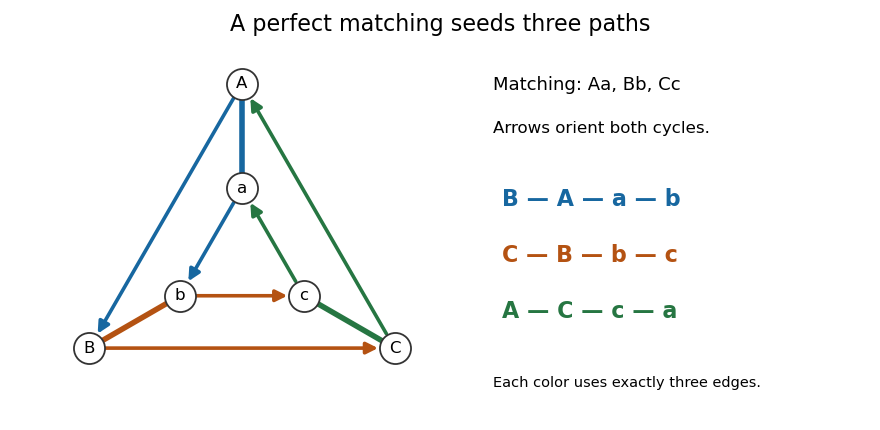

<h1 id="3/b/ii/solution">Solution</h1>

↑ **Parent:** [Ii](../ii.md)

Choose a [perfect matching](../../../../../../perfect-matching.md) $M$ from (i). Every [vertex](../../../../../../vertex-graph-theory.md) has exactly two incident [edges](../../../../../../edge-of-a-graph.md) in $E\setminus M$, so this spanning [subgraph](../../../../../../subgraph.md) is a disjoint [union](../../../../../../set-union.md) of [graph cycles](../../../../../../cycle-in-a-graph.md). Orient each [graph cycle](../../../../../../cycle-in-a-graph.md) cyclically, and let $s(v)$ be the next [vertex](../../../../../../vertex-graph-theory.md) after $v$ along its oriented [graph cycle](../../../../../../cycle-in-a-graph.md).

For each $uv\in M$, take the three-[edge](../../../../../../edge-of-a-graph.md) sequence

$$
s(u),\ u,\ v,\ s(v).
$$

Its four [vertices](../../../../../../vertex-graph-theory.md) are distinct. Each $s(u)\ne u$ and $s(v)\ne v$ because the [graph](../../../../../../graph-split.md) is a [simple graph](../../../../../../simple-graph.md). Also $s(u)\ne v$ and $s(v)\ne u$, since $uv$ belongs to $M$, rather than $E\setminus M$. Finally $s(u)\ne s(v)$ because the successor map $s$ is a [bijection](../../../../../../bijection.md) on the disjoint [graph cycles](../../../../../../cycle-in-a-graph.md). Thus this is a [graph path](../../../../../../path-in-a-graph.md) of length exactly three.

Every [edge](../../../../../../edge-of-a-graph.md) of $M$ is used once as a middle [edge](../../../../../../edge-of-a-graph.md). Every [edge](../../../../../../edge-of-a-graph.md) of $E\setminus M$ is used once as the outgoing [edge](../../../../../../edge-of-a-graph.md) of its tail, whose unique [edge](../../../../../../edge-of-a-graph.md) of $M$ determines which [graph path](../../../../../../path-in-a-graph.md) contains it. Hence these [graph paths](../../../../../../path-in-a-graph.md) are pairwise edge-disjoint and cover $E$. This is the [three-edge path decomposition from a perfect matching](../../../../../../three-edge-path-decomposition-from-a-perfect-matching.md).

**[Figure 1](#3/b/ii/image-on-a-triangular-prism-orient-the-two-remaining-graph-cycles-and-extend-each-perfect-matching-edge-by-its-endpoints-outgoing-edges-the-three-colors-partition-all-nine-edges-into-length-three-graph-paths). On a triangular prism, orient the two remaining graph cycles and extend each perfect matching edge by its endpoints' outgoing edges; the three colors partition all nine edges into length-three graph paths**.

## ↑ Ancestors (12)

1. [Ii](../ii.md)
2. [B](../../b.md)
3. [3](../../../3.md)
4. [Combinatorial optimisation](../../../../combinatorial-optimisation-split.md)
5. [2023](../../../../split.md)
6. [Past exam of the computer science course of the University of Oxford](../../../../../split.md)
7. [Computer science course of the University of Oxford](../../../../../../computer-science-course-of-the-university-of-oxford.md)
8. [Undergraduate course of the University of Oxford](../../../../../../undergraduate-course-of-the-university-of-oxford.md)
9. [Course of the University of Oxford](../../../../../../course-of-the-university-of-oxford.md)
10. [University of Oxford](../../../../../../university-of-oxford-split.md)
11. [List of universities](../../../../../../list-of-universities.md)
12. [Codex Wiki](../../../../../../split.md)
