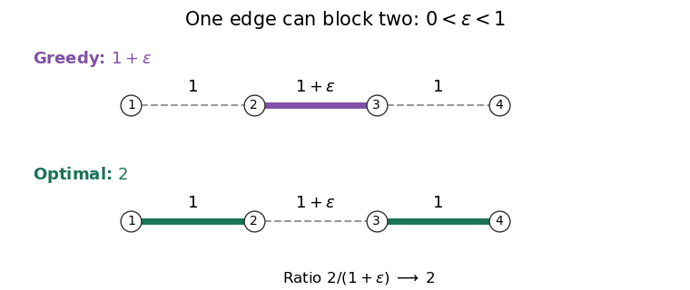

<h1 id="3/c/ii/solution">Solution</h1>

↑ **Parent:** [Ii](../ii.md)

The sharp [approximation algorithm](../../../../../../approximation-algorithm.md) factor is **$c=2$**. Charge each [edge](../../../../../../edge-of-a-graph.md) $e$ of an optimal [maximum-weight matching](../../../../../../maximum-weight-matching.md) $M_o$ to an [edge](../../../../../../edge-of-a-graph.md) of the [greedy matching](../../../../../../greedy-matching.md) $M_g$. If $e\in M_g$, charge it to itself. Otherwise it was rejected because a previously selected [edge](../../../../../../edge-of-a-graph.md) $g\in M_g$ shared an endpoint; charge $e$ to one such $g$. Since the scan is in nonincreasing weight order, $w(e)\leq w(g)$.

Each $g\in M_g$ receives at most two charges, since each of its two endpoints meets at most one [edge](../../../../../../edge-of-a-graph.md) of the [matching in a graph](../../../../../../matching-graph-theory-split.md) $M_o$. If $g\in M_o$, only its own charge is possible. Thus

$$
\boxed{w(M_o)\leq2w(M_g).}
$$

This inequality also covers the edgeless [graph](../../../../../../graph-split.md), for which both weights are zero and the displayed ratio in the question is undefined.

For tightness, take a four-[vertex](../../../../../../vertex-graph-theory.md) [path graph](../../../../../../path-graph.md) with weights $1,1+\varepsilon,1$ in order, where $0<\varepsilon<1$. The [greedy matching](../../../../../../greedy-matching.md) chooses only the middle [edge](../../../../../../edge-of-a-graph.md), of weight $1+\varepsilon$, whereas the optimal [matching in a graph](../../../../../../matching-graph-theory-split.md) chooses both outer [edges](../../../../../../edge-of-a-graph.md), of total weight $2$. Hence

$$
\frac{w(M_o)}{w(M_g)}=\frac{2}{1+\varepsilon}\longrightarrow2\qquad(\varepsilon\downarrow0).
$$

To obtain infinitely many different sizes, for each $k\geq2$ take $k$ disjoint copies with $\varepsilon=1/k$. Their weights add, so their ratio is $2/(1+1/k)\to2$. All weights are strictly positive, and the middle [edge](../../../../../../edge-of-a-graph.md) is uniquely heaviest in each copy. With all three weights equal to $1$, a permitted tie order selecting each middle [edge](../../../../../../edge-of-a-graph.md) first attains ratio $2$ exactly. The [greedy two-approximation for maximum-weight matching](../../../../../../greedy-two-approximation-for-maximum-weight-matching.md) is therefore best possible.

**[Figure 2](#3/c/ii/image-a-uniquely-heavier-middle-edge-gives-a-greedy-matching-of-weight-1-plus-varepsilon-while-the-two-outer-edges-give-a-maximum-weight-matching-of-weight-2). A uniquely heavier middle edge gives a greedy matching of weight $1+\varepsilon$, while the two outer edges give a maximum-weight matching of weight $2$**.

## ↑ Ancestors (12)

1. [Ii](../ii.md)
2. [C](../../c.md)
3. [3](../../../3.md)
4. [Combinatorial optimisation](../../../../combinatorial-optimisation-split.md)
5. [2023](../../../../split.md)
6. [Past exam of the computer science course of the University of Oxford](../../../../../split.md)
7. [Computer science course of the University of Oxford](../../../../../../computer-science-course-of-the-university-of-oxford.md)
8. [Undergraduate course of the University of Oxford](../../../../../../undergraduate-course-of-the-university-of-oxford.md)
9. [Course of the University of Oxford](../../../../../../course-of-the-university-of-oxford.md)
10. [University of Oxford](../../../../../../university-of-oxford-split.md)
11. [List of universities](../../../../../../list-of-universities.md)
12. [Codex Wiki](../../../../../../split.md)
