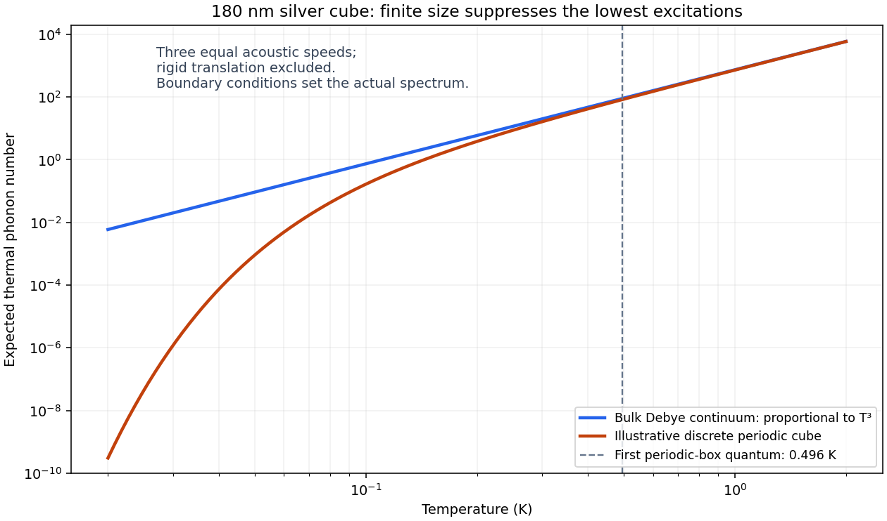
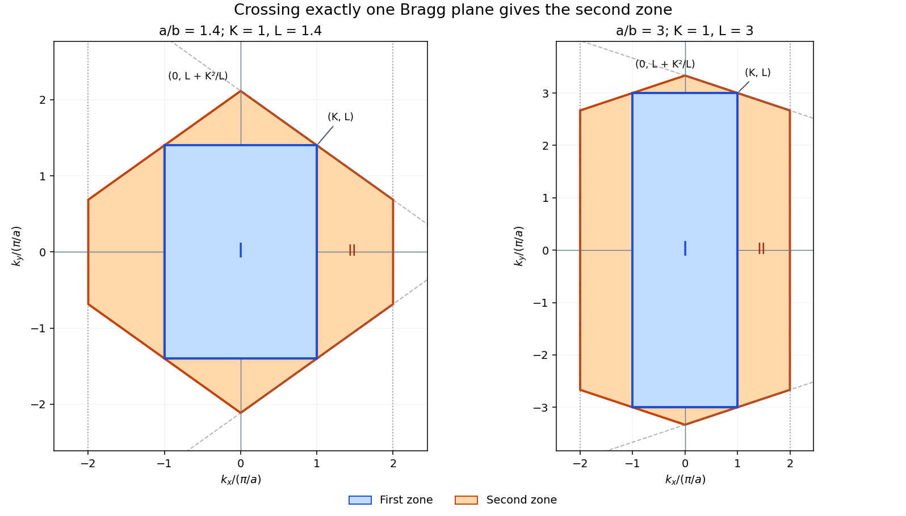

# 2012

↑ **Parent:** [Past exam of the condensed matter physics course of the University of Oxford](../past-exam-of-the-condensed-matter-physics-course-of-the-university-of-oxford.md)

Source paper: [https://www-thphys.physics.ox.ac.uk/people/SteveSimon/condmat2015/b3_VI_2012.pdf](https://www-thphys.physics.ox.ac.uk/people/SteveSimon/condmat2015/b3_VI_2012.pdf)

**Table of contents**

- [1](#1)
  - [a](#1/a)
    - [Solution](#1/a/solution)
  - [b](#1/b)
    - [Solution](#1/b/solution)
  - [c](#1/c)
    - [Solution](#1/c/solution)
  - [d](#1/d)
    - [Solution](#1/d/solution)
- [2](#2)
  - [a](#2/a)
    - [Solution](#2/a/solution)
  - [b](#2/b)
    - [Solution](#2/b/solution)
  - [c](#2/c)
    - [Solution](#2/c/solution)
- [3](#3)
  - [a](#3/a)
    - [Solution](#3/a/solution)
  - [b](#3/b)
    - [Solution](#3/b/solution)
  - [c](#3/c)
    - [Solution](#3/c/solution)
- [4](#4)
  - [a](#4/a)
    - [Solution](#4/a/solution)
  - [b](#4/b)
    - [Solution](#4/b/solution)
  - [c](#4/c)
    - [Solution](#4/c/solution)
  - [d](#4/d)
    - [Solution](#4/d/solution)
  - [e](#4/e)
    - [Solution](#4/e/solution)

## 1

↑ **Parent:** [2012](2012.md)

<h3 id="1/a">a</h3>

↑ **Parent:** [1](#1)

<h4 id="1/a/solution">Solution</h4>

↑ **Parent:** [A](#1/a)

The incident [X-ray](../electromagnetic-radiation.md#x-ray) drives the [electrons](../physics.md#electron) of an atom. Away from an [absorption edge](../electromagnetic-radiation.md#absorption-edge), and when the photon [energy](../energy.md) greatly exceeds the relevant electronic binding energies but is small compared with $m_ec^2$, each electron has approximately the same [Thomson scattering](../cosmic-microwave-background-anisotropy.md#thomson-scattering) amplitude. The much heavier nucleus makes a negligible contribution because its acceleration is much smaller.

For [elastic scattering](../quantum-scattering.md#elastic-scattering), the amplitudes from different bound [electrons](../physics.md#electron) add coherently. In units of the single-electron amplitude, the [atomic scattering factor](../quantum-scattering.md#atomic-scattering-factor) is the [Fourier transform](../fourier-transform.md) of the bound-electron [number density](../statistical-physics.md#number-density):

$$
f(\mathbf q)=\int n_e(\mathbf r)e^{i\mathbf q\cdot\mathbf r}\,d^3r,
\qquad f(\mathbf0)=N_e.
$$

Consequently, when the [electron](../physics.md#electron) cloud is not well resolved by the [scattering vector](../optics.md#scattering-vector), its internal phase differences are small and

$$
\boxed{f\simeq N_e,\qquad I\propto N_e^2.}
$$

This is an approximation to the coherent [scattering amplitude](../quantum-scattering.md#scattering-amplitude), not an assertion that independently scattered intensities add as $N_e$. At larger momentum transfer, destructive interference within the cloud reduces $f$; near [absorption edges](../electromagnetic-radiation.md#absorption-edge), the [atomic scattering factor](../quantum-scattering.md#atomic-scattering-factor) acquires dispersive corrections. [Inelastic scattering](../quantum-scattering.md#inelastic-scattering) is a separate contribution. In an [ionic crystal](../ionic-bonding.md#ionic-crystal), use the ion's bound-electron count rather than automatically using the neutral atom's atomic number.

<h3 id="1/b">b</h3>

↑ **Parent:** [1](#1)

<h4 id="1/b/solution">Solution</h4>

↑ **Parent:** [B](#1/b)

Use the total scattering angle $\psi=2\theta$. For a cubic [unit cell](../quantum-scattering.md#unit-cell), [Bragg's law](../quantum-scattering.md#bragg-s-law) and the [Miller indices](../physical-chemistry.md#miller-index) give

$$
\sin^2\theta=\frac{\lambda^2}{4a_0^2}(h^2+k^2+l^2).
$$

The four measured values of $\sin^2\theta$, normalized to the first, are $1,1.330,2.655,3.649$. Multiplying by three gives approximately $3,4,8,11$, the initial allowed sequence for a [face-centered cubic lattice](../quantum-scattering.md#face-centered-cubic-lattice):

$$
\{111\},\quad\{200\},\quad\{220\},\quad\{311\}.
$$

The FCC lattice factor is $1+(-1)^{h+k}+(-1)^{h+l}+(-1)^{k+l}$; it vanishes unless all three indices have the same parity. Thus the initial ratios differ from those of a primitive or body-centered cubic lattice. This is the conventional minimal cubic indexing; arbitrarily hiding additional weak reflections could make a short list alone ambiguous.

The low-pressure [rock salt structure](../ionic-bonding.md#rock-salt-structure) has an FCC [Bravais lattice](../quantum-scattering.md#bravais-lattice) with one NaCl [formula unit](../chemical-substance.md#formula-unit) per [primitive unit cell](../quantum-scattering.md#primitive-unit-cell), or four per conventional cube. A possible [atomic basis of a crystal](../physical-chemistry.md#atomic-basis-of-a-crystal) is Na at zero and Cl at $(1/2,0,0)$ in conventional fractional coordinates. The two species have unequal [atomic scattering factors](../quantum-scattering.md#atomic-scattering-factor), so both the odd and even FCC families can occur.

The four independent [lattice constant](../physical-chemistry.md#lattice-constant) estimates are

$$
a_0=\frac{\lambda\sqrt{h^2+k^2+l^2}}{2\sin(\psi/2)}
=(0.56312,\ 0.56386,\ 0.56436,\ 0.56446)\,\mathrm{nm}.
$$

Their small scatter reflects the rounded angular data. The appropriate reported result is

$$
\boxed{\text{FCC Bravais lattice},\qquad a_0\simeq0.564\,\mathrm{nm}.}
$$

<h3 id="1/c">c</h3>

↑ **Parent:** [1](#1)

<h4 id="1/c/solution">Solution</h4>

↑ **Parent:** [C](#1/c)

The high-pressure [atomic basis of a crystal](../physical-chemistry.md#atomic-basis-of-a-crystal) has the [caesium chloride structure](../physical-chemistry.md#caesium-chloride-structure). Its chemically labelled [Bravais lattice](../quantum-scattering.md#bravais-lattice) is [simple cubic lattice](../quantum-scattering.md#primitive-cubic-lattice): exchanging Na and Cl is not a [translation symmetry](../physics.md#translational-symmetry). Its [structure factor](../quantum-scattering.md#structure-factor) is

$$
F_{hkl}=f_{\rm Na}+(-1)^{h+k+l}f_{\rm Cl}.
$$

Because [ionic bonding](../ionic-bonding.md) gives approximately Na$^+$ and Cl$^-$, their bound-electron counts are $10$ and $18$. In the stipulated electron-count approximation, odd-index-sum reflections have $|F|=8$, while even-index-sum reflections have $|F|=28$. In particular, the first ring $\{100\}$ is weak but present; it must not be discarded using a body-centering extinction rule.

The next ring is $\{110\}$, and [Bragg's law](../quantum-scattering.md#bragg-s-law) gives

$$
\sin\frac{\psi_{110}}2=\sqrt2\sin\frac{29.7^\circ}2,
\qquad\boxed{\psi_{110}=42.50^\circ.}
$$

The [powder diffraction multiplicities](../physical-chemistry.md#powder-diffraction-multiplicity) are six and twelve. Counting all symmetry-equivalent reflections, while neglecting other angular factors, therefore gives

$$
\boxed{\frac{I_{110}}{I_{100}}\simeq\frac{12}{6}\left(\frac{28}{8}\right)^2=24.5.}
$$

The corresponding single-directed-reflection ratio would be $12.25$. Neutral-atom counts would give the wrong contrast because the material is ionic.

For measured integrated photon counts, the geometry must also be specified. More generally the ratio is $2|F_{110}/F_{100}|^2$ times the ratio of [Lorentz-polarization factors](../physical-chemistry.md#lorentz-polarization-factor), thermal-motion factors and detection efficiencies. For example, the common unpolarized symmetric-powder convention has

$$
LP(\theta)\propto\frac{1+\cos^2(2\theta)}{\sin^2\theta\cos\theta},
$$

and gives $24.5\,LP(21.2506^\circ)/LP(14.85^\circ)\simeq11.18$ if all other corrections are suppressed. Thus **24.5 is the multiplicity-and-structure-factor estimate**, rather than a geometry-independent precision count ratio; actual angle-dependent ionic form factors are also not supplied.

<h3 id="1/d">d</h3>

↑ **Parent:** [1](#1)

<h4 id="1/d/solution">Solution</h4>

↑ **Parent:** [D](#1/d)

The high-pressure [lattice constant](../physical-chemistry.md#lattice-constant) follows from its first $(100)$ reflection:

$$
a_P=\frac{0.154\,\mathrm{nm}}{2\sin14.85^\circ}=0.30044\,\mathrm{nm}.
$$

Conserve the number of NaCl [formula units](../chemical-substance.md#formula-unit). The low-pressure conventional [unit cell](../quantum-scattering.md#unit-cell) contains four, whereas the high-pressure cell contains one. The [volume](../geometry-and-topology.md#volume) per [formula unit](../chemical-substance.md#formula-unit) changes from $a_0^3/4$ to $a_P^3$, so

$$
\boxed{\frac{V_P}{V_0}=4\left(\frac{a_P}{a_0}\right)^3\simeq0.605.}
$$

The sample contracts by about $39.5\%$. Comparing $a_P^3$ directly with $a_0^3$ would compare different amounts of material.

## 2

↑ **Parent:** [2012](2012.md)

<h3 id="2/a">a</h3>

↑ **Parent:** [2](#2)

<h4 id="2/a/solution">Solution</h4>

↑ **Parent:** [A](#2/a)

The [Debye model](../quantum-ideal-gas-statistics.md#debye-model) treats a three-dimensional solid as an isotropic elastic continuum with three independent acoustic [phonon polarizations](../quantum-ideal-gas-statistics.md#phonon-polarization). It assumes harmonic [normal modes](../wave-equation.md#normal-mode), a linear [dispersion relation](../dispersion-relation.md) $\omega=vq$, and equilibrium [Bose-Einstein statistics](../quantum-ideal-gas-statistics.md#bose-einstein-statistics) with zero [phonon](../quantum-ideal-gas-statistics.md#phonon) [chemical potential](../chemical-potential.md). Real anisotropy and nonlinear dispersion are replaced by one effective [Debye sound speed](../quantum-ideal-gas-statistics.md#debye-sound-speed). A cutoff restores the finite number of atomic vibrational degrees of freedom; the continuum itself would otherwise have infinitely many modes.

For sample [volume](../geometry-and-topology.md#volume) $V$, the [wavevector](../elasticity-physics.md#wavevector) state density is $V/(2\pi)^3$ per polarization. Counting a sphere gives

$$
\mathcal N(q)=3\frac{V}{(2\pi)^3}\frac{4\pi q^3}{3}
=\frac{Vq^3}{2\pi^2}.
$$

There are $3N$ modes for $N$ atoms. Hence

$$
q_D^3=6\pi^2\frac NV,
\qquad\boxed{\omega_D=v\left(6\pi^2n_a\right)^{1/3},\quad n_a=N/V.}
$$

The associated [phonon density of states](../quantum-ideal-gas-statistics.md#phonon-density-of-states) is

$$
g(\omega)=\frac{3V\omega^2}{2\pi^2v^3}
=\frac{9N\omega^2}{\omega_D^3},\qquad0<\omega<\omega_D.
$$

If longitudinal and transverse [sound speeds](../compressible-flow.md#speed-of-sound) differ, use $3/v^3=1/v_L^3+2/v_T^3$ for the low-frequency count. The [Debye frequency](../quantum-ideal-gas-statistics.md#debye-frequency) is an effective mode-counting cutoff, not a claim that every actual branch terminates at exactly that frequency.

<h3 id="2/b">b</h3>

↑ **Parent:** [2](#2)

<h4 id="2/b/solution">Solution</h4>

↑ **Parent:** [B](#2/b)

The FCC conventional [unit cell](../quantum-scattering.md#unit-cell) has four atoms, so the cube contains

$$
N=4\left(\frac{180}{0.409}\right)^3=3.4096\times10^8
$$

atoms, neglecting surface corrections. A [phonon](../quantum-ideal-gas-statistics.md#phonon) is one excitation quantum of a vibrational [normal mode](../wave-equation.md#normal-mode); there can be many quanta per mode, and [zero-point motion](../quantum-harmonic-oscillator.md#zero-point-motion) does not add half a phonon to the thermal population.

For the [low-temperature thermal phonon number](../quantum-ideal-gas-statistics.md#low-temperature-thermal-phonon-number), integrate the [Bose-Einstein distribution](../quantum-ideal-gas-statistics.md#bose-einstein-distribution) against the [Debye model](../quantum-ideal-gas-statistics.md#debye-model) [phonon density of states](../quantum-ideal-gas-statistics.md#phonon-density-of-states):

$$
N_{\rm ph}=\int_0^{\omega_D}\frac{g(\omega)}{e^{\hbar\omega/(k_BT)}-1}\,d\omega
=9N\left(\frac{T}{\Theta_D}\right)^3
\int_0^{\Theta_D/T}\frac{x^2}{e^x-1}\,dx.
$$

At $10\,\mathrm K$, $\Theta_D/T=21.5$, so extending the upper limit to infinity has negligible effect at the precision required. The supplied integral yields

$$
\boxed{N_{\rm ph}\simeq9(3.4096\times10^8)\left(\frac{10}{215}\right)^3(2.404)
\simeq7.42\times10^5.}
$$

This is the thermally excited [phonon](../quantum-ideal-gas-statistics.md#phonon) number, not the number $3N$ of available modes.

The continuum approximation fails when the thermally occupied [wavelengths](../wave-equation.md#wavelength) become comparable with the cube size $L$. From the [Debye temperature](../quantum-ideal-gas-statistics.md#debye-temperature),

$$
v=\frac{k_B\Theta_D}{\hbar(6\pi^2n_a)^{1/3}}\simeq1.86\times10^3\,\mathrm{m\,s^{-1}}.
$$

A lowest nontrivial acoustic frequency is of order $v/L$; a standing-wave estimate $\omega_{\min}\sim\pi v/L$ corresponds to $\hbar\omega_{\min}/k_B\sim0.25\,\mathrm K$. [Periodic boundary conditions](../differential-equation.md#periodic-boundary-conditions) instead give $2\pi v/L$ and $0.50\,\mathrm K$. The precise spectrum depends on mechanical boundary conditions and branch speeds, neither of which is specified.

This [finite-crystal phonon freeze-out](../quantum-ideal-gas-statistics.md#finite-crystal-phonon-freeze-out) requires summing discrete [normal modes](../wave-equation.md#normal-mode). For a finite positive lowest frequency, $N_{\rm ph}\sim g_{\min}e^{-\hbar\omega_{\min}/(k_BT)}$, rather than extrapolating the bulk $T^3$ law indefinitely. Rigid translations and rotations of an isolated crystallite are not internal thermal [phonons](../quantum-ideal-gas-statistics.md#phonon). Surface acoustic modes can modify the intermediate crossover, but do not justify inventing a unique boundary spectrum.

**[Figure 1](#2/b/image-bulk-and-finite-box-thermal-phonon-populations). Bulk and finite-box thermal phonon populations**. The discrete curve uses an illustrative periodic cube and three equal acoustic speeds; its low-temperature suppression is not a fitted free-surface spectrum.

<h3 id="2/c">c</h3>

↑ **Parent:** [2](#2)

<h4 id="2/c/solution">Solution</h4>

↑ **Parent:** [C](#2/c)

The harmonic [phonon](../quantum-ideal-gas-statistics.md#phonon) contribution to the [internal energy](../internal-energy.md) is

$$
U=\int_0^{\omega_D}g(\omega)\hbar\omega
\left[\frac12+\frac1{e^{\hbar\omega/(k_BT)}-1}\right]d\omega.
$$

For $T\gg\Theta_D$, every retained mode has $x=\hbar\omega/(k_BT)\ll1$. Expanding $1/(e^x-1)=1/x-1/2+O(x)$ cancels the explicit half quantum and gives $k_BT$ per mode to leading order. Therefore

$$
U=3Nk_BT+O\!\left(\frac{N(k_B\Theta_D)^2}{k_BT}\right),
\qquad\boxed{C_V=\left(\frac{\partial U}{\partial T}\right)_V\longrightarrow3Nk_B.}
$$

Equivalently, differentiating before integrating gives

$$
C_V=9Nk_B\left(\frac{T}{\Theta_D}\right)^3\int_0^{\Theta_D/T}\frac{x^4e^x}{(e^x-1)^2}\,dx.
$$

The integrand tends to $x^2$, and its integral is $(\Theta_D/T)^3/3$, producing the same [Dulong-Petit law](../heat.md#dulong-petit-law). In classical language, the [equipartition theorem](../canonical-ensemble.md#equipartition-theorem) assigns $k_BT/2$ each to the kinetic and elastic parts of every harmonic [normal mode](../wave-equation.md#normal-mode). Fixed [zero-point energy](../quantum-harmonic-oscillator.md#zero-point-energy) does not contribute to the [heat capacity](../heat.md#heat-capacity).

## 3

↑ **Parent:** [2012](2012.md)

<h3 id="3/a">a</h3>

↑ **Parent:** [3](#3)

<h4 id="3/a/solution">Solution</h4>

↑ **Parent:** [A](#3/a)

Assume [thermal equilibrium](../thermal-equilibrium.md), nondegenerate carriers, and isotropic [parabolic band dispersions](../bloch-s-theorem.md#parabolic-band-dispersion), with the supplied [effective masses](../bloch-s-theorem.md#band-effective-mass) interpreted as density-of-states masses. Take one effective valley with two [electron spin](../angular-momentum-operator.md#electron-spin) states for each band; any additional valley multiplicity must instead be absorbed into the masses or explicit degeneracy factors.

Let the [conduction band](../quantum-mechanics.md#conduction-band) edge be $E_c$, the [valence band](../quantum-mechanics.md#valence-band) edge $E_v$, and $E_g=E_c-E_v$. The spin-summed conduction [density of states](../quantum-ideal-gas-statistics.md#density-of-states) per [volume](../geometry-and-topology.md#volume) is

$$
g_c(E)=\frac1{2\pi^2}\left(\frac{2m_e^*}{\hbar^2}\right)^{3/2}\sqrt{E-E_c},\qquad E\geq E_c.
$$

Using the nondegenerate limit of the [Fermi-Dirac distribution](../quantum-ideal-gas-statistics.md#fermi-dirac-distribution) and the substitution $x=(E-E_c)/(k_BT)$ gives

$$
n=\int_{E_c}^\infty g_c(E)e^{-(E-\mu)/(k_BT)}dE
=N_c e^{-(E_c-\mu)/(k_BT)},
\quad N_c=2\left(\frac{m_e^*k_BT}{2\pi\hbar^2}\right)^{3/2}.
$$

The factor $\sqrt\pi/2$ in the supplied integral produces the normalization. Counting missing [valence band](../quantum-mechanics.md#valence-band) [electrons](../physics.md#electron) similarly gives

$$
p=N_v e^{-(\mu-E_v)/(k_BT)},\qquad
N_v=2\left(\frac{m_h^*k_BT}{2\pi\hbar^2}\right)^{3/2}.
$$

Multiplication cancels the [chemical potential](../chemical-potential.md), establishing the [semiconductor mass-action law](../semiconductor.md#semiconductor-mass-action-law):

$$
\boxed{np=N_cN_v e^{-E_g/(k_BT)}
=4\left(\frac{k_BT}{2\pi\hbar^2}\right)^3(m_e^*m_h^*)^{3/2}e^{-E_g/(k_BT)}.}
$$

The result does not require an [intrinsic semiconductor](../semiconductor.md#intrinsic-semiconductor): [semiconductor doping](../semiconductor.md#semiconductor-doping) changes $n$ and $p$ separately while preserving this product under the stated equilibrium and nondegeneracy assumptions.

<h3 id="3/b">b</h3>

↑ **Parent:** [3](#3)

<h4 id="3/b/solution">Solution</h4>

↑ **Parent:** [B](#3/b)

A substitutional group-V atom such as [phosphorus](../chemical-substance.md#phosphorus) has one more [valence electron](../chemical-bond.md#valence-electron) than [germanium](../chemical-substance.md#germanium) and acts as a [donor impurity](../semiconductor.md#donor-impurity), giving an [n-type semiconductor](../semiconductor.md#n-type-semiconductor). Approximate its outer [electron](../physics.md#electron) by a [hydrogenic donor state](../semiconductor.md#hydrogenic-donor-state) with screened Coulomb attraction and [effective mass](../bloch-s-theorem.md#band-effective-mass) $m_e^*$. The [ionization energy](../mathematical-physics.md#ionization-energy) is the positive binding-energy magnitude

$$
E_D=13.606\,\mathrm{eV}\,\frac{m_e^*/m_e}{\epsilon_r^2}
=13.606\frac{0.22}{15.8^2}\,\mathrm{eV},
\qquad\boxed{E_D\simeq0.0120\,\mathrm{eV}=12.0\,\mathrm{meV}.}
$$

Its [effective Bohr radius of a hydrogenic donor](../semiconductor.md#effective-bohr-radius-of-a-hydrogenic-donor) is about $3.80\,\mathrm{nm}$, much larger than an atomic core, consistent with a shallow extended bound state.

At $300\,\mathrm K$, $k_BT=25.9\,\mathrm{meV}$, while the mean three-dimensional classical translational [kinetic energy](../energy.md#kinetic-energy) is $3k_BT/2=38.8\,\mathrm{meV}$. Both exceed the donor binding [energy](../energy.md), so substantial thermal ionization is expected, unlike excitation across the much larger $0.661\,\mathrm{eV}$ host [band gap](../bloch-s-theorem.md#band-gap). A precise ionized fraction also depends on the [chemical potential](../chemical-potential.md), [dopant density](../semiconductor.md#dopant-density) and [donor charge-state degeneracy](../semiconductor.md#donor-charge-state-degeneracy); comparing two energy scales alone does not prove complete ionization at arbitrary concentration.

<h3 id="3/c">c</h3>

↑ **Parent:** [3](#3)

<h4 id="3/c/solution">Solution</h4>

↑ **Parent:** [C](#3/c)

With the supplied fixed [band gap](../bloch-s-theorem.md#band-gap) and [effective masses](../bloch-s-theorem.md#band-effective-mass), the [intrinsic carrier concentration](../semiconductor.md#intrinsic-carrier-concentration) is

$$
n_i(T)=2\left(\frac{k_BT}{2\pi\hbar^2}\right)^{3/2}(m_e^*m_h^*)^{3/4}
 e^{-E_g/(2k_BT)}.
$$

Numerically,

$$
n_i(750\,\mathrm K)=8.53\times10^{22}\,\mathrm{m^{-3}},\qquad
n_i(300\,\mathrm K)=1.01\times10^{19}\,\mathrm{m^{-3}}.
$$

For uncompensated, approximately ionized [donor impurities](../semiconductor.md#donor-impurity), [charge neutrality](../electric-charge.md#charge-neutrality) and the [semiconductor mass-action law](../semiconductor.md#semiconductor-mass-action-law) require

$$
n-p=N_D,\qquad np=n_i^2,\qquad
n=\frac{N_D+\sqrt{N_D^2+4n_i^2}}2.
$$

There is no abrupt extrinsic-to-intrinsic transition. An order-of-magnitude lower crossover density is therefore

$$
\boxed{N_D\gtrsim n_i(750\,\mathrm K)\simeq8.5\times10^{22}\,\mathrm{m^{-3}}
=8.5\times10^{16}\,\mathrm{cm^{-3}}.}
$$

Robust extrinsic dominance requires $N_D\gg n_i$; at the nominal equality, $n=1.618N_D$ and $p=0.618N_D$, so intrinsic contributions are already appreciable. For a quantitative tolerance $p/n\leq\eta$, the minimum ionized [dopant density](../semiconductor.md#dopant-density) is $n_i(1-\eta)/\sqrt\eta$. For example, $\eta=0.1$ would require $N_D\geq2.85n_i$ at the upper temperature.

Using the nominal crossover estimate and the complete-ionization approximation at room temperature, $n\simeq N_D$ and

$$
\boxed{p(300\,\mathrm K)\simeq\frac{n_i(300\,\mathrm K)^2}{N_D}
=1.19\times10^{15}\,\mathrm{m^{-3}}\simeq1.19\times10^9\,\mathrm{cm^{-3}}.}
$$

For the twofold neutral-donor degeneracy, a consistency calculation gives about $91.3\%$ ionization at $300\,\mathrm K$, raising this minority density to $1.30\times10^{15}\,\mathrm{m^{-3}}$, about $9.6\%$ above the complete-ionization estimate. Stronger extrinsic dominance uses more donors and correspondingly fewer [electron holes](../quantum-mechanics.md#electron-hole). Actual germanium has [temperature](../temperature.md)-dependent band parameters and multiple valleys; the numerical estimate consistently uses the fixed effective data supplied rather than adding an unsupplied multiplicity.

## 4

↑ **Parent:** [2012](2012.md)

<h3 id="4/a">a</h3>

↑ **Parent:** [4](#4)

<h4 id="4/a/solution">Solution</h4>

↑ **Parent:** [A](#4/a)

A [Wigner-Seitz cell](../quantum-scattering.md#wigner-seitz-cell) is the region of real space at least as close to a chosen [Bravais lattice](../quantum-scattering.md#bravais-lattice) point as to any other. It is bounded by perpendicular bisectors of vectors to neighboring lattice points and is a [primitive unit cell](../quantum-scattering.md#primitive-unit-cell).

A [reciprocal lattice vector](../quantum-scattering.md#reciprocal-lattice-vector) $\mathbf G$ satisfies $e^{i\mathbf G\cdot\mathbf R}=1$ for every [lattice translation](../quantum-scattering.md#lattice-translation) $\mathbf R$. With primitive vectors $\mathbf a_i$, reciprocal primitive vectors satisfy $\mathbf a_i\cdot\mathbf b_j=2\pi\delta_{ij}$, and $\mathbf G=\sum_jn_j\mathbf b_j$ for integers $n_j$.

The [first Brillouin zone](../bloch-s-theorem.md#first-brillouin-zone) is the [Wigner-Seitz cell](../quantum-scattering.md#wigner-seitz-cell) of that [reciprocal lattice](../quantum-scattering.md#reciprocal-lattice), centered at $\mathbf k=0$. Its boundaries are [Bragg planes](../quantum-scattering.md#bragg-plane), $\mathbf k\cdot\mathbf G=G^2/2$. Higher [Brillouin zones](../bloch-s-theorem.md#brillouin-zone) are the regions separated from the origin by successively more such planes: an interior point of zone $j$ has crossed exactly $j-1$ planes. A [second Brillouin zone](../bloch-s-theorem.md#second-brillouin-zone) is generally disconnected in this extended-zone representation; it is not just a translated first-zone rectangle.

<h3 id="4/b">b</h3>

↑ **Parent:** [4](#4)

<h4 id="4/b/solution">Solution</h4>

↑ **Parent:** [B](#4/b)

For area $A$, allowed [wavevectors](../elasticity-physics.md#wavevector) have density $A/(2\pi)^2$. Include two [electron spin](../angular-momentum-operator.md#electron-spin) states and fill a disk of radius $k_F$ at zero [temperature](../temperature.md). Then

$$
N=2\frac{A}{(2\pi)^2}\pi k_F^2,
\qquad n_s=N/A=\frac{k_F^2}{2\pi}.
$$

The [free electron model](../physics.md#free-electron-model) has [parabolic dispersion](../bloch-s-theorem.md#parabolic-band-dispersion) $E=\hbar^2k^2/(2m_e)$, with its minimum chosen as zero, so

$$
\boxed{k_F=\sqrt{2\pi n_s},\qquad E_F=\frac{\pi\hbar^2n_s}{m_e}.}
$$

These are the [Fermi wavevector](../quantum-ideal-gas-statistics.md#fermi-wavevector) and [Fermi energy](../quantum-ideal-gas-statistics.md#fermi-energy) for a spin-degenerate two-dimensional [free electron gas](../physics.md#free-electron-model). An imposed spin polarization or additional valley degeneracy would change the state count.

<h3 id="4/c">c</h3>

↑ **Parent:** [4](#4)

<h4 id="4/c/solution">Solution</h4>

↑ **Parent:** [C](#4/c)

For the [first two Brillouin zones of a rectangular lattice](../bloch-s-theorem.md#first-two-brillouin-zones-of-a-rectangular-lattice), write $K=\pi/a$ and $L=\pi/b$, so $0<K<L$ and the [reciprocal lattice vectors](../quantum-scattering.md#reciprocal-lattice-vector) are $(2nK,2mL)$. The perpendicular bisectors to the four nearest axial reciprocal points enclose

$$
\boxed{\mathcal B_1=\{(k_x,k_y):|k_x|<K,\ |k_y|<L\}.}
$$

The [second Brillouin zone](../bloch-s-theorem.md#second-brillouin-zone) consists of points beyond exactly one [Bragg plane](../quantum-scattering.md#bragg-plane). In the first quadrant, it is the union of the following two regions:

$$
\begin{aligned}
K<k_x<2K,&\qquad 0<k_y<\frac{K^2+L^2-Kk_x}{L},\\
0<k_x<K,&\qquad L<k_y<\frac{K^2+L^2-Kk_x}{L}.
\end{aligned}
$$

Reflect these regions in both axes. The first is a trapezoidal side lobe; the second is half of a triangular top lobe. The sloping boundary is the bisector for $\mathbf G=(2K,2L)$. On the side lobe, $k_x<2K$ is the bisector condition for $\mathbf G=(4K,0)$: crossing that plane too would enter the third or a higher zone. These additional bisectors are why four rectangles pasted onto the first zone would be incorrect.

Equivalently, the full right lobe has vertices

$$
(K,-L),\quad(2K,-L+K^2/L),\quad(2K,L-K^2/L),\quad(K,L),
$$

and the top lobe has vertices $(-K,L),(K,L),(0,L+K^2/L)$. Add their left and bottom reflections. Their total area is

$$
2\left(2KL-\frac{K^3}{L}\right)+2\frac{K^3}{L}=4KL,
$$

equal to the first-zone area, as required by reciprocal-space state counting. These formulas remain valid for every $a>b$, including very elongated rectangles; boundaries themselves can be shared by convention.

**[Figure 2](#4/c/image-first-and-second-brillouin-zones-of-rectangular-lattices). First and second Brillouin zones of rectangular lattices**. Blue is the first zone and orange is the complete disconnected second zone; two aspect ratios show the effect of the higher axial Bragg plane. All coordinates are in units of pi divided by a.

<h3 id="4/d">d</h3>

↑ **Parent:** [4](#4)

<h4 id="4/d/solution">Solution</h4>

↑ **Parent:** [D](#4/d)

For one [electron](../physics.md#electron) per [primitive unit cell](../quantum-scattering.md#primitive-unit-cell), the areal [number density](../statistical-physics.md#number-density) is $n_s=1/(ab)$. The [Fermi circle](../fermi-liquid.md#fermi-circle) has radius $k_F=\sqrt{2\pi/(ab)}$. The nearer first-zone boundary is $k_x=\pm\pi/a$, because $a>b$. The circle protrudes precisely when

$$
k_F>\frac\pi a
\quad\Longleftrightarrow\quad
\frac{2\pi}{ab}>\frac{\pi^2}{a^2}
\quad\Longleftrightarrow\quad
\boxed{a>\frac{\pi b}{2}.}
$$

At equality the [Fermi surface](../fermi-liquid.md#fermi-surface) only touches the boundary. Crossing an extended-zone boundary alone does not make a gap: the [free electron gas](../physics.md#free-electron-model) remains metallic when the ionic [periodic potential](../bloch-s-theorem.md#periodic-potential) is neglected.

<h3 id="4/e">e</h3>

↑ **Parent:** [4](#4)

<h4 id="4/e/solution">Solution</h4>

↑ **Parent:** [E](#4/e)

With [spin degeneracy](../statistical-physics.md#spin-degeneracy), each [energy band](../bloch-s-theorem.md#energy-band) contains two [electrons](../physics.md#electron) per [primitive unit cell](../quantum-scattering.md#primitive-unit-cell). Divalency therefore permits a filled first band, but only if its maximum lies below the second band's minimum. With negligible ionic [periodic potential](../bloch-s-theorem.md#periodic-potential), the circular [Fermi surface](../fermi-liquid.md#fermi-surface) and the rectangular zone have equal enclosed area, not equal shape. Electrons occupy some states outside the first zone while some higher-[energy](../energy.md) first-zone states remain empty. Folded bands overlap, and the material is a [metal](../chemical-substance.md#metal).

A [periodic potential](../bloch-s-theorem.md#periodic-potential) mixes [plane waves](../wave-function.md#plane-wave) differing by a [reciprocal lattice vector](../quantum-scattering.md#reciprocal-lattice-vector). At a two-wave [Bragg point](../bloch-s-theorem.md#bragg-point), the [nearly-free electron model](../bloch-s-theorem.md#nearly-free-electron-model) gives a direct gap $2|V_{\mathbf G}|$. Increasing appropriate [Fourier coefficients](../fourier-series.md#fourier-coefficient) can remove the band overlap. With the first band filled, the system is then a [band insulator](../bloch-s-theorem.md#band-insulator), provided the [temperature](../temperature.md) is small compared with the insulating [band gap](../bloch-s-theorem.md#band-gap) in energy units.

The [rectangular free-electron band-overlap scale](../bloch-s-theorem.md#rectangular-free-electron-band-overlap-scale) follows from two different points in reciprocal space. Put $C=\hbar^2/(2m_e)$. Before gap opening, the highest first-zone energy is at the corner, while the lowest second-zone energy is at the midpoint of the nearer face:

$$
E_{1,\max}^{(0)}=C(K^2+L^2),\qquad E_{2,\min}^{(0)}=CK^2.
$$

Thus the downward shift $\delta_v$ of the first-band maximum plus the upward shift $\delta_c$ of the second-band minimum must overcome

$$
\boxed{\Delta_{\rm overlap}=CL^2=\frac{\hbar^2\pi^2}{2m_eb^2},\qquad
E_g^{\rm indirect}=\delta_v+\delta_c-\Delta_{\rm overlap}>0.}
$$

In a rigid-splitting estimate, an opening $\Delta$ lowers the first band by $\Delta/2$ and raises the second by $\Delta/2$, giving the familiar threshold $\Delta>\hbar^2\pi^2/(2m_eb^2)$. Equality is only band touching, not a positive insulating gap. This expression is the **overlap that must be removed**, under that explicit band-shift approximation.

[Positive direct gaps can coexist with band overlap](../bloch-s-theorem.md#positive-direct-gaps-can-coexist-with-band-overlap): a local direct splitting and the global [indirect band gap](../bloch-s-theorem.md#indirect-band-gap) are not interchangeable. The shape and [Fourier coefficients](../fourier-series.md#fourier-coefficient) of the ionic potential are unspecified, so there is no universal exact critical direct-gap width determined by $a,b$ alone. For a concrete demonstration, a separable potential $2V_x\cos(2Kx)+2V_y\cos(2Ly)$ has axial direct gaps $\Delta_x=2|V_x|$ and $\Delta_y=2|V_y|$. To first order, the corner's lowest level is $C(K^2+L^2)-|V_x|-|V_y|$, and the two candidate second-band minima are $CK^2+|V_x|$ and $CL^2+|V_y|$. Therefore, within this model and neglecting higher-order band shifts, nonoverlap requires

$$
\Delta_x+\frac{\Delta_y}{2}>CL^2,
\qquad \frac{\Delta_x}{2}+\Delta_y>CK^2.
$$

Equal axial gaps would give the first-order estimate $\Delta>2CL^2/3$, rather than the rigid-splitting estimate. Such a large opening can exceed the quantitative range of weak-potential perturbation theory, but the example identifies the missing model assumption: corner levels feel both couplings. The exact general answer is the positive indirect-gap criterion above; a geometry-only direct-gap threshold would claim more than the supplied potential information supports.

## ↑ Ancestors (9)

1. [Past exam of the condensed matter physics course of the University of Oxford](../past-exam-of-the-condensed-matter-physics-course-of-the-university-of-oxford.md)
2. [Condensed matter physics course of the University of Oxford](../university-of-oxford.md#condensed-matter-physics-course-of-the-university-of-oxford)
3. [Year 3 of the physics course of the University of Oxford](../university-of-oxford.md#year-3-of-the-physics-course-of-the-university-of-oxford)
4. [Physics course of the University of Oxford](../university-of-oxford.md#physics-course-of-the-university-of-oxford)
5. [Undergraduate course of the University of Oxford](../university-of-oxford.md#undergraduate-course-of-the-university-of-oxford)
6. [Course of the University of Oxford](../university-of-oxford.md#course-of-the-university-of-oxford)
7. [University of Oxford](../university-of-oxford.md)
8. [List of universities](../README.md#list-of-universities)
9. [Codex Wiki](../README.md)
