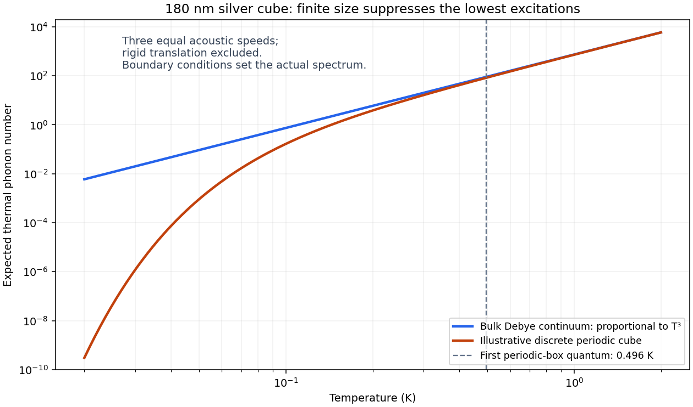

<h1 id="2/b/solution">Solution</h1>

↑ **Parent:** [B](../b.md)

The FCC conventional [unit cell](../../../../unit-cell.md) has four atoms, so the cube contains

$$
N=4\left(\frac{180}{0.409}\right)^3=3.4096\times10^8
$$

atoms, neglecting surface corrections. A [phonon](../../../../phonon.md) is one excitation quantum of a vibrational [normal mode](../../../../normal-mode.md); there can be many quanta per mode, and [zero-point motion](../../../../zero-point-motion.md) does not add half a phonon to the thermal population.

For the [low-temperature thermal phonon number](../../../../low-temperature-thermal-phonon-number.md), integrate the [Bose-Einstein distribution](../../../../bose-einstein-distribution.md) against the [Debye model](../../../../debye-model.md) [phonon density of states](../../../../phonon-density-of-states.md):

$$
N_{\rm ph}=\int_0^{\omega_D}\frac{g(\omega)}{e^{\hbar\omega/(k_BT)}-1}\,d\omega
=9N\left(\frac{T}{\Theta_D}\right)^3
\int_0^{\Theta_D/T}\frac{x^2}{e^x-1}\,dx.
$$

At $10\,\mathrm K$, $\Theta_D/T=21.5$, so extending the upper limit to infinity has negligible effect at the precision required. The supplied integral yields

$$
\boxed{N_{\rm ph}\simeq9(3.4096\times10^8)\left(\frac{10}{215}\right)^3(2.404)
\simeq7.42\times10^5.}
$$

This is the thermally excited [phonon](../../../../phonon.md) number, not the number $3N$ of available modes.

The continuum approximation fails when the thermally occupied [wavelengths](../../../../wavelength.md) become comparable with the cube size $L$. From the [Debye temperature](../../../../debye-temperature.md),

$$
v=\frac{k_B\Theta_D}{\hbar(6\pi^2n_a)^{1/3}}\simeq1.86\times10^3\,\mathrm{m\,s^{-1}}.
$$

A lowest nontrivial acoustic frequency is of order $v/L$; a standing-wave estimate $\omega_{\min}\sim\pi v/L$ corresponds to $\hbar\omega_{\min}/k_B\sim0.25\,\mathrm K$. [Periodic boundary conditions](../../../../periodic-boundary-conditions.md) instead give $2\pi v/L$ and $0.50\,\mathrm K$. The precise spectrum depends on mechanical boundary conditions and branch speeds, neither of which is specified.

This [finite-crystal phonon freeze-out](../../../../finite-crystal-phonon-freeze-out.md) requires summing discrete [normal modes](../../../../normal-mode.md). For a finite positive lowest frequency, $N_{\rm ph}\sim g_{\min}e^{-\hbar\omega_{\min}/(k_BT)}$, rather than extrapolating the bulk $T^3$ law indefinitely. Rigid translations and rotations of an isolated crystallite are not internal thermal [phonons](../../../../phonon.md). Surface acoustic modes can modify the intermediate crossover, but do not justify inventing a unique boundary spectrum.

**[Figure 1](#2/b/image-bulk-and-finite-box-thermal-phonon-populations). Bulk and finite-box thermal phonon populations**. The discrete curve uses an illustrative periodic cube and three equal acoustic speeds; its low-temperature suppression is not a fitted free-surface spectrum.

## ↑ Ancestors (12)

1. [B](../b.md)
2. [2](../../2.md)
3. [2012](../../../2012-split.md)
4. [Past exam of the condensed matter physics course of the University of Oxford](../../../split.md)
5. [Condensed matter physics course of the University of Oxford](../../../../condensed-matter-physics-course-of-the-university-of-oxford.md)
6. [Year 3 of the physics course of the University of Oxford](../../../../year-3-of-the-physics-course-of-the-university-of-oxford.md)
7. [Physics course of the University of Oxford](../../../../physics-course-of-the-university-of-oxford.md)
8. [Undergraduate course of the University of Oxford](../../../../undergraduate-course-of-the-university-of-oxford.md)
9. [Course of the University of Oxford](../../../../course-of-the-university-of-oxford.md)
10. [University of Oxford](../../../../university-of-oxford-split.md)
11. [List of universities](../../../../list-of-universities.md)
12. [Codex Wiki](../../../../split.md)
