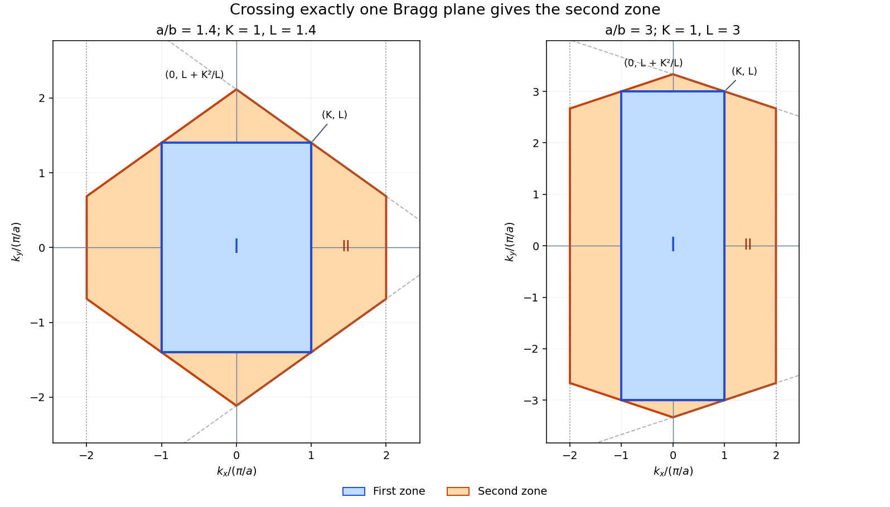

<h1 id="4/c/solution">Solution</h1>

↑ **Parent:** [C](../c.md)

For the [first two Brillouin zones of a rectangular lattice](../../../../first-two-brillouin-zones-of-a-rectangular-lattice.md), write $K=\pi/a$ and $L=\pi/b$, so $0<K<L$ and the [reciprocal lattice vectors](../../../../reciprocal-lattice-vector.md) are $(2nK,2mL)$. The perpendicular bisectors to the four nearest axial reciprocal points enclose

$$
\boxed{\mathcal B_1=\{(k_x,k_y):|k_x|<K,\ |k_y|<L\}.}
$$

The [second Brillouin zone](../../../../second-brillouin-zone.md) consists of points beyond exactly one [Bragg plane](../../../../bragg-plane.md). In the first quadrant, it is the union of the following two regions:

$$
\begin{aligned}
K<k_x<2K,&\qquad 0<k_y<\frac{K^2+L^2-Kk_x}{L},\\
0<k_x<K,&\qquad L<k_y<\frac{K^2+L^2-Kk_x}{L}.
\end{aligned}
$$

Reflect these regions in both axes. The first is a trapezoidal side lobe; the second is half of a triangular top lobe. The sloping boundary is the bisector for $\mathbf G=(2K,2L)$. On the side lobe, $k_x<2K$ is the bisector condition for $\mathbf G=(4K,0)$: crossing that plane too would enter the third or a higher zone. These additional bisectors are why four rectangles pasted onto the first zone would be incorrect.

Equivalently, the full right lobe has vertices

$$
(K,-L),\quad(2K,-L+K^2/L),\quad(2K,L-K^2/L),\quad(K,L),
$$

and the top lobe has vertices $(-K,L),(K,L),(0,L+K^2/L)$. Add their left and bottom reflections. Their total area is

$$
2\left(2KL-\frac{K^3}{L}\right)+2\frac{K^3}{L}=4KL,
$$

equal to the first-zone area, as required by reciprocal-space state counting. These formulas remain valid for every $a>b$, including very elongated rectangles; boundaries themselves can be shared by convention.

**[Figure 2](#4/c/image-first-and-second-brillouin-zones-of-rectangular-lattices). First and second Brillouin zones of rectangular lattices**. Blue is the first zone and orange is the complete disconnected second zone; two aspect ratios show the effect of the higher axial Bragg plane. All coordinates are in units of pi divided by a.

## ↑ Ancestors (12)

1. [C](../c.md)
2. [4](../../4.md)
3. [2012](../../../2012-split.md)
4. [Past exam of the condensed matter physics course of the University of Oxford](../../../split.md)
5. [Condensed matter physics course of the University of Oxford](../../../../condensed-matter-physics-course-of-the-university-of-oxford.md)
6. [Year 3 of the physics course of the University of Oxford](../../../../year-3-of-the-physics-course-of-the-university-of-oxford.md)
7. [Physics course of the University of Oxford](../../../../physics-course-of-the-university-of-oxford.md)
8. [Undergraduate course of the University of Oxford](../../../../undergraduate-course-of-the-university-of-oxford.md)
9. [Course of the University of Oxford](../../../../course-of-the-university-of-oxford.md)
10. [University of Oxford](../../../../university-of-oxford-split.md)
11. [List of universities](../../../../list-of-universities.md)
12. [Codex Wiki](../../../../split.md)
