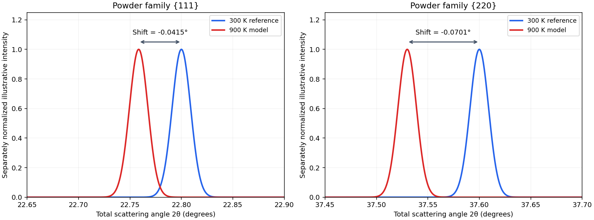

<h1 id="1/c/solution">Solution</h1>

↑ **Parent:** [C](../c.md)

At fixed radiation [wavelength](../../../../wavelength.md), differentiating [Bragg's law](../../../../bragg-s-law.md) gives $\cot\theta\,d\theta=-da/a$. With constant linear [thermal expansion coefficient](../../../../coefficient-of-thermal-expansion.md) $\alpha_L$,

$$
\frac{\Delta a}{a}\simeq\alpha_L\Delta T=0.0018,
\qquad
\boxed{\Delta\psi=2\Delta\theta\simeq-2\alpha_L\Delta T\tan\theta.}
$$

Both scattering angles decrease as the lattice expands. Substitution gives

$$
\boxed{\Delta\psi_{111}\simeq-0.0416^\circ,\qquad
\Delta\psi_{220}\simeq-0.0702^\circ.}
$$

These are shifts of $2\theta$, not of the Bragg angle alone. As a finite-step check, using $a'=a(1+0.0018)$ gives $\psi'=2\arcsin[\sin(\psi/2)/(1.0018)]$. It produces shifts $-0.04151^\circ$ and $-0.07008^\circ$, consistent with the first-order estimate. A strictly constant differential coefficient would instead give $a'/a=e^{\alpha_L\Delta T}$; its difference from the linear length approximation is second order in this small expansion.

**[Figure 1](#1/c/image-calculated-thermal-shifts-of-the-two-lowest-angle-diamond-cubic-powder-lines). Calculated thermal shifts of the two lowest-angle diamond-cubic powder lines**. Original illustrative line profiles centred on the stated scattering angles and their calculated shifted positions. Each line is normalized separately; the chosen common Gaussian width is not a measured instrumental width, and the panels do not predict an intensity ratio. The finite-step curves use $a'/a=1.0018$.

## ↑ Ancestors (12)

1. [C](../c.md)
2. [1](../../1.md)
3. [2013](../../../2013-split.md)
4. [Past exam of the condensed matter physics course of the University of Oxford](../../../split.md)
5. [Condensed matter physics course of the University of Oxford](../../../../condensed-matter-physics-course-of-the-university-of-oxford.md)
6. [Year 3 of the physics course of the University of Oxford](../../../../year-3-of-the-physics-course-of-the-university-of-oxford.md)
7. [Physics course of the University of Oxford](../../../../physics-course-of-the-university-of-oxford.md)
8. [Undergraduate course of the University of Oxford](../../../../undergraduate-course-of-the-university-of-oxford.md)
9. [Course of the University of Oxford](../../../../course-of-the-university-of-oxford.md)
10. [University of Oxford](../../../../university-of-oxford-split.md)
11. [List of universities](../../../../list-of-universities.md)
12. [Codex Wiki](../../../../split.md)
