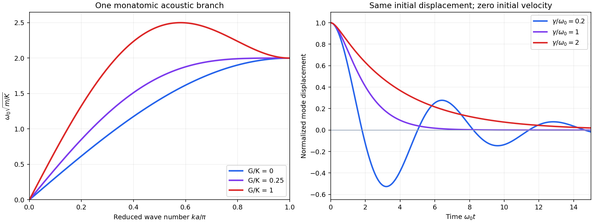

<h1 id="3/b/solution">Solution</h1>

↑ **Parent:** [B](../b.md)

Substitute the traveling [normal mode](../../../../normal-mode.md) $u_j=u\exp[i(kja-\omega t)]$. Combining the opposite-neighbour phases gives

$$
m\omega^2=2K(1-\cos ka)+2G(1-\cos2ka),
$$

so the positive-frequency branch is

$$
\boxed{\omega_0(k)=2\sqrt{\frac{K\sin^2(ka/2)+G\sin^2(ka)}{m}},
\qquad |k|\leq\pi/a.}
$$

For positive [spring constants](../../../../spring-constant.md) this is a stable acoustic branch. At long wavelengths,

$$
\omega_0^2\simeq\frac{a^2(K+4G)}m k^2,\qquad
\boxed{c_s=a\sqrt{\frac{K+4G}{m}}.}
$$

The next-nearest-neighbour bond spans twice the distance, hence contributes the factor four. Relative to $G=0$, positive $G$ increases the sound speed by $\sqrt{1+4G/K}$. The chain still has one acoustic branch and no optical branch.

The group speed near $k=0$ and the maximum frequency need not change in the same way. The zone-edge value is always $\omega_0(\pi/a)=2\sqrt{K/m}$, because the next-nearest-neighbour sites then move together. For $G>K/4$ the frequency maximum moves inside the zone, with $\cos(ka)=-K/(4G)$; the small-$k$ sound speed nevertheless keeps increasing.

**[Figure 2](#3/b/image-one-acoustic-branch-with-further-neighbour-springs-and-three-viscous-decay-regimes). One acoustic branch with further-neighbour springs, and three viscous-decay regimes**. Original calculated dispersions for stated values of $G/K$, all normalized using the same $K,m,a$. The right panel shows a single normal coordinate with initial displacement one and initial [velocity](../../../../velocity.md) zero, for damping ratios $\gamma/\omega_0=0.2,1,2$. It illustrates that a nonoscillatory overdamped response does not have the same envelope as an underdamped [phonon](../../../../phonon.md).

## ↑ Ancestors (12)

1. [B](../b.md)
2. [3](../../3.md)
3. [2013](../../../2013-split.md)
4. [Past exam of the condensed matter physics course of the University of Oxford](../../../split.md)
5. [Condensed matter physics course of the University of Oxford](../../../../condensed-matter-physics-course-of-the-university-of-oxford.md)
6. [Year 3 of the physics course of the University of Oxford](../../../../year-3-of-the-physics-course-of-the-university-of-oxford.md)
7. [Physics course of the University of Oxford](../../../../physics-course-of-the-university-of-oxford.md)
8. [Undergraduate course of the University of Oxford](../../../../undergraduate-course-of-the-university-of-oxford.md)
9. [Course of the University of Oxford](../../../../course-of-the-university-of-oxford.md)
10. [University of Oxford](../../../../university-of-oxford-split.md)
11. [List of universities](../../../../list-of-universities.md)
12. [Codex Wiki](../../../../split.md)
